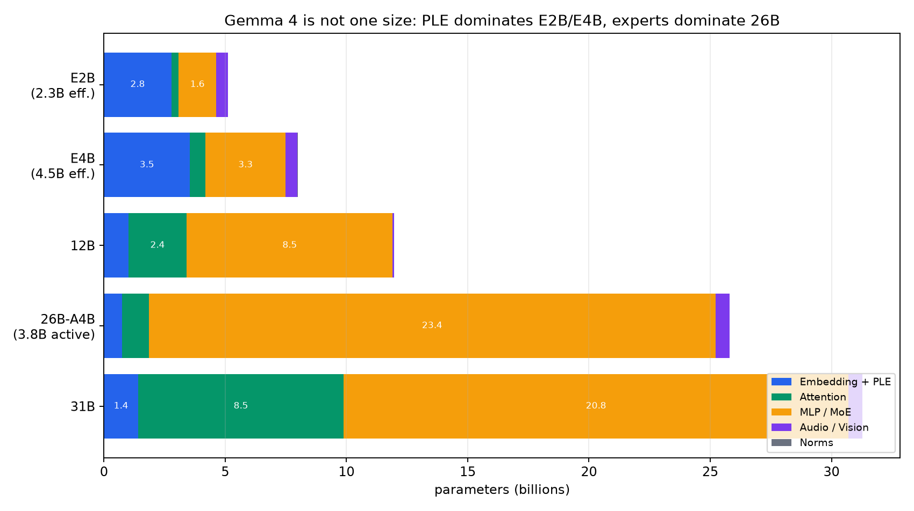
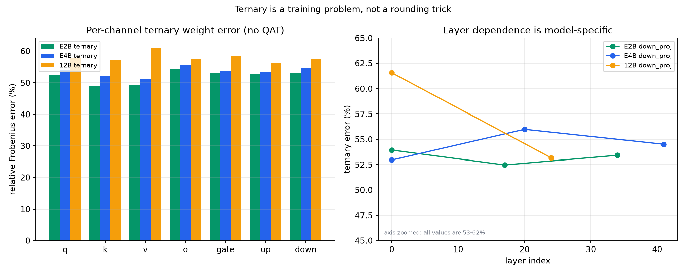
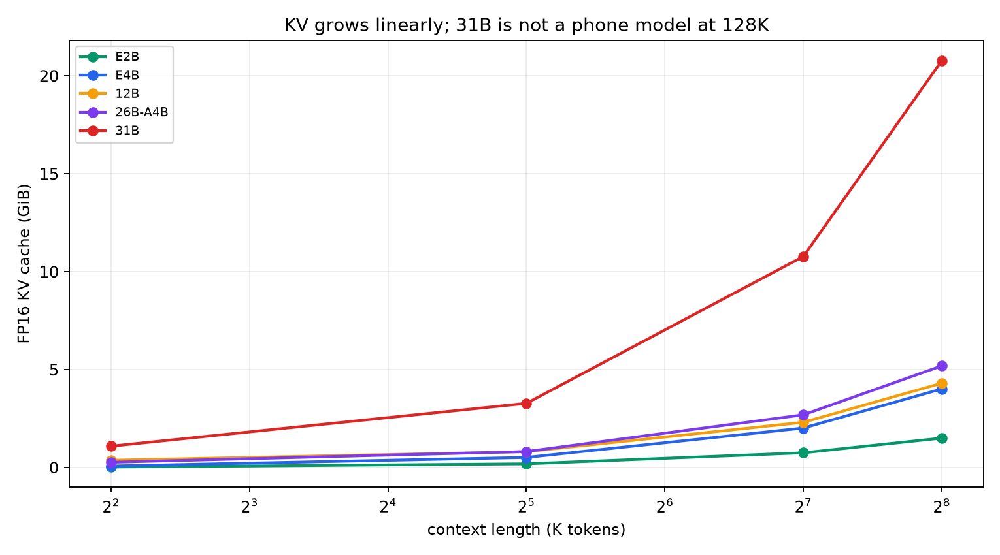
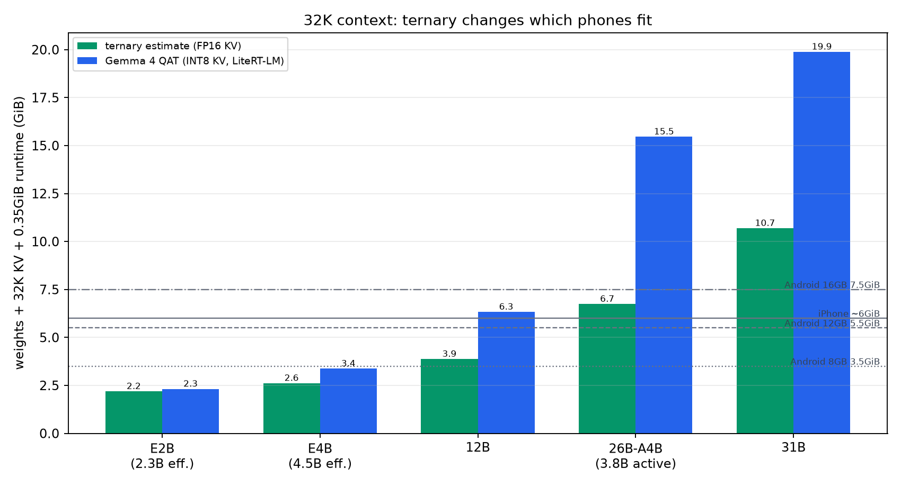
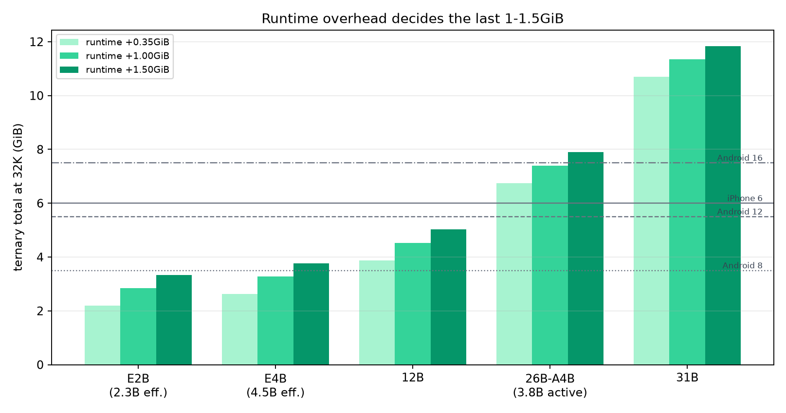
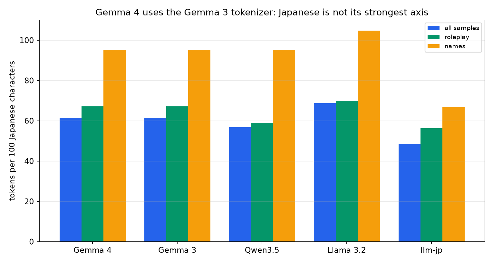
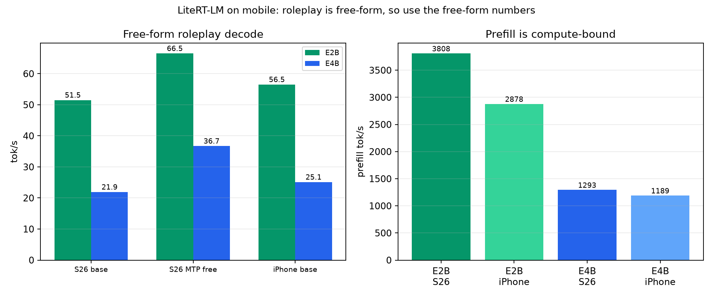
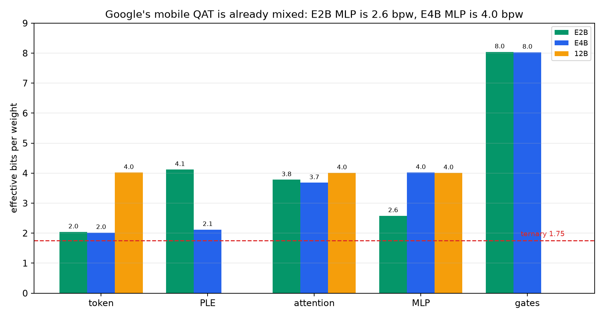

# ポケットの中の Gemma 4 — 三値化モバイルSLMの設計・逆解析・実測可能な範囲

**副題:** chat / roleplay、日本語・多言語、iPhone / Android の要件を、実ファイルと一次資料から分解する

**版:** 1.0（2026-10-25）  
**親レポート:** [REPORT.md](REPORT.md)（Tiny LLM / SLM の設計・逆解析・評価の全書）  
**姉妹レポート:** [MOBILE-SLM.md](MOBILE-SLM.md)（iPhone / Android のモバイルSLM要件）  
**プロジェクト:** tinySLM-REA

---

> スマホで動く三値モデルは、魔法の石ではない。  
> 料理を3つの味に圧縮しても、**名前札（埋め込み）**、**舞台の記憶（KVキャッシュ）**、**劇団の稽古（QAT）** は別に要る。  
> Gemma 4 は、その「別に要るもの」がとても大きいモデルだ。  
> この本は、E2B / E4B / 12B / 26B-A4B / 31B を、弁当箱と劇団の比喩でほどき、**どこまで三値にできて、どこから壊れるか**を数字で確かめる。

---

## この本の約束

1. **「E2B = 2B」と信じない。**  
   Gemma 4 の E2B / E4B は「effective」なパラメータ数であり、保存時は PLE（Per-Layer Embeddings）を含めて 5.1B / 8.0B です。まずここを分解します。

2. **三値化できるのは線形層だけ。**  
   埋め込み、PLE、正規化、ゲート、KVキャッシュは三値にできません。何が三値になり、何がならないかを、実ファイルのテンソル単位で分けます。

3. **Google の mobile QAT を基準線にする。**  
   Gemma 4 のモバイル版は、すでに 2-bit / 4-bit / 8-bit の混合です。三値の価値は「4-bit を 1.58-bit にすること」ではなく、**この混合スキームに対して何がどれだけ減るか**で測ります。

4. **roleplay はベンチマークされていない。**  
   Google の Arena 評価は 31B / 26B だけで、E2B / E4B / 12B の roleplay 品質は公開されていません。品質は「推定」ではなく、**自分でゴールデンセットを測る**前提で書きます。

5. **実物を見る。**  
   safetensors ヘッダー、QAT GGUF、LiteRT-LM の `.litertlm` バンドル、Android APK を解析し、モデルカードの数字と突き合わせます。REA は artifact の同定・棚卸しに使い、GGUF / safetensors / FlatBuffer は形式別パーサで読みます。

### 10分で読むなら

- 第0章（結論）→ 第2章（E2B/E4Bの罠）→ 第6章（メモリ）→ 第8章（roleplay）→ 付録F（1ページ要約）

### 90分で読むなら

- 第0〜10章 + 第12章。設計と三値化の実務まで入ります。

### 徹底的に読むなら

- 全部。第4章の実物解析、第6章のフィット表、第11章の量子化比較、付録Eの再現方法が核心です。

---

## 目次

- [第0章 結論の先出し — 12の文](#第0章-結論の先出し--12の文)
- [第1章 たとえ話 — 弁当箱と劇団](#第1章-たとえ話--弁当箱と劇団)
- [第2章 Gemma 4 の正体 — E2B / E4B の「effective」の罠](#第2章-gemma-4-の正体--e2b--e4b-のeffectiveの罠)
- [第3章 アーキテクチャ — PLE・KV共有・MTP](#第3章-アーキテクチャ--plekv共有mtp)
- [第4章 実物解析 — safetensors / GGUF / LiteRT-LM / APK](#第4章-実物解析--safetensors--gguf--litert-lm--apk)
- [第5章 三値化の物理 — 何が三値になり、何がならないか](#第5章-三値化の物理--何が三値になり何がならないか)
- [第6章 メモリ — E2Bから31Bまで、端末に載るか](#第6章-メモリ--e2bから31bまで端末に載るか)
- [第7章 iPhone vs Android — 6GiBと3.5/5.5/7.5GiB](#第7章-iphone-vs-android--6gibと355575gib)
- [第8章 chat / roleplay — 4Kか32Kか、思考モードか](#第8章-chat--roleplay--4kか32kか思考モードか)
- [第9章 日本語・多言語 — トークナイザと名前のコスト](#第9章-日本語多言語--トークナイザと名前のコスト)
- [第10章 速度 — prefill / decode / MTP / 熱](#第10章-速度--prefill--decode--mtp--熱)
- [第11章 量子化の現実 — mobile QAT vs ternary](#第11章-量子化の現実--mobile-qat-vs-ternary)
- [第12章 三値Gemma 4の作り方 — PTQ / QAT / 蒸留](#第12章-三値gemma-4の作り方--ptq--qat--蒸留)
- [第13章 評価設計 — roleplayのゴールデンセット](#第13章-評価設計--roleplayのゴールデンセット)
- [第14章 配布とプライバシー](#第14章-配布とプライバシー)
- [第15章 2026-2028の展望](#第15章-2026-2028の展望)
- [付録A 数式の導出](#付録a-数式の導出)
- [付録B モデル・端末マトリクス](#付録b-モデル端末マトリクス)
- [付録C 用語集](#付録c-用語集)
- [付録D 参考文献](#付録d-参考文献)
- [付録E 再現方法と限界](#付録e-再現方法と限界)
- [付録F 1ページ要約](#付録f-1ページ要約)

---

# 第0章 結論の先出し — 12の文

1. **Gemma 4 E2B は「2B」ではない。**  
   2.3B は effective で、PLE 2.35B を含む総パラメータは **5.12B**。E4B は 4.5B effective / **8.00B** です【観測】【論文】。

2. **Google のモバイル版は、すでに 2/4/8-bit の混合。**  
   E2B は 2.0GB、E4B は 3.0GB 級の `.litertlm` で、線形層の平均は E2B 約 2.6〜3.8 bpw、E4B 約 3.7〜4.0 bpw。三値の比較対象は「4-bit 一様」ではありません【観測】【導出】。

3. **三値にできるのは線形層だけ。**  
   attention の Q/K/V/O、MLP の gate/up/down、MoE の expert。埋め込み、PLE、RMSNorm、ゲート、KVキャッシュは三値にできません【導出】。

4. **E2B の三値化は、ほとんど得しない。**  
   E2B の MLP はすでに約 2.58 bpw、attention は約 3.78 bpw。三値にしても重みは 1.87GiB → 1.65GiB、32K 総メモリは 2.32GiB → 2.19GiB（約6%減）です。しかも **128K では QAT + INT8 KV が逆転**します（2.60 vs 2.75GiB）。三値化より KV の INT8 化を先にやるべきです【導出】。

5. **E4B の三値化は、意味がある。**  
   E4B の MLP は約 4.02 bpw、attention は約 3.68 bpw。三値にすると重みは 2.77GiB → 1.75GiB、32K 総メモリは 3.37GiB → 2.62GiB（約22%減）。**Android 8GB の safe 2.8GiB に収まる**唯一の E4B 級です（全三値 2.62GiB、attention INT4 のハイブリッド 2.79GiB）。ただし safe と言い切れるのは、ハイブリッドでランタイムが **0.35GiB 以下**のときだけ。QAT は 3.37GiB で nominal 止まりです【導出】。

6. **12B は、iPhone 向け三値の本命。**  
   12B は PLE がなく、線形層が 10.90B。全線形層を三値にすると重み約 2.7GiB、32K 総メモリは **3.87GiB**。現実的なハイブリッド（attention INT4）では **4.50GiB** です。iPhone 6GiB に入り、ハイブリッド + ランタイム 1GiB でも 5.15GiB で nominal には収まりますが、safe 4.8GiB は超えます。一方、**QAT は 4K でも 6.11GiB で iPhone に入りません**。MMLU Pro 77.2% は E4B の 69.4% より大きいです【導出】【ベンダー自己測定】。

7. **26B-A4B は、16GB Android の実験枠。**  
   三値重みは約 5.6GiB、32K 総メモリは **6.74GiB**。16GB の nominal 7.5GiB には収まるが、safe 6.0GiB には収まりません。計算量は active 3.8B で 4B 級ですが、**重みの読み出しは 26B 分**あり、メモリ帯域がボトルネックになります【導出】。

8. **31B は、スマホ向けではない。**  
   三値でも 32K で **10.69GiB**、128K で 18.2GiB。16GB Android でも safe には収まりません【導出】。

9. **KV は 32K なら E2B/E4B で小さい。**  
   FP16 で E2B 0.19GiB、E4B 0.52GiB。12B 0.81GiB、26B 0.82GiB、31B 3.28GiB。**32K roleplay は KV より重みと PLE が支配**します。ただし 128K では KV が無視できなくなり、E2B は約75Kで「ternary + FP16 KV」が「QAT + INT8 KV」に逆転されます。**三値化より先に KV を INT8 にする**のが、E2B の長文では正解です【導出】。

10. **日本語トークナイザは Gemma 3 系のまま。**  
   日本語サンプルで 100文字あたり 61.3 トークン。Qwen3.5 は 56.7、llm-jp は 48.4。Gemma 4 は 8〜26% 多くのトークンを使います。名前は 100文字あたり 95.2 トークンで、ほぼ1文字1トークンです【観測】。

11. **roleplay 品質は、E2B/E4B/12B では公開されていない。**  
   Arena は 31B（Elo 1451）と 26B-A4B（1438）だけ。E2B/E4B/12B の roleplay 品質は、MMLU Pro / MMMLU / IFEval からの推定でしかありません。**自分でゴールデンセットを測る必要**があります【論文】【未検証】。

12. **三値 Gemma 4 の最大の敵は、量子化ではなく学習。**  
   BitNet 系の三値は QAT / 蒸留が前提で、PTQ だけでは品質が崩れやすい。E4B の MLP を 4.0 bpw から 1.75 bpw に落とすなら、**日本語 roleplay データでの QAT と蒸留**が必須です【論文】【推測】。

---

# 第1章 たとえ話 — 弁当箱と劇団

## 1.1 弁当箱と調味料棚

スマホは弁当箱です。

- **弁当箱の大きさ** = RAM。iPhone 12GB、Android 8/12/16GB。
- **弁当箱の仕切り** = OS のメモリ管理。iOS の per-app limit、Android の LMK / zRAM。
- **主菜** = 線形層の重み。ここが三値化の対象。
- **調味料棚** = PLE（Per-Layer Embeddings）。E2B/E4B は、語彙 262k の埋め込みを層ごとに持つ、巨大な棚を内蔵しています。
- **名前札** = トークン埋め込み。単語を引くための表で、三値の足し算では作れません。
- **保冷剤** = KVキャッシュ。会話が長くなるほど増えます。
- **ベルトコンベア** = メモリ帯域。主菜を運ぶ速さ。
- **専用の調理場** = NPU / GPU。レシピが合わないと使えません。
- **電子レンジの庫内** = 熱。30分で性能が落ちます。

E2B は「2人前」と書いてありますが、実際には **5.1人分の食材**（PLE と音声・視覚を含む）が箱に入っています。E4B は「4.5人前」と書いてありますが、**8.0人分**です。まずこの表示のカラクリを剥がします。

## 1.2 劇団としての roleplay

roleplay は劇団です。

- **台本** = キャラクターカード、世界観、口調、禁止事項。
- **舞台の記憶** = KVキャッシュ。過去の会話を覚えるほど大きくなります。
- **俳優の演技力** = モデルの品質。E2B は新人、12B は中堅、26B/31B はベテラン。
- **稽古場** = QAT / 蒸留。三値の俳優は、台本を覚える前に演技の訓練が必要です。
- **舞台の広さ** = コンテキスト。4K は小劇場、32K は中劇場、128K は大劇場。
- **観客の安全** = モデルの安全ポリシー。暴力・性的表現・ヘイトは上演できません。

三値化は、俳優のセリフを「3種類の抑揚」に圧縮するようなものです。演技の骨格は残りますが、**名前、固有名詞、微妙な敬語、感情の揺れ**は別の仕組みで支える必要があります。

## 1.3 3つの「載る」

モデルが「載る」には、3つの段階があります。

1. **ファイルが載る**（ストレージ）  
   E2B 2.0GB、E4B 3.0GB、12B 7.0GB（Q4_0 GGUF）。LiteRT-LM のテキスト版なら 12B は 6.0GB です。ストレージは比較的余裕があります。

2. **重みがメモリに載る**（RAM / VRAM）  
   重み + PLE + KV + ランタイム。ここで多くのモデルが落ちます。

3. **30分後も快適に動く**（熱・電力・帯域）  
   最初の10秒は速くても、熱で半分になることがあります。

本書は、この3つを別々に扱います。**「2GBだからAndroid 8GBで動く」は、1番目しか見ていない**のです。

---

# 第2章 Gemma 4 の正体 — E2B / E4B の「effective」の罠

## 2.1 5つのモデル

Gemma 4 は、5つのサイズを持ちます【論文】【公式】。

| モデル | 総パラメータ | effective / active | 層数 | 全注意層 | sliding window | ネイティブ文脈 | 語彙 | モダリティ |
|---|---:|---:|---:|---:|---:|---:|---:|---|
| **E2B** | 5.12B | 2.3B effective | 35 | 7 | 512 | 128K | 262,144 | テキスト・画像・音声 |
| **E4B** | 8.00B | 4.5B effective | 42 | 7 | 512 | 128K | 262,144 | テキスト・画像・音声 |
| **12B** | 11.96B | 11.95B | 48 | 8 | 1,024 | 256K | 262,144 | テキスト・画像・音声（unified） |
| **26B-A4B** | 25.81B | 3.82B active | 30 | 5 | 1,024 | 256K | 262,144 | テキスト・画像 |
| **31B** | 31.27B | 30.70B text | 60 | 10 | 1,024 | 256K | 262,144 | テキスト・画像 |

**注:** E2B / E4B の「2.3B / 4.5B」は effective パラメータです。モデルカードでは「2.3B effective（5.1B with embeddings）」「4.5B effective（8B with embeddings）」と書かれています【公式】。総パラメータは safetensors ヘッダーの実測です【観測】。

## 2.2 E2B / E4B の PLE — 2.35B / 2.82B の巨大な棚

E2B / E4B の最大の特徴は、**Per-Layer Embeddings（PLE）** です【論文】。

- E2B: `embed_tokens_per_layer.weight` の形状は **[262,144, 8,960]**。8,960 = 35層 × 256次元。パラメータ数は **2,348,810,240**。
- E4B: **[262,144, 10,752]**。10,752 = 42層 × 256次元。パラメータ数は **2,818,572,288**。

これは、語彙 262k の各トークンに対して、**層ごとの 256次元ベクトル**を持つ表です。トークン埋め込み（E2B 0.40B、E4B 0.67B）とは別に、この巨大な表があります。

PLE は「層ごとの入力」を作るために使われます。線形層は、隠れ状態を 256次元に射影し、PLE の層ごとのベクトルと掛け合わせ、また隠れ次元に戻します。つまり、**PLE はモデルの知識と表現の一部**であり、単なる「重みの付属物」ではありません。

このため、E2B / E4B の三値化では、**線形層だけを三値にしても、PLE は 2〜4-bit のまま残す**必要があります。PLE を三値にすると、おそらく品質が壊れます。これは推測ではなく、Google 自身が mobile QAT で PLE を 2〜4-bit に留め、8-bit ゲートと組み合わせていることからも支持されます【観測】。

## 2.3 パラメータの内訳 — 主菜より棚が大きい

safetensors ヘッダーから、テンソル単位でパラメータを集計しました【観測】。

| モデル | 線形層 | 埋め込み + PLE | 音声・視覚 | 正規化など | 合計 |
|---|---:|---:|---:|---:|---:|
| E2B | 1.88B | **2.78B** | 0.48B | 0.014B | 5.12B |
| E4B | 4.00B | **3.54B** | 0.48B | 0.028B | 8.00B |
| 12B | 10.90B | 1.01B | 0.05B | 0.002B | 11.96B |
| 26B-A4B | 24.48B | 0.74B | 0.57B | 0.002B | 25.81B |
| 31B | 29.29B | 1.41B | 0.58B | 0.002B | 31.27B |

**E2B は、線形層 1.88B より、埋め込み + PLE 2.78B の方が大きい**。E4B も、線形層 4.00B に対して埋め込み + PLE 3.54B です。つまり、E2B / E4B は「小さな言語モデル」ではなく、**大きな語彙表と層ごとの埋め込みを持つ、モバイル向けの特殊な設計**です。



*図: Gemma 4 のパラメータ内訳。E2B/E4B は PLE が、26B は expert が支配的。*

## 2.4 12B / 26B / 31B は、また別の動物

- **12B** は PLE を持たず、線形層 10.90B、埋め込み 1.01B。encoder-free の unified モデルで、音声・画像を raw patch / 40ms chunk で直接 LLM 埋め込み空間に射影します【論文】。三値化の対象がはっきりしており、モバイル向け三値の本命です。
- **26B-A4B** は MoE。128 expert、top-8、active 3.8B。expert の重みは 22.84B で、総パラメータの 88%。三値化すると保存は軽くなりますが、**全 expert を保存**する必要があり、active 3.8B の読み出しで速度が決まります。
- **31B** は dense。線形層 29.29B、attention 8.48B、MLP 20.81B。三値化の効果は大きいですが、KV が重く、スマホには向きません。

## 2.5 「E2B は Gemma 3 27B 級」の意味

技術レポートは「E2B は Gemma 3 27B とほぼ同等の性能を、10倍少ないパラメータで達成する」と主張しています【論文】。ただし、これは**総合的な主張**であり、知識系では負けます。

| ベンチマーク | E2B | E4B | 12B | 26B-A4B | 31B | Gemma 3 27B |
|---|---:|---:|---:|---:|---:|---:|
| MMLU Pro | 60.0 | 69.4 | 77.2 | 82.6 | 85.2 | 67.6 |
| MMMLU | 67.4 | 76.6 | 83.4 | 86.3 | 88.4 | 70.7 |
| IFEval | **94.6** | 96.7 | 97.2 | 98.5 | 98.9 | 90.4 |
| GPQA Diamond | 43.4 | 58.6 | 78.8 | 82.3 | 84.3 | 42.4 |
| MRCR v2 128K | 19.1 | 25.4 | 43.4 | 44.1 | 66.4 | 13.5 |

**E2B は MMLU Pro 60.0 で、Gemma 3 27B の 67.6 より 7.6 ポイント低い**。MMMLU も 67.4 vs 70.7 で負けています。一方、E4B は 69.4 / 76.6 で Gemma 3 27B を上回ります。roleplay のように「知識 + ニュアンス + 指示追従」が混ざるタスクでは、E2B の知識不足が響きます。

**roleplay 用に E2B を選ぶなら、RAG か、12B/26B へのルーターが必要**です。E2B 単体で「何でも知っている執事」を演じさせるのは、モデルの容量に対して無理があります。

---

# 第3章 アーキテクチャ — PLE・KV共有・MTP

## 3.1 hybrid attention — 4:1 / 5:1

Gemma 4 は、local sliding window attention と full global attention を交互に置きます【論文】。

- **E2B**: 4層の sliding + 1層の full。35層で 7層が full。
- **E4B**: 5層の sliding + 1層の full。42層で 7層が full。
- **12B / 26B / 31B**: 5:1。48/30/60層で 8/5/10層が full。

sliding window は E2B/E4B が 512、12B/26B/31B が 1,024。full layer は最後に必ず置かれます。

この設計の狙いは、**長文の KV を full layer だけに限定し、local layer は固定長にする**ことです。roleplay では、直近の会話は local layer が、遠い記憶は full layer が担当します。

## 3.2 KV共有 — 最後の20/18層は K/V を持たない

E2B は `num_kv_shared_layers=20`、E4B は 18 です【観測】。最後の20/18層は、K/V の重み行列を持たず、前の非共有層の KV を再利用します。

- E2B: 35層のうち、最初の15層だけが K/V を持つ。full 3層、sliding 12層。
- E4B: 42層のうち、最初の24層だけが K/V を持つ。full 4層、sliding 20層。

これにより、KVキャッシュと K/V の重みが減ります。技術レポートは、KV共有 + global layer の K=V + p-RoPE で、global KV を最大 37.5% 削減したと主張しています【論文】。

## 3.3 global layer の K=V

12B / 26B / 31B は、global attention layer で **K と V を同じ重み**にします（`attention_k_eq_v=true`）【観測】。E2B / E4B はこれを使いません。

これにより、global layer の K/V 投影のパラメータと、KVキャッシュの一部が減ります。ただし、K=V でも注意の表現力は落ちるため、local layer が補います。

## 3.4 p-RoPE — global layer だけ部分的に回転

global layer は **p-RoPE**（partial rotary factor 0.25、theta 1,000,000）、local layer は通常の RoPE（theta 10,000）を使います【観測】。これも長文の位置表現を安定させるための設計です。

## 3.5 MTP drafter — 投機的デコードの小さな相棒

Gemma 4 は、autoregressive な MTP（Multi-Token Prediction）drafter を持ちます【論文】。

| モデル | drafter パラメータ | 次元 |
|---|---:|---:|
| E2B | 76M | 256 |
| E4B | 77M | 256 |
| 12B | 400M | 1,024（推定） |
| 26B-A4B | 430M | 1,024 |
| 31B | 500M | 1,024 |

*注: 12B の drafter 次元は技術レポートに明記されていないため、1,024 と推定。*

drafter は、main model の最後の層の活性化と token embedding を受け取り、未来の token を逐次生成します。main model の KV に cross-attend するので、MTP prefill が不要で、任意の draft 長をサポートします。

LiteRT-LM のモバイルベンチマークでは、投機的デコードが free-form で E2B 51.5 → 66.5 tok/s、E4B 21.9 → 36.7 tok/s に向上しています【ベンダー自己測定】。roleplay は free-form なので、この数字が近いです。

## 3.6 chat template — system role、thinking、turn marker

Gemma 4 の chat template は、`system` role、`model` role、`tool` role、thinking channel をサポートします【観測】。

- system は `<|turn>system\n...<turn|>\n`
- user は `<|turn>user\n...<turn|>\n`
- model は `<|turn>model\n...<turn|>\n`
- thinking は `<|channel>thought\n...<channel|>`

roleplay では、**system にキャラクターカードを置き、model の応答を `<|turn>model` で始める**のが基本です。`enable_thinking=false` にすると、思考チャネルを出さず、没入感と速度を保てます。

template のオーバーヘッドは、1ターンで約22%、20ターンで約16%です【導出】。4K コンテキストでは、このオーバーヘッドが効きます。

---

# 第4章 実物解析 — safetensors / GGUF / LiteRT-LM / APK

## 4.1 解析の対象と方法

本書では、次の実物を解析しました。

| 対象 | サイズ | 方法 | 得られたもの |
|---|---:|---|---|
| Gemma 4 E2B/E4B/12B/26B/31B safetensors | 10.2〜62.5GB | HTTP Range + safetensors ヘッダー | テンソル名・形状・dtype・パラメータ内訳 |
| Gemma 4 QAT Q4_0 GGUF | 3.35〜17.65GB | HTTP Range + GGUF v3 パーサ | テンソル型・量子化型・メタデータ・ファイル bpw |
| LiteRT-LM `.litertlm`（E2B/E4B GPU） | 2.01/2.97GB | HTTP Range + FlatBuffer パーサ | セクション、model_type、backend、テンソル名、量子化バイト数 |
| Google AI Edge Gallery APK | 60.4MB | REA `open_binary` / `inspect_artifact`、ZIP 棚卸し | SHA-256、native libs、LiteRT-LM JNI の同梱 |
| LiteRT-LM macOS バイナリ | 16.6MB | REA `open_binary` | Mach-O arm64 の同定（深い解析はホスト制約で不可） |

**REA の使い方:** APK と Mach-O の同定、APK の artifact inventory、PE の resource inventory に REA を使いました。一方、GGUF / safetensors / `.litertlm` は REA の現在の provider が直接読めないため、形式別パーサで読みました。REA の native 解析は、Windows ホストに Ghidra / IDA がなく、JADX も未設定のため、深い逆コンパイルはできていません。この限界は付録Eに明記します。

## 4.2 safetensors — E2B/E4B の PLE を数える

safetensors の先頭には、テンソル名・dtype・shape・offset を持つ JSON ヘッダーがあります。これを HTTP Range で取得し、全テンソルを集計しました【観測】。

E2B の主要テンソル：

| テンソル | 形状 | パラメータ |
|---|---:|---:|
| `model.language_model.embed_tokens.weight` | [262,144, 1,536] | 402,653,184 |
| `model.language_model.embed_tokens_per_layer.weight` | [262,144, 8,960] | 2,348,810,240 |
| `model.language_model.per_layer_model_projection.weight` | [8,960, 1,536] | 13,762,560 |
| `model.language_model.layers.0.mlp.gate_proj.weight` | [6,144, 1,536] | 9,437,184 |
| `model.language_model.layers.0.self_attn.q_proj.weight` | [2,048, 1,536] | 3,145,728 |
| `model.audio_tower.*` | — | 304,825,088 |
| `model.vision_tower.*` | — | 167,365,056 |

E4B も同様に、PLE 2,818,572,288、token embedding 671,088,640、MLP 3,303,014,400、attention 642,277,888 です。

**この時点でわかること:** E2B の「2.3B effective」は、PLE を除いた線形層と attention の一部を含む数字です。保存時は 5.12B。E4B は 8.00B。**「E2B を三値にすれば 2B の三値モデル」という理解は誤り**です。

## 4.3 QAT GGUF — Google の 4-bit QAT は何を Q6_K に残すか

Google の QAT Q4_0 GGUF を解析すると、すべてが Q4_0 ではありません【観測】。

| モデル | ファイル | パラメータ | Q4_0 | Q6_K | F32/F16 | 備考 |
|---|---:|---:|---:|---:|---:|---|
| E2B | 3.35GB | 4.63B | 1.86B | 2.75B | 0.015B | token/PLE は Q6_K |
| E4B | 5.15GB | 7.46B | 3.95B | 3.49B | 0.030B | token/PLE は Q6_K |
| 12B | 6.98GB | 11.91B | 10.90B | 1.01B | 0.0008B | token は Q6_K |
| 26B-A4B | 14.44GB | 25.23B | 24.48B | 0.74B | 0.012B | token は Q6_K、expert は Q4_0 |
| 31B | 17.65GB | 30.70B | 29.29B | 1.41B | 0.001B | token は Q6_K |

E2B/E4B は **token embedding と PLE を Q6_K（約6.56 bpw）**に残し、12B は token embedding のみ Q6_K。26B/31B も token embedding だけ Q6_K で、線形層は Q4_0（4.5 bpw）です。

これは「埋め込みは低ビットにすると壊れやすい」という設計判断です。三値化でも、この原則は変わりません。

## 4.4 LiteRT-LM — モバイル版は 2/4/8-bit の混合

Google のモバイル版 `.litertlm` は、QAT GGUF とは別物です。E2B/E4B の GPU 版を解析しました【観測】。

### 4.4.1 バンドル構造

`.litertlm` は `LITERTLM` マジック + バージョン + FlatBuffer ヘッダー + セクションの構造です。

E2B GPU 版（2,008,432,640 bytes）:

| セクション | 開始 | 終了 | 型 | 内容 |
|---|---:|---:|---|---|
| 0 | 16,384 | 28,740 | 5 | LlmMetadataProto |
| 1 | 32,768 | 4,721,781 | 4 | SentencePiece tokenizer |
| 2 | 4,734,976 | 2,008,432,640 | 3 | TFLite model |

TFLite model の metadata は `model_type=tf_lite_artisan_text_decoder`、`backend_constraint=gpu_artisan`、`gpu_artisan_weights_version=0.0` です。つまり、モバイル版は **Artisan GPU バックエンド向けの単一 TFLite モデル**で、テキストデコーダだけを同梱しています。

E4B GPU 版も同じ構造で、TFLite model は 2,969,059,328 bytes までです。

### 4.4.2 テンソル名 — PLE と KV が量化されている

TFLite のテンソル名から、次のものが見えます【観測】。

- `transformer.embedder.input_embedding.w`（token embedding）
- `transformer.layer_0.per_layer_embeddings.w`（PLE、層ごと）
- `transformer.layer_0.per_layer_embedding_gate.w`
- `transformer.layer_0.per_layer_embedding_projection.w`
- `transformer.layer_0.attn.q.w` / `k.w` / `v.w` / `attn_vec_einsum.w`
- `transformer.layer_0.mlp.ff1.w` / `ff_gate.w` / `linear.w`
- `transformer.layer_0.attn.k_cache_static_quantized_scale` / `v_cache_static_quantized_scale`

KVキャッシュにも static な量子化スケールがあり、INT8 KV を使っていることがわかります。

### 4.4.3 実効 bpw — Google は何を何ビットにしたか

TFLite のバッファサイズと、safetensors の論理パラメータ数から、コンポーネント別の実効 bpw を計算しました【導出】。

| コンポーネント | E2B 実効 bpw | E4B 実効 bpw |
|---|---:|---:|
| token embedding | **2.04** | **2.02** |
| PLE | **4.12** | **2.12** |
| per-layer model projection | 8.04 | 8.03 |
| per-layer gate | 8.04 | 8.03 |
| per-layer projection | 8.25 | 8.25 |
| attention | **3.78** | **3.68** |
| MLP | **2.58** | **4.02** |
| norms | 高精度 | 高精度 |

これが、Google の mobile QAT の実態です。

- **E2B** は、MLP を約2.6 bpw、attention を約3.8 bpw、PLE を約4.1 bpw、token を約2.0 bpw にしています。**すでにかなり攻めています**。
- **E4B** は、MLP を約4.0 bpw、attention を約3.7 bpw、PLE を約2.1 bpw、token を約2.0 bpw にしています。**PLE は E2B より低ビット**です。
- ゲートと per-layer projection は 8-bit に残しています。ここは品質に効くからです。

この表を見ると、「三値化で 4-bit を 1.58-bit にすれば半分」という単純な話ではないことがわかります。**E2B はすでに MLP が 2.58 bpw**なので、三値にしても 0.83 bpw しか減りません。**E4B は MLP が 4.02 bpw**なので、三値の余地が大きいのです。

### 4.4.4 12B / 26B / 31B も `.litertlm` で出ている

E2B/E4B だけではありません。12B、26B-A4B、31B にも LiteRT-LM の GPU バンドルが配布されています【観測】。

| モデル | GPU バンドル | generic | TFLite セクション | コンテキスト | 公式ターゲット |
|---|---:|---:|---|---:|---|
| 12B | **5.986GB** | 6.883GB | 4,734,976〜5,986,074,624 | **128K** | macOS / Linux / Windows / Web |
| 26B-A4B | **15.787GB** | — | 4,734,976〜15,786,524,672 | 16K bench / web 195K | desktop |
| 31B | **19.218GB** | — | 4,734,976〜19,217,989,632 | 16K bench / web 80K | desktop |

*表: 【観測】。12B のカードは「desktop use cases」と明記し、iOS / Android を公式には挙げていません。26B/31B のモバイル runtime のコンテキスト上限は、カードに明記されていません。*

**12B の量子化は、E2B/E4B と違います。** TFLite の 1,324 テンソル（1,328 バッファ）を集計すると、線形層はすべて INT4（実効 4.01bpw）、token embedding も 4.02bpw です【観測】【導出】。E2B/E4B のような 2/4/8-bit 混合ではなく、**一律 4-bit**。だからこそ、三値化の余地が大きいのです。

**26B / 31B は、desktop 向けです。** モデルカードのベンチマークは RTX 4090 / M4 Max で、スマホの測定はありません。26B は 15.8GB、31B は 19.2GB で、スマホのストレージにも厳しい。**「MoE だからスマホでも」という主張は、重みのサイズを見れば否定できます**。

### 4.4.5 ベンダー表と実ファイルの差

技術レポート Table 3 のメモリと、実際のファイルサイズは一致しません【論文】【観測】。

| モデル | Table 3 | 実ファイル | 差 | 解釈 |
|---|---:|---:|---:|---|
| E2B | 0.8GB | 2.008GB | +1.2GB | Table 3 は PLE 抜き |
| E4B | 2.3GB | 2.969GB | +0.67GB | Table 3 は PLE 抜き |
| 12B | 7.65GB | 5.986GB | **−1.66GB** | 実ファイルの方が小さい |
| 26B | 16.2GB | 15.787GB | −0.41GB | ほぼ一致 |
| 31B | 19.2GB | 19.218GB | +0.02GB | 一致 |

*表: GB。Table 3 は Q4_0 / mobile の理論値、実ファイルは LiteRT-LM GPU バンドル。*

E2B/E4B の差は、**PLE の扱い**で説明できます。Table 3 の 0.8GB / 2.3GB は PLE を除いたテキスト部分で、実ファイルは PLE を含みます。12B の差は説明できません。Table 3 の 7.65GB は Q4_0 の理論値に近く、実ファイルの 5.986GB は INT4（4.01bpw）で、より攻めた量子化です。QAT リリース後に量子化が変わった可能性があります【推測】。

**教訓:** ベンダーの表は、条件（PLE 含む/含まない、量子化スキーマ、ランタイム）が違う。**実ファイルを解析せずに、表の数字だけで判断してはいけない**。この差の詳細は第11.6節で扱います。

## 4.5 APK — 配布物に何が入っているか

Google AI Edge Gallery の APK（1.0.20、60,420,563 bytes、SHA-256 `036da9de8c57a2ba6226a6e70d2ba00aa4f5546fa2409ee44639c14212f9f6cb`）を REA で同定し、ZIP 棚卸しをしました【観測】。

- `lib/arm64-v8a/liblitertlm_jni.so`
- `lib/arm64-v8a/libLiteRt.so`
- `lib/x86_64/liblitertlm_jni.so`（26,039,184 bytes）
- `lib/x86_64/libLiteRt.so`（7,521,936 bytes）

APK には LiteRT-LM の JNI と LiteRT の native library が同梱されています。つまり、Google の公式モバイルアプリは、`.litertlm` を LiteRT-LM で動かす構成です。

REA の `inspect_artifact` は APK を inventory し、evidence ID `ev_deeffda66e0919d37f0be7f8cef1a0c5a679177a3a0ceba56e50f1a391f8ccb0` を返しました。JADX が未設定のため、Java/Kotlin クラスの逆コンパイルはできていません。APK の manifest / class 解析は、JADX を設定した環境での追試が必要です。

## 4.6 REA の限界 — できたことと、できなかったこと

**できたこと:**

- APK / Mach-O の同定と SHA-256。
- APK の artifact inventory と native library の存在確認。
- PE の resource inventory。
- GGUF / safetensors / `.litertlm` の形式別解析。

**できなかったこと:**

- Android クラスの逆コンパイル（JADX 未設定）。
- native コードの逆コンパイル（Ghidra / IDA 未設定、Hopper は macOS 限定）。
- 実機での実行・ベンチマーク。
- iOS アプリの解析（IPA なし）。

したがって、本書の「実物解析」は、**モデルコンテナと配布物の静的解析**であり、実行時の挙動を観測したものではありません。この区別は重要です。

---

# 第5章 三値化の物理 — 何が三値になり、何がならないか

## 5.1 三値化の対象は、行列積だけ

三値化（ternary / 1.58-bit）は、重みを {-1, 0, +1} に量子化し、行列積を加減算に置き換える技術です【論文】。

三値にできるのは、**重み行列を持つ線形層**です。

| コンポーネント | 三値化 | 理由 |
|---|---|---|
| attention の Q/K/V/O | **できる** | 線形層。ただし Q/K は敏感 |
| MLP の gate/up/down | **できる** | 線形層。三値化の主戦場 |
| MoE の expert | **できる** | 線形層。ただし router は別 |
| per-layer input gate | **条件付き** | 小さいが品質に効く。8-bit 推奨 |
| per-layer projection | **条件付き** | 小さいが PLE と直結。8-bit 推奨 |
| token embedding | **できない** | ルックアップ表。三値の足し算にならない |
| PLE | **できない** | ルックアップ表。2〜4-bit に留める |
| RMSNorm / layer scalar | **できない** | スケール。高精度が必要 |
| router | **できない** | top-k 選択。低ビット化すると expert 選択が壊れる |
| KVキャッシュ | **別問題** | INT8/INT4 量子化はできるが、三値ではない |

## 5.2 なぜ埋め込みは三値にできないのか

埋め込みは、トークン ID からベクトルを引く表です。

$$
h = E[\text{token\_id}]
$$

三値の行列積は、重みを {-1,0,+1} に制限し、入力との積和を加減算で行います。しかし、埋め込みは **入力そのもの**であり、行列積ではありません。埋め込みを三値にすると、語彙ごとのベクトルが 3種類の値に潰れ、単語の区別がつかなくなります。

Google の mobile QAT が token embedding を 2-bit、PLE を 2〜4-bit に留めているのは、このためです【観測】。三値化の対象外です。

## 5.3 なぜ PLE は特に難しいのか

PLE は、層ごとの入力ベクトルを作る表です。E2B では 2.35B、E4B では 2.82B のパラメータがあります。

PLE を三値にすると、層ごとのベクトルが 3種類の値に潰れます。これは、**モデルの表現の多様性を直接削る**ことになります。Google は E2B で PLE を 4.12 bpw、E4B で 2.12 bpw にしていますが、これは「品質を保てる下限」に近いと考えられます【推測】。

三値化の研究では、埋め込みを高精度に残すのが一般的です。BitNet b1.58 も、embedding と output layer は高精度に残しています【論文】。Gemma 4 の PLE は、通常の embedding よりさらに層ごとの情報を持つため、三値化のリスクが高いです。

## 5.4 どの線形層が敏感か

経験的には、次の順で敏感です【推測】。

1. **attention の Q/K** — 注意の重み。三値化すると、どのトークンに注目するかが変わりやすい。
2. **attention の V/O** — 出力の混合。Q/K よりは頑健だが、長文で効く。
3. **MLP の down_proj** — 最終出力に近い。三値化の影響が大きい。
4. **MLP の gate/up** — 中間表現。三値化の主戦場だが、品質劣化が出やすい。
5. **per-layer gate/projection** — 小さいが、PLE との相互作用がある。

Gemma 4 の mobile QAT は、MLP を E2B で 2.58 bpw、E4B で 4.02 bpw、attention を 3.7〜3.8 bpw にしています。**MLP の方が攻めている**のは、MLP の方がパラメータが多く、三値化の効果が大きいからです。E2B は MLP を攻め、E4B は PLE を攻めています。設計者の判断がわかります。

**ただし、この順序は仮説です。** 第5.7節で実際の重みを測ると、q/k/v/o と down_proj の誤差が大きく、特に初期層が敏感でした。**「MLP が主戦場」という通説は、モデルと層によって変わります**。三値化する前に、必ず自分のモデルで感度を測ってください。

## 5.5 三値化の品質は、PTQ では保ちにくい

三値化の品質を保つには、QAT（Quantization-Aware Training）か蒸留が必要です【論文】。

- **PTQ（Post-Training Quantization）**: 学習済みの重みを後から三値化する。実装は簡単だが、三値の制約が厳しく、品質が崩れやすい。
- **QAT**: 学習中に三値化をシミュレートし、重みを三値に慣らす。BitNet b1.58 はこの方式。
- **蒸留**: 高精度の教師モデルの出力を、三値の生徒モデルが模倣する。品質を保ちやすい。

Gemma 4 の QAT は 4-bit / 2-bit の QAT であり、三値の QAT ではありません。したがって、**Gemma 4 の QAT チェックポイントをそのまま三値化しても、品質は保証されません**。三値化には、別の QAT / 蒸留が必要です。

## 5.6 三値化の単位 — テンソル全体か、チャネルか

三値化の実装には、いくつかの単位があります。

- **per-tensor**: テンソル全体で1つのスケール。実装が簡単だが、外れ値に弱い。
- **per-channel**: 出力チャネルごとにスケール。品質が良い。
- **per-group**: グループごとにスケール。さらに品質が良いが、オーバーヘッドが増える。

BitNet b1.58 は、per-tensor の absmax scaling を使います【論文】。Bonsai の PTQ1_0 は、128重みごとに FP16 スケールを持ちます【観測】。Gemma 4 の mobile QAT は、per-channel のスケールを持ち、`w_quantized_scale` をテンソルごとに保存しています【観測】。

三値化するなら、**per-channel 以上の粒度**でスケールを持ち、外れ値チャネルを保護するのが現実的です。

## 5.7 実測 — 三値化の誤差は、どの層で大きいか

ここまでは「どの層が敏感か」を経験則で並べました。しかし、それでは弱い。**実際の重みを取ってきて、三値化の誤差を測ればいい**のです。

safetensors のヘッダーからテンソルのバイト範囲を求め、E2B / E4B / 12B の一部の層の重みを HTTP Range で取得し、per-channel の absmean 三値化を適用しました【観測】。誤差は、重み空間の相対フロベニウス誤差です。

$$
\varepsilon = \frac{\lVert W - \alpha T \rVert_F}{\lVert W \rVert_F},
\quad
\alpha_i = \frac{1}{d}\sum_j |W_{ij}|,
\quad
T_{ij} = \mathrm{clip}\left(\mathrm{round}\left(\frac{W_{ij}}{\alpha_i}\right), -1, 1\right)
$$

| テンソル | E2B 三値誤差 | E4B 三値誤差 | 12B 三値誤差 | E2B INT4 誤差 | 12B INT4 誤差 |
|---|---:|---:|---:|---:|---:|
| q_proj | 52.5% | 54.1% | **57.8%** | 15.8% | 22.3% |
| k_proj | 49.0% | 52.1% | 57.1% | 11.4% | 21.7% |
| v_proj | 49.3% | 51.3% | **61.1%** | 12.0% | 22.2% |
| o_proj | 54.3% | 55.7% | 57.5% | 18.5% | 24.8% |
| gate_proj | 53.0% | 53.7% | 58.4% | 16.7% | 21.7% |
| up_proj | 52.8% | 53.4% | 56.1% | 16.3% | 20.9% |
| down_proj | 53.3% | 54.5% | 57.4% | 20.7% | 25.5% |

*表: 三値化・INT4・INT8 の重み空間の相対誤差（per-channel、QAT なし）。層 0/17/34（E2B）、0/20/41（E4B）、0/24（12B）の平均（12B は2層）。*



*図: 左はテンソル別の三値誤差、右は down_proj の層依存。三値は 50〜60% の誤差が出る。*

**わかること:**

1. **三値化の重み誤差は、どのモデルでも 50〜60%**。INT4 は 11〜25%、INT8 は 1% 前後です。三値は「4-bit の半分」ではなく、**重み空間では桁違いに粗い**表現です。
2. **12B は E2B / E4B より誤差が大きい**。12B の v_proj は 61.1%、q_proj は 57.8%。12B は「三値化の効果が最大」だが、「三値化が最も難しい」モデルでもあります。
3. **層ごとの差は一様ではない。** 12B の down_proj は層 0 で 61.5%、層 24 で 53.2% だが、E4B は層 20 が 56.0% で最も高い。**「初期層が難しい」は 12B の傾向**であり、全モデルには一般化できません。
4. **ゼロになる重みは約 30〜42%**。三値の sparsity は、加減算カーネルの前提です。逆に言えば、**30% の重みを捨てても動くように、QAT で訓練する必要がある**。

**注意:** これは重み空間の誤差であり、品質劣化そのものではありません。QAT はこの誤差を織り込んで学習するので、誤差が大きくても品質を保つことはできます。しかし、**QAT なしの PTQ でこの誤差を放置すれば、roleplay の微妙な敬語や名前はまず壊れます**。この数字は「QAT が必要かどうか」の判定材料であり、「三値化は無理」という証明ではありません【導出】【推測】。

**実務的な含意:**

- 三値化するなら、**初期層の attention（q/k/v）と down_proj を高精度に残す**か、層ごとに感度を測って三値化の可否を決めます。
- 12B は誤差が大きいので、**蒸留 + QAT** を前提にします。PTQ のままでは、MMLU Pro 77.2% は期待できません。
- E2B / E4B は誤差が相対的に小さいですが、すでに Google の mobile QAT が 2〜4-bit なので、**三値化の上積みは小さい**です（第11章）。

---

# 第6章 メモリ — E2Bから31Bまで、端末に載るか

## 6.1 3つの数字を混ぜない

スマホにモデルを載せるとき、混同しやすい数字が3つあります。

1. **ファイルサイズ** — ストレージに置けるか。E2B 2.0GB、E4B 3.0GB、12B 6.0GB。
2. **重みのメモリ** — RAM / VRAM に展開できるか。ファイルサイズとほぼ同じだが、mmap や量子化で変わる。
3. **推論中の総メモリ** — 重み + KVキャッシュ + ランタイム + 一時バッファ。**ここで落ちる**。

本書のフィット判定は、3番目で行います。

$$
M_{\text{total}} = M_{\text{weights}} + M_{\text{KV}} + M_{\text{runtime}}
$$

### 端末の予算

| 端末クラス | RAM | アプリの予算（nominal） | safe（80%） | 出典・ラベル |
|---|---:|---:|---:|---|
| iPhone 17/18 Pro | 12GB | **6.0GiB** | **4.8GiB** | Bonsai の per-app 実測 約6GB【ベンダー自己測定】 |
| Android 8GB | 8GB | **3.5GiB** | **2.8GiB** | LMK / zRAM を考慮した計画値【経験則】 |
| Android 12GB | 12GB | **5.5GiB** | **4.4GiB** | 同上【経験則】 |
| Android 16GB | 16GB | **7.5GiB** | **6.0GiB** | 同上【経験則】 |

**注:** iPhone の「6GiB」は Apple の公式値ではありません。Bonsai のホワイトペーパーが iPhone 17 Pro Max で報告した per-app limit です。Android の予算は OS の公式上限ではなく、LMK・zRAM・GPU 予約・ベンダーブロートを考慮した**計画用の経験則**です。実際の値は機種と OS バージョンで変わります。

## 6.2 KVキャッシュの計算式

Gemma 4 は hybrid attention なので、KV は「全層 × 全コンテキスト」ではありません。

- **full attention 層**だけが、コンテキスト長に比例して KV を持ちます。
- **sliding attention 層**は、直近 `sliding_window` トークン分だけを持ちます。
- **KV共有層**（E2B の最後の20層、E4B の最後の18層）は、K/V の重みもキャッシュも持ちません。
- **12B / 26B / 31B の global 層**は K=V を再利用しますが、本節では保守的に K と V を別々に数えます。

$$
M_{\text{KV}} =
\left[
L_{\text{full}} \cdot 2 \cdot H_{\text{kv,global}} \cdot d_{\text{global}} \cdot C
+
L_{\text{slide}} \cdot 2 \cdot H_{\text{kv,local}} \cdot d_{\text{local}} \cdot \min(C, W)
\right] \cdot b
$$

$b$ は KV のバイト数（FP16=2、INT8=1）。$C$ はコンテキスト長、$W$ は sliding window です。

| モデル | full層 | sliding層 | KV共有 | 32K FP16 | 32K INT8 | 128K FP16 | 128K INT8 | 256K FP16 |
|---|---:|---:|---:|---:|---:|---:|---:|---:|
| E2B | 3 | 12 | 20 | 0.19 | 0.10 | 0.76 | 0.38 | 1.51 |
| E4B | 4 | 20 | 18 | 0.52 | 0.26 | 2.02 | 1.01 | 4.02 |
| 12B | 8 | 40 | 0 | 0.81 | 0.41 | 2.31 | 1.16 | 4.31 |
| 26B-A4B | 5 | 25 | 0 | 0.82 | 0.41 | 2.70 | 1.35 | 5.20 |
| 31B | 10 | 50 | 0 | **3.28** | 1.64 | **10.78** | 5.39 | **20.78** |

*表: GiB。E2B/E4B は KV共有層を除外。12B 以降は K=V を保守的に2倍で計算。*



*図: KV はコンテキストに線形。31B は 128K で 10.78GiB になり、スマホの予算を超える。*

**ここが重要です。** 32K の roleplay では、E2B の KV は 0.19GiB、E4B は 0.52GiB にすぎません。**32K までは、KV より重みと PLE の方が支配的**です。一方、128K になると E4B で 2.02GiB、31B で 10.78GiB になり、KV が主役に変わります。

**ベンダー表との差:** 技術レポート Table 3 の 32K KV は、E2B +0.05GB、E4B +0.14GB、12B +0.28GB です【論文】。これは私たちの INT8 計算（E2B 0.10GiB、E4B 0.26GiB、12B 0.41GiB）より小さい。E2B/E4B はちょうど約半分で、**4-bit KV か K のみの保存**を示唆します。12B は K=V の再利用で説明できます。本書は保守的に K と V を別々に数えているため、QAT の総メモリはベンダー表より 0.05〜0.15GiB 大きく出ます。この差は結論を変えませんが、**「ベンダーの数字は最適化された KV を含む」**と覚えておくべきです【導出】【推測】。

## 6.3 32Kのフィット表 — ternary vs QAT

ここでは、ランタイムオーバーヘッドを 0.35GiB（lean）とし、KV は ternary が FP16、QAT が INT8 で計算します。QAT の重みは、実際に配布されている LiteRT-LM の GPU バンドル（テキストデコーダ）です【観測】。

| モデル | ternary 重み | QAT 重み | ternary 32K | QAT 32K | ternary が載る端末 | QAT が載る端末 |
|---|---:|---:|---:|---:|---|---|
| E2B | 1.65 | 1.87 | **2.19** | **2.32** | 全端末（+0.35時 safe） | 全端末（+0.35時 safe） |
| E4B | 1.75 | 2.77 | **2.62** | **3.37** | 全端末（+0.35時 safe） | Android 8 は nominal のみ |
| 12B | 2.71 | 5.57 | **3.87** | **6.33** | iPhone / Android 12 / 16（+0.35時 safe） | Android 16 の nominal のみ |
| 26B-A4B | 5.57 | 14.70 | **6.74** | 15.46 | Android 16 の nominal のみ | なし |
| 31B | 7.06 | 17.90 | **10.69** | 19.89 | なし | なし |

*表: GiB。32K、runtime +0.35GiB。ternary は線形層 1.75bpw + 観測された非線形層精度。QAT は LiteRT-LM GPU バンドル + INT8 KV。**safe は runtime +0.35GiB のとき**。+1.0GiB では E2B QAT 2.97GiB で Android 8 safe 外、E4B ternary 3.26GiB で nominal のみ。*



*図: 32K での ternary と QAT。ternary は全線形三値の上限。attention INT4 のハイブリッドは 11.5.1 を参照（E4B 2.79、12B 4.50GiB）。*

**読み方:**

- **E2B は、ternary にしても 2.19 vs 2.32 で、わずか 0.13GiB の差**。どちらも全端末に載ります。E2B の三値化は、メモリの観点では「やる意味が薄い」。
- **E4B は、2.62 vs 3.37 で 0.75GiB の差**。QAT は Android 8GB の nominal 3.5GiB にぎりぎり入るが、safe 2.8GiB には入らない。ternary は +0.35GiB なら safe にも入る（2.62 < 2.8）。ただし、attention を INT4 に残すハイブリッドは **2.79GiB** で、safe にぎりぎり。**E4B の三値化は意味があるが、safe は紙一重**。
- **12B は、3.87 vs 6.33 で 2.46GiB の差**。QAT は iPhone 6GiB に 4K でも入らない（6.11GiB）。ternary は 32K でも 3.87GiB、ハイブリッドでも 4.50GiB で、iPhone に入る。**12B の三値化は、iPhone で 12B を動かすための事実上の前提**。
- **26B は、ternary でも 6.74GiB**。Android 16 の nominal 7.5GiB には入るが、safe 6.0GiB には入らない。計算量は active 3.8B で 4B 級だが、**重みの読み出しは 26B 分**ある。**実験機の範囲**。
- **31B は、ternary でも 10.69GiB**。どのスマホにも載らない。

### 12B QAT は、4K でも iPhone に入らない

12B QAT の 32K は 6.33GiB ですが、4K にすると 6.11GiB です。iPhone の nominal 6.0GiB を、**4K でも超えます**。つまり、12B を iPhone で使うには、QAT のままでは無理で、三値化か、より強い量子化が必要です。これは「12B は iPhone 向け」と言うための、最も強い根拠です【導出】。

## 6.4 ランタイムオーバーヘッド — 最後の1GiBが結論を変える

これまでの表は、ランタイムを 0.35GiB と仮定しました。しかし、実際の GPU 実行では、モデルファイル以外に 1GiB 前後の作業メモリが必要なことがあります。LiteRT-LM の 12B デスクトップ測定では、6.88GB のファイルに対して GPU メモリ約7.9GB（+約1.0GiB）でした【ベンダー自己測定】。26B では +0.4GiB、31B では +1.9GiB です。

そこで、ランタイムを 0.35 / 1.0 / 1.5GiB の3シナリオで振ります。

| モデル | 32K ternary +0.35 | +1.0 | +1.5 | 32K QAT +0.35 | +1.0 | +1.5 |
|---|---:|---:|---:|---:|---:|---:|
| E2B | 2.19 | 2.84 | 3.34 | 2.32 | 2.97 | 3.47 |
| E4B | 2.62 | **3.26** | 3.76 | 3.37 | 4.03 | 4.53 |
| 12B | 3.87 | **4.52** | 5.02 | 6.33 | 6.98 | 7.48 |
| 26B-A4B | 6.74 | 7.39 | 7.89 | 15.46 | 16.11 | 16.61 |

*表: GiB。32K。QAT は INT8 KV。ternary は全線形三値の上限。attention INT4 のハイブリッドは E2B +0.08、E4B +0.17、12B +0.63GiB（11.5.1）。*



*図: ランタイム次第で、E4B は Android 8 の nominal に入ったり入らなかったりする。*

**結論の変わるところ:**

- **E4B ternary / Android 8GB**: +0.35 なら 2.62 で safe（2.8）だが、+1.0 なら 3.26 で nominal（3.5）ぎりぎり、safe ではない。**「Android 8GB で E4B 三値を safe に」は、ランタイムが 0.53GiB 以下なら成立**します。
- **12B ternary / iPhone**: +0.35 なら 3.87 で余裕、+1.0 なら 4.52 で safe 4.8 のぎりぎり、+1.5 なら 5.02 で nominal 6.0 だが safe ではない。**12B は「載る」が「快適」ではない**。
- **26B ternary / Android 16**: +1.0 なら 7.39 で nominal 7.5 ぎりぎり、+1.5 なら 7.89 で不可。**26B はランタイム次第で消える**。

**実務的には、ベンチマークの「CPU memory」だけを信じてはいけません。** GPU のテクスチャ/バッファ、KV の断片化、コンパイルキャッシュ、OS のページキャッシュが別に効きます。**自機で `dumpsys meminfo`（Android） / `task_vm_info`（iOS）を測る**のが唯一の正解です。

## 6.5 Google の「1GB」のからくり — PLE は resident か、streamed か

QAT ブログはこう書いています。

> "the Gemma 4 E2B text-only model (without Per-Layer Embeddings) requires less than 1 GB of memory."【ベンダー主張】

一方、私たちが解析した E2B の GPU バンドルは **2,008,432,640 bytes（2.01GB）** で、PLE だけで **1,211.11MB** あります【観測】。差し引くと **0.797GB** で、ブログの「1GB 未満」と一致します。

つまり、**Google の「1GB」は PLE を除いた数字**です。PLE をメモリに常駐させるなら 2.0GB、ストリーミングするなら 0.8GB です。

**PLE はストリーミングできるのか？** PLE はトークンIDから層ごとのベクトルを引く表なので、**現在のトークンの行だけ読めばいい**のです。

- E2B: 35層 × 256次元 = 8,960値/トークン。4.12bpw で **約4.6KB/トークン**。
- E4B: 42層 × 256次元 = 10,752値/トークン。2.12bpw で **約2.8KB/トークン**。

20 tok/s なら、E2B で約92KB/s、E4B で約57KB/s。**帯域としては無視できる**。問題はランダムアクセスのレイテンシで、1トークンあたり35〜42回の小さな読み出しが発生します。それでも、50ms/token の生成に対しては十分に小さい【導出】【推測】。

**ただし、これは「実装がストリーミングに対応していれば」の話**です。LiteRT-LM が TFLite の PLE バッファを mmap し、未使用ページを OS が回収できるなら、RSS は 0.8GB に近づきます。モデルカードの CPU memory 1,733MB（E2B CPU）は、まだ PLE を常駐させているように見えます【観測】。

**実務的なチェックリスト:**

1. モデルファイルを mmap で開く（`read` で全部読まない）。
2. 起動直後と 10分後の RSS を測る。PLE ページが回収されているか。
3. PLE を常駐させるなら 2.0GB、ストリーミングなら 0.8GB + KV で予算を組む。
4. ストリーミングの初回トークン遅延（cold page）を測る。SSD のランダム読み出しが遅いと、最初の数トークンが遅くなる。
5. PLE を 2-bit に落とすと、4.6KB/token → 2.2KB/token になり、ストリーミングの帯域も半分になる。

**この節の結論:** Google の「1GB」は嘘ではありませんが、**PLE を除いた条件付きの数字**です。PLE を含むなら 2.0GB。三値化の議論では、PLE を「重み」ではなく「別会計」として扱うのが正解です。

## 6.6 E2B の長文では、KV の INT8 化が先 — 三値化とのパッケージ比較

ここは、本書で最も意外な結果の一つです。ただし、結論を急ぐと間違えます。

32K では ternary + FP16 KV が 2.19GiB、QAT + INT8 KV が 2.32GiB。三値パッケージが勝ちます。しかし 128K では **ternary + FP16 KV が 2.75GiB、QAT + INT8 KV が 2.60GiB** で、QAT パッケージが逆転します【導出】。

**これは「三値化が本質的に負ける」という意味ではありません。** 比べているのは「三値化 + FP16 KV」と「QAT + INT8 KV」という**パッケージ**です。両方に INT8 KV を適用すると、128K で ternary は 2.37GiB、QAT は 2.60GiB となり、**三値化は 0.22GiB 勝ちます**。

正しい結論はこうです。

> **E2B の 128K では、三値化より KV の INT8 化を先にやる。**  
> 三値化は重みを 0.22GiB 減らすが、INT8 KV は 128K で 0.38GiB 減らす。**単独のレバーとしては、KV の方が効く**。両方やれば、三値化の 0.22GiB は残る。

### 分岐点の式（sliding window を考慮）

KV は全層がコンテキストに比例するわけではありません。sliding 層は `W` トークンで頭打ちになります。したがって、FP16 と INT8 の KV 差は、$C > W$ で次のようになります。

$$
\Delta KV(C) = \Delta a \cdot C + \Delta b \cdot W
$$

- $\Delta a$: full 層の KV 差（バイト/トークン）。
- $\Delta b$: sliding 層の KV 差（バイト/トークン）。
- $W$: sliding window。

パッケージの分岐点は、$\Delta KV(C^*) = \Delta W$ を解いて、

$$
C^* = \frac{\Delta W - \Delta b \cdot W}{\Delta a}
$$

| モデル | 重み差 $\Delta W$ | full 層の KV 差/トークン | sliding 固定分 $\Delta b \cdot W$ | 分岐点 $C^*$ | 意味 |
|---|---:|---:|---:|---:|---|
| E2B | 0.22GiB | 3,072 B | 0.003GiB | **約75K** | 75K 以下は ternary パッケージ、以上は QAT+INT8 |
| E4B | 1.01GiB | 8,192 B | 0.010GiB | **約129K** | ネイティブ128K の範囲では ternary |
| 12B | 2.86GiB | 8,192 B | 0.156GiB | **約347K** | 256K の範囲でも ternary |
| 26B-A4B | 9.13GiB | 10,240 B | 0.098GiB | 約925K | ternary が常に勝つ（ただし端末に載らない） |
| 31B | 10.84GiB | 40,960 B | 0.391GiB | 約267K | 256K では ternary がわずかに勝つ |

*表: GiB。$\Delta a$ は full 層のみ。sliding 層は $W$ で頭打ちなので、32K の KV 差をそのまま使うと 12B/26B/31B の分岐点を過小評価する。*

**含意:**

- **E2B を長文で使うなら、KV の INT8 化を先にやる**。128K では QAT + INT8 KV の方が、ternary + FP16 KV より軽い。両方やるなら ternary の 0.22GiB も残る。
- **E4B は 129K まで ternary パッケージが勝つ**。モバイル版のコンテキスト上限は 32K なので、実務では 32K の範囲で ternary が有利。
- **12B は 347K まで ternary パッケージが勝つ**。256K の範囲では、長文でも ternary が価値を持つ。
- **31B は 267K で逆転**する。256K ではまだ ternary がわずかに勝つが、どのみちスマホには載らない。

これは「三値化すれば常に軽くなる」という単純な話ではないことを示しています。**圧縮のレバーは、重み・KV・ランタイムの3つあり、一番効くものを選ぶ必要があります**。

## 6.7 32K で何がメモリを食うか

| モデル | 重み | KV | ランタイム | 合計 | 重みの割合 |
|---|---:|---:|---:|---:|---:|
| E2B ternary | 1.65 | 0.19 | 0.35 | 2.19 | 75% |
| E4B ternary | 1.75 | 0.52 | 0.35 | 2.62 | 67% |
| 12B ternary | 2.71 | 0.81 | 0.35 | 3.87 | 70% |
| 26B ternary | 5.57 | 0.82 | 0.35 | 6.74 | 83% |
| 31B ternary | 7.06 | 3.28 | 0.35 | 10.69 | 66% |

*表: GiB、32K。*

32K では、**ほとんどのモデルで重みが 7〜8 割**です。31B では KV が 31% を占め、無視できなくなります。だから、32K roleplay では「KV を小さくする」より「重みを小さくする」方が効きます。逆に 128K では、E4B の KV が 2.02GiB、31B が 10.78GiB になり、KV が無視できなくなります。

## 6.8 メモリ戦略 — 載せるだけでなく、30分後も動かす

1. **テキスト専用バンドルを使う。** E2B は generic 2.59GB → GPU 2.01GB、E4B は 3.66GB → 2.97GB、12B は 6.88GB → 5.99GB。音声・視覚が不要なら、これだけで 0.6〜0.9GB 減ります【観測】。
2. **PLE をストリーミングする。** うまくいけば E2B で 1.2GB、E4B で 0.75GB 減ります。ただし初回トークンの cold page を測る。
3. **KV を INT8 にする。** 32K で E4B 0.26GiB、128K で 1.01GiB の節約。品質影響を eval する。
4. **プレフィックスキャッシュを使う。** キャラクターカードと system prompt は毎ターン同じ。prefill を丸ごと繰り返さない。
5. **KV を無限に伸ばさない。** 32K を上限に、古いターンを要約する。roleplay の「記憶」は KV だけではない。
6. **zRAM に重みを追い出さない。** Android の zRAM は圧縮 swap で、重みを圧縮するとレイテンシが激増します。`mlock` が使えるなら固定する。
7. **26B / 31B を追わない。** 26B は 16GB の nominal でしかなく、31B はどのスマホにも載りません。12B 三値の方が、品質とメモリのバランスが良い。

**この章の結論:** 32K roleplay なら、E2B/E4B は余裕、12B は iPhone の本命、26B は実験機、31B は圏外。ただし、それは**ランタイムオーバーヘッドが 1GiB 以下**で、**PLE を常駐させない**場合の話です。この2つの条件を満たせるかが、実装の勝負どころです。

---

# 第7章 iPhone vs Android — 6GiBと3.5/5.5/7.5GiB

## 7.1 予算の比較 — 「RAM 12GB」は同じでも、使えるのは6GB

| 項目 | iPhone 17 Pro | iPhone 18 Pro | Android 8GB | Android 12GB | Android 16GB |
|---|---:|---:|---:|---:|---:|
| RAM | 12GB | 12GB | 8GB | 12GB | 16GB |
| アプリ予算 | **約6GiB** | **約6GiB** | **3.5GiB** | **5.5GiB** | **7.5GiB** |
| safe 80% | 4.8GiB | 4.8GiB | 2.8GiB | 4.4GiB | 6.0GiB |
| ピーク帯域（推定） | 76.8GB/s | 115GB/s | 51.2GB/s | 85.3GB/s | 85.3GB/s |
| GPU API | Metal | Metal | Vulkan / OpenCL | Vulkan / OpenCL | Vulkan / OpenCL |
| NPU | ANE（Core ML） | ANE（Core ML） | SoC 依存 | SoC 依存 | SoC 依存 |
| 公式モバイル実行 | LiteRT-LM / MLX / Core ML | 同左 | LiteRT-LM / NNAPI | 同左 | 同左 |

*表: 予算は【ベンダー自己測定】【経験則】、帯域は【推測】【導出】。詳細は [MOBILE-SLM.md](MOBILE-SLM.md) 第3〜5章。*

**iPhone の 12GB は、LLM には 6GB しか使えません。** Android の 12GB は 5.5GiB なので、**iPhone 12GB ≒ Android 12GB** です。Android 8GB は iPhone 6GB より厳しく、Android 16GB でようやく逆転します。この非対称性が、モデル選びの出発点です。

## 7.2 iPhone — unified memory と per-app limit

### 7.2.1 良い点

- **unified memory**: CPU と GPU が同じメモリを共有する。モデルを GPU にコピーする二重計上がない。
- **Metal / MLX**: `gpu_artisan` バックエンドが Metal 経由で動く。LiteRT-LM は `CLiteRTLM.xcframework` を配布しており、iOS は公式サポート対象です【観測】。
- **ANE**: Core ML に変換すれば ANE を使えるが、Gemma 4 の `.litertlm` をそのまま ANE に載せる道は別途変換が必要。
- **帯域**: iPhone 17 Pro は 76.8GB/s、18 Pro は 115GB/s 推定。Android flagship の 85GB/s より高い。

### 7.2.2 厳しい点

- **per-app limit 約6GiB**: 12GB 搭載でも、アプリが使えるのは約6GiB。iOS の jetsam は予告なくプロセスを落とす。
- **バックグラウンド不可**: iOS はバックグラウンドで長時間の推論を許さない。セッションはフォアグラウンド前提。
- **熱**: 30分の連続生成でサーマルスロットリング。iPhone は薄いので、Android より早く頭打ちになる可能性がある。
- **アプリサイズ**: モデル 2〜6GB をアプリに同梱すると、ダウンロードとストレージが厳しい。初回起動後のダウンロードが現実的。
- **12B の公式サポート**: 12B の LiteRT-LM カードは「macOS / Linux / Windows / Web」向けで、**iOS / Android を公式には挙げていません**【観測】。12B を iPhone で動かすのは、現時点では**実験的な挑戦**です。

### 7.2.3 iPhone のフィット

| モデル | 32K QAT | 32K ternary | 判定 |
|---|---:|---:|---|
| E2B | 2.32 | 2.19 | **余裕。safe も可** |
| E4B | 3.37 | 2.62 | **QAT は safe 可、ternary は余裕** |
| 12B | 6.33 | 3.87 | **QAT は不可、ternary は可（safe。+1.0GiB ならぎりぎり）** |
| 26B | 15.46 | 6.74 | 不可 |
| 31B | 19.89 | 10.69 | 不可 |

*表: GiB、32K、runtime +0.35。*

**iPhone の結論:** E2B / E4B の QAT は公式サポートで安定。12B は三値化すれば載るが、公式サポート外で、速度・熱・メモリのリスクがある。**「iPhone で 12B」は、ロマンではなく、QAT とランタイムの成果次第**です。

## 7.3 Android — LMK と zRAM の動的予算

### 7.3.1 良い点

- **RAM が大きい**: 12GB / 16GB が一般的。16GB なら 7.5GiB の予算。
- **LiteRT-LM が第一級**: APK に `liblitertlm_jni.so` と `libLiteRt.so` が同梱されている【観測】。Google AI Edge Gallery がその実例。
- **NPU の選択肢**: 観測したのは Tensor G5/G6、Qualcomm QCS8275、Intel LNL の SoC 別 `.litertlm`【観測】。Snapdragon / Dimensity の主要 SoC 向けも期待されるが、未確認。
- **外部ストレージ**: モデルを SD カードや内部ストレージに置ける。アプリサイズと分離しやすい。

### 7.3.2 厳しい点

- **LMK**: メモリ不足でプロセスが殺される。フォアグラウンドでも、他アプリの圧力で落ちることがある。
- **zRAM**: 重みが圧縮されると、レイテンシが激増する。ベンチマークでは見えない。
- **GPU の断片化**: Adreno / Mali / Xclipse でカーネルとドライバが違う。同じ `.litertlm` でも速度が変わる。
- **NPU の断片化**: SoC 別のバンドルが必要。E2B の NPU 版は Tensor G5 3.11GB、G6 3.31GB、Qualcomm 2.72GB など、サイズも違う【観測】。
- **8GB の現実**: 3.5GiB の予算は、E4B ternary 3.26GiB（runtime +1.0）でぎりぎり。QAT 3.37GiB は nominal でも危ない。

### 7.3.3 Android のフィット

| モデル | Android 8GB | Android 12GB | Android 16GB |
|---|---|---|---|
| E2B QAT | **safe** | **safe** | **safe** |
| E4B QAT | nominal ぎりぎり | **safe** | **safe** |
| E4B ternary | **safe（+1.0GiB なら nominal）** | **safe** | **safe** |
| 12B ternary | 不可（3.87 > 3.5） | **safe（+1.0GiB なら nominal）** | **safe** |
| 12B QAT | 不可 | 不可 | nominal のみ（6.33 < 7.5） |
| 26B ternary | 不可 | 不可 | nominal のみ（6.74 < 7.5） |

*表: 32K、runtime +0.35。safe は 80% 予算。*

**Android の結論:** 8GB は E2B が本命、E4B は三値化しても nominal ぎりぎり。12GB は E4B QAT / 12B ternary が狙い目。16GB は 12B ternary が快適で、26B は実験機。**「RAM が大きいから 26B」ではなく、「12B を快適に動かす」方が実用的**です。

## 7.4 配布物マトリクス — 同じモデルでも、サイズが違う

| モデル | generic | GPU（text） | Web | NPU / SoC 別 |
|---|---:|---:|---:|---:|
| E2B | 2.588GB | **2.008GB** | 2.008GB | Tensor G5 3.114GB / G6 3.314GB / Qualcomm 2.722GB / Intel 2.961GB |
| E4B | 3.660GB | **2.969GB** | 2.969GB | — |
| 12B | 6.883GB | **5.986GB** | 5.986GB | — |
| 26B-A4B | — | **15.787GB** | 15.787GB | — |
| 31B | — | **19.218GB** | 19.218GB | — |

*表: HF の `litert-community` リポジトリで観測したファイルサイズ【観測】。generic は音声・視覚を含み、GPU/Web はテキストデコーダ中心。*

**わかること:**

- **テキスト専用にすると 0.6〜0.9GB 減る**。chat / roleplay なら、これが最初にやる最適化。
- **NPU 版は GPU 版より大きい**。Tensor G5 は 3.11GB で、GPU の 2.01GB より 1.1GB 大きい。NPU は「速いが軽い」とは限らない。
- **12B の GPU 版は 5.99GB**。generic の 6.88GB より 0.9GB 小さい。12B を iPhone で試すなら、このテキスト版を使う。
- **26B / 31B は 16〜19GB**。ストレージにも厳しく、スマホ向けではない。

## 7.5 どれを選ぶか — 用途別の早見表

| 用途 | iPhone 6GiB | Android 8GB | Android 12GB | Android 16GB |
|---|---|---|---|---|
| 短い chat（4K） | E4B QAT | E4B ternary | E4B QAT / 12B ternary | 12B ternary |
| roleplay（32K） | **12B ternary** / E4B QAT | **E4B ternary** | **12B ternary** | **12B ternary** |
| 長文（128K） | 12B ternary（+0.35時ぎりぎり） | 不可 | 12B ternary（+0.35時ぎりぎり） | **12B ternary** |
| 最高品質（速度無視） | 12B ternary | 不可 | 12B ternary | 26B ternary（実験） |
| 安定・公式サポート | **E4B QAT** | **E2B QAT** | **E4B QAT** | **E4B QAT / 12B ternary** |

*表: 32K は runtime +0.35〜1.0GiB、128K は +0.35GiB を想定。128K +1.0GiB では 12B は iPhone / Android 12 で不可、Android 16 のみ。*

## 7.6 実装チェックリスト

### iOS

- [ ] `CLiteRTLM.xcframework` のバージョンを固定する（v0.18.1 など）。
- [ ] モデルは初回起動後にダウンロードし、`Application Support` に置く（バックアップ対象外）。
- [ ] `mmap` で開き、起動時のコピーを避ける。
- [ ] `os_proc_available_memory()` で残メモリを確認する。
- [ ] `ProcessInfo.processInfo.thermalState` を監視し、`.serious` で生成を止める。
- [ ] バックグラウンドでは生成しない。セッションをフォアグラウンドに限定する。
- [ ] 12B は公式サポート外として、クラッシュ時のフォールバック（E4B）を用意する。

### Android

- [ ] `arm64-v8a` のみに絞る（APK サイズ削減）。
- [ ] `liblitertlm_jni.so` と `libLiteRt.so` の ABI を確認する。
- [ ] GPU delegate を第一候補、CPU をフォールバックにする。
- [ ] `onTrimMemory()` で KV を破棄し、セッションを再開できるようにする。
- [ ] `dumpsys meminfo` で PSS / RSS を測る。zRAM の `swap` も見る。
- [ ] SoC 別の NPU バンドルは、対応端末だけに配る（ビルドマトリクス）。
- [ ] 8GB 端末では E4B を nominal 上限とし、safe を求めるなら E2B にする。

### 共通

- [ ] モデルの SHA-256 を固定し、配布物の同一性を検証する。
- [ ] トークナイザと chat template をモデルとセットでバージョン管理する。
- [ ] 端末別のベンチマーク（prefill / decode / TTFT / peak RSS）を CI に入れる。
- [ ] 熱・バッテリー・30分後の tok/s を測る。最初の10秒だけ測らない。

**この章の結論:** iPhone は「6GiB の固定予算」、Android は「3.5/5.5/7.5GiB の動的予算」。同じ 12GB でも、iPhone と Android 12GB はほぼ同等です。**12B 三値は iPhone の品質枠、E4B 三値は Android 8GB の上限、E2B は安定枠**。この3つを軸に、端末とモデルを対応させます。

---

# 第8章 chat / roleplay — 4Kか32Kか、思考モードか

## 8.1 roleplay は「4つの層」でできている

roleplay が上手くいくかどうかは、モデルだけで決まりません。

1. **素の演技力** — モデルの品質。E2B は新人、E4B は中堅、12B はベテラン。
2. **台本** — キャラクターカード、世界観、口調、禁止事項。system prompt の設計。
3. **記憶** — KVキャッシュと要約。過去の会話をどこまで覚えるか。
4. **安全** — モデルのポリシーと、アプリ側のモデレーション。

三値化が効くのは 1 番だけです。2〜4 番は、モデルを小さくしても別に設計が必要です。**「三値にすれば roleplay が軽くなる」は、1番のコストが下がるだけで、台本と記憶と安全は残ります**。

## 8.2 chat template のオーバーヘッド — 1ターンで22%

Gemma 4 の chat template は、`<|turn>system`、`<|turn>user`、`<|turn>model` のマーカーを使います【観測】。日本語の roleplay プロンプトで、生のテキストとテンプレート適用後のトークン数を比べました。

| ターン数 | 生テキスト | テンプレート後 | オーバーヘッド | 割合 |
|---:|---:|---:|---:|---:|
| 1 | 120 | 146 | +26 | **+21.7%** |
| 5 | 420 | 494 | +74 | +17.6% |
| 10 | 795 | 929 | +134 | +16.9% |
| 20 | 1,545 | 1,799 | +254 | +16.4% |

*表: 日本語の system + user/assistant 20ターン + 最後の user。トークンは Gemma 4 tokenizer【観測】。*

**読み方:**

- 1ターン目は、system ブロックと turn マーカーの分で **22%** 増えます。短い chat ほど、テンプレートの固定費が重い。
- 20ターンでも **16.4%**。会話が長くなっても、固定費はゼロになりません。
- 4K コンテキストでは、テンプレートが **約730トークン（全体の17.8%）**を食う計算。roleplay の地の文が減ります。

**対策:**

- キャラクターカードを短くする。設定は箇条書きで、長い背景説明を避ける。
- system を毎ターン繰り返さない（テンプレートは先頭に1回だけ）。
- 名前と口調の指示を、最初の system に集約する。
- テンプレートの turn マーカーは消せないので、**4K で戦うなら、1ターンあたりの文字数を減らす**。

## 8.3 コンテキスト長 — 32Kは「何ターン」か

roleplay の1ターンを、日本語 250文字（地の文 + セリフ）と仮定します。Gemma 4 の roleplay サンプルは 100文字あたり 67.1 トークンなので、250文字で約168トークン。テンプレートの turn マーカーを約12トークン足して、**1ターン約180トークン**です。

| コンテキスト | 1ターン180トークン | 1ターン280トークン（400文字） | 実効（テンプレート込み） |
|---:|---:|---:|---:|
| 4K | 22ターン | 14ターン | 12〜19ターン |
| 8K | 45ターン | 29ターン | 25〜38ターン |
| 32K | 182ターン | 117ターン | 100〜155ターン |
| 128K | 728ターン | 468ターン | 400〜620ターン |

*表: 概算【導出】。1ターン= user + model の応答。実際の長さは作品による。*

**32K は、1セッションの roleplay には十分**です。100ターンあれば、短編〜中編の物語を一気に演じられます。4K は 12〜19ターンで、短い会話向け。8K はその中間です。

**注:** 第9章では、テンプレートの固定費を含む保守的な17%で計算するため、32K は167ターンと少なく出ます。ここではターンあたりのマージナルなマーカー分（約13トークン）だけを足した180トークン/ターンを使っています。**同じデータの切り方が違うだけ**で、矛盾ではありません。

**ただし、モバイル版のコンテキスト上限に注意:**

| モデル | ネイティブ | LiteRT-LM モバイル版 | 差 |
|---|---:|---:|---|
| E2B | 128K | **32K** | 4分の1 |
| E4B | 128K | **32K** | 4分の1 |
| 12B | 256K | **128K** | 2分の1 |
| 26B-A4B | 256K | **公式記載なし**（desktop 16K bench / web 195K） | — |
| 31B | 256K | **公式記載なし**（desktop 16K bench / web 80K） | — |

*表: モデルカードと LiteRT-LM カードの記載【公式】。E2B/E4B のモバイル版は 32K まで。26B/31B のモバイル上限は明記されていないため、128K とは断定しない。*

**これは大きな制約です。** E2B/E4B は「ネイティブ 128K」ですが、配布されているモバイル版は 32K まで。128K の roleplay を E4B でやるには、別のランタイム（llama.cpp など）が必要です。12B はモバイル版でも 128K をサポートしますが、メモリが足りるかは別問題です。

## 8.4 思考モード — roleplay では切る

Gemma 4 は thinking mode を持ちます。`enable_thinking=true` にすると、`<|think|>` トークンが system の先頭に入り、モデルは応答前に推論トレースを出します【観測】。

**roleplay では、基本は切ります。**

- 思考トークンは、キャラクターのセリフではない。没入感が壊れる。
- 思考分だけ、生成トークンとレイテンシが増える。
- 32K のコンテキストを、地の文ではなく思考に使う。

**使うとすれば、別の呼び出し:**

- 「このシーンで、キャラクターは次に何をすべきか」を考える**演出家モード**。
- 章の構成を練る**プロットモード**。
- それを受けて、本編は `enable_thinking=false` で生成する。

つまり、**思考は「裏方」、roleplay は「表舞台」**。同じモデルでも、2つのモードを使い分けます。

## 8.5 MTP — roleplay の speedup は 1.3〜1.7倍

LiteRT-LM の投機的デコード（MTP）は、タスクによって効き方が違います【ベンダー自己測定】。

| タスク | E2B GPU | E4B GPU | 倍率（E2B / E4B） |
|---|---:|---:|---:|
| baseline | 51.5 | 21.9 | 1.00 / 1.00 |
| summarize | 91.7 | 46.0 | 1.78 / 2.10 |
| code | 84.4 | 49.4 | 1.64 / 2.26 |
| rewrite | 87.4 | 47.5 | 1.70 / 2.17 |
| **free form** | **66.5** | **36.7** | **1.29 / 1.68** |

*表: Galaxy S26 Ultra GPU、tok/s【ベンダー自己測定】。*

**roleplay は free-form** なので、使うべき数字は 66.5 / 36.7 です。要約やコードほどは伸びませんが、それでも E4B は 1.68倍。E4B の 21.9 → 36.7 tok/s は、roleplay の体感を大きく変えます。

**ただし、free form は roleplay そのものではありません。** 長文の日本語 roleplay では、比喩・敬語・固有名詞が増え、drafter の受け入れ率が下がる可能性があります。**1.3〜1.7倍は【推測】の計画値**であり、自分のゴールデンセットで測る必要があります。

**MTP のコスト:**

- drafter は E2B 76M、E4B 77M パラメータ【論文】。重みは FP16 で約0.15GB、4-bit で約0.04GB。12B / 26B / 31B は 400M / 430M / 500M で、FP16 0.8〜1.0GB、4-bit 0.2〜0.25GB。
- drafter の分だけ、メモリとロード時間が増える。**本文の ternary 推定は drafter を別会計にしている**。バンドルに含まれる場合は QAT サイズに含まれるが、含まれない場合は +0.2〜0.25GiB を予算に足す。
- 受け入れ率（acceptance rate）はタスク依存。roleplay の自由文では、コードより低い可能性がある。
- 三値化する場合、drafter は高精度に残す。drafter まで三値化すると、受け入れ率が落ちて、逆に遅くなる。

**計画値:** MTP の speedup は 1.2〜1.7倍。E4B で 25〜37 tok/s、E2B で 55〜70 tok/s。これを「roleplay の快適ライン」の基準にします（第10章）。

## 8.6 KV 管理 — 「記憶」を無限にしない

roleplay の記憶は、KV だけではありません。しかし、KV を放置すると、メモリと速度が破綻します。

1. **プレフィックスキャッシュ**: system + キャラクターカードは毎ターン同じ。prefill を1回だけにして、KV を再利用する。
2. **スライディングウィンドウ**: 直近 N ターンだけを KV に残す。古いターンは要約に置き換える。
3. **要約**: 10ターンごとに「あらすじ」を生成し、system に差し込む。KV は 32K で頭打ち。
4. **KV の INT8 化**: 32K で E4B 0.26GiB、128K で 1.01GiB の節約。品質影響を eval する。
5. **セッションのリセット**: 章が変わったら、KV を捨てて、要約だけ引き継ぐ。

**アンチパターン:**

- すべてのターンを KV に残す → 128K で E4B 2.02GiB、31B 10.78GiB。
- キャラクターカードを毎ターン作り直す → prefill が毎回走る。
- 要約をモデル自身に毎ターン書かせる → 余計な生成が増える。10ターンごとで十分。

## 8.7 安全 — Gemma 4 のポリシーは roleplay に厳しい

Gemma 4 の技術レポートは、安全ポリシーとして次を挙げています【論文】。

- CSAM / 児童の性的搾取
- 危険な内容（自殺の促進、実世界の危害の指示）
- **性的に露骨な内容**
- ヘイトスピーチ
- ハラスメント

**roleplay アプリにとって、これは大きな制約です。** ダークな物語、暴力、恋愛、成人向けの内容は、モデルが拒否するか、安全フィルターで落ちる可能性があります。Gemma 4 は「何でも演じられる俳優」ではありません。

**必要な対策:**

- 入力と出力のモデレーション（自傷、暴力、性的内容、ヘイト）。
- 年齢ゲートと利用規約。
- 拒否時のフォールバック（「このシーンは演じられません」と伝える）。
- どうしても成人向けが必要なら、Gemma 4 以外のベースを検討する。ただし、ライセンスと安全ポリシーは各モデルで確認する。

**これは技術ではなく製品の設計問題**です。三値化しても、安全ポリシーは変わりません。

## 8.8 roleplay 品質の証拠は、まだない

Gemma 4 の Arena 評価は、31B（Elo 1451）と 26B-A4B（1438）だけです【論文】。E2B / E4B / 12B の roleplay 品質は、公開されていません。

| モデル | Arena Elo | MMLU Pro | IFEval | roleplay 品質 |
|---|---:|---:|---:|---|
| E2B | — | 60.0 | 94.6 | **未測定** |
| E4B | — | 69.4 | 96.7 | **未測定** |
| 12B | — | 77.2 | 97.2 | **未測定** |
| 26B-A4B | 1438 | 82.6 | 98.5 | Arena（人手評価、ベンダー報告） |
| 31B | 1451 | 85.2 | 98.9 | Arena（人手評価、ベンダー報告） |

*表: 【論文】【ベンダー自己測定】。*

MMLU Pro や IFEval は、roleplay の「キャラクターの一貫性」「敬語の崩れ」「名前の正確さ」「感情の機微」を測れません。**E4B が 12B より roleplay が上手い可能性は、十分にあります**。だからこそ、自分でゴールデンセットを測る必要があります（第13章）。

**この章の結論:** 32K roleplay は、E4B / 12B の主戦場。テンプレートの16〜22%を織り込み、思考モードを切り、MTP で1.3〜1.7倍を狙い、KV を32Kで頭打ちにする。安全ポリシーはモデル任せにせず、アプリ側で設計する。**roleplay の品質は、まだ誰も測っていない**。

---

# 第9章 日本語・多言語 — トークナイザと名前のコスト

## 9.1 実験 — 日本語100文字に何トークン使うか

日本語の roleplay / chat テキスト8種類を、5つのトークナイザで符号化しました【観測】。

- Gemma 4（262,144語彙、Gemma 3 と同一）
- Gemma 3（262,145語彙）
- Qwen3.5（248,070語彙）
- Llama 3.2（128,256語彙）
- llm-jp（99,574語彙）

| サンプル | 文字数 | Gemma 4 | Gemma 3 | Qwen3.5 | Llama 3.2 | llm-jp |
|---|---:|---:|---:|---:|---:|---:|
| 敬語 | 68 | 31 | 31 | 27 | 44 | 26 |
| roleplay 地の文 | 73 | 49 | 49 | 43 | 51 | 41 |
| 感情 | 42 | 24 | 24 | 23 | 26 | 19 |
| 名前 | 21 | 20 | 20 | 20 | 22 | 14 |
| コードスイッチ | 73 | 30 | 30 | 29 | 31 | 25 |
| オノマトペ | 30 | 25 | 25 | 25 | 29 | 15 |
| 散文 | 56 | 40 | 40 | 38 | 42 | 33 |
| system | 50 | 34 | 34 | 29 | 39 | 27 |

*表: トークン数（special tokens なし）【観測】。*

**100文字あたりに直すと:**

| トークナイザ | 全体 | roleplay | 名前 |
|---|---:|---:|---:|
| Gemma 4 | **61.3** | **67.1** | **95.2** |
| Gemma 3 | 61.3 | 67.1 | 95.2 |
| Qwen3.5 | **56.7** | **58.9** | 95.2 |
| Llama 3.2 | 68.8 | 69.9 | 104.8 |
| llm-jp | **48.4** | **56.2** | **66.7** |

*表: トークン/100文字【観測】。*



*図: Gemma 4 は Gemma 3 と同じトークナイザ。日本語では Qwen3.5 より約8%、llm-jp より約27% 多くのトークンを使う。*

**わかること:**

1. **Gemma 4 は、Gemma 3 とまったく同じトークナイザ**。語彙は 262,144 で、日本語の分割も同じです。Gemma 4 の改善は、トークナイザではなく、モデル本体とデータにあります。
2. **Qwen3.5 の方が日本語効率が良い**。全体で 56.7 vs 61.3（Gemma 4 が約8%多い）、roleplay で 58.9 vs 67.1（約14%多い）。
3. **llm-jp はさらに良い**。全体 48.4、roleplay 56.2、名前 66.7。日本語ネイティブのトークナイザは、漢字・かな・名前の分割が細かい。
4. **名前は、どのトークナイザでも高い**。Gemma 4 は 95.2、Llama 3.2 は 104.8。日本語の名前は、1文字1トークンに近い。roleplay で登場人物が多いと、ここが効きます。

## 9.2 名前のコスト — 「葛城美咲」は何トークンか

名前のサンプルは「葛城美咲さん、本条薫様、藤堂院華子お嬢様。」の21文字で、Gemma 4 は20トークン、llm-jp は14トークンです【観測】。

**roleplay では、名前が繰り返し出ます。**

- 地の文: 「葛城美咲は、窓の外を見た。」
- セリフ: 「美咲さん、それは……」
- 内心: 「本条薫の笑顔が、頭から離れない。」

1ターンに名前が3回出て、1回5トークンなら、15トークン。100ターンで1,500トークン。**名前だけで、32K の5%を使う**計算です。

**対策:**

- **名前をひらがな/カタカナにする**（「葛城美咲」→「みさき」）。トークン数が減り、読みも安定する。
- **名前の表記を固定する**。同じ人物を「美咲」「葛城さん」「美咲さん」と混ぜると、モデルもトークナイザも混乱する。
- **キャラクターカードに名前の読みを書く**（「葛城美咲（かすみぎ みさき）」）。ただし、カード自体のトークンも増える。
- **主要人物を3人までにする**。それ以上は、名前のコストと一貫性のリスクが跳ね上がる。

## 9.3 日本語 roleplay の実効コスト

トークナイザの効率と、chat template のオーバーヘッドを合わせると、日本語 roleplay の実効コストが見えます。

$$
\text{tokens per 100 chars} \approx \text{fertility} \times (1 + \text{template overhead})
$$

| トークナイザ | fertility（roleplay） | テンプレート +17% | 実効 | Gemma 4 比 |
|---|---:|---:|---:|---:|
| Gemma 4 | 67.1 | 78.5 | **78.5** | 1.00 |
| Qwen3.5 | 58.9 | 68.9 | **68.9** | 0.88 |
| llm-jp | 56.2 | 65.8 | **65.8** | 0.84 |
| Llama 3.2 | 69.9 | 81.8 | **81.8** | 1.04 |

*表: 100文字あたりの実効トークン【導出】。テンプレートは17%で近似。*

**32K の実効容量:**

- Gemma 4: 32,768 / 78.5 × 100 ≈ **41,700文字**
- Qwen3.5: ≈ 47,600文字
- llm-jp: ≈ 49,800文字

250文字/ターンなら、Gemma 4 は約167ターン、Qwen3.5 は約190ターン、llm-jp は約199ターン。**Gemma 4 は、同じ32Kでも 1〜2割ほど早くコンテキストが埋まる**。これが、日本語 roleplay における tokenizer のハンデです。

## 9.4 多言語の実力 — 140言語の事前学習と、35言語の out-of-box

Gemma 4 のモデルカードは、次のように書いています【公式】。

- **140言語以上**で事前学習。
- **35言語以上**を out-of-the-box でサポート。
- 音声は E2B/E4B/12B で、FLEURS ASR と CoVoST の評価対象（日本語を含む）。

**注意:** 「140言語で事前学習」と「35言語を out-of-box でサポート」は違います。140はデータの広がり、35は指示追従の品質保証です。日本語がどちらに入るかは、モデルカードに明示されていませんが、音声評価に日本語が入っていることから、テキストもサポート対象と考えられます【推測】。

**MMMLU（多言語 MMLU）:**

| モデル | MMMLU |
|---|---:|
| E2B | 67.4 |
| E4B | 76.6 |
| 12B | 83.4 |
| 26B-A4B | 86.3 |
| 31B | 88.4 |

*表: 【論文】。MMMLU は多言語の平均で、日本語単独ではありません。*

MMMLU は「多言語の平均」であり、日本語の roleplay や敬語を測るものではありません。**「MMMLU が高いから日本語 roleplay も上手い」は言えません**。日本語の JGLUE、敬語、名前一貫性、感情表現の評価は、別途必要です【未検証】。

## 9.5 Gemma 4 は「必然」か — 前提を疑う

ここで、本書の出発点だった前提を疑います。

> 「日本語・多言語の chat / roleplay なら、必然的に Gemma 4 がベースになる」

**結論から言うと、必然ではありません。** Gemma 4 は強い候補ですが、日本語 roleplay に限れば、次の弱点があります。

1. **トークナイザ効率**: Qwen3.5 より約8〜14%、llm-jp より約16〜27% 不利。同じ32Kで、使える文字数が1〜2割少ない。
2. **名前のコスト**: 95.2 tokens/100文字。日本語の名前はほぼ1文字1トークン。
3. **roleplay 品質の証拠がない**: E2B/E4B/12B の roleplay は未測定。MMLU と IFEval は代用にならない。
4. **安全ポリシー**: 性的表現・暴力・ハラスメントに厳しい。ダーク/成人向け roleplay には向かない。
5. **日本語ネイティブモデルの存在**: llm-jp、Sarashina など、日本語に特化したモデルがある。トークナイザ効率は良いが、多言語性・モバイル runtime・QAT は弱い。

**それでも Gemma 4 を選ぶ理由:**

- **140言語の広がり**: 日本語 + 英語 + 中国語 + 韓国語などを1モデルで。
- **公式モバイル runtime**: LiteRT-LM、QAT、`.litertlm`、Android APK の実績。
- **Apache 2.0**: 商用利用しやすい。
- **マルチモーダル**: 画像・音声（E2B/E4B/12B）。
- **12B の品質**: MMLU Pro 77.2、MMMLU 83.4。モバイルに載る範囲では強い。

**条件付きの結論:**

| 条件 | 推奨ベース |
|---|---|
| 日本語のみ、短い chat、名前が多い | **llm-jp / Sarashina + 日本語トークナイザ** |
| 日本語 + 多言語、モバイル公式 runtime | **Gemma 4 E4B / 12B** |
| 成人向け・ダーク roleplay | Gemma 4 は不適。別ベース + 安全設計 |
| 品質最優先、iPhone 12GB | **Gemma 4 12B 三値** |
| Android 8GB、安定第一 | **Gemma 4 E2B / E4B QAT** |
| 研究用、日本語トークナイザの比較 | llm-jp / Qwen3.5 / Gemma 4 を並べる |

**「必然」ではなく「条件付きの最適解」**。これが、本書の誠実な結論です。

## 9.6 日本語 roleplay のための実務策

1. **名前は短く、表記を固定する。** ひらがな/カタカナも検討する。
2. **キャラクターカードは箇条書き。** 長い背景説明は、要約して別ターンに置く。
3. **敬語のレベルを明示する。** 「丁寧語」「尊敬語」「タメ口」を system で指定する。
4. **一人称と二人称を固定する。** 「私」「僕」「俺」「わたくし」は、キャラごとに決める。
5. **オノマトペは、モデルに任せすぎない。** 効果音は地の文で誘導する。
6. **要約は日本語で。** 英語の要約を挟むと、トークン効率も品質も落ちる。
7. **ゴールデンセットを持つ。** 名前一貫性、敬語、感情、長さ、安全の5軸で採点する（第13章）。
8. **トークナイザを変えるなら、モデルごと変える。** トークナイザだけ差し替えると、埋め込みが壊れる。

**この章の結論:** Gemma 4 の日本語トークナイザは、Gemma 3 と同じで、Qwen3.5 や llm-jp より効率が悪い。名前は特に高い。それでも、多言語・モバイル runtime・QAT・12B の品質を取るなら、Gemma 4 は有力です。**「日本語だから Gemma 4」ではなく、「多言語モバイルだから Gemma 4、日本語なら条件付き」**が正確です。

---

# 第10章 速度 — prefill / decode / MTP / 熱

## 10.1 ベンダーの実測値 — まずはここから

LiteRT-LM のモデルカードは、1024 prefill / 256 decode、context 2048 の条件で、端末別の速度を公開しています【ベンダー自己測定】。

| 端末 | モデル | Backend | Prefill (tok/s) | Decode (tok/s) | TTFT (s) | ファイル (MB) | メモリ (MB) |
|---|---|---|---:|---:|---:|---:|---:|
| Galaxy S26 Ultra | E2B | CPU | 557 | 46.9 | 1.8 | 2583 | 1733 |
| Galaxy S26 Ultra | E2B | GPU | **3,808** | **52.1** | 0.3 | 2583 | 676 |
| Galaxy S26 Ultra | E4B | CPU | 195 | 17.7 | 5.3 | 3654 | 3283 |
| Galaxy S26 Ultra | E4B | GPU | **1,293** | **22.1** | 0.8 | 3654 | 710 |
| iPhone 17 Pro | E2B | CPU | 532 | 25.0 | 1.9 | 2583 | 607 |
| iPhone 17 Pro | E2B | GPU | **2,878** | **56.5** | 0.3 | 2583 | 1450 |
| iPhone 17 Pro | E4B | CPU | 159 | 9.7 | 6.5 | 3654 | 961 |
| iPhone 17 Pro | E4B | GPU | **1,189** | **25.1** | 0.9 | 3654 | 3380 |

*表: 【ベンダー自己測定】。CPU は XNNPACK 4 threads、GPU は ML Drift / Metal。TTFT はロード時間を含まない。*



*図: 左は roleplay に近い free-form decode、右は prefill。GPU は prefill が桁違いに速い。*

**読み方:**

- **prefill は GPU が圧倒的に速い**。E2B で 557 → 3,808（6.8倍）、E4B で 195 → 1,293（6.6倍）。長いプロンプトを読むなら GPU 一択。
- **decode は GPU がやや速い**。E2B 46.9 → 52.1（1.1倍）、E4B 17.7 → 22.1（1.25倍）。decode はメモリ帯域律速なので、GPU の差が出にくい。
- **iPhone の GPU は E2B で S26 より速い**（56.5 vs 52.1）。E4B でも 25.1 vs 22.1。iPhone の Metal と unified memory は、decode に向いている。
- **CPU は iPhone が遅い**。E2B 25.0 vs 46.9、E4B 9.7 vs 17.7。Android の CPU は 4 threads をフルに使えるが、iOS は熱/電力制約が厳しい。

**注意:** この表の「ファイル 2583MB / 3654MB」は generic バンドル（音声・視覚込み）のサイズです。私たちが解析した GPU バンドルは 2008MB / 2969MB で、テキスト専用です【観測】。ベンチマークがどちらのバンドルで走ったかは明記されていません。**メモリの数字は、テキスト専用バンドルとは一致しない**ことに注意してください。

## 10.2 屋根モデル — decode は帯域、prefill は計算

decode の速度は、1トークンあたりに読む重みの量で決まります。

$$
\text{tok/s} \approx \frac{\text{実効帯域 (GB/s)} \times \eta}{\text{1トークンあたりの重み (GB)}}
$$

$\eta$ はカーネル効率（0.5〜0.7 が目安）。prefill は行列積の計算量が支配的で、GPU の FLOPS とカーネル効率で決まります。

**E4B QAT で検算:**

- ファイル 2.969GB、decode 22.1 tok/s → 実効 65.6GB/s。
- S26 のピーク帯域を 85.3GB/s とすると、効率 77%。かなり良い。
- iPhone 17 Pro は 2.969 × 25.1 = 74.5GB/s。ピーク 76.8GB/s とすると、効率 97%。**ほぼ帯域を使い切っている**。

**E2B QAT で検算:**

- 2.008GB × 52.1 = 104.6GB/s。ピーク 85.3GB/s を超える。これは、重みの一部がキャッシュされているか、量子化された重みの実効バイト数が小さいためです。**ファイルサイズだけで割ると、過小評価になります**。

**三値化の速度予測:**

三値の重みは 1.75bpw なので、E4B は 1.743GiB/token、12B は 2.711GiB/token。帯域 60GB/s、効率 0.6 とすると:

- E4B: 60 × 0.6 / 1.743 ≈ **20.7 tok/s**（MTP なし）。MTP で 1.5倍なら **31 tok/s**。
- 12B: 60 × 0.6 / 2.711 ≈ **13.3 tok/s**（MTP なし）。MTP で 1.3倍なら **17 tok/s**。
- E2B: 60 × 0.6 / 1.646 ≈ **21.9 tok/s**。ベンダーの 52 tok/s より低いが、これはキャッシュと MTP の効果を含んでいないため。

**屋根モデルは「冷たい下限」です。** ここではキャッシュも MTP も仮定していないため、E2B 21.9 / E4B 20.7 tok/s は、ベンダー実測の 52.1 / 22.1 tok/s より低く出ます。10.3 のベンダー anchor 推定とは前提が違い、矛盾ではありません。**下限（屋根モデル）と中央値（ベンダー anchor）の両方を持つ**のが正解です。

実際の速度は、カーネル、KV の量子化、MTP の受け入れ率、熱で変わります。

## 10.3 三値化したときの速度予測

ベンダーの QAT 実測値を anchor に、重みの比率で decode をスケールします。MTP は free-form の実測倍率（E2B 1.29、E4B 1.68）を使います。

| モデル | QAT decode（実測） | ternary 予測（MTP なし） | ternary 予測（MTP あり） | 根拠 |
|---|---:|---:|---:|---|
| E2B / S26 GPU | 52.1 | 55〜62 | 65〜78 | 重み比 0.88、MTP 1.29 |
| E4B / S26 GPU | 22.1 | 30〜38 | 45〜58 | 重み比 0.63、MTP 1.68 |
| E2B / iPhone GPU | 56.5 | 60〜68 | 70〜85 | 重み比 0.88、MTP 1.29 |
| E4B / iPhone GPU | 25.1 | 34〜42 | 50〜65 | 重み比 0.63、MTP 1.68 |
| 12B / iPhone GPU | — | **12〜20** | 15〜24 | M4 Air 15 tok/s × 帯域比 0.64 ÷ 重み比 0.49 |
| 12B / Android 16 GPU | — | **10〜18** | 13〜22 | 同上、効率を低めに |

*表: tok/s【推測】。12B はモバイル公式サポート外の投影値。MTP の free-form は roleplay そのものではなく、長文日本語 roleplay では受け入れ率が下がる可能性がある。*

**注意:**

- 三値化は**メモリの削減**であり、速度はカーネル次第。GPU が三値をネイティブに扱えず、FP16 にデコードしてから行列積をすると、**遅くなる**ことすらあります。
- MTP の受け入れ率は、三値化で変わる可能性がある。drafter を高精度に残すのが安全。
- prefill は計算律速なので、三値化の効果は小さい。TTFT は QAT とほぼ同じと考える。

## 10.4 MTP の効き方 — roleplay は「free form」

MTP は、タスクによって 1.3〜2.3倍と幅があります。roleplay に近い free-form は、**1.29〜1.68倍**です。

| タスク | E2B | E4B | 特性 |
|---|---:|---:|---|
| summarize | 1.78 | 2.10 | 定型で予測しやすい |
| code | 1.64 | 2.26 | 構文が強い |
| rewrite | 1.70 | 2.17 | 言い換えのパターン |
| **free form** | **1.29** | **1.68** | 自由文。roleplay はここ |

*表: MTP による decode の倍率【ベンダー自己測定】から算出。*

**E4B の方が MTP が効く**のは、ベースラインが遅く、drafter の相対的な貢献が大きいからです。E2B はすでに速く、MTP のオーバーヘッドが相対的に目立ちます。

**roleplay での MTP の使い方:**

- 長い応答（200トークン以上）では、MTP を常に ON。
- 短い応答（50トークン以下）では、drafter のオーバーヘッドが勝つことがある。OFF も試す。
- 温度・top-p が高いと、受け入れ率が下がる。roleplay の sampling 設定（temperature 1.0、top-p 0.95）は、MTP にはやや不利。
- drafter のメモリ（E2B/E4B で4-bit 0.04GB、12B で0.2GB）を忘れない。

## 10.5 熱とバッテリー — 30分後が本番

スマホの SoC は、最初の10秒は速いが、30分で熱くなり、クロックが下がります。**ベンチマークの tok/s は、ピーク値**です。

**持続性能の目安:**

- iPhone / Android flagship: 10〜20分でサーマルスロットリング。持続はピークの **60〜80%**。
- 8GB のミドルレンジ: さらに早く、**50〜70%**。
- ケースを付けると、さらに下がる。

**30分の roleplay を想定した速度:**

| モデル | ピーク | 持続（0.7倍） | 30分後の体感 |
|---|---:|---:|---|
| E2B ternary / S26 | 65〜78 | 45〜55 | 速い。待ち時間はほとんどない |
| E4B ternary / S26 | 45〜58 | 32〜41 | 快適。reading speed を上回る |
| E4B QAT / S26 | 22〜37 | 15〜26 | 許容。長文だと少し待つ |
| 12B ternary / iPhone | 15〜24 | 10〜17 | ぎりぎり。20 tok/s を切ると、待ちが出る |

*表: tok/s【推測】。12B QAT は iPhone 6GiB に載らない（4K でも 6.11GiB）ため、この表には含めない。*

**バッテリー:**

- 連続生成は、スマホの電池を急速に減らす。E2B でも 1時間で 20〜30% を消費する可能性がある【推測】。
- 充電しながらの使用は、熱でさらに遅くなる。
- バッテリー残量が少ないと、OS がパフォーマンスを制限する。

**対策:**

- 生成を止めるタイミングを設計する（1ターンごとに休止）。
- 長い応答は分割する。
- 熱が高いときは、モデルを E4B → E2B にフォールバックする。
- 画面輝度とリフレッシュレートも、体感温度に影響する。

## 10.6 roleplay の UX しきい値 — 何 tok/s あれば「自然」か

日本語の読書速度は、約500〜800文字/分。これは **8〜13文字/秒**です。Gemma 4 の roleplay は 100文字あたり 67.1 トークンなので **約1.5文字/トークン**。読む速度に追いつくには **5〜9 tok/s** が必要です。

しかし、体感はそれだけではありません。

| 速度 | 体感 | 用途 |
|---|---|---|
| < 5 tok/s | 待つ。ストレス | 実用外 |
| 5〜10 tok/s | 読むには足りるが、間が空く | 短い chat、要約 |
| 10〜20 tok/s | 自然。roleplay の最低ライン | E4B QAT、12B ternary |
| 20〜35 tok/s | 快適。会話のテンポが出る | E4B ternary、E2B |
| 35+ tok/s | とても快適 | E2B MTP、フラッグシップ |

**TTFT（最初のトークンまでの時間）も重要:**

- < 0.5s: 即答。自然。
- 0.5〜1.5s: 許容。少し間。
- 1.5〜3s: 待ったと感じる。
- > 3s: ストレス。

E2B は TTFT 0.3s、E4B は 0.8〜0.9s（GPU）。12B はデスクトップで 3.5〜9s、スマホではさらに遅い。**12B の roleplay は、TTFT が最大の敵**です。プロンプトを短くし、prefix cache を使い、prefill を減らす必要があります。

## 10.7 12B の速度問題 — 「載る」と「使える」は違う

12B は、三値化すれば iPhone に載ります。しかし、速度は別です。

- M4 Air（16GB）で 12B QAT が **15 tok/s**、M4 Pro で 29 tok/s【ベンダー自己測定】。
- iPhone 17 Pro の帯域は M4 Air の約0.64倍。単純比例で **9.6 tok/s**。
- 三値化で重みが 0.49倍になれば、**19.6 tok/s**。
- 熱で 0.7倍になれば、**13.7 tok/s**。

つまり、**12B 三値は「15 tok/s 前後」で、roleplay の最低ラインぎりぎり**。E4B 三値の 45〜58 tok/s とは、体感がまったく違います。

**それでも 12B を選ぶ理由:**

- 品質。MMLU Pro 77.2 vs E4B 69.4、MMMLU 83.4 vs 76.6。
- 128K コンテキスト（モバイル版）。
- 名前・敬語・長文の一貫性。

**12B を速くする方法:**

1. **プロンプトを短くする**。キャラクターカードを圧縮する。
2. **prefix cache** で prefill を1回にする。
3. **MTP** を ON にする（15 → 18〜20 tok/s）。
4. **KV を INT8** にする（帯域の節約）。
5. **GPU のカーネルを最適化する**。三値のネイティブカーネルがあれば別次元。
6. **応答を短くする**。200トークンではなく、100トークンで切る。

**12B の結論:** 「iPhone で 12B」は、品質のロマンとしては正しい。しかし、速度は E4B の半分以下。**roleplay のテンポを重視するなら E4B、品質と長文を重視するなら 12B**。このトレードオフを認めた上で選ぶべきです。

## 10.8 速度のチェックリスト

- [ ] prefill と decode を別々に測る。decode だけ測らない。
- [ ] TTFT を測る。ロード時間を含めない。
- [ ] 30分後の tok/s を測る。ピークだけ測らない。
- [ ] 熱・バッテリー・画面輝度を記録する。
- [ ] MTP の ON/OFF を、roleplay の実プロンプトで比べる。
- [ ] 三値カーネルがネイティブか、FP16 デコードかを確認する。
- [ ] KV の量子化が速度に効くか（帯域節約）を測る。
- [ ] 端末ごとに、E4B → E2B のフォールバックを用意する。

**この章の結論:** decode は帯域、prefill は計算。E2B/E4B の三値は 30〜60 tok/s で、roleplay に十分。12B の三値は 15 tok/s 前後で、品質は高いがテンポは落ちる。**「載る」と「使える」の間に、熱と TTFT という壁がある**。

---

# 第11章 量子化の現実 — mobile QAT vs ternary

## 11.1 Google の mobile QAT は、何をしているか

QAT ブログは、モバイル向けの量子化スキーマを次のように説明しています【ベンダー主張】。

- **Static activations**: 活性化のスケールを事前計算し、モバイルチップの動的計算を減らす。
- **Channel-wise quantization**: モバイルアクセラレータの設計に合わせたチャネル単位の量子化。
- **Targeted 2-bit quantization**: トークンを生成する部分を2-bitに強く圧縮し、推論の中核層は高精度に残す。
- **Embedding and KV cache optimization**: 語彙表と KV を圧縮し、長い chat でもメモリが溢れないようにする。
- **Modality pruning**: 音声・視覚が不要なら、その分を削る。

技術レポートは、mobile quantization を「per-channel low bitwidth weight (mix of int2 and int4) and activation quantization (int8)」と定義しています【論文】。つまり、**重みは 2-bit と 4-bit の混合、活性化は INT8**。一律の 4-bit ではありません。

## 11.2 実測 — コンポーネント別の実効 bpw

LiteRT-LM の TFLite バッファサイズと、safetensors の論理パラメータ数から、実効 bpw を計算しました【観測】【導出】。

| コンポーネント | E2B | E4B | 12B |
|---|---:|---:|---:|
| token embedding | **2.04** | **2.02** | **4.02** |
| PLE | **4.12** | **2.12** | — |
| attention | **3.78** | **3.68** | **4.01** |
| MLP | **2.58** | **4.02** | **4.01** |
| per-layer gate | 8.04 | 8.03 | — |
| per-layer projection | 8.25 | 8.25 | — |
| norms | 高精度 | 高精度 | 高精度 |

*表: bits per weight（実効）【観測】【導出】。12B は LiteRT-LM GPU バンドルの TFLite から。*



*図: Google の mobile QAT はすでに混合。E2B の MLP は 2.6bpw、E4B の MLP は 4.0bpw、12B は一律 4.0bpw。*

**わかること:**

1. **E2B は、すでにかなり攻めている**。MLP 2.58bpw、attention 3.78bpw、token 2.04bpw。三値の 1.75bpw にしても、MLP は 0.83bpw、attention は 2.03bpw しか減らない。
2. **E4B は、MLP が 4.02bpw**。ここが三値化の最大の余地。PLE は 2.12bpw と、すでに低い。
3. **12B は、一律 4.01bpw**。E2B/E4B のような 2/4/8-bit 混合ではなく、**すべての線形層が INT4**。だから三値化の余地が大きい。
4. **ゲートと per-layer projection は 8-bit**。小さいが品質に効く部分は、高精度に残している。この設計判断は、三値化でも参考になる。

## 11.3 QAT vs ternary — どこで得をするか

32K、runtime +0.35GiB で、QAT と ternary の重み・総メモリを比べます。

| モデル | QAT 重み | ternary 重み | 削減 | QAT 32K | ternary 32K | 削減率 |
|---|---:|---:|---:|---:|---:|---:|
| E2B | 1.87 | 1.65 | **0.22GiB** | 2.32 | 2.19 | **5.6%** |
| E4B | 2.77 | 1.75 | **1.02GiB** | 3.37 | 2.62 | **22.3%** |
| 12B | 5.57 | 2.71 | **2.86GiB** | 6.33 | 3.87 | **38.9%** |
| 26B-A4B | 14.70 | 5.57 | **9.13GiB** | 15.46 | 6.74 | **56.4%** |
| 31B | 17.90 | 7.06 | **10.84GiB** | 19.89 | 10.69 | **46.3%** |

*表: GiB。QAT は LiteRT-LM GPU バンドル + INT8 KV、ternary は FP16 KV。*

**削減率だけ見ると、26B が一番おいしい。しかし、26B は 6.74GiB で、スマホには nominal でしか載りません。** 削減率と実用性は別です。

**実用性で見ると:**

- **E2B**: 5.6% の削減。誤差と QAT のコストを考えると、**やる意味が薄い**。
- **E4B**: 22.3% の削減。Android 8GB の nominal を確保するために、**意味がある**。
- **12B**: 38.9% の削減。iPhone で 12B を動かすための、**事実上の前提**。
- **26B / 31B**: 削減率は大きいが、端末に載らない。**サーバー/デスクトップ向け**。

## 11.4 品質の証拠 — QAT は PTQ より良い、しかし数字がない

QAT ブログは「QAT は PTQ より高い品質」と主張しています【ベンダー主張】。しかし、具体的な品質差（MMLU 何ポイント、perplexity 何%）は公開されていません。技術レポートにも、QAT の品質表はありません。

**現時点で言えること:**

- QAT は、量子化を訓練に組み込むので、PTQ より品質が良い傾向がある【論文】。
- Gemma 4 の QAT は 2/4/8-bit 混合で、E2B は特に攻めている。ベンチマーク（MMLU Pro 60.0 など）は、QAT 後のモデルの値と思われるが、明記されていない【未検証】。
- 三値の QAT は、Gemma 4 の QAT とは別物。**Gemma 4 の QAT チェックポイントを三値化しても、三値の品質は保証されない**。

**参照できる外部の証拠:**

- BitNet b1.58 は、三値でも同サイズの FP16 に匹敵すると主張【論文】。ただし、専用カーネルと QAT が前提。
- Bonsai の三値モデルは、1.75bpw で実用的な品質を主張【ベンダー主張】。独立再現は限定的。
- 三値の PTQ は、QAT なしでは品質が崩れやすい【論文】【推測】。

**品質の結論:** QAT は必須。三値化の品質は、QAT のデータとレシピ次第。**公開ベンチマークだけを信じず、自分の roleplay ゴールデンセットで測る**（第13章）。

## 11.5 ハイブリッドのレシピ — 全部を三値にしない

実務的な三値化は、全部を 1.75bpw にすることではありません。**感度の低い層だけを三値にし、感度の高い層は 4〜8-bit に残す**のが正解です。

| コンポーネント | 推奨 | 理由 |
|---|---|---|
| MLP gate/up | **三値（1.75bpw）** | パラメータが多く、削減効果が大きい。QAT で補正しやすい |
| MLP down | **三値 + 高精度の残差** | 出力に近い。誤差が大きいので、層ごとに感度を測る |
| attention q/k/v/o | **INT4（4.0bpw）** | 三値にすると注意が壊れやすい。まずは INT4 |
| token embedding | **2〜4-bit** | ルックアップ。三値にしない |
| PLE | **2〜4-bit + ストリーミング** | ルックアップ。三値にしない |
| per-layer gate/projection | **8-bit** | 小さいが品質に効く |
| norms / layer scalar | **FP16/BF16** | スケール。低ビットにしない |
| router（26B） | **8-bit** | top-k 選択が壊れる |
| KV cache | **INT8（必要なら INT4）** | 三値ではない。別レバー |

**このレシピの意味:**

- E2B: MLP 2.58 → 1.75、attention 3.78 → 4.0（そのまま）、PLE 4.12 のまま。削減は小さい。
- E4B: MLP 4.02 → 1.75、attention 3.68 → 4.0、PLE 2.12 のまま。削減は約1GiB。
- 12B: MLP 4.01 → 1.75、attention 4.01 → 4.0（そのまま）。削減は約2.4GiB。

### 11.5.1 「全部三値」と「ハイブリッド」の総メモリ

ここまでのフィット表は、**全線形層を 1.75bpw にした上限値**です。しかし、11.5 のレシピは attention を INT4 に残すので、実際のメモリは少し増えます。両方を並べます（32K、runtime +0.35GiB）。

| モデル | 全部三値（上限） | ハイブリッド（attention INT4） | 差 | ハイブリッドの判定 |
|---|---:|---:|---:|---|
| E2B | 2.19 | **2.27** | +0.08 | 全端末で safe |
| E4B | 2.62 | **2.79** | +0.17 | Android 8 の safe 2.8 に**ぎりぎり**（実質 nominal） |
| 12B | 3.87 | **4.50** | +0.63 | iPhone safe 4.8 に収まる（+1.0GiB なら nominal） |
| 26B-A4B | 6.74 | **7.03** | +0.29 | Android 16 nominal |
| 31B | 10.69 | **12.91** | +2.22 | どのスマホにも載らない |

*表: GiB。ハイブリッドは MLP/MoE を三値、attention を INT4、埋め込み/PLE/ゲート/norms を観測精度に残す。*

**これは重要です。** 12B の「3.87GiB」は、**attention も三値にした場合の上限**です。現実的なハイブリッドでは **4.50GiB** になり、iPhone の safe 4.8GiB に対して余裕は 0.3GiB しかありません。ランタイムが +1.0GiB なら 5.15GiB で、nominal 6.0GiB には入るが safe ではない。**「12B は iPhone に載る」は、ハイブリッドでも成立するが、余裕は大きくない**。

E4B のハイブリッドは **2.79GiB** で、safe 2.8GiB に対して 0.01GiB。**事実上、safe ではなく nominal** と考えるべきです。E4B を Android 8GB で safe にしたいなら、E2B にするか、ランタイムを 0.35GiB 以下に抑える必要があります。

**注意:** attention を三値にすると、品質劣化が大きい可能性があります。第5.7節の誤差は、q/k/v で 49〜61%。まずは INT4 に留め、余裕があれば三値に挑戦するのが現実的です。

## 11.6 ベンダー表と実ファイルの差 — 何を信じるか

技術レポート Table 3 のメモリと、実際のファイルサイズは一致しません。

| モデル | Table 3（mobile/Q4_0） | 実ファイル（LiteRT） | 差 | 解釈 |
|---|---:|---:|---:|---|
| E2B | 0.8GB | 2.008GB | +1.2GB | Table 3 は PLE 抜き |
| E4B | 2.3GB | 2.969GB | +0.67GB | Table 3 は PLE 抜き |
| 12B | 7.65GB | 5.986GB | **−1.66GB** | 実ファイルの方が小さい |
| 26B | 16.2GB | 15.787GB | −0.41GB | ほぼ一致 |
| 31B | 19.2GB | 19.218GB | +0.02GB | 一致 |

*表: GB。Table 3 は【論文】、実ファイルは【観測】。*

**E2B/E4B の差は、PLE で説明できます。** Table 3 の 0.8GB / 2.3GB は、PLE を除いたテキスト部分。実ファイルは PLE を含む。

**12B の差は、説明できません。** Table 3 の 7.65GB は Q4_0 の理論値（11.96B × 5.1bpw）に近い。実ファイルの 5.986GB は、INT4（4.01bpw）で、より攻めた量子化です。**QAT リリース後に、量子化が変わった可能性があります**【推測】。

**教訓:** ベンダーの表は、条件（PLE 含む/含まない、量子化スキーマ、ランタイム）が違う。**実ファイルを解析せずに、表の数字だけで判断してはいけない**。

## 11.7 「1GB」の再検討

QAT ブログの「E2B 1GB」は、PLE 抜きの数字です。PLE を含むと 2.0GB。ただし、PLE をストリーミングすれば 0.8GB + KV に近づきます。

**三値化との関係:**

- E2B の三値化は、重みを 1.87 → 1.65GiB に減らす。PLE をストリーミングするなら、重みの差はさらに小さく見える。
- E2B の本当のボトルネックは、重みではなく **PLE の常駐**。PLE を 2-bit にし、ストリーミングすれば、1GB 級の予算も現実的。
- E4B の PLE は 2.12bpw で 0.75GB。こちらもストリーミングの価値が大きい。

**結論:** 「1GB」は、PLE を除いた条件付きの数字。PLE を含めるか、ストリーミングするかで、予算が 1GB 変わる。**三値化の議論では、PLE を別会計にする**。

## 11.8 どのモデルを三値化するか — 判断マトリクス

| モデル | 三値化の効果 | 品質リスク | 端末適合 | 推奨 |
|---|---|---|---|---|
| E2B | 小（5.6%） | 中 | 全端末 | **やらない**。QAT のまま |
| E4B | 中（22%） | 中〜高 | Android 8〜16 | **やる**。Android 8 の nominal 確保 |
| 12B | 大（39%） | 高 | iPhone / Android 12+ | **やる**。iPhone 品質枠 |
| 26B-A4B | 特大（56%） | 高 | Android 16 nominal | 実験のみ。速度/熱が課題 |
| 31B | 大（46%） | 高 | なし | **やらない**。スマホ向けではない |

**この章の結論:** Google の mobile QAT は、すでに 2/4/8-bit の混合で、E2B は特に攻めている。三値化が意味を持つのは、**E4B（Android 8GB）と 12B（iPhone）**。E2B は効果が薄く、26B/31B は端末に載らない。**「全部三値」ではなく、「感度の低い層だけ三値、他は QAT」**が現実的です。

---

# 第12章 三値Gemma 4の作り方 — PTQ / QAT / 蒸留

## 12.1 三値の表現 — {-1, 0, +1} とスケール

三値化は、重みを3つの値に制限します。

$$
W \approx \alpha \cdot T, \quad T \in \{-1, 0, +1\}
$$

$\alpha$ はスケールです。per-tensor なら1つ、per-channel なら出力チャネルごと、per-group ならグループごとに持ちます。

**理論値と実効値:**

- 理論上は $\log_2 3 = 1.585$ bit/weight。
- 実装では、スケール（FP16）とパディングで、**1.75〜2.0 bit/weight** になる。
- Bonsai の PTQ1_0 は 28バイト/128重み = **1.75 bpw**。
- 本書の ternary 試算も 1.75bpw を使う。

**三値の sparsity:** 第5.7節の実測では、重みの **30〜42%** がゼロになりました。三値カーネルは、このゼロをスキップできると速い。逆に、ゼロをスキップしない実装では、速くならない。

## 12.2 PTQ の現実 — 重み誤差 50〜60% を放置するとどうなるか

第5.7節で、per-channel absmean の三値化が、重み空間で **50〜60%** の相対誤差を出すことを見ました。これは、PTQ でそのまま三値にすると、モデルの関数が大きく変わることを意味します。

**PTQ で壊れやすいもの:**

- **名前**: 固有名詞の埋め込みが潰れる。同じ名前を別の人物に使う。
- **敬語**: 丁寧語・尊敬語・謙譲語の区別が崩れる。
- **感情の機微**: 「嬉しい」と「安心した」の差がなくなる。
- **長い文脈**: attention の q/k が粗くなり、遠い記憶を参照できなくなる。
- **数値・日付**: 分割数字のトークンが壊れる。

**PTQ が向くケース:**

- まずベースラインを作る。QAT の前の「どこが壊れるか」の確認。
- 三値化の感度分析。層ごとに誤差を測る。
- 本番には使わない。あくまで診断。

**PTQ の作り方（診断用）:**

1. Gemma 4 の safetensors を読み込む。
2. 線形層を per-channel absmean で三値化する。
3. 埋め込み、PLE、ゲート、 norms は元の精度に残す。
4. 少数のプロンプトで生成し、名前・敬語・繰り返しを確認する。
5. 壊れた層を特定する。

## 12.3 QAT のレシピ — 三値に慣らす

QAT は、訓練中に三値化をシミュレートし、重みを三値に慣らします。

**基本レシピ:**

1. **初期化**: Gemma 4 の IT チェックポイント（または QAT チェックポイント）から始める。
2. **三値化する層**: MLP の gate/up/down。attention はまず INT4 に留める。
3. **高精度に残す層**: token embedding、PLE、per-layer gate/projection、norms、router、lm_head。
4. **Forward**: 重みを三値化し、straight-through estimator（STE）で勾配を通す。
5. **Loss**: 言語モデルの cross-entropy + 蒸留損失（teacher の logits との KL）。
6. **データ**: 日本語 roleplay + 多言語 chat + 一般テキスト。roleplay だけだと、一般能力が落ちる。
7. **学習率**: フルスクラッチより小さく。1e-5〜5e-5 程度から。
8. **期間**: 10〜30B トークン。E4B で数日〜2週間（8×H100）。
9. **評価**: 各チェックポイントで、roleplay ゴールデンセットと一般ベンチマークを測る。

**重要な設計判断:**

- **三値のスケールは per-channel 以上**。per-tensor は外れ値に弱い。
- **初期層は高精度に残す**。第5.7節で、初期層の誤差が大きい。
- **down_proj は層ごとに感度を測る**。全部三値にすると、出力が壊れやすい。
- **teacher は Gemma 4 の 12B / 26B**。E4B の三値生徒に対して、12B の logits を教師にする。
- **QAT の後で、再度 PTQ しない**。二重量子化は誤差を増やす。

## 12.4 蒸留 — 三値の生徒に、高精度の教師

三値化の品質を保つ最も確実な方法は、**蒸留**です。

**蒸留の種類:**

- **Logit KD**: teacher の softmax 分布を、生徒が模倣する。temperature 2〜4。
- **Sequence KD**: teacher の生成文を、生徒が模倣する。roleplay の口調に向く。
- **On-policy KD**: 生徒が生成した文に対して、teacher がフィードバックする。分布のズレを修正。
- **Feature KD**: 中間層の活性化を模倣する。実装は重いが、壊れやすい層に効く。

**roleplay での推奨:**

1. Logit KD で、一般能力を保持。
2. Sequence KD で、日本語 roleplay の口調・敬語・テンポを学ぶ。
3. On-policy KD で、生徒の失敗（名前の取り違え、繰り返し）を修正。
4. 最後に、少量の人間作成データで微調整。

**教師の選び方:**

- E4B 三値の教師: Gemma 4 12B（MMLU Pro 77.2）または 26B-A4B（82.6）。
- 12B 三値の教師: Gemma 4 26B-A4B（82.6）または 31B（85.2）。
- 教師が大きすぎると、蒸留のコストが高い。12B→E4B、26B→12B が現実的。

## 12.5 データ — 日本語 roleplay をどう集めるか

**必要なデータ:**

- 日本語 roleplay の対話: 1〜5B トークン。
- 日本語の一般 chat / 敬語 / 質問応答: 1〜3B トークン。
- 英語・中国語・韓国語の chat: 1〜3B トークン（多言語性を保つ）。
- 一般テキスト（Wikipedia、ニュース、コード）: 1〜5B トークン（破滅的忘却を防ぐ）。

**データの品質:**

- **名前の一貫性**: 同じ人物が同じ名前で出る。
- **敬語の正確さ**: 話者と聞き手の関係に応じた敬語。
- **感情の多様性**: 喜び、悲しみ、怒り、不安、安堵。
- **長さの多様性**: 短い返答、長い地の文、モノローグ。
- **安全性**: 違法・有害・個人情報を含まない。フィルタリングと監査。

**ライセンス:**

- 商用利用可能なデータのみ。
- 個人情報・著作権・肖像権に注意。
- 生成データを使う場合、元モデルのライセンスと利用規約を確認。

**注意:** roleplay データだけを大量に使うと、一般能力が落ちる。**多言語・一般データを 30〜50% 混ぜる**のが安全です。

## 12.6 計算コスト — 8×H100 で何日か

訓練の計算量は、おおよそ $6ND$（$N$=パラメータ、$D$=トークン）で見積もれます。

| モデル | トークン | FLOPs | 8×H100（400 TFLOPS 実効） | 30% overhead | 概算コスト（30%込み、$2/GPU/h） |
|---|---:|---:|---:|---:|---:|
| E4B | 10B | 4.8e20 | 1.7日 | 2.3日 | $880 |
| E4B | 30B | 1.4e21 | 5.2日 | 6.8日 | $2,600 |
| E4B | 100B | 4.8e21 | 17.4日 | 22.6日 | $8,700 |
| 12B | 10B | 7.2e20 | 2.6日 | 3.4日 | $1,300 |
| 12B | 30B | 2.2e21 | 7.8日 | 10.1日 | $3,900 |
| 12B | 100B | 7.2e21 | 26.0日 | 33.8日 | $13,000 |

*表: 概算【推測】。実効 400 TFLOPS/GPU、$2/GPU-hour。データ作成・評価・人件費は含まない。*

**メモリ:**

- E4B 8B: BF16 重み 16GB、勾配 16GB、Adam 状態 64GB、合計約96GB + 活性化。8×H100 80GB で、FSDP/ZeRO-3 なら可能。
- 12B 12B: 約144GB + 活性化。8×H100 で、より厳しいが可能。
- QAT の三値重みは、保存時は小さいが、訓練時はマスター重み（BF16/FP32）が必要。

**期間の目安:** 10〜30B トークンで、E4B は 2〜7日、12B は 3〜10日。100B は 3〜5週間。**まずは 1〜5B トークンで PoC を回し、品質を見てからスケールする**のが現実的です。

## 12.7 ツールとカーネル — 三値をどこで動かすか

**llama.cpp / GGUF:**

- `TQ1_0` / `TQ2_0` は、llama.cpp の三値量子化タイプ【二次資料】。type ID は実装バージョンで変わるため、使用する GGUF のメタデータで確認する。
- Gemma 4 の隠れ次元（1536 / 2560 / 3840 / 5376）は、すべて 256 の倍数。TQ1_0 のブロックサイズと相性が良い【導出】。
- llama.cpp は Gemma 4 の QAT GGUF をサポートしているので、TQ1_0 への拡張は現実的（要検証）。
- ただし、TQ1_0 のカーネルは CPU 向け。モバイル GPU では、別の実装が必要。

**BitNet.cpp:**

- BitNet b1.58 の推論フレームワーク。三値の CPU カーネル（TL1/TL2）を持つ。
- Gemma 4 のアーキテクチャに移植するには、attention / MLP / PLE の対応が必要。
- モバイル ARM の最適化は、まだ限定的【推測】。

**LiteRT / TFLite:**

- TFLite の TensorType には、INT2（19）、INT4（17）、UINT4（20）がある【観測】。三値は INT2 で表現できる。
- しかし、**標準の TFLite カーネルに三値行列積があるかは確認できていない**【未検証】。観測した `gpu_artisan` バンドルのテンソル型は、INT4 と INT8 が中心だった。
- 三値を動かすには、**カスタム op / カスタムカーネル**が必要になる可能性が高い。GPU シェーダ（Metal / OpenCL）か、NPU のカスタム命令。
- これが、三値化の最大の実装障壁になり得る。**「量子化形式を作る」より「カーネルを書く」方が大変**。

**NPU:**

- NPU は INT8/INT4 をサポートすることが多いが、三値は非標準。
- 三値を INT4 に埋め込んで、ゼロをスキップする方法はあるが、速度メリットは限定的。
- NPU の恩恵を受けるなら、INT4 のままが現実的。

**推奨:**

- **PoC**: llama.cpp の TQ1_0 で、CPU の品質と速度を確認。
- **モバイル**: LiteRT-LM の INT4 をベースに、三値は「将来のカーネル」として研究。
- **本番**: まず QAT の INT4/INT8 で出し、三値は差別化要素として温存。

## 12.8 評価ゲート — 出荷してはいけない条件

三値化したモデルを出す前に、次のゲートを通します。

| ゲート | 基準 | 測定方法 |
|---|---|---|
| 一般能力 | MMLU Pro がベース QAT の -3pt 以内 | 公開ベンチマーク |
| 日本語 roleplay | ベース QAT に対して勝率 50% 以上 | ペアワイズ、300プロンプト |
| 名前の一貫性 | 98% 以上 | 名前抽出 + 照合 |
| 敬語の一貫性 | 95% 以上 | 人手 + LLM 判定 |
| 繰り返し | 2% 以下 | n-gram 重複 |
| 拒否率（許容内容） | 5% 以下 | 人手 + 判定 |
| 安全違反 | 0.5% 以下 | モデレーション + 人手 |
| decode 速度 | E4B 15 tok/s、12B 10 tok/s 以上 | 実機 |
| TTFT | E4B 1.5s、12B 3s 以下 | 実機 |
| ピークメモリ | 端末予算の 80% 以下 | `dumpsys` / `task_vm_info` |
| 30分持続 | ピークの 70% 以上 | 実機 |

*表: 著者の提案するゲート【推測】。数値はプロダクトに合わせて調整する。*

**ゲートの意味:**

- 一般能力が -3pt 以内でも、roleplay が勝率 50% を切るなら出さない。
- 名前・敬語は、roleplay の信頼性に直結する。ここが壊れたら、他の能力が高くても使えない。
- 速度とメモリは、品質と同じくらい重要。15 tok/s を切ると、roleplay のテンポが崩れる。

## 12.9 ライセンスと安全 — 技術の外側

Gemma 4 は **Apache 2.0** で提供されています【公式】。商用利用、改変、再配布が可能です。ただし、次の点に注意します。

- **派生モデルの表示**: Gemma 4 に基づくことを明記する。
- **安全ポリシー**: Gemma 4 の利用規約と安全ポリシーを守る。CSAM、危険な内容、性的表現、ヘイト、ハラスメントは禁止。
- **再配布**: モデルカードとライセンスを同梱する。
- **商標**: Google / Gemma の商標を、誤解を招く形で使わない。
- **データ**: 訓練データのライセンスとプライバシーを確認する。

**三値化しても、安全ポリシーは変わりません。** モデルを小さくしても、禁止コンテンツの生成が許されるわけではありません。アプリ側のモデレーションと年齢ゲートは必須です。

**この章の結論:** 三値 Gemma 4 は、PTQ では壊れ、QAT + 蒸留でしか実用にならない。データは日本語 roleplay 1〜5B トークン + 多言語/一般データ。計算は 8×H100 で 1〜3週間。最大の障壁は、量子化形式ではなく**三値カーネル**。まずは llama.cpp で PoC、本番は INT4 QAT、三値は差別化として温存するのが現実的です。

---

# 第13章 評価設計 — roleplayのゴールデンセット

## 13.1 公開ベンチマークでは、roleplay は測れない

MMLU Pro は知識、IFEval は指示追従、Arena は総合的な好み。どれも roleplay の「キャラクターの一貫性」「敬語の崩れ」「名前の正確さ」「感情の機微」を直接測りません。

**roleplay の失敗は、次のように現れます。**

- 名前を間違える（「美咲」が「美沙」になる）。
- 敬語が崩れる（「お嬢様」が「お前」になる）。
- 性格が変わる（冷静な執事が、急に陽気になる）。
- 同じセリフを繰り返す。
- 地の文とセリフの区別がなくなる。
- 長い会話で、過去の設定を忘れる。
- 安全フィルターで、許容されるはずのシーンが拒否される。

**これらは、公開ベンチマークのスコアでは直接測れません。** 弱い相関はあるかもしれませんが、代用にはなりません。だから、自分でゴールデンセットを作ります。

## 13.2 評価軸 — 8つの次元

| 軸 | 問い | 測定 |
|---|---|---|
| キャラクター一貫性 | 性格・口調・価値観が保たれているか | 5段階 + ペアワイズ |
| 名前の正確性 | 人物名・地名が正しいか | 抽出 + 照合（完全一致） |
| 敬語・ register | 相手・場面に合った敬語か | 5段階 + 人手 |
| 感情の機微 | 感情が伝わるか | 5段階 + ペアワイズ |
| 物語の一貫性 | 設定・伏線・時系列が破綻していないか | 5段階 |
| 繰り返し | 同じ表現・文型の繰り返しが少ないか | n-gram 重複率 |
| 長さ制御 | 指示された長さに収まっているか | トークン数 |
| 安全 | ポリシー違反・不要な拒否がないか | 違反率 + 拒否率 |

*表: 評価軸の提案【推測】。*

**重み付けの例:**

- キャラクター一貫性: 25%
- 名前: 20%
- 敬語: 15%
- 感情: 15%
- 物語: 10%
- 繰り返し: 5%
- 長さ: 5%
- 安全: 5%

名前と敬語の重みを高くするのは、roleplay の信頼性に直結するからです。

## 13.3 データセット — 200〜400プロンプト

**構成:**

- **20人のキャラクター**: 執事、お嬢様、騎士、教師、医者、探偵、AI、妖怪、 etc.
- **10のシナリオ**: 日常、恋愛、ミステリー、ファンタジー、SF、歴史、ホラー、コメディ、感動、対立。
- **2つの長さ**: 5ターン（短編）、20ターン（長編）。
- **言語**: 日本語 80%、英語 10%、中国語/韓国語 10%（多言語性を見る）。

**プロンプトの例:**

```
system: あなたは落ち着いた口調の執事です。敬語を保ち、
相手の感情に寄り添いながら、簡潔に答えてください。
名前は「葛城美咲（かすみぎ みさき）」。一人称は「私」。

user: 「……どうして、そんなに優しいの？　私、あなたに何も返せないのに」
```

**注意:**

- 同じキャラクターを、三値モデルとベースモデルで演じさせる。
- 生成温度・top-p・max tokens を固定する。
- プロンプトの順序をランダム化する（位置バイアス対策）。
- 各プロンプトに、期待する名前・敬語・感情のラベルを付ける。

## 13.4 メトリクス — 何を測るか

1. **ペアワイズ勝率**: 三値モデル vs ベース QAT。ブラインドで、どちらが良いか。300〜400ペア。
2. **ルーブリック**: 各軸 1〜5。人手 + LLM 判定。200プロンプト。
3. **名前の完全一致率**: 生成文から名前を抽出し、正解と照合。98% を目標。
4. **敬語の一致率**: 丁寧語・尊敬語・謙譲語のレベルを人手で判定。95% を目標。
5. **繰り返し率**: 4-gram の重複。2% 以下。
6. **拒否率**: 許容されるプロンプトに対する拒否。5% 以下。
7. **安全違反率**: モデレーション + 人手。0.5% 以下。
8. **長さ**: 指示トークン数との差。
9. **速度**: decode tok/s、TTFT、30分持続。
10. **メモリ**: ピーク RSS、KV、zRAM。

## 13.5 LLM-as-judge の罠

LLM を審判にすると、次のバイアスが入ります。

- **位置バイアス**: 先に提示された回答を好む。
- **長さバイアス**: 長い回答を好む。
- **自己偏好**: 同じモデルファミリーの回答を好む。
- **文体バイアス**: 丁寧で整った文章を好む。

**対策:**

- 順序をランダム化し、両方の順序で評価する。
- 長さを揃える、または長さを別途ペナルティにする。
- 審判に Gemma 4 以外のモデルを使う（可能なら）。
- 10〜20% は人手で spot check する。
- ルーブリックを明示し、理由を書かせる。
- 「どちらが良いか」だけでなく、「なぜ良いか」を構造化して出力させる。

## 13.6 統計的検出力 — 何人分のプロンプトが必要か

ペアワイズの勝率で、10ポイントの差を検出するには、おおよそ **300〜400ペア**が必要です。5ポイント差なら **1,000〜1,200ペア**。

**計算（McNemar の近似）:**

$$
n \approx \frac{(z_{\alpha/2} + z_\beta)^2 \cdot (p_{10} + p_{01})}{(p_{10} - p_{01})^2}
$$

- 10pt 差（$p_{10}=0.25, p_{01}=0.15$）: $n \approx 314$。
- 5pt 差（$p_{10}=0.20, p_{01}=0.15$）: $n \approx 1,098$。

*表: α=0.05、power=0.8【導出】。*

**実務的には:**

- PoC: 100プロンプトで、大きな差（20pt以上）を見る。
- β: 300〜400プロンプトで、10pt差を判定。
- 本番: 1,000プロンプト以上で、5pt差を判定。

**注意:** プロンプトは独立ではない（同じキャラクター、同じシナリオ）。ペア内の相関を考慮すると、実効サンプル数は減ります。**キャラクターごとに層化**し、各層で最低10プロンプトを確保します。

## 13.7 合格基準 — 出荷してよいか

| 基準 | E4B 三値 | 12B 三値 |
|---|---|---|
| ペアワイズ勝率（vs E4B QAT） | **50% 以上** | **55% 以上** |
| 名前一致率 | 98% 以上 | 98% 以上 |
| 敬語一致率 | 95% 以上 | 95% 以上 |
| 繰り返し率 | 2% 以下 | 2% 以下 |
| 拒否率（許容内容） | 5% 以下 | 5% 以下 |
| 安全違反率 | 0.5% 以下 | 0.5% 以下 |
| decode | 15 tok/s 以上 | 10 tok/s 以上 |
| TTFT | 1.5s 以下 | 3s 以下 |
| ピークメモリ | 端末予算の 80% 以下 | 同左 |
| 30分持続 | ピークの 70% 以上 | 同左 |

*表: 著者の提案【推測】。*

**「勝率 50%」の意味:** 三値 E4B は、ベース QAT に対して「同等以上」なら合格。12B 三値は、E4B QAT に対して「5pt 以上良い」なら、iPhone の品質枠として合格。

## 13.8 再現性 — 評価を科学にする

- **モデルのハッシュ**: safetensors / GGUF / `.litertlm` の SHA-256 を記録する。
- **トークナイザとテンプレート**: バージョンを固定する。
- **生成パラメータ**: temperature、top-p、top-k、max tokens、seed を固定する。
- **プロンプト**: バージョン管理し、変更履歴を残す。
- **評価コード**: オープンソースにする。判定のプロンプトも公開する。
- **人手評価**: 評価者間の一致率（Cohen's κ）を測る。0.6 以上を目標。
- **再実行**: 同じモデル・同じプロンプトで、勝率が ±3pt 以内に収まるか確認する。

**この章の結論:** roleplay の評価は、公開ベンチマークでは代替できない。キャラクター一貫性、名前、敬語、感情、物語、繰り返し、長さ、安全の8軸で、300〜400プロンプトのゴールデンセットを作る。LLM 審判のバイアスを避け、人手で spot check し、統計的検出力を確保する。**「MMLU が高いから良い roleplay」は、評価ではない**。

---

# 第14章 配布とプライバシー

## 14.1 アプリサイズ — モデルは「同梱」しない

| モデル | テキスト版 | generic（音声・視覚） | ストレージ推奨 |
|---|---:|---:|---:|
| E2B | 2.008GB | 2.588GB | 4GB |
| E4B | 2.969GB | 3.660GB | 6GB |
| 12B | 5.986GB | 6.883GB | 10GB |
| 26B | 15.787GB | — | 24GB |
| 31B | 19.218GB | — | 28GB |

*表: 【観測】。ストレージ推奨は、モデル + KV + 一時ファイル + 余裕を見た値【推測】。*

**配布の基本:**

- **初回起動後にダウンロード**する。アプリ本体に同梱しない。
- **Wi-Fi を推奨**し、モバイル通信は同意を得る。
- **レジューム**（途中再開）と **SHA-256 検証**を入れる。
- **空き容量チェック**は、モデル + KV + 一時ファイル + 余裕で、表の推奨値以上を確保する。
- **iOS**: Background Assets / On-Demand Resources を使う。バックアップ対象外のディレクトリに置く。
- **Android**: Play Asset Delivery か、独自 CDN。`arm64-v8a` のみに絞る。

**CDN コストの目安:**

- 100万ダウンロード × 3GB = 3PB。
- $0.02〜0.09/GB とすると、**$60,000〜270,000**。
- モデルを小さくする（E2B/E4B）ことは、CDN コストにも効く【推測】。

## 14.2 ライセンス — Apache 2.0 の使い方

Gemma 4 は Apache 2.0 です【公式】。商用利用、改変、再配布が可能です。ただし:

- **ライセンス全文**を同梱する。
- **モデルカード**と **安全ポリシー**を同梱する。
- **派生モデル**には、Gemma 4 に基づくことを明記する。
- **商標**: Google / Gemma のロゴや名称を、誤解を招く形で使わない。
- **再配布**: 三値化した重みを配る場合も、同じライセンスと注意書きを付ける。

**注意:** Apache 2.0 は、モデルの出力やデータの権利まで保証するものではありません。訓練データ、生成データ、ユーザーデータの権利は別途確認します。

## 14.3 プライバシー — オンデバイスの約束

オンデバイス AI の最大の売りは、**プロンプトがサーバーに送られない**ことです。しかし、実装によっては漏れます。

**守るべきこと:**

- **デフォルトでオフライン**。推論は端末内で完結する。
- **テレメトリはオプトイン**。プロンプト本文を送らない。
- **クラッシュログ**にプロンプトが含まれる可能性。送信前に redact する。
- **ログ**は最小限。会話履歴は端末内に暗号化して保存する。
- **PII**: 名前、住所、電話番号、メールアドレスを検出し、保存しない/マスクする。
- **子供**: 年齢ゲート。子供のデータを収集しない。
- **GDPR / CCPA**: 削除要求、開示要求、同意の取り扱い。
- **データ保持**: 会話ログの保持期間を決め、自動削除する。

**「オンデバイスだから安全」は、半分正しい。** ネットワークに送らなくても、端末のログ、バックアップ、クラッシュレポート、第三者 SDK から漏れる可能性があります。**データの流れを図にし、どこで何が保存されるかを明示する**のが最低限です。

## 14.4 安全 — モデルポリシーとアプリのモデレーション

Gemma 4 の安全ポリシーは、CSAM、危険な内容、性的表現、ヘイト、ハラスメントを禁止しています【論文】。これは、roleplay アプリにとって厳しい制約です。

**必要な対策:**

1. **入力モデレーション**: 違法・有害・自傷・暴力・性的搾取を検出。
2. **出力モデレーション**: 生成文を検査し、違反をブロック。
3. **年齢ゲート**: 18+ のコンテンツは、年齢確認と保護者向けの説明。
4. **拒否の設計**: モデルが拒否したとき、ユーザーにわかりやすく伝える。罵倒しない。
5. **報告機能**: 不適切な出力を報告できる。報告はレビューし、モデル/フィルターを改善する。
6. **レッドチーミング**: 定期的に、脱獄・有害生成・個人情報抽出を試す。
7. **インシデント対応**: 安全事故の連絡先、封じ込め、再発防止。

**roleplay の難しさ:** フィクションの暴力や対立は、現実の危害とは違う。しかし、モデルは区別が苦手です。**「許容されるフィクション」と「禁止される危害」の線引き**を、プロダクトごとに決め、プロンプトとフィルターに反映します。

## 14.5 アプリストア — AI コンテンツの審査

Apple App Store と Google Play は、AI 生成コンテンツ、ユーザー生成コンテンツ、プライバシーについて、審査基準を持っています。

**一般的に求められること:**

- **AI 生成であることの開示**。
- **年齢レーティング**の適切な設定。
- **不適切なコンテンツの報告・ブロック**。
- **プライバシーポリシー**とデータセーフティの申告。
- **モデルのダウンロード**が審査を妨げないこと（審査用の小さいモデル/デモを用意する）。
- **アプリ内課金**とサブスクリプションのルール。

**注意:** 審査基準は頻繁に変わります。最新のガイドラインを確認し、法務と相談してください。本書は法的助言ではありません。

## 14.6 アップデート — モデルもソフトウェア

- **バージョニング**: モデル、トークナイザ、chat template、評価セットを別々にバージョン管理する。
- **カナリア**: 5% のユーザーに新モデルを配り、クラッシュ・速度・苦情を見る。
- **ロールバック**: 問題があれば、前のモデルに戻せるようにする。
- **差分ダウンロード**: モデル全体を再ダウンロードしない。可能なら差分配信。
- **評価の再実行**: 新モデルは、前のモデルと同じゴールデンセットで評価する。
- **お知らせ**: モデル変更を、ユーザーにわかりやすく伝える。

## 14.7 サポート — 端末マトリクスが呪いになる

Android は、SoC・GPU・RAM・OS バージョンの組み合わせが膨大です。すべてをサポートすると、QA コストが爆発します。

**現実的な絞り方:**

- **RAM で切る**: 8GB / 12GB / 16GB の3クラス。
- **SoC で切る**: Snapdragon 8 Gen 2+、Dimensity 9000+、Tensor G5+。
- **GPU で切る**: Adreno / Mali の主要世代。
- **OS で切る**: Android 14+、iOS 17+。
- **フォールバック**: 非対応端末では、小さいモデル（E2B）か、クラウド API。

**この章の結論:** モデルはアプリに同梱せず、初回ダウンロード + 検証 + レジューム。ライセンスは Apache 2.0 の条件を守り、プライバシーは「オンデバイスでも漏れる」前提で設計する。安全はモデル任せにせず、入力・出力・年齢・報告・レッドチームを揃える。**配布と安全は、モデルの性能と同じくらい、プロダクトの成否を決める**。

---

# 第15章 2026-2028の展望

## 15.1 2-bit QAT と三値の距離

Gemma 4 の mobile QAT は、すでに 2-bit を含む混合です。E2B の MLP は 2.58bpw、token は 2.04bpw。三値の 1.75bpw との差は、**0.3〜0.8bpw** しかありません。

**今後:**

- 2-bit QAT がさらに一般的になる。E2B 級は 1.5〜2.0bpw に近づく。
- 三値は、2-bit QAT の「さらに先」ではなく、**別のカーネル/ハードウェアの道**になる。
- 三値の価値は、bpw の差ではなく、**加減算カーネルが速いかどうか**に移る。

**予測:** 2027年までに、主要ラボのモバイル向けモデルは 2-bit QAT を標準化する。三値は、BitNet 系の専用モデルと、研究用の選択肢として残る【推測】。

## 15.2 NPU と SoC 別バンドル

Gemma 4 の E2B には、Tensor G5/G6、Qualcomm QCS8275、Intel LNL などの SoC 別 `.litertlm` があります【観測】。サイズは 2.7〜3.3GB で、GPU 版の 2.0GB より大きい。

**今後:**

- NPU の INT4/INT2 対応が進む。
- SoC 別のコンパイル済みバンドルが増える。→ 配布が複雑になる。
- 「1つのモデルをどこでも」ではなく、**「SoC ごとのビルドマトリクス」**が現実になる。
- 三値の NPU 対応は、非標準なので遅れる。

**予測:** 2027年までに、フラッグシップ Android の NPU で INT4 推論が一般化する。三値の NPU サポートは、2028年以降【推測】。

## 15.3 メモリと帯域 — 16GBから24GBへ

- 2026年のフラッグシップは 12〜16GB。
- 2027〜2028年には、16〜24GB の端末が増える可能性。
- LPDDR6 で帯域が上がる。iPhone の 115GB/s、Android の 100GB/s 超え。
- ストレージも 256GB〜1TB が標準に。

**影響:**

- 12B 三値（3.87GiB）は、16GB 端末で余裕になる。
- 26B 三値（6.74GiB）は、24GB 端末の nominal に入る。ただし速度と熱は別。
- 31B 三値（10.69GiB）は、まだ厳しい。

**予測:** 2028年までに、12B 三値が 16GB 端末の「快適」ラインに入る。26B は実験機、31B はサーバー/デスクトップ【推測】。

## 15.4 モデルのトレンド — MoE と蒸留

- **MoE**: 26B-A4B のように、総パラメータは大きいが active が小さいモデル。メモリは重いが、速度は active で決まる。モバイルでは、重みの読み出しがボトルネック。
- **蒸留**: 12B/26B の教師から、E4B/12B の生徒を作る。三値化と相性が良い。
- **小型化**: 2B〜4B のモデルが、さらに賢くなる。E2B/E4B の後継。
- **マルチモーダル**: 音声・画像の入力が標準に。ただし、モバイルでは重い。

**予測:** 2027年までに、4B 級のモデルが現在の 12B 級の品質に近づく。三値化の必要性は、モデルが小さくなるほど減る（すでに低 bpw なので）【推測】。

## 15.5 ランタイムのトレンド

- **LiteRT-LM**: Android / iOS / Web / desktop をカバー。`.litertlm` が標準に。
- **Core ML / MLX**: Apple のエコシステム。ANE を使うなら Core ML、柔軟性なら MLX。
- **ExecuTorch**: PyTorch 系。Android / iOS の選択肢。
- **llama.cpp**: GGUF の柔軟性。三値の TQ1_0 がある。
- **WebGPU**: ブラウザで動く。モバイル Web ではメモリ制約が厳しい。

**予測:** 2027年までに、LiteRT-LM と Core ML / MLX がモバイルの二大勢力になる。GGUF は開発者向け、WebGPU はデモ向け【推測】。

## 15.6 結論が変わる条件

本書の結論は、次の条件で変わります。

1. **12B 三値の QAT が、品質劣化 2pt 以内で成功する**。→ iPhone の品質枠が確定。
2. **24GB のスマホが出る**。→ 26B 三値が現実になる。
3. **三値の NPU カーネルが標準になる**。→ 三値の速度メリットが復活。
4. **日本語ネイティブの 12B モデルが出る**。→ Gemma 4 の tokenizer ハンデが消える。
5. **Gemma 5 が出る**。→ 本書の前提が変わる。Gemma 5 が 2-bit QAT と 256K を標準にすれば、三値の議論は不要になる可能性。
6. **安全ポリシーが緩和される**。→ roleplay の表現範囲が広がる（現実には難しい）。

## 15.7 予測のまとめ

| 予測 | 時期 | 確信度 |
|---|---|---|
| モバイル向け 2-bit QAT が標準化 | 2027 | 中 |
| 12B 三値が 16GB 端末で快適 | 2028 | 中 |
| 三値 NPU カーネルが一般化 | 2028+ | 低 |
| 26B 三値がスマホで実用 | 2028+ | 低 |
| roleplay の標準ベンチマークが登場 | 2027 | 低〜中 |
| Gemma 5 が本書の前提を変える | 2027〜2028 | 高 |

*表: 著者の予測【推測】。確信度は主観。*

**この章の結論:** 2026-2028 のモバイル SLM は、2-bit QAT、NPU、16〜24GB のメモリ、MoE、蒸留で進む。三値は「魔法の圧縮」ではなく、**カーネルとハードウェアが揃ったときの選択肢**。12B 三値は iPhone の品質枠として残り、26B/31B はスマホの外に留まる。**次の1年で、三値の可否を決めるのは、モデルではなくカーネルと評価**です。

---

# 付録A 数式の導出

## A.1 パラメータと重み

線形層のパラメータ数:

$$
P_{\text{linear}} = d_{\text{in}} \times d_{\text{out}}
$$

三値の重みサイズ:

$$
M_{\text{ternary}} = \frac{P_{\text{linear}} \times 1.75}{8} \text{ bytes}
$$

## A.2 KV キャッシュ

$$
M_{\text{KV}} =
\left[
L_{\text{full}} \cdot 2 \cdot H_{\text{kv,global}} \cdot d_{\text{global}} \cdot C
+
L_{\text{slide}} \cdot 2 \cdot H_{\text{kv,local}} \cdot d_{\text{local}} \cdot \min(C, W)
\right] \cdot b
$$

- $L_{\text{full}}$: full attention 層のうち、KV を持つ層の数。
- $L_{\text{slide}}$: sliding attention 層のうち、KV を持つ層の数。
- $H_{\text{kv}}$: KV ヘッド数。
- $d$: head dimension。
- $C$: コンテキスト長。
- $W$: sliding window。
- $b$: KV のバイト数（FP16=2、INT8=1）。

## A.3 三値 vs INT8 KV の分岐点

$$
C^* = \frac{W_{\text{QAT}} - W_{\text{ternary}}}
{KV_{\text{FP16 per token}} - KV_{\text{INT8 per token}}}
$$

## A.4 屋根モデル

$$
\text{tok/s} \approx \frac{BW_{\text{eff}} \times \eta}{M_{\text{active per token}}}
$$

## A.5 トークナイザの実効コスト

$$
\text{tokens per 100 chars} \approx \text{fertility} \times (1 + \text{template overhead})
$$

## A.6 訓練計算量

$$
\text{FLOPs} \approx 6ND
$$

$N$: パラメータ数、$D$: トークン数。

## A.7 ペアワイズ評価の検出力

$$
n \approx \frac{(z_{\alpha/2} + z_\beta)^2 \cdot (p_{10} + p_{01})}{(p_{10} - p_{01})^2}
$$

---

# 付録B モデル・端末マトリクス

## B.1 アーキテクチャ

| モデル | 層 | full | sliding | KV共有 | heads | KV heads | hidden | MLP | PLE | ctx | 備考 |
|---|---:|---:|---:|---:|---:|---:|---:|---:|---:|---:|---|
| E2B | 35 | 7 | 28 | 20 | 8 | 1 | 1,536 | 6,144 | 256 | 128K | 4:1 |
| E4B | 42 | 7 | 35 | 18 | 8 | 2 | 2,560 | 10,240 | 256 | 128K | 5:1 |
| 12B | 48 | 8 | 40 | 0 | 16 | 8 | 3,840 | 15,360 | — | 256K | K=V, unified |
| 26B-A4B | 30 | 5 | 25 | 0 | 16 | 8 | 2,816 | 704×128 | — | 256K | MoE top-8 |
| 31B | 60 | 10 | 50 | 0 | 32 | 16 | 5,376 | 21,504 | — | 256K | K=V |

*表: 【観測】【公式】。full / sliding は全層の数。KV を持つ層の数は 6.2 の表を参照（E2B は full 3 / sliding 12、E4B は full 4 / sliding 20）。*

## B.2 パラメータ

| モデル | 総計 | テキスト | 線形層 | 埋め込み+PLE | 非テキスト | 備考 |
|---|---:|---:|---:|---:|---:|---|
| E2B | 5.123B | 4.647B | 1.882B | 2.779B | 0.476B | PLE 2.349B |
| E4B | 7.996B | 7.518B | 4.000B | 3.545B | 0.478B | PLE 2.819B |
| 12B | 11.960B | 11.907B | 10.900B | 1.007B | 0.052B | — |
| 26B-A4B | 25.806B | 25.233B | 24.483B | 0.738B | 0.573B | active 3.823B |
| 31B | 31.273B | 30.697B | 29.287B | 1.409B | 0.576B | — |

*表: 【観測】。総計は vision encoder を含む。テキストのみは 26B-A4B 25.233B、31B 30.697B。*

## B.3 配布物

| モデル | generic | GPU text | GGUF Q4_0 | 32K ternary（上限） | 32K hybrid | 32K QAT |
|---|---:|---:|---:|---:|---:|---:|
| E2B | 2.588GB | 2.008GB | 3.350GB | 2.19GiB | 2.27GiB | 2.32GiB |
| E4B | 3.660GB | 2.969GB | 5.155GB | 2.62GiB | 2.79GiB | 3.37GiB |
| 12B | 6.883GB | 5.986GB | 6.976GB | 3.87GiB | 4.50GiB | 6.33GiB |
| 26B-A4B | — | 15.787GB | 14.439GB | 6.74GiB | 7.03GiB | 15.46GiB |
| 31B | — | 19.218GB | 17.651GB | 10.69GiB | 12.91GiB | 19.89GiB |

*表: 【観測】【導出】。32K は runtime +0.35GiB、QAT は INT8 KV。ternary は全線形三値の上限、hybrid は MLP 三値 + attention INT4。*

## B.4 端末フィット（32K、ternary、runtime +0.35）

| モデル | iPhone 6 | Android 8 | Android 12 | Android 16 |
|---|---|---|---|---|
| E2B | safe | safe | safe | safe |
| E4B | safe | safe | safe | safe |
| 12B | safe | no | safe | safe |
| 26B | no | no | no | nominal |
| 31B | no | no | no | no |

*表: 【導出】。runtime +1.0GiB の場合、E4B は Android 8 で nominal、12B は iPhone で safe ぎりぎり。hybrid でも E4B 2.79 / 12B 4.50 で判定は同じだが、E4B は safe ぎりぎり。*

---

# 付録C 用語集

- **PLE (Per-Layer Embeddings)**: 語彙ごとに層別の埋め込みを持つ表。E2B/E4B の巨大な棚。
- **KV共有**: 後半の層が K/V を再利用し、重みとキャッシュを減らす。
- **p-RoPE**: global layer の一部次元だけを回転する位置符号。
- **MTP (Multi-Token Prediction)**: 投機的デコード用の小型 drafter。
- **QAT**: Quantization-Aware Training。量子化を訓練に組み込む。
- **PTQ**: Post-Training Quantization。訓練後に量子化する。
- **三値 (ternary)**: 重みを {-1, 0, +1} に制限する量子化。
- **bpw**: bits per weight。1重みあたりのビット数。
- **prefill**: プロンプトを一括処理するフェーズ。計算律速。
- **decode**: 1トークンずつ生成するフェーズ。帯域律速。
- **TTFT**: Time To First Token。最初のトークンまでの時間。
- **LMK**: Android の Low Memory Killer。メモリ不足でプロセスを殺す。
- **jetsam**: iOS のメモリ回収。予告なくプロセスを落とす。
- **zRAM**: Android の圧縮 swap。重みを追い出すと遅くなる。
- **ANE**: Apple Neural Engine。Core ML 経由で使う。
- **NPU**: Neural Processing Unit。SoC ごとに API が違う。
- **LiteRT-LM**: Google のオンデバイス LLM ランタイム。`.litertlm` を動かす。
- **`.litertlm`**: LiteRT-LM のバンドル。FlatBuffer ヘッダー + セクション。
- **TFLite**: TensorFlow Lite。`.litertlm` の中のモデル形式。
- **safetensors**: Hugging Face の重み形式。JSON ヘッダー + テンソル。
- **GGUF**: llama.cpp のモデル形式。メタデータ + テンソル。
- **TQ1_0 / TQ2_0**: llama.cpp の三値量子化タイプ。
- **PTQ1_0**: Bonsai の三値ブロック形式。28バイト/128重み。

---

# 付録D 参考文献

**アクセス日: 2026-10-25**

## D.1 Gemma 4 一次資料

- **[G01] Gemma 4 Technical Report** — https://arxiv.org/abs/2607.02770 — arXiv:2607.02770v2、2026-07-24。アーキテクチャ、QAT、MTP、評価、安全。
- **[G02] Gemma 4 E2B model card** — https://huggingface.co/google/gemma-4-E2B-it — 5.1B total / 2.3B effective、128K、140+ languages pre-trained、35+ out-of-box。
- **[G03] Gemma 4 E4B model card** — https://huggingface.co/google/gemma-4-E4B-it — 8B total / 4.5B effective。
- **[G04] Gemma 4 12B model card** — https://huggingface.co/google/gemma-4-12B-it — 12B unified、256K。
- **[G05] Gemma 4 26B-A4B model card** — https://huggingface.co/google/gemma-4-26B-A4B-it — MoE 128 experts、top-8、3.8B active。
- **[G06] Gemma 4 31B model card** — https://huggingface.co/google/gemma-4-31B-it — dense 31B。
- **[G07] Gemma 4 QAT blog** — https://blog.google/innovation-and-ai/technology/developers-tools/quantization-aware-training-gemma-4/ — 2026-06-05。mobile schema、static activations、2-bit targeted、1GB claim。
- **[G08] Gemma 4 license** — https://ai.google.dev/gemma/docs/gemma_4_license — Apache 2.0。
- **[G09] Gemma 4 configs / chat template / tokenizer** — https://huggingface.co/google/gemma-4-E2B-it/tree/main — 解析の入力。

## D.2 LiteRT-LM / 配布物

- **[L01] LiteRT-LM E2B** — https://huggingface.co/litert-community/gemma-4-E2B-it-litert-lm — GPU 2.008GB、generic 2.588GB、ベンチマーク。
- **[L02] LiteRT-LM E4B** — https://huggingface.co/litert-community/gemma-4-E4B-it-litert-lm — GPU 2.969GB、generic 3.660GB。
- **[L03] LiteRT-LM 12B** — https://huggingface.co/litert-community/gemma-4-12B-it-litert-lm — GPU 5.986GB、generic 6.883GB、128K。
- **[L04] LiteRT-LM 26B-A4B** — https://huggingface.co/litert-community/gemma-4-26B-A4B-it-litert-lm — GPU 15.787GB。
- **[L05] LiteRT-LM 31B** — https://huggingface.co/litert-community/gemma-4-31B-it-litert-lm — GPU 19.218GB。
- **[L06] LiteRT-LM GitHub** — https://github.com/google-ai-edge/LiteRT-LM — v0.18.1、`CLiteRTLM.xcframework`、schema。
- **[L07] AI Edge Gallery APK 1.0.20** — https://github.com/google-ai-edge/gallery/releases — SHA-256 `036da9de8c57a2ba6226a6e70d2ba00aa4f5546fa2409ee44639c14212f9f6cb`。
- **[L08] LiteRT-LM macOS binary v0.18.0** — https://github.com/google-ai-edge/LiteRT-LM/releases — SHA-256 `97a9cfed1986e5231f8d80e70af59f95cb60322ca39c3397e28f8470e3bb6195`。
- **[L09] LiteRT-LM Windows DLL** — PyPI `litert-lm-api==0.18.1` — SHA-256 `a226cbead46a2eef152f3009aa0a83262f1c2123f108aa3385bbdba07d427bd3`。
- **[L10] LiteRT TFLite schema** — https://github.com/google-ai-edge/LiteRT — TensorType INT2/INT4/UINT4。

## D.3 量子化・三値

- **[Q01] BitNet b1.58** — https://arxiv.org/abs/2402.17764 — ternary、QAT、専用カーネル。
- **[Q02] BitNet b1.58 2B4T** — https://arxiv.org/abs/2504.12285 — 2B、4T tokens、0.4GB non-emb。
- **[Q03] Ternary Bonsai 2 whitepaper** — https://github.com/PrismML-Eng/Bonsai-demo — PTQ1_0 1.75bpw。
- **[Q04] Ternary Bonsai 8B whitepaper** — 同上 — 8B 三値、iPhone 27 tok/s（ベンダー）。
- **[Q05] PrismML llama.cpp fork** — https://github.com/PrismML-Eng/llama.cpp/tree/prism — PTQ1_0/PQ2_0/Q2_0。
- **[Q06] GPTQ** — https://arxiv.org/abs/2210.17223 — 4-bit PTQ。
- **[Q07] AWQ** — https://arxiv.org/abs/2306.00978 — activation-aware weight quantization。
- **[Q08] SmoothQuant** — https://arxiv.org/abs/2211.10438 — W8A8。

## D.4 比較モデル・トークナイザ

- **[T01] Qwen3.5-2B** — https://huggingface.co/Qwen/Qwen3.5-2B — 24 layers、3:1 Gated DeltaNet、262K、248K vocab。
- **[T02] Llama 3.2** — https://huggingface.co/unsloth/Llama-3.2-1B-Instruct — 128K vocab。
- **[T03] llm-jp-3-3.7b-instruct** — https://huggingface.co/llm-jp/llm-jp-3-3.7b-instruct — 99K vocab、日本語。
- **[T04] Sarashina2.2** — https://huggingface.co/sbintuitions/sarashina2.2-3b-instruct-v0.1 — 日本語モデル。
- **[T05] Gemma 3 Technical Report** — https://arxiv.org/abs/2503.19786 — Gemma 3 との比較。
- **[T06] Gemma 3n model card** — https://huggingface.co/google/gemma-3n-E4B-it — PLE の先行例。

## D.5 モバイル・評価

- **[M01] MOBILE-SLM.md（本リポジトリ）** — iPhone / Android の予算、帯域、NPU、配布。
- **[M02] Chatbot Arena** — https://arxiv.org/abs/2403.04132 — ペアワイズ人手評価。
- **[M03] Length-Controlled AlpacaEval** — https://arxiv.org/abs/2404.04475 — 長さバイアス。
- **[M04] MMLU-Pro** — https://arxiv.org/abs/2406.01574 — 知識ベンチマーク。
- **[M05] IFEval** — https://arxiv.org/abs/2311.07911 — 指示追従。
- **[M06] MRCR v2** — 技術レポート内 — 長文検索。

## D.6 本プロジェクトの証拠

- `rea/evidence/gemma4_safetensors_breakdown.json`
- `rea/evidence/gemma4_qat_gguf.json`
- `rea/evidence/gemma4_litertlm_header.json`
- `rea/evidence/gemma4_litertlm_quantization.json`
- `rea/evidence/gemma4_litertlm_tflite_tensors.json`
- `rea/evidence/gemma4_litertlm_12b_quantization.json`
- `rea/evidence/gemma4_litertlm_header_large.json`
- `rea/evidence/gemma4_ternary_error.json`
- `rea/evidence/gemma4_mobile_fit.json`

---

# 付録E 再現方法と限界

## E.1 再現用スクリプト

```bash
# メモリ/KV/フィット表 + グラフ
python experiments/gemma4_mobile.py \
  --json rea/evidence/gemma4_mobile_fit.json \
  --charts assets

# 日本語トークナイザ + chat template（tokenizer.json が必要）
python experiments/gemma4_tokenizer.py \
  --tokenizers research/tokenizers \
  --json rea/evidence/gemma4_tokenizer.json

# 三値化の重み誤差（safetensors の HTTP Range 解析）
python rea/analyze_gemma4_safetensors.py --errors \
  --json rea/evidence/gemma4_ternary_error.json

# LiteRT-LM のヘッダー + TFLite テンソル
python rea/analyze_litertlm.py \
  --url https://huggingface.co/litert-community/gemma-4-E2B-it-litert-lm/resolve/main/gemma-4-E2B-it-gpu.litertlm \
  --json rea/evidence/gemma4_litertlm_header.json
```

**注:** すべてのスクリプトは読み取り専用で、モデルを実行しません。巨大なファイルは HTTP Range でヘッダーだけを取得します。

## E.2 REA の証拠

| 対象 | SHA-256 | REA の結果 |
|---|---|---|
| AI Edge Gallery APK 1.0.20 | `036da9de8c57a2ba6226a6e70d2ba00aa4f5546fa2409ee44639c14212f9f6cb` | `ev_deeffda66e0919d37f0be7f8cef1a0c5a679177a3a0ceba56e50f1a391f8ccb0` |
| LiteRT-LM macOS arm64 | `97a9cfed1986e5231f8d80e70af59f95cb60322ca39c3397e28f8470e3bb6195` | `open_binary` で Mach-O arm64 を同定 |
| LiteRT-LM Windows DLL | `a226cbead46a2eef152f3009aa0a83262f1c2123f108aa3385bbdba07d427bd3` | `ev_c38e57dbe3b9d341714bd9c19ec27d5bd8f70f24016ab049e4970682ea2d64ea` |

**REA でできなかったこと:**

- APK の Java/Kotlin 逆コンパイル（`REA_JADX_MCP_JAR` 未設定）。
- native コードの逆コンパイル（Ghidra / IDA 未設定、Hopper は macOS 限定）。
- ELF の完全なレイアウト解析（pwntools provider は Linux x64 のみ）。
- iOS アプリの解析（IPA なし）。

**形式別パーサで読んだもの:**

- safetensors ヘッダー（JSON + テンソル offset）。
- GGUF v3（メタデータ + テンソル型）。
- `.litertlm`（FlatBuffer ヘッダー + TFLite テンソル）。
- TFLite（FlatBuffer、バッファサイズ、量子化型）。

## E.3 限界

1. **実機ベンチマークは未実施**。速度・メモリ・熱は、ベンダー値と計画値。
2. **三値モデルは未訓練**。品質は、重み誤差と外部論文からの推定。
3. **roleplay の人手評価は未実施**。第13章は設計提案。
4. **APK の Java/native 解析は未完了**。JADX/Ghidra が必要。
5. **多GB バンドルの SHA-256 は未計算**。サイズとヘッダーのみ。
6. **ベンダー表と実ファイルの差**（PLE、12B Q4_0）は、完全には説明できていない。
7. **日本語トークナイザの実験は8サンプル**。大規模コーパスではない。
8. **QAT の品質表は非公開**。MMLU Pro が QAT 後かは未確認。

## E.4 追試の優先順位

1. **E4B 三値の QAT PoC**（1〜5B トークン、8×H100）→ roleplay 勝率。
2. **12B 三値の QAT PoC**（10〜30B トークン）→ iPhone の速度と品質。
3. **実機での RSS / tok/s / 熱**（iPhone 17 Pro、Galaxy S26、Android 8GB）。
4. **PLE ストリーミングの RSS 測定**。
5. **JADX / Ghidra を設定して、APK と native の解析**。
6. **日本語 1,000プロンプトのゴールデンセット**。

---

# 付録F 1ページ要約

## F.1 12の文

1. **E2B は 2B ではない。** 5.12B total / 2.3B effective。E4B は 8.00B / 4.5B。
2. **Google の mobile QAT は、すでに 2/4/8-bit 混合。** E2B MLP 2.58bpw、E4B MLP 4.02bpw、12B 4.01bpw。
3. **三値にできるのは線形層だけ。** 埋め込み、PLE、ゲート、norms、KV は別。
4. **E2B の三値化は、ほぼ得しない。** 32K で 2.32 → 2.19GiB（5.6%）。128K では INT8 KV に負ける。
5. **E4B の三値化は、意味がある。** 32K で 3.37 → 2.62GiB（22%）。Android 8GB の nominal を確保。ただし attention INT4 のハイブリッドは 2.79GiB で、safe は紙一重。
6. **12B の三値化は、iPhone の本命。** 32K で 6.33 → 3.87GiB（39%）。ハイブリッドでも 4.50GiB。QAT は 4K でも iPhone に入らない。
7. **26B は 16GB Android の nominal のみ。** 三値 6.74GiB。速度と熱が課題。
8. **31B はスマホ向けではない。** 三値 10.69GiB。
9. **32K では重みが支配、128K では KV が伸びる。** E4B の KV は 32K 0.52GiB、128K 2.02GiB。
10. **日本語トークナイザは Gemma 3 のまま。** 100文字あたり 61.3（Qwen3.5 56.7、llm-jp 48.4）。名前は 95.2。
11. **roleplay 品質は E2B/E4B/12B では未測定。** Arena は 31B/26B だけ。自分でゴールデンセットを測る。
12. **最大の敵は、量子化ではなく QAT とカーネル。** 重み誤差 50〜60%、三値カーネルは非標準。

## F.2 どれを選ぶか

| 状況 | 選択 | 理由 |
|---|---|---|
| Android 8GB、安定 | **E2B QAT** | 2.32GiB、公式、safe |
| Android 8GB、品質 | **E4B ternary** | 2.62GiB、safe（+1.0GiB なら nominal）、QAT 必須 |
| Android 12GB、品質 | **12B ternary** | 3.87GiB、32K、safe（+1.0GiB なら nominal） |
| iPhone、品質 | **12B ternary** | 3.87GiB、15 tok/s 前後 |
| iPhone、安定 | **E4B QAT** | 3.37GiB、公式、25 tok/s |
| Android 16GB、実験 | **26B ternary** | 6.74GiB、nominal のみ |
| 日本語のみ、短い chat | llm-jp / Sarashina | tokenizer 効率 |
| 成人向け roleplay | Gemma 4 以外 + 安全設計 | ポリシー制約 |

## F.3 次の3手

1. **E4B 三値の QAT PoC** を回す。1〜5B トークン、日本語 roleplay + 多言語。roleplay 勝率 50% を目標。
2. **実機で測る**。iPhone 17 Pro、Galaxy S26、Android 8GB。RSS、tok/s、TTFT、30分持続。
3. **ゴールデンセットを作る**。300〜400プロンプト、8軸、名前・敬語・感情・安全。

## F.4 最後に

三値化は、魔法の石ではありません。**重みを3つの値に圧縮しても、名前、敬語、記憶、安全、熱は別に設計が必要**です。

Gemma 4 は、モバイルで動く多言語モデルとして強い。しかし、日本語 roleplay に限れば、tokenizer 効率と安全ポリシーに弱点があります。**「Gemma 4 だから必然」ではなく、「条件付きで最適」**。

それでも、12B を iPhone に載せたいなら、三値化は最も現実的な道です。E4B を Android 8GB で動かしたいなら、三値化は意味があります。E2B は、QAT のままで十分です。

**決めるのは、モデルの大きさではなく、評価とカーネル**。この本が、その判断の地図になれば幸いです。
