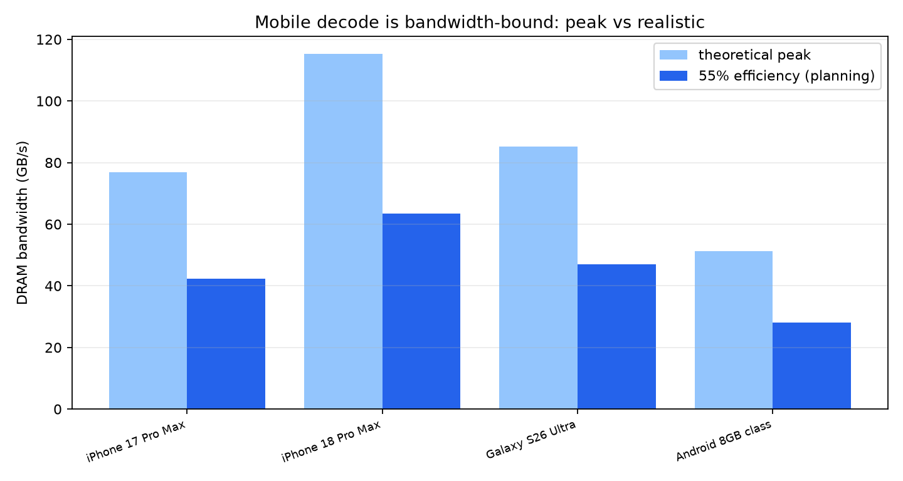
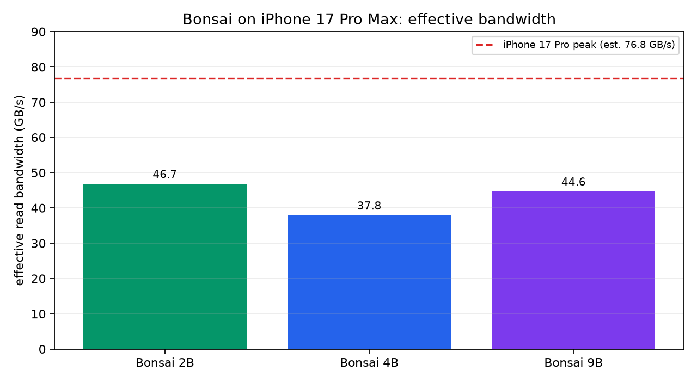
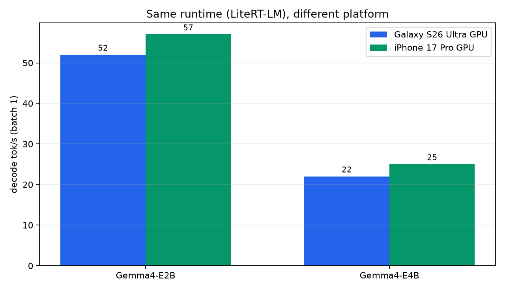
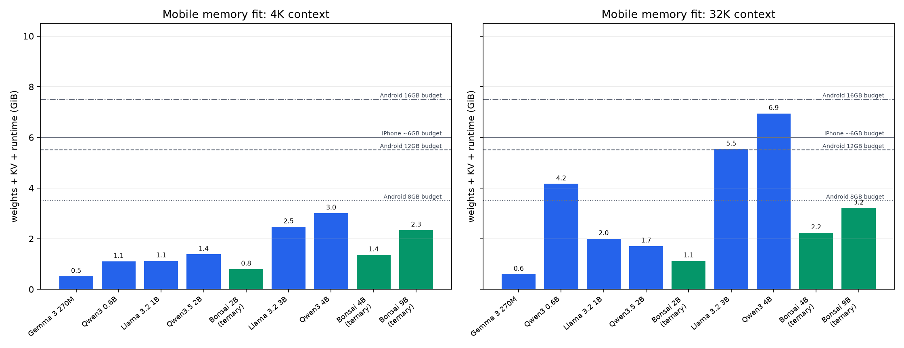
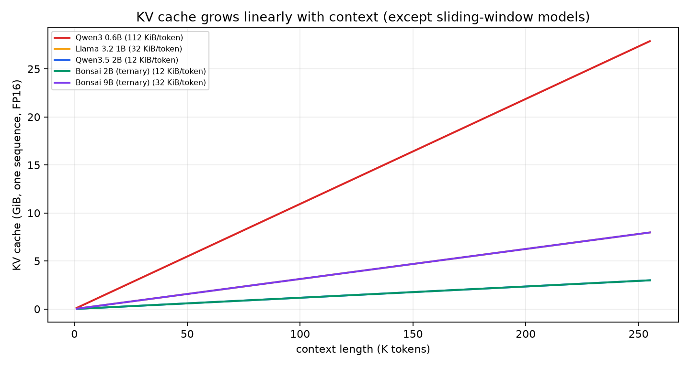

# ポケットの中の知能 — モバイルSLM 要件設計の全書

**副題:** iPhone と Android で「何がどこまで載るのか」を、帯域・メモリ・NPU・OS・配布から定量化する

**版:** 1.0（2026-10-25）  
**親レポート:** [REPORT.md](REPORT.md)（Tiny LLM / SLM の設計・逆解析・評価の全書）  
**プロジェクト:** tinySLM-REA

---

> スマホは「小さな工場」だ。  
> RAMは倉庫、メモリ帯域はベルトコンベア、NPUは専用の調理場、OSは建築基準法。  
> モデルは「料理」。同じ料理でも、工場の規格が違えば、必要な設備も、出せる速度も変わる。  
> この本は、iPhoneとAndroidという2つの工場の「設備仕様書」を読み比べる本である。

---

## この本の約束

1. **iPhoneとAndroidを、根拠のある数字で比べる。**  
   ベンチマークの1回のスコアではなく、RAM、帯域、NPUへのアクセス、OSの制約、配布の現実を並べます。

2. **「動く」と「快適に動く」を分ける。**  
   モデルがメモリに載るか、KVキャッシュが収まるか、30分後に熱で落ちないか。別々に考えます。

3. **測定値と推定値を混ぜない。**  
   次のラベルで区別します。特に、Androidのアプリメモリ予算とiPhone 18 Proの帯域は、断定できない部分があります。

| ラベル | 意味 |
|---|---|
| 【観測】 | 実ファイル・バイト列・配布物から直接確認 |
| 【導出】 | 観測値からの計算 |
| 【論文】 | 一次資料（arXiv・公式ブログ・モデルカード） |
| 【ベンダー主張】 | 提供元の自己申告。独立再現なし |
| 【ベンダー自己測定】 | 提供元が自分の環境で測ったベンチマーク。本書は再現していない |
| 【デバイス仕様】 | 公開された端末仕様 |
| 【公式】 | ベンダーの公式ドキュメント/サポートページ |
| 【経験則】 | 本書の計画用経験値。OSの上限ではない |
| 【二次資料】 | Wikipedia・レビューなど二次資料 |
| 【推測】 | 根拠はあるが断定できない |
| 【未検証】 | 未確認。断定禁止 |

### 10分で読むなら

- 第0章（結論）→ 第2章（物理）→ 第5章（iPhone vs Android）→ 第6章（モデル別フィット）→ 付録F（1ページ要約）

### 90分で読むなら

- 第0〜9章 + 第11章。設計と評価の実務まで入ります。

### 徹底的に読むなら

- 全部。第7章の量子化フォーマット、第8章のKVキャッシュ、付録Eの再現方法が技術の核心です。

---

## 目次

- [第0章 結論の先出し — 12の文](#第0章-結論の先出し--12の文)
- [第1章 たとえ話 — スマホは弁当箱](#第1章-たとえ話--スマホは弁当箱)
- [第2章 モバイル推論の物理 — 帯域・KV・熱](#第2章-モバイル推論の物理--帯域kv熱)
- [第3章 iPhoneの要件 — 6GBの壁とANE](#第3章-iphoneの要件--6gbの壁とane)
- [第4章 Androidの要件 — 断片化とNPU](#第4章-androidの要件--断片化とnpu)
- [第5章 iPhone vs Android — 要件差の定量比較](#第5章-iphone-vs-android--要件差の定量比較)
- [第6章 モデル別フィット表 — 0.27Bから9Bまで](#第6章-モデル別フィット表--027bから9bまで)
- [第7章 量子化フォーマット — 同じ4-bitでも別物](#第7章-量子化フォーマット--同じ4-bitでも別物)
- [第8章 コンテキストとKV — 4K・32K・262K](#第8章-コンテキストとkv--4k32k262k)
- [第9章 熱・電力・持続性能](#第9章-熱電力持続性能)
- [第10章 配布とプライバシー](#第10章-配布とプライバシー)
- [第11章 設計レシピ — iPhone-first / Android-first / cross-platform](#第11章-設計レシピ--iphone-first--android-first--cross-platform)
- [第12章 評価とアンチパターン](#第12章-評価とアンチパターン)
- [第13章 2026-2028の展望](#第13章-2026-2028の展望)
- [付録A 数式の導出](#付録a-数式の導出)
- [付録B デバイスマトリクス](#付録b-デバイスマトリクス)
- [付録C 用語集](#付録c-用語集)
- [付録D 参考文献](#付録d-参考文献)
- [付録E 再現方法](#付録e-再現方法)
- [付録F 1ページ要約](#付録f-1ページ要約)

---

# 第0章 結論の先出し — 12の文

## 0.1 最初に知っておくべきこと

**iPhoneとAndroidの差は、「CPUやGPUの生の速さ」だけではない。**  
決定的なのは、**実効メモリ予算、NPUへの道、OSが提供するシステムモデル、配布の仕組み**です。この4つが、同じモデルでも「載る/載らない」「速い/遅い」「作れる/作れない」を分けます。

12の文にすると、次のようになります。

1. **iPhoneは12GB積んでいても、アプリが使えるのは約6GB。**  
   Bonsaiの測定では、iPhone 17 Pro Maxのper-app limitは約6GBでした【ベンダー自己測定】。Appleは公式には公表していません。RAMの数字だけを見ると誤解します。

2. **AndroidはRAM容量で予算が変わる。**  
   8GB機は約3.5GB、12GB機は約5.5GB、16GB機は約7.5GBが実用予算の目安です【経験則】。OSのLMK（Low Memory Killer）とzRAMの挙動で、同じ「8GB」でも機種差が大きいです。

3. **Android 8GBは、iPhone 6GBより厳しい。**  
   Android 12GBでようやくiPhone 6GBと同等、Android 16GBで逆転します。**「iPhone 12GB ≒ Android 12GB」**と覚えると、モデル選びが現実的になります。

4. **帯域はiPhone 18 Proが強い。**  
   AppleはA20 Proで「A19 Pro比50%増の統合メモリ帯域」と言っています【ベンダー主張】。A19 Proの64-bit LPDDR5Xを76.8GB/sと置くと、A20 Proは96-bitで約115GB/sという推測になります【推測】。Android flagshipはLPDDR5X 10667で約85GB/s【導出】です。

5. **2B三元モデルは、4Kならほぼどの現行機でも動く。**  
   Bonsai 2Bは重み0.40GiB、4KのKV 0.05GiB、ランタイム0.35GiBで合計約0.80GiB【導出】。8GB Androidでも余裕があります。

6. **262Kは「モデルの売り文句」と「実際に載るか」が別。**  
   Bonsai 2Bの262K KVは3.0GiB。合計3.75GiBで、iPhone 6GBとAndroid 12GBは余裕、Android 8GBは届きません【導出】。Qwen3.5 2B 4-bitも4.33GiBで可。4B/9Bは262Kで8.0GiBのKVが必要で、どのスマホでも厳しいです【導出】。

7. **4B三元は32KならiPhone/Android 8GBで動く（nominal）。**  
   重み0.88GiB + KV 1.0GiB + ランタイム0.35GiB = 2.23GiB【導出】。128Kは5.23GiBでiPhone 6GB/Android 12GBだが、20%余裕のsafeではiPhoneは2B三元まで。262Kは9.23GiBでどのスマホも不可です。

8. **9B三元は32KならiPhone 6GB/Android 8GBで動く（nominal）。**  
   重み1.86GiB + KV 1.0GiB + ランタイム0.35GiB = 3.21GiB【導出】。128Kは6.21GiBでAndroid 16GBのみ（safeでは4B三元が安全）、262Kは10.21GiBで不可です。

9. **8B 4-bitは4KならiPhone 6GB/Android 12GB（nominal）。32Kは16GBでも予算オーバー。**  
   4Kで5.04GiB、32Kで8.54GiB【導出】。iPhone 6GBは4Kまでだが、safeでは9B三元が安全。32Kは24GB級のAndroidが必要です。

10. **NPUのTOPSは、LLMの速さの指標にならない。**  
   デコードはメモリ帯域律速です。100TOPSのNPUでも帯域50GB/sなら、40TOPSで帯域100GB/sのNPUに負けます。**TOPSは「計算の上限」、帯域は「供給の上限」**。LLMは供給で決まります。

11. **同じLiteRT-LMでも、Android CPUがiPhone CPUより速いことがある。**  
   Gemma4-E2B（2.58GB）のデコードは、Galaxy S26 Ultra CPU 47 tok/s、iPhone 17 Pro CPU 25 tok/s。GPUは52 vs 57でほぼ互角です【ベンダー自己測定】。iPhoneが常に速いわけではありません。ランタイムとカーネル次第です。

12. **クロスプラットフォームは「1つのモデルファイル」ではなく「ビルドマトリクス」。**  
   iOSはCore AI/MLX/Core ML/llama.cpp、AndroidはLiteRT/ExecuTorch/llama.cpp。量子化フォーマットもNPU delegateも別です。**1つのモデルを2つの工場で動かすには、少なくとも2プラットフォーム分、実際は5〜7種類のartifactとQAが必要**です。

## 0.2 一番大事な1枚

| 質問 | iPhone | Android | 差の本質 |
|---|---|---|---|
| アプリが使えるメモリ | 約6GB（12GB機） | 8GB機≈3.5GB、12GB機≈5.5GB、16GB機≈7.5GB | iOSは固定上限、Androidは総RAMとLMK次第 |
| ピーク帯域 | 17 Pro≈76.8GB/s、18 Pro≈115GB/s（推定） | flagship≈85GB/s（推定） | iPhone 18 Proが約35%高い |
| NPUへの道 | Core ML / Core AIでANE | LiteRT / ExecuTorch + vendor delegate | iOSは一本道、Androidは分岐 |
| システムLLM | Apple Foundation Models 3B / 4,096トークン total | Gemini Nano v2-v4 / 入力4,000未満 + 出力4K以下 | 4Kの意味が違う（total vs input/output） |
| モデル形式 | .aimodel / .mlpackage / GGUF / safetensors | .litertlm / .tflite / .pte / GGUF | 相互変換が必要 |
| 配布 | App Store | Google Play（base 500MB、total 4GB、asset pack 30GB） | 大きなモデルは初回DLが前提 |

## 0.3 本書の立場

本書は「iPhoneの勝ち」「Androidの勝ち」を決める本ではありません。**あなたのタスク、コンテキスト長、端末層、配布方法に対して、どちらの工場が合うか**を決めるための本です。

そして、どちらの工場でも、**「モデルが載る」だけでは不十分**です。KVキャッシュ、熱、電力、TTFT、P95、そして品質のゴールデンセットまで含めて、初めて「動く」と言えます。

---

# 第1章 たとえ話 — スマホは弁当箱

## 1.1 弁当箱と料理

あなたは弁当箱に料理を詰めるとします。

- **弁当箱の大きさ** = RAM。入る量の上限。
- **弁当箱の仕切り** = OSのメモリ管理。アプリ用、OS用、GPU用に分かれている。
- **料理の重さ** = モデルの重み。0.43GB、2GB、4.5GB。
- **保冷剤** = KVキャッシュ。食べる（生成する）ほど増える。最初は小さくても、最後には場所を取る。
- **弁当箱を運ぶベルト** = メモリ帯域。料理を出す速さ。
- **専用の調理場** = NPU。決まった料理は速いが、レシピが合わないと使えない。
- **電子レンジの庫内** = 熱。30分連続で使うと、温度が上がる。

大事なのは、**「弁当箱が大きい＝良い」ではない**ことです。仕切りが大きくて料理が入らないこともあるし、保冷剤が大きすぎて主菜が入らないこともある。iPhoneの12GBは、仕切りの都合で6GBしか使えません。Androidの8GBは、仕切りとzRAMの都合で3.5GBしか使えないことがあります。

## 1.2 3つの「入る」

モデルが「入る」には、3つの段階があります。

1. **ファイルが入る**（ストレージ）  
   0.43GBのGGUFは、128GBのスマホに余裕で入ります。これは一番簡単です。

2. **重みがRAMに載る**（メモリ）  
   0.43GBの重み + 0.35GBのランタイム + KV。ここで多くのモデルが落ちます。

3. **30分後も快適に動く**（熱・電力・帯域）  
   最初の10秒は速くても、熱でクロックが下がり、後半は半分になることがあります。

本書は、この3つを別々に扱います。**「0.43GBだからiPhoneで動く」は、1番目しか見ていない**のです。

## 1.3 iPhoneとAndroidの「工場の違い」

| 工場の設備 | iPhone | Android |
|---|---|---|
| 建物の設計 | Appleがハード・OS・ランタイムを一社で設計 | SoCベンダー、OEM、OSが分業 |
| 倉庫の仕切り | per-app limit（約6GB） | LMKとzRAMで動的 |
| 専用調理場 | ANE（Core ML/Core AIで使う） | Hexagon/NeuroPilot/Tensor/Exynos（vendor delegate） |
| ベルトコンベア | 統合メモリ、A20 Proで+50% | LPDDR5X 10667、約85GB/s |
| メニュー | Foundation Models（3B/4K） | Gemini Nano（v2-v4/4K） |
| 宅配 | App Store | Google Play + asset pack |

この違いは、**「同じ料理を同じレシピで作れるか」**に直結します。iPhoneではANE用に変換した料理（Core ML）が速い。AndroidではLiteRT用に変換した料理（.litertlm）が速い。**GGUFはどちらでも動くが、NPUは使わない**。これが、本章の一番実務的な結論です。

---

# 第2章 モバイル推論の物理 — 帯域・KV・熱

## 2.1 デコードは「メモリ帯域」で決まる

LLMのデコード（1トークンずつ生成）では、毎トークン、モデルの重みと**その時点のKVキャッシュ全体**をメモリから読みます。GPUやNPUの計算ユニットは、データが来るのを待っています。したがって、理論上のトークン速度は：

$$
\text{tok/s} \approx \frac{BW_{\text{effective}}}{M_{\text{weights}} + T \times M_{\text{KV per token}}}
$$

ここで $BW_{\text{effective}}$ は実効帯域、$M_{\text{weights}}$ は重みのバイト数、$T$ はコンテキスト長、$M_{\text{KV per token}}$ は1トークンあたりのKVキャッシュです。**KVは「1トークン分」ではなく「Tトークン分」を毎回読む**ことに注意してください。

**例：Bonsai 2B（PQ2_0、0.52GB）をiPhone 17 Pro Maxで動かすと、89.9 tok/s【ベンダー自己測定】。**  
これは **tg128（短いコンテキスト）** の測定です。実効帯域は $0.52 \times 89.9 \approx 46.7$ GB/s【導出】。iPhone 17 Proのピークを76.8GB/sと置くと、効率は約61%です。  
（本書がファイル構造を解析したのはPTQ1_0の0.43GB/0.40GiB。89.9 tok/sはPQ2_0の値で、同じモデルの別パックです。）

**例：Bonsai 4B（0.95GB）は39.8 tok/s、9B（2.0GB）は22.3 tok/s【ベンダー自己測定】。**  
短いコンテキストでの実効帯域は、4Bが $0.95 \times 39.8 \approx 37.8$ GB/s、9Bが $2.0 \times 22.3 \approx 44.6$ GB/s。**モデルが大きくなっても、実効帯域は37.8〜46.7GB/sの範囲**に収まっています【導出】。これは「帯域律速」の強い証拠です。

しかし、コンテキストが長くなると、KVキャッシュ全体を読む分だけ遅くなります。同じ46.7GB/sを使うと、Bonsai 2Bの推定は次のようになります【導出】。

| コンテキスト | KV | 重み + KV | 推定tok/s |
|---:|---:|---:|---:|
| 4K | 0.05GB | 0.57GB | 82 |
| 32K | 0.40GB | 0.92GB | 51 |
| 128K | 1.61GB | 2.13GB | 22 |
| 262K | 3.22GB | 3.74GB | 12 |

**「90 tok/s」は短いコンテキストの数字**であり、262Kでは12 tok/s程度まで落ちる可能性があります。実際の速度は、カーネル、KV量子化、バッチ、熱で変わります。

## 2.2 なぜ「TOPS」だけでは決まらないのか

NPUのスペックには「100 TOPS」のような数字が並びます。しかし、LLMのデコードは、計算ユニットを遊ばせながら、メモリから重みを読む作業です。

- **TOPS** = 1秒間に何回の積和演算ができるか。計算の上限。
- **帯域** = 1秒間に何バイト運べるか。供給の上限。
- **カーネル効率** = 実際にその帯域を使い切れるか。実装の上限。

LLMのデコードでは、**帯域 × カーネル効率**が先に決まります。TOPSが高くても、帯域が細ければ、計算ユニットは待ちます。逆に、TOPSが低くても、帯域が太く、カーネルが良ければ、速いです。

これは、スマホのNPU選びで最も誤解されている点です。**「TOPSが2倍」は「LLMが2倍速い」ではない**。ベンダーのTOPS比較は、畳み込みニューラルネットワーク（画像認識）では意味がありますが、LLMのデコードには当てはまりません。

## 2.3 PrefillとDecode — 2つの違うボトルネック

推論には2つのフェーズがあります。

1. **Prefill（プロンプト処理）**  
   入力全体を一度に処理します。計算量が大きく、GPU/NPUの演算器がフル稼働します。**計算律速**です。
2. **Decode（生成）**  
   1トークンずつ生成します。重みをメモリから読む時間が支配的です。**メモリ帯域律速**です。

LiteRT-LMの公式ベンチマークでは、Gemma4-E2B（2.58GB）のGalaxy S26 Ultra GPUが、Prefill 3,808 tok/s、Decode 52 tok/s。iPhone 17 Pro GPUがPrefill 2,878 tok/s、Decode 57 tok/sです【ベンダー自己測定】。**PrefillはDecodeの約48〜73倍速い**。これは、長いプロンプトの処理は比較的速く、長い回答の生成は遅い、という当たり前の事実を数字で示しています。

実務では、次のように使い分けます。

- **長い文書を読むタスク**（要約、抽出）: Prefillが支配的。GPU/NPUの計算性能とバッチ処理が重要。
- **長い回答を書くタスク**（創作、コーディング）: Decodeが支配的。帯域と量子化が重要。
- **チャット**: 最初のTTFT（Prefill）と、その後のTPOT（Decode）の両方。P95を見る。

## 2.4 KVキャッシュ — 見えない主役

Transformerの全注意は、過去のKeyとValueを保存します。そのサイズは：

$$
M_{\text{KV}} = L_{\text{full}} \times H_{\text{kv}} \times (d_k + d_v) \times T \times \text{bytes}
$$

ここで $L_{\text{full}}$ は全注意層の数、$H_{\text{kv}}$ はKVヘッド数、$d_k, d_v$ はKey/Valueの次元、$T$ はコンテキスト長です。$d_k+d_v$ がすでにKとVの両方を含むことに注意してください。

Bonsai 2B（6全注意層、2 KVヘッド、Key/Value各256次元、FP16）では：

- 1トークンあたり: $6 \times 2 \times 512 \times 2 = 12,288$ bytes = **12KiB/token**
- 4K: 48MiB
- 32K: 384MiB
- 128K: 1.5GiB
- 262K: 3.0GiB

**PTQ1_0の重みが0.40GiBなのに、262KではKVが3.0GiB**。これが「262Kコンテキスト」の現実です。

もっと極端な例がQwen3 0.6Bです。28層、8 KVヘッド、head_dim 128、FP16で：

- 1トークンあたり: $28 \times 8 \times 256 \times 2 = 114,688$ bytes = **112KiB/token**
- 32K: 3.5GiB
- 40K（最大）: 4.4GiB

**重み0.31GiBのモデルが、32KでKV 3.5GiB**。KVキャッシュは、重みの10倍以上になります。**「0.6Bだから軽い」は、長文では通用しません。**

## 2.5 熱と電力 — 30分後の性能

スマホのSoCは、ピーク性能を数秒〜数十秒しか出せません。熱が上がるとクロックを下げ、性能が落ちます。これを**サーマルスロットリング**と呼びます。

AppleはiPhone 18 Proで「前世代比最大40%の持続性能向上」と主張しています【ベンダー主張】。A20 Proは2nmプロセスで、メモリをダイの横に置くパッケージにし、ベイパーチャンバーの面積を3倍にしたといいます【ベンダー主張】。これは、**「最初の10秒」ではなく「30分後」を売りにした**珍しい改善です。

Android側も、Dimensity 9500がNPU 990で「前世代比2倍以上のトークン生成速度」「ピーク電力56%削減」と主張しています【ベンダー主張】。Snapdragon 8 Elite Gen 5も3nmで、Adreno 840を積みます【デバイス仕様】。

しかし、**ベンダーのピーク値は、持続性能を保証しません**。スマホでLLMを動かすときは、必ず30分の連続生成テストをしてください。本書の第12章で、その方法を書きます。

---

# 第3章 iPhoneの要件 — 6GBの壁とANE

## 3.1 iPhoneのハードウェア地図

2026年10月時点のiPhoneは、A19/A19 Pro（iPhone 17世代）とA20 Pro（iPhone 18 Pro世代）が中心です。

| 項目 | iPhone 17 Pro / Pro Max | iPhone 18 Pro / Pro Max |
|---|---|---|
| SoC | A19 Pro（3nm） | A20 Pro（2nm） |
| RAM | 12GB | 12GB |
| Neural Engine | 16-core | dual 16-core（32-core相当） |
| GPU | 6-core | 7-core + Neural Accelerators |
| メモリ帯域 | 推定76.8GB/s | A19 Pro比+50%（推定115GB/s） |
| OS | iOS 26 → 27 | iOS 27 |
| システムLLM | Foundation Models 3B / 4K | 同左 + Core AI |

A20 Proの「dual 16-core Neural Engine」はAppleの公式表現です【ベンダー主張】。ただし、TOPSは公表されていません。**TOPSがないから比較できない**のではなく、**TOPSを使わない方がLLMには正確**です。

## 3.2 6GBの壁 — RAM 12GBでもアプリは6GB

iPhone 17 Pro Maxは12GBのRAMを積みますが、Bonsaiのホワイトペーパーは「iPhoneの約6GBのper-app limitに、3モデルすべてが収まる」と書いています【ベンダー自己測定】。つまり、**12GBのうち、アプリがLLMに使えるのは約6GB**です。

Appleはper-app limitを公式には公表していません。しかし、この数字は非常に重要です。

- 12GB積んでいても、27B三元モデル（別モデル、重み約6.5GB）は載らない【ベンダー主張】。
- 9B三元モデル（重み2GB）は、32Kなら余裕、128Kならギリギリ超える。
- 8B 4-bit（重み4.2GB）は、4KならiPhone 6GB/Android 12GBに載るが、32Kは8.54GiBで16GB Androidでも予算オーバー。

**iPhoneのRAMは「12GB」ではなく「6GB」として設計する**。これが、iPhone向けSLMの第一原則です。

## 3.3 iOSのシステムモデル — Foundation Models

iOS 26以降、Appleは**Foundation Models**フレームワークで、オンデバイスの基盤モデルをアプリに開放しています【公式】。

- **モデル**: Apple Intelligenceのオンデバイスモデル（約3B、2-bit QAT）【論文】
- **コンテキスト**: **4,096トークン/セッション**。指示、ツール定義、スキーマ、出力まですべて含む【公式】
- **機能**: guided generation（Swiftの型で構造化出力）、tool calling、ストリーミング、コンテンツタグ付け【公式】
- **言語**: Apple Intelligenceが対応する言語。日本語も対応【公式】
- **料金**: 無料、オフライン、モデルダウンロード不要【公式】
- **利用条件**: Apple Intelligence対応デバイス（iPhone 15 Pro以降、iPhone 16以降など）【公式】

4,096トークンは、**ユーザーのプロンプトだけに使えるわけではありません**。システム指示、ツールの説明、guided generationのスキーマ、会話履歴、モデルの出力、すべてがこの4Kに入ります。実務では、ユーザーの入力に使えるのは2,000〜3,000トークン程度と考えた方が安全です。

AppleはPrivate Cloud Compute（PCC）で**32Kトークン**のサーバーモデルも提供しています【公式】。ただし、PCCはネットワークが必要で、1日の利用上限があります。オンデバイス4Kで足りないときのフォールバックとして使います。

## 3.4 iOS 27のCore AI — カスタムモデルの新しい道

iOS 27では、**Core AI**フレームワークが追加されました【公式】。

- **`.aimodel`形式**で、PyTorchから変換したモデルをアプリに同梱できる。
- **CPU / GPU / Neural Engine**を明示的に選べる（`ComputeUnitKind`）。
- **Foundation Modelsの`LanguageModel`プロトコル**に準拠するので、システムモデルと同じ`LanguageModelSession` APIで使える。
- **バックグラウンド推論**のentitlement（`com.apple.developer.background-tasks.continued-processing.inference`）がある。
- **AOTコンパイル**（`coreai-build`）で、初回起動のspecialization時間を削減できる。

これは、Appleが「システムモデルだけではなく、サードパーティのモデルもANEで動かす」方向に舵を切ったことを意味します。**Core MLの後継というより、LLM時代の新しい推論スタック**です。

ただし、Core AIはiOS 27以降です。iOS 26以前はCore ML/MLX/llama.cppを使います。また、Core AIの量子化対応はまだ発展途上で、現時点ではCore MLのpalettizationの方が実績があります【推測】。

## 3.5 Core ML — ANEを使うための古典的な道

Core MLは、Appleの伝統的なMLフレームワークです。LLMでも使えますが、いくつか注意点があります。

- **量子化**: palettization（1/2/3/4/6/8-bit）、linear quantization（4/8-bit weights、8-bit activations）【公式】
- **ANE**: `MLModelConfiguration.computeUnits = .all` または `.cpuAndNeuralEngine` でANEを使える。`.cpuAndGPU`はANEを使わない【公式】
- **per-grouped-channel palettization**: iOS 18以降。グループごとにLUTを持てる【公式】
- **JIT decompression**: iOS 17以降、ANEがpalettized weightsを「ちょうど間に合うように」展開する。これがメモリ帯域の節約になる【公式】
- **制約**: 動的形状、KVキャッシュの状態管理、カスタムopsに弱い。LLM向けには、stateful modelや`MLState`が必要。

Core MLのpalettizationは、**2-bitでも精度が保ちやすい**のが強みです。Appleのベンチマークでは、MobileNetV2の2-bit palettizationが0.47ms（FP16 0.48ms）と、ほぼ同じレイテンシでした【公式】。ただし、これは画像モデルの話で、LLMでは品質劣化とカーネル対応を別途評価する必要があります。

## 3.6 MLX — GPUを使うがANEは使わない

MLXは、Apple Silicon向けのNumPyライクなフレームワークです【公式】。

- **統一メモリ**: CPU/GPU間のコピーなし。
- **量子化**: affine 1/2/3/4/5/6/8-bit、group size 32/64/128。MXFP4/8、NVFP4も対応【公式】。
- **MLX Swift**: iOS向けのLLM実装（MLXLLM/MLXVLM）がある。
- **ANE**: **使わない**。MLXはGPU（Metal）で動く。

MLXは、iPhoneでGGUF/MLXモデルを動かすときに便利ですが、**ANEを捨てる**選択です。GPUの方が柔軟で、モデル変換が簡単という利点があります。BonsaiのM5 Proでは、MLX Swift 2-bitがllama.cpp Metalより速い（2B 276.3 vs 229.6 tok/s）という結果もあります【ベンダー自己測定】。ただし、iPhoneではMLXの方が速いとは限りません。実測が必要です。

## 3.7 iPhoneの要件まとめ

| 要件 | 目安 |
|---|---|
| OS | iOS 26+（Foundation Models）、iOS 27+（Core AI） |
| 実効メモリ | 約6GB（12GB機） |
| システムLLM | 3B / 4K、無料、オフライン |
| カスタムLLM | Core AI / Core ML / MLX / llama.cpp |
| ANE | Core ML/Core AI経由。MLXはGPUのみ |
| 量子化 | Core ML palettization 1-8-bit、MLX 1-8-bit |
| 帯域 | 17 Pro≈76.8GB/s、18 Pro≈115GB/s（推定） |
| 配布 | App Store。大きなモデルは初回DL |
| 熱 | 18 Proで持続性能+40%（ベンダー主張） |

**iPhone向けの第一原則**: 6GBに収め、ANEを使いたければCore ML/Core AI、柔軟性が欲しければMLX/llama.cpp。システムモデルで足りるなら、それを使う。

---

# 第4章 Androidの要件 — 断片化とNPU

## 4.1 Androidのハードウェア地図

Androidは、SoCベンダー、OEM、OSバージョンが分かれます。2026年の flagship は、おおまかに次の4系統です。

| SoC | 代表デバイス | NPU | RAM | 備考 |
|---|---|---|---|---|
| Snapdragon 8 Elite Gen 5 | Galaxy S26 Ultra | Hexagon NPU | 12/16GB | 3nm、Adreno 840 |
| Google Tensor G6 | Pixel 11 Pro XL | Tensor TPU | 12/16GB | Android 17、AICore |
| MediaTek Dimensity 9500 | vivo X300 Proなど | NPU 990 | 12/16GB | LPDDR5X 10667、N3P |
| Samsung Exynos 2600 | Galaxy S26（地域版） | Exynos NPU | 12GB | 地域差あり |

Androidの最大の特徴は、**同じ「Android」でも、NPUの命令セットも、ドライバも、使えるAPIも違う**ことです。iPhoneのように「Core MLを呼べばANE」という一本道ではありません。

## 4.2 NNAPIはもう古い — Android 15で非推奨

AndroidのNPUアクセスは、歴史的にNNAPI（Neural Networks API）でした。しかし、**NNAPIはAndroid 15で非推奨**になりました【公式】。Android Developersのページには、次のように書かれています。

> NNAPI is deprecated. While you can continue to use NNAPI, we expect the majority of devices in the future to use the CPU backend, and therefore for performance critical workloads, we recommend migrating to alternative solutions, for example the TF Lite GPU runtime.

つまり、**NNAPIを前提にした設計は、今後CPUに落ちる可能性が高い**。LLMでは致命的です。代わりに、LiteRT（旧TFLite）のCompiledModel API、ベンダーdelegate（Qualcomm QNN、MediaTek NeuroPilot、Google Tensor、Samsung Exynos）、ExecuTorchのbackendを使います。

## 4.3 LiteRT / LiteRT-LM — Googleの本命

LiteRTは、Googleのエッジ推論ランタイムです。LLM向けには**LiteRT-LM**があります【公式】。

- **対応モデル**: Gemma、Llama、Phi-4、Qwenなど。
- **バックエンド**: CPU、GPU、NPU（Androidのみ）。
- **NPU対応**: Qualcomm AI Engine Direct（QNN）、MediaTek NeuroPilot、Google Tensor、Samsung Exynos AI LiteCore。
- **AOT/JIT**: AOTコンパイルで初期化時間を削減、JITでオンデバイスコンパイル。
- **配布**: Google Playの**AI Pack**で、SoCごとに最適化したモデルを配信。
- **制約**: NPUは**Android API 31+、arm64-v8aのみ**。NPU runtimeライブラリを別途配布する必要がある。

LiteRT-LMの公式ベンチマークは、AndroidとiPhoneを同じランタイムで比較できる貴重なデータです（第5章）。

## 4.4 ExecuTorch — PyTorchのエッジ Runtime

ExecuTorchは、PyTorchのエッジ推論ランタイムです【公式】。

- **`.pte`形式**。モデルごとにbackendを選ぶ。
- **iOS**: Core ML（NPU/GPU/CPU）、MLX（GPU、実験的）、XNNPACK（CPU）。
- **Android**: Vulkan（GPU）、Qualcomm QNN（NPU）、MediaTek（NPU）、Samsung Exynos（CPU/GPU/NPU）、XNNPACK（CPU）。
- **LLM**: `TextLLMRunner`/`MultimodalRunner`（iOSは実験的）。
- **量子化**: torchaoなどでINT4/INT8。backendごとに対応が違う。

ExecuTorchは「PyTorchで書いたモデルを、そのままエッジに」という思想ですが、**backendごとに`.pte`を書き出す**必要があります。LiteRT-LMと同様、ビルドマトリクスが発生します。

## 4.5 Gemini Nano / AICore — Androidのシステムモデル

Androidには、Googleの**Gemini Nano**をAICore経由で使う仕組みがあります【公式】。

- **AICore**: Androidのシステムサービス。モデルの配布、更新、安全性、推論を管理。
- **ML Kit GenAI APIs**: Prompt、Summarization、Proofreading、Rewriting、Image Description、Speech Recognition。
- **コンテキスト**: 入力は**4,000トークン未満**、出力は4Kトークン以下を推奨【公式】。
- **デバイス**: Pixel 9/10/11、Galaxy S25/S26、Xiaomi 15/17、OnePlus 13/15など、多数の flagship。ただし**nano-v2/v3/v4で対応デバイスが違う**【公式】。
- **バックグラウンド**: **禁止**。アプリがフォアグラウンドのときだけ推論できる。foreground serviceでも`BACKGROUND_USE_BLOCKED`【公式】。
- **クォータ**: アプリごとに推論クォータ。短期/長期の上限がある【公式】。
- **モデル更新**: AICoreが管理。アプリはモデルをダウンロードしない。

これは、AppleのFoundation Modelsとよく似ていますが、**デバイス対応が狭く、バックグラウンドが禁止で、クォータがある**点が違います。また、Prompt APIはbetaで、SLAがない【公式】。

## 4.6 Androidのメモリ — 固定上限はないが、LMKがいる

Androidには、iOSのような「per-app limit」の公式な数字がありません。代わりに、**LMK（Low Memory Killer）**が、メモリが不足するとプロセスを殺します【公式】。

- **Java heap limit**: `ActivityManager.getMemoryClass()`で取得できるが、これはJavaヒープの話。ネイティブメモリは別。
- **ネイティブメモリ**: モデルの重みは`mmap`や`AHardwareBuffer`で確保される。LMKのスコアは、フォアグラウンドアプリが最も低い（殺されにくい）。
- **zRAM**: メモリを圧縮してswapのように使う。モデルの重みをzRAMに追い出すと、レイテンシが激増する。
- **実用予算**: 8GB機で3〜4GB、12GB機で5〜7GB、16GB機で7〜9GBが目安【経験則】。OS、GPU、zRAM、ベンダーブロートで変わる。

**Androidの「8GB」は、iPhoneの「6GB」より広いとは限らない**。これが、第5章の比較の出発点です。

## 4.7 Androidの要件まとめ

| 要件 | 目安 |
|---|---|
| OS | Android 12+（LiteRT）、14+（AICore）、15+（NNAPI非推奨） |
| 実効メモリ | 8GB≈3.5GiB、12GB≈5.5GiB、16GB≈7.5GiB |
| システムLLM | Gemini Nano v2-v4 / 入力4,000未満＋出力4K以下、デバイス限定 |
| カスタムLLM | LiteRT-LM / ExecuTorch / llama.cpp |
| NPU | LiteRT/ExecuTorch + vendor delegate。API 31+、arm64 |
| 量子化 | LiteRT INT4/INT8、QNN、GGUF |
| 帯域 | flagship≈85GB/s（推定） |
| 配布 | Google Play（base 500MB、total 4GB、asset pack 30GB） |
| バックグラウンド | ML Kit GenAIは禁止。カスタムはforeground service |

**Android向けの第一原則**: 端末層を8GB/12GB/16GBで分け、LiteRT-LMでCPU/GPUを基本、NPUは対応SoCだけのボーナスとして扱う。システムモデルはデバイス限定なので、フォールバックを用意する。

---

# 第5章 iPhone vs Android — 要件差の定量比較

## 5.1 デバイスマトリクス

まず、2026年10月時点の代表的な端末を並べます。数字は公開仕様と、本書の推定を区別しています。

| 端末 | SoC | RAM | アプリ予算 | ピーク帯域 | NPU | OS |
|---|---|---:|---:|---:|---|---|
| iPhone 17 Pro Max | A19 Pro | 12GB | **約6GiB**（ベンダー表記6GB） | 76.8GB/s（推定） | 16-core ANE | iOS 26/27 |
| iPhone 18 Pro Max | A20 Pro | 12GB | **約6GiB**（推定） | **115.2GB/s**（推定） | dual 16-core ANE | iOS 27 |
| Galaxy S26 Ultra | SD 8 Elite Gen 5 | 12/16GB | 5.5 / 7.5GiB（経験則） | 85.3GB/s（推定） | Hexagon NPU | Android 16/17 |
| Pixel 11 Pro XL | Tensor G6 | 12/16GB | 5.5 / 7.5GiB（経験則） | 85.3GB/s（推定） | Tensor TPU | Android 17 |
| Android 8GB class | 例: SD 7系 / Dimensity 7系 | 8GB | 3.5GiB（経験則） | 51.2GB/s（推定） | 機種次第 | Android 14+ |

**注:** iPhoneの「アプリ予算」はBonsaiのホワイトペーパーがiPhone 17 Pro Maxで約6GBと報告した値です【ベンダー自己測定】。Appleは公式には公表していません。Androidの予算は、LMK/zRAM/OS/GPU予約を考慮した**計画用の経験則**であり、OSの公式上限ではありません【推測】。

## 5.2 帯域の比較 — iPhone 18 Proが約35%高い

帯域の数字は、次のように導出しました。

- **iPhone 17 Pro**: A19 Pro、64-bit LPDDR5X、9600MT/sと仮定 → $64/8 \times 9.6 \approx 76.8$ GB/s【推測】。
- **iPhone 18 Pro**: Appleが「A19 Pro比50%増」と主張【ベンダー主張】。A20 Proの96-bitメモリインターフェースというリーク情報【未検証】と、9600MT/sを仮定 → $96/8 \times 9.6 = 115.2$ GB/s。これはちょうど+50%で、Appleの主張と整合します【推測】。
- **Android flagship**: MediaTek Dimensity 9500のLPDDR5X 10667【公式】を64-bitで計算 → $64/8 \times 10.667 \approx 85.3$ GB/s【導出】。Snapdragon 8 Elite Gen 5も同クラスと仮定【推測】。



*図: ピーク帯域と、計画用の55%効率。実効帯域はカーネル、KV、バッチ、熱でさらに下がる。*

**ただし、帯域は「理論値」です。** Bonsaiの実測では、iPhone 17 Pro Maxの実効帯域は37.8〜46.7GB/sで、ピークの49〜61%でした【導出】。



*図: Bonsai 2B/4B/9Bの実測tok/sから逆算した実効帯域。短いコンテキストでは37.8〜46.7GB/sに収まる。*

## 5.3 同じランタイムで比べる — LiteRT-LMの公式データ

LiteRT-LMの公式ドキュメントには、AndroidとiPhoneで同じランタイムを使ったデコード速度が載っています【ベンダー自己測定】。これは、ハードウェアとランタイムの差を見るのに最適です。

| モデル | ファイルサイズ | 端末 | CPU decode | GPU decode | GPU prefill |
|---|---:|---|---:|---:|---:|
| Gemma4-E2B | 2,583MB | Galaxy S26 Ultra | **47 tok/s** | 52 tok/s | 3,808 tok/s |
| Gemma4-E2B | 2,583MB | iPhone 17 Pro | 25 tok/s | **57 tok/s** | 2,878 tok/s |
| Gemma4-E4B | 3,654MB | Galaxy S26 Ultra | **18 tok/s** | 22 tok/s | 1,293 tok/s |
| Gemma4-E4B | 3,654MB | iPhone 17 Pro | 10 tok/s | **25 tok/s** | 1,189 tok/s |
| Gemma3-1B | 1,005MB | Galaxy S24 Ultra | **33 tok/s** | 24 tok/s | — |
| Phi-4-mini | 3,906MB | Galaxy S24 Ultra | 7 tok/s | **10 tok/s** | — |
| Qwen2.5-1.5B | 1,598MB | Galaxy S25 Ultra | **34 tok/s** | 31 tok/s | — |
| Qwen3-0.6B | 586MB | Vivo X300 Pro | 9 tok/s | **21 tok/s** | — |



*図: 同じLiteRT-LMでも、Android GPUとiPhone GPUはほぼ互角。Android CPUはiPhone CPUより速い。*

この表から、いくつかの重要なことがわかります。

1. **GPUはほぼ互角。** Gemma4-E2Bで52 vs 57、E4Bで22 vs 25。iPhoneがわずかに速いが、2倍ではない。
2. **CPUはAndroidが速い。** E2Bで47 vs 25、E4Bで18 vs 10。Androidの8コアCPUとKleidiAI系の最適化が効いている。
3. **GPUがCPUより遅いことがある。** Gemma3-1BのS24 UltraはCPU 33、GPU 24。小さいモデルでは、GPUのオーバーヘッドが相対的に大きい。
4. **ランタイムが違えば、同じ端末でも結果が変わる。** これはベンダーの「最速」比較をそのまま信じてはいけない理由です。

## 5.4 システムモデルの比較

| 項目 | Apple Foundation Models | Gemini Nano / AICore |
|---|---|---|
| モデルサイズ | 約3B（2-bit QAT）【論文】 | 非公開。nano-v2/v3/v4で異なる |
| コンテキスト | **4,096トークン**/セッション【公式】 | 入力**4,000トークン未満**、出力4K以下推奨【公式】 |
| 利用条件 | Apple Intelligence対応デバイス（iPhone 15 Pro以降など）【公式】 | 対応デバイスリスト（Pixel 9/10/11、Galaxy S25/S26など）【公式】 |
| 料金 | 無料、オフライン | 無料、オフライン |
| モデルDL | 不要（OSに同梱） | 不要（AICoreが管理）。初回はダウンロードが必要な場合あり |
| ツール呼び出し | 対応（`Tool`プロトコル）【公式】 | Prompt APIはbeta。構造化出力はalpha【公式】 |
| バックグラウンド | システムモデルは前景前提。Core AIはバックグラウンド推論entitlementあり【公式】 | **禁止**。foregroundのみ【公式】 |
| クォータ | オンデバイスは無制限。PCCは1日上限【公式】 | アプリごとにクォータ【公式】 |
| ストレージ | Apple Intelligence全体で最大8〜14GB【公式】 | AICoreが管理。アプリのストレージは消費しない |

**4Kという数字は近いですが、意味が違います。** Appleは指示・ツール・スキーマ・履歴・出力を含む**4,096トークン total**。Gemini Nanoは**入力4,000トークン未満＋出力4K以下**です。どちらも、現在のスマホのメモリと計算で3B級を快適に動かすための現実的な線です。

## 5.5 NPUへの道の比較

| 項目 | iPhone | Android |
|---|---|---|
| 標準API | Core ML / Core AI | LiteRT / ExecuTorch |
| NPU選択 | `.all` / `.cpuAndNeuralEngine` / `ComputeUnitKind.neuralEngine` | `Accelerator.NPU` / backend delegate |
| ベンダー差 | なし（Apple製のみ） | Qualcomm / MediaTek / Google / Samsung / Exynos |
| 対応SoC | A12以降（Core ML）、A17 Pro以降（Apple Intelligence） | Snapdragon 8 Gen 2+、Dimensity 7300-9500、Tensor、Exynos（LiteRT） |
| 最小OS | iOS 16+（palettization）、iOS 27+（Core AI） | Android API 31+（NPU）、Android 14+（AICore） |
| モデル形式 | `.mlpackage` / `.mlmodelc` / `.aimodel` | `.tflite` / `.litertlm` / `.pte` |
| 変換ツール | coremltools / coreai-torch | LiteRT Quantizer / ExecuTorch / QNN SDK |
| 実装の難しさ | 低〜中（一本道） | 中〜高（端末マトリクス） |
| カーネル未対応時 | CPU/GPUにフォールバック | CPU/GPUにフォールバック。NNAPIはCPUに落ちる可能性 |

**iPhoneの強みは「一本道」、Androidの強みは「選択肢」**です。ただし、Androidの選択肢は、そのまま開発コストになります。

## 5.6 要件差スコアカード

以下は、客観的な数字ではなく、著者の評価です【推測】。5点満点。

| 観点 | iPhone | Android | コメント |
|---|---:|---:|---|
| メモリの使いやすさ | 4 | 3 | iPhoneは6GB固定で予測しやすい。Androidは機種差が大きい |
| 帯域 | 5 | 3 | iPhone 18 Proの115GB/sは強い。Androidは85GB/s |
| NPUアクセスの簡単さ | 5 | 2 | Core ML/Core AIは一本道。Androidはvendor delegate |
| NPUの性能 | 4 | 4 | どちらも上位は強い。ただしTOPS比較は無意味 |
| システムモデル | 5 | 3 | Appleは全対応デバイスで3B/4K。Androidはデバイス限定 |
| カスタムモデルの柔軟性 | 4 | 5 | AndroidはLiteRT/ExecuTorch/GGUF/ONNX。iOSはCore AI/MLX/Core ML/GGUF |
| 端末の多様性 | 2 | 5 | Androidは8GBから16GBまで。iPhoneは6GB中心 |
| 配布のしやすさ | 4 | 4 | App Store vs Play asset pack。大きなモデルはどちらも初回DL |
| 熱持続 | 4 | 3 | iPhone 18 Proは+40%。Androidは機種次第 |
| 開発・QAコスト | 4 | 2 | Androidは端末マトリクスが大きい |

**総合:** iPhoneは「予測しやすく、速く、作りやすい」、Androidは「安く、多様で、大容量」。どちらが上かは、タスクと端末層で決まります。

## 5.7 どちらが勝つか — 用途別

| 用途 | 推奨 | 理由 |
|---|---|---|
| 4Kチャット、ツール呼び出し | iPhone: Foundation Models / Android: Gemini Nano | システムモデルで十分。DL不要 |
| 4Kチャット、カスタム品質 | iPhone: Core AI 2B / Android: LiteRT-LM 2B | 2B三元/4-bitが両方で動く |
| 32K文書要約 | iPhone: 4B三元 / Android 12GB: 4B三元 | KV 1GiB（Bonsai 4B）。Qwen3 4B 4-bitはKV 4.5GiBで12GBには重い |
| 128K長文 | iPhone: 4B三元 / Android 16GB: 9B三元 | nominal。safeはiPhone 2B三元、Android 16GB 4B三元 |
| 262K超長文 | Bonsai 2B 3.75GiB / Qwen3.5 2B 4-bit 4.33GiB | iPhone 6GB/Android 12GBは余裕、Android 8GBは不可 |
| オフライン知識 | 2B + RAG | モデルに知識を詰めない |
| 8GB Android | 2B 4-bit/三元、4K-32K | Bonsai 4B/9B三元は32Kまでnominal。4B 4-bitは4Kでも厳しい |
| 16GB Android | 9B三元 128K | nominal。safeは4B三元 128K |
| iPhone 18 Pro Max | 4B三元 128K / 9B三元 32K | nominal。safeは4B 32K / 2B 128K |

---

# 第6章 モデル別フィット表 — 0.27Bから9Bまで

## 6.1 計算の前提

本章のメモリ計算は、次の前提です。

- **重み**: 4-bitは4.5 bit/param（Q4_0相当）、三元は実ファイルのbit/param（Bonsai 2B 1.8245、4B 1.8062、9B 1.7847）。
- **KV**: FP16、1シーケンス。モデルの層数・KVヘッド・head_dimから計算。
- **ランタイム**: 0.35GiB（CUDA/Metal/Vulkan/CPUのオーバーヘッド、活性化、トークナイザー、アプリの一部）。
- **コンテキスト**: 4K、32K、128K、262K。モデルの最大長を超える場合は「—」。
- **量子化**: 重みのみ。KV量子化は別途（第8章）。
- **単位**: メモリはGiB（$2^{30}$ bytes）で統一。Bonsaiの「約6GB」は6.0GiBとして扱います。厳密に10進6GBなら5.59GiBで、iPhoneのsafe予算はさらに厳しくなります【推測】。

> **注意:** これは「載るかどうか」の**nominal（公称）**値です。実際のピークメモリは、アロケータ、断片化、GPUバッファ、OSの予約で1〜2割増えることがあります。**計画では20%の余裕を見てください。**

### 6.1.1 nominalとsafe

本書の表は、**nominal = 重み + KV + ランタイム0.35GiB**です。実務では、これに20%の余裕を足した**safe**で判断します。

| 端末 | nominal予算 | safe予算（80%） |
|---|---:|---:|
| iPhone 6GB | 6.0GiB | **4.8GiB** |
| Android 8GB | 3.5GiB | **2.8GiB** |
| Android 12GB | 5.5GiB | **4.4GiB** |
| Android 16GB | 7.5GiB | **6.0GiB** |

**safeで見ると、nominalの「最大モデル」は1ランク下がることがあります。** 例えば:

- iPhone 6GBの4Kは、nominalでは8B 4-bit（5.04GiB）だが、safeでは9B三元（2.34GiB）が安全。
- Android 8GBの32Kは、nominalでは9B三元（3.21GiB）だが、safeでは4B三元（2.23GiB）が安全。
- Android 16GBの128Kは、nominalでは9B三元（6.21GiB）だが、safeでは4B三元（5.23GiB）が安全（9Bは6.21 vs 6.0で境界）。

**「nominalで載る」と「safeで載る」は別**です。本書の表はnominalで統一し、実務の推奨はsafeで書きます。

## 6.2 モデル別メモリ表

| モデル | パラメータ | 保存ビット | 重み | KV/token | 4K合計 | 32K合計 | 128K合計 | 262K合計 |
|---|---:|---:|---:|---:|---:|---:|---:|---:|
| Gemma 3 270M | 0.27B | 4.5 | 0.14GiB | 3KiB | **0.51** | **0.59** | — | — |
| Qwen3 0.6B | 0.60B | 4.5 | 0.31GiB | 112KiB | **1.10** | **4.16** | — | — |
| Llama 3.2 1B | 1.24B | 4.5 | 0.65GiB | 32KiB | **1.12** | **2.00** | **5.00** | — |
| Qwen3.5 2B | 1.88B | 4.5 | 0.98GiB | 12KiB | **1.38** | **1.71** | **2.83** | **4.33** |
| Bonsai 2B（三元） | 1.88B | 1.8245 | 0.40GiB | 12KiB | **0.80** | **1.12** | **2.25** | **3.75** |
| SmolLM3 3B | 3.0B | 4.5 | 1.57GiB | 72KiB | **2.20** | **4.17** | — | — |
| Llama 3.2 3B | 3.21B | 4.5 | 1.68GiB | 112KiB | **2.47** | **5.53** | **16.03** | — |
| Qwen3 4B | 4.0B | 4.5 | 2.10GiB | 144KiB | **3.01** | **6.95** | **20.45** | **38.45** |
| Bonsai 4B（三元） | 4.21B | 1.8062 | 0.88GiB | 32KiB | **1.36** | **2.23** | **5.23** | **9.23** |
| Llama 3.2 8B | 8.0B | 4.5 | 4.19GiB | 128KiB | **5.04** | **8.54** | **20.54** | — |
| Bonsai 9B（三元） | 8.95B | 1.7847 | 1.86GiB | 32KiB | **2.34** | **3.21** | **6.21** | **10.21** |



*図: 4K/32Kでのnominalメモリ。緑が三元、青が4-bit。横線はiPhone 6GiB、Android 8/12/16GiBの予算。*

**読み方の例:**

- **Bonsai 2B**: 4Kなら0.80GiB。8GB Android（予算3.5GiB）でも余裕。262Kなら3.75GiBで、iPhone 6GB/Android 12GBは余裕、Android 8GBは予算オーバー。Qwen3.5 2B 4-bitも4.33GiBで262Kが可能。
- **Qwen3 0.6B**: 4Kなら1.10GiBだが、32Kだと4.16GiB。**重みよりKVの方が大きい**。0.6Bでも長文では8GB Androidに載らない。
- **Bonsai 9B**: 4Kなら2.34GiB、32Kなら3.21GiB。**9B三元は、32KまでならiPhone 6GB/Android 8GBで動く（nominal）**。128Kは6.21GiBでAndroid 16GBのみ（safeは4B三元）。

## 6.3 デバイス別フィット表

各セルの「最大モデル」は、その端末のアプリ予算に**nominalで**収まる最も大きいモデルです。表中の「—」は、そのコンテキストをサポートしない、または予算オーバーを意味します。**safe（80%）の推奨は6.1.1を参照してください。**

| 端末（予算） | 4Kで動く最大（nominal） | 32Kで動く最大（nominal） | 128Kで動く最大（nominal） | 262Kで動く最大（nominal） |
|---|---|---|---|---|
| iPhone 6GB | 8B 4-bit / 9B三元 | 9B三元 / 4B三元 | 4B三元 | 2B三元 / Qwen3.5 2B 4-bit |
| Android 8GB（3.5GiB） | Qwen3 4B 4-bit | 9B三元 / 4B三元 | 2B三元 / Qwen3.5 2B 4-bit | なし（2B三元3.75GiB） |
| Android 12GB（5.5GiB） | 8B 4-bit | 9B三元 / 4B三元 | 4B三元 | 2B三元 / Qwen3.5 2B 4-bit |
| Android 16GB（7.5GiB） | 8B 4-bit / 9B三元 | Qwen3 4B 4-bit | 9B三元 | 2B三元 / Qwen3.5 2B 4-bit |

**この表が、本書の最も実用的な結論です。**

- **iPhone 6GB**は、4Kなら8B 4-bit、32Kなら9B三元、128Kなら4B三元、262Kなら2B三元 / Qwen3.5 2B 4-bit（すべてnominal。safeは4K 9B三元、128K 2B三元）。
- **Android 8GB**は、4Kなら4B 4-bit、32Kなら9B三元、128Kなら2B三元 / Qwen3.5 2B 4-bit（nominal）。**8B 4-bitは4Kでも載らない**。
- **Android 12GB**は、4Kなら8B 4-bit、32Kなら9B三元、128Kなら4B三元、262Kなら2B三元 / Qwen3.5 2B 4-bit（nominal。safeは128K 2B三元）。
- **Android 16GB**は、32KならQwen3 4B 4-bit、128Kなら9B三元、262Kなら2B三元 / Qwen3.5 2B 4-bit（nominal。safeは32K 9B三元、128K 4B三元）。**4B/9Bの262Kは厳しい**。

## 6.4 最小デバイス層の目安

以下は、モデルを「4Kで快適に動かす」ための最低ラインの目安です【推測】。実際には量子化、ランタイム、熱で変わります。

| モデル | iPhone | Android | 備考 |
|---|---|---|---|
| Gemma 3 270M | iPhone A12以降 | 4GB | 量子化次第でさらに軽い |
| Qwen3 0.6B | iPhone A13以降 | 6GB | 32Kは12GB（KV 3.5GiB） |
| Llama 3.2 1B | iPhone A14以降 | 6GB | 32Kは8GBでOK |
| Qwen3.5 2B | iPhone A15以降 | 8GB | 262Kは12GB |
| Bonsai 2B三元 | iPhone A15以降 | 8GB | 262Kは12GB |
| SmolLM3 3B | iPhone A16以降 | 8GB | 32Kは12GB |
| Llama 3.2 3B | iPhone A16以降 | 8GB | 32Kは16GB（5.53GiB） |
| Qwen3 4B | iPhone A17 Pro以降 | 8GB（4K nominal）/ 12GB（safe） | 32Kは16GB nominal、safeは不可 |
| Bonsai 4B三元 | iPhone A17 Pro以降 | 8GB | 128Kは12GB nominal / 16GB safe |
| Llama 3.2 8B | iPhone 17 Pro（12GB）以降（4K nominal） | 12GB（4K nominal）/ 24GB級（32K） | safeは9B三元。A18 Proの8GB iPhoneは未検証 |
| Bonsai 9B三元 | iPhone A17 Pro以降 | 8GB | 128Kは16GB nominal（6.21GiB）。safeは4B三元 |

## 6.5 なぜ「ファイルサイズ」と「RAM」は違うのか

Bonsai 2Bのファイルは0.43GBです。しかし、262Kコンテキストで動かすと、KVキャッシュだけで3.0GiB必要です。**ファイルサイズは「重みの大きさ」であって、「実行時のメモリ」ではありません。**

同じことが、Qwen3 0.6Bにも言えます。ファイルは0.31GiB（4-bit）ですが、32KではKVが3.5GiB。**0.6Bのモデルが、8GB Androidで32K長文を動かすと、メモリ不足で落ちる**可能性があります。

**モデル選びの正しい順序:**

1. タスクとコンテキスト長を決める。
2. KV/tokenを計算する。
3. 重み + KV + ランタイムが、端末のアプリ予算に収まるか確認する。
4. 収まったら、帯域からtok/sを見積もる。
5. 30分の熱テストと品質評価を行う。

この順序を逆にすると、「0.43GBだからiPhoneで動く」と誤解します。

## 6.6 Bonsai 4B/9Bの実測ヘッダー

本書では、Bonsai 4B/9BのGGUFヘッダーをHTTP Rangeで取得し、メタデータとテンソル表を解析しました【観測】。

| 項目 | Bonsai 4B | Bonsai 9B |
|---|---:|---:|
| パラメータ | 4,205,751,296 | 8,953,803,264 |
| 層数 | 32 | 32 |
| 全注意層 | 8 | 8 |
| KVヘッド | 4 | 4 |
| Key/Value次元 | 256 / 256 | 256 / 256 |
| KV/token | 32KiB | 32KiB |
| 262K KV | 8.0GiB | 8.0GiB |
| ファイルサイズ | 949,549,920 bytes | 1,997,486,976 bytes |
| ファイル全体 | 1.8062 bit/param | 1.7847 bit/param |

**4Bと9Bは、KVの構造が同じ**です。だから、262KのKVはどちらも8.0GiB。重みは4Bが0.88GiB、9Bが1.86GiB。**9Bの方が重みは大きいが、KVは同じ**。このため、32Kなら9B三元が3.21GiBで、4B三元の2.23GiBより0.98GiB重いだけです。

---

# 第7章 量子化フォーマット — 同じ4-bitでも別物

## 7.1 「4-bit」は1つの規格ではない

「4-bitモデル」と言っても、実際のファイルは4.0 bit/paramではありません。スケール、ゼロ点、LUT、パディング、メタデータが加わります。

| 形式 | 重みの表現 | 実効ビット/paramの目安 | 主な用途 |
|---|---|---:|---|
| GGUF Q4_0 | 4-bit + FP16スケール | **4.5** | llama.cpp、CPU/GPU |
| GGUF Q4_K_M | 4-bit K-quant + スーパーブロック | **4.8前後** | llama.cpp、CPU/GPU |
| GGUF Q6_K | 6-bit K-quant | **6.56前後** | 高品質CPU/GPU |
| AWQ 4-bit | 4-bit + per-group scale | **4.25前後** | GPU |
| GPTQ 4-bit | 4-bit + group scale | **4.25前後** | GPU |
| MLX 4-bit affine | 4-bit + scale/bias、group 64 | **4.25〜4.5** | Apple GPU |
| Core ML 4-bit palettization | 4-bit index + LUT + scale | **4.2〜4.5** | ANE/GPU |
| LiteRT INT4 blockwise | 4-bit + block scale（32/64/128/256） | **4.25前後** | CPU/GPU/NPU |
| PTQ1_0（Bonsai） | base-3 trit + FP16 scale | **1.75（ペイロード）** | PrismML llama.cpp |

**同じ「4-bit」でも、Q4_0は4.5、Q4_K_Mは4.8、MLXは4.25。** 1Bモデルなら0.069GBの差、8Bモデルなら0.55GBの差になります。**「4-bit」と言うときは、必ず実効ビットを確認**してください。

## 7.2 プラットフォーム別の対応表

| 形式 | iPhone | Android | NPU |
|---|---|---|---|
| Core ML `.mlpackage` / `.mlmodelc` | ✅ Core ML | ❌ | ANE/GPU/CPU |
| Core AI `.aimodel` | ✅ iOS 27+ | ❌ | ANE/GPU/CPU |
| MLX safetensors | ✅ MLX Swift | ❌ | GPUのみ |
| GGUF | ✅ llama.cpp | ✅ llama.cpp | 通常はCPU/GPU |
| LiteRT `.tflite` / `.litertlm` | ✅ LiteRT-LM（GPU/CPU） | ✅ LiteRT-LM | Android NPU |
| ExecuTorch `.pte` | ✅ Core ML/Metal | ✅ QNN/MediaTek/Samsung/Vulkan | ベンダー次第 |
| ONNX | △ ORT | ✅ ORT | ベンダー次第 |
| PTQ1_0 | ✅ PrismML fork | ✅ PrismML fork | CPU/GPU |

**クロスプラットフォームで一番無難なのはGGUF**ですが、GGUFはNPUを使いません。LiteRT-LMはAndroidのNPUを使えますが、iOSではGPU/CPUです。Core AI/Core MLはiPhoneのANEを使えますが、Androidでは動きません。

## 7.3 Core ML — palettizationとlinear quantization

Core MLには、大きく2つの量子化があります【公式】。

### 7.3.1 Palettization（クラスタリング）

重みをクラスタリングし、代表値（centroid）のLUTとインデックスで表現します。

- **ビット数**: N = 1, 2, 3, 4, 6, 8【公式】。
- **granularity**: per-tensor、per-channel、per-grouped-channel（iOS 18+）【公式】。
- **LUT**: デフォルトはfloat、iOS 18+で8-bit LUTも可能【公式】。
- **ANE**: iOS 17以降、palettized weightsをJITで展開。メモリ帯域の節約になる【公式】。

palettizationは、**非一様な量子化**です。重みの分布に合わせて代表値を選ぶので、同じ4-bitでも一様量子化より精度が良いことがあります。ただし、LUTのオーバーヘッドと、グループ数を増やしたときの速度低下に注意します。Appleは「group size 8または16が、精度と速度のバランスに良い」と書いています【公式】。

### 7.3.2 Linear quantization（線形量子化）

重みをスケールとゼロ点で線形に量子化します。

- **重み**: 4-bit or 8-bit【公式】。
- **活性化**: 8-bit【公式】。
- **A17 Pro/M4以降**: INT8の重みと活性化で、ANEの最適化された計算を使える【公式】。

Linear quantizationは、実装がシンプルで、カーネルも成熟しています。ただし、4-bitの線形量子化は、外れ値に弱い。AWQ/GPTQのような-salient channel保護や、Hadamard回転を組み合わせる必要があります。

## 7.4 MLX — GPU向けの柔軟な量子化

MLXの`quantize`は、次のモードをサポートします【公式】。

| モード | group size | bits | scale | bias |
|---|---|---|---:|---|
| affine | 32, 64（デフォルト）, 128 | 1, 2, 3, 4（デフォルト）, 5, 6, 8 | 入力と同じ | あり |
| mxfp4 | 32 | 4 | e8m0 | なし |
| mxfp8 | 32 | 8 | e8m0 | なし |
| nvfp4 | 16 | 4 | e4m3 | なし |

**1-bitから8-bitまで、affineで選べる**のがMLXの強みです。group size 64がデフォルトで、4-bitなら実効4.25〜4.5 bit/param。MXFP4/NVFP4は、NVIDIA/OCPの-microscaling形式で、将来のNPU/GPU互換性が期待されます。

ただし、MLXは**GPUのみ**で、ANEを使いません。iPhoneでANEを使いたいなら、Core ML/Core AIが必要です。

## 7.5 LiteRT — Androidの量子化

LiteRT Quantizerは、PyTorch/JAX/TensorFlow/Kerasのモデルを、CPU/GPU/NPU向けに量子化します【公式】。

- **Weight-only**: INT8、活性化はFP32。校正データ不要。精度が高い。
- **Dynamic**: INT8、活性化は動的に量子化。CPU/GPU向け。
- **Static**: INT8、活性化もINT8。校正データが必要。NPU向け。
- **Blockwise**: 32/64/128/256のブロック単位でスケール。INT4の精度を保ちやすい。
- **Advanced**: GPTQ、OCTAV、Hadamard transform【公式】。

LiteRTの推奨は、**CPU/GPUはdynamic、NPUはstatic**です【公式】。NPUは静的量子化を要求することが多く、校正データの品質がそのまま精度になります。

## 7.6 GGUF — llama.cppの形式

GGUFは、llama.cpp系のランタイムで使われる形式です。

- **Q4_0**: 4-bit、ブロック32、FP16スケール。実効4.5 bit/param。
- **Q4_K_M**: 4-bit K-quant、スーパーブロック。実効4.8 bit/param前後。品質とサイズのバランスが良い。
- **Q6_K**: 6-bit K-quant。実効6.56 bit/param前後。高品質。
- **PTQ1_0**: PrismMLの三元形式。28バイト/128重み、base-3 5 trits/byte + 4 trits/byte + FP16スケール。ペイロード1.75 bit/param【観測】。

GGUFの強みは、**CPU/GPUで動くこと**と、**モデルファイルが自己完結していること**（トークナイザー、チャットテンプレート、メタデータを含む）。弱みは、**NPUを使わないこと**と、**形式がfork依存になること**です。PTQ1_0はPrismMLのllama.cpp forkでしか動きません。

## 7.7 PTQ1_0のケーススタディ — 1.75 bitの現実

Bonsai 2BのPTQ1_0は、三元（-1, 0, +1）を28バイト/128重みで保存します【観測】。

- **24バイト**: base-3、5 trits/byte、最初の120個。
- **2バイト**: base-3、4 trits/byte、最後の8個。
- **2バイト**: FP16スケール。
- **合計**: 28バイト = 1.75 bit/param。

ファイル全体は1.8245 bit/param（2B）、1.8062（4B）、1.7847（9B）。F32の正規化層、SSMの状態パス、メタデータ、トークナイザーを含むためです。

**この形式は、PrismMLのforkに最適化されています。** 一般的なllama.cppでは読めません。Core MLやLiteRTに変換するときは、一度dequantizeして再量子化する必要があります。**「1.75 bitのファイルを、そのままiPhoneのANEに載せる」ことはできません**。

## 7.8 量子化の品質 — どこで壊れるか

量子化の劣化は、タスクによって違います。

- **一般的な会話**: 4-bitで目立たないことが多い。
- **数学の多段推論**: 4-bitでも劣化することがある。2-bitは厳しい。
- **コードの長い生成**: 4-bitで劣化することがある。構文は保てても、APIの細部が怪しくなる。
- **長文の参照**: KVキャッシュの量子化が効く。INT8で半分、INT4で1/4だが、品質は別途評価。
- **事実の長尾**: 低ビットで幻覚が増えることがある。RAGで補う。

**「4-bitなら安全」は迷信**です。モデル、タスク、グループサイズ、校正データ、カーネルで変わります。必ずゴールデンセットで評価してください。

## 7.9 量子化の実務チェックリスト

- [ ] 実効ビット/paramを計算したか？（スケール、LUT、メタデータ込み）
- [ ] 端末のランタイムがその形式をサポートしているか？
- [ ] NPUを使う場合、静的量子化と校正データがあるか？
- [ ] ANEを使う場合、palettizationのgroup sizeを調整したか？
- [ ] 量子化前後で、ゴールデンセットの品質を比較したか？
- [ ] 長文、数学、コード、事実の長尾で劣化を確認したか？
- [ ] KVキャッシュの量子化も検討したか？
- [ ] モデルファイルのライセンスと再配布条件を確認したか？

---

# 第8章 コンテキストとKV — 4K・32K・262K

## 8.1 コンテキスト長は「記憶の広さ」ではない

コンテキスト長は、モデルが一度に参照できるトークン数です。しかし、**コンテキストを長くすると、KVキャッシュが増え、TTFTが伸び、精度が落ちることがあります**。

スマホでは、次の3つを分けて考えます。

1. **システムモデルのコンテキスト**: Apple 4,096トークン total、Gemini Nano 入力4,000未満＋出力4K以下。手軽だが短い。
2. **カスタムモデルのコンテキスト**: 32K、128K、262K。メモリと帯域と相談。
3. **実効コンテキスト**: 指示、ツール、スキーマ、会話履歴、出力を含めた残り。4Kのうち、ユーザー入力に使えるのは2〜3K。

## 8.2 モデル別KVキャッシュ表

| モデル | KV/token | 4K | 32K | 128K | 262K |
|---|---:|---:|---:|---:|---:|
| Gemma 3 270M | 3KiB + 固定7.5MiB | 0.02GiB | 0.10GiB | — | — |
| Qwen3 0.6B | 112KiB | 0.44GiB | 3.50GiB | — | — |
| Llama 3.2 1B | 32KiB | 0.13GiB | 1.00GiB | 4.00GiB | — |
| Qwen3.5 2B | 12KiB | 0.05GiB | 0.38GiB | 1.50GiB | 3.00GiB |
| Bonsai 2B | 12KiB | 0.05GiB | 0.38GiB | 1.50GiB | 3.00GiB |
| SmolLM3 3B | 72KiB | 0.28GiB | 2.25GiB | — | — |
| Llama 3.2 3B | 112KiB | 0.44GiB | 3.50GiB | 14.00GiB | — |
| Qwen3 4B | 144KiB | 0.56GiB | 4.50GiB | 18.00GiB | 36.00GiB |
| Bonsai 4B | 32KiB | 0.13GiB | 1.00GiB | 4.00GiB | 8.00GiB |
| Llama 3.2 8B | 128KiB | 0.50GiB | 4.00GiB | 16.00GiB | — |
| Bonsai 9B | 32KiB | 0.13GiB | 1.00GiB | 4.00GiB | 8.00GiB |



*図: KVキャッシュはコンテキストに比例して増える。Qwen3 0.6Bの112KiB/tokenは、32Kで3.5GiB。*

**驚くべきは、Qwen3 0.6BのKVの大きさ**です。重み0.31GiBに対して、32KのKVが3.5GiB。**「0.6Bだから軽い」は、長文では完全に間違い**です。Qwen3 0.6Bは、28層・8 KVヘッド・head_dim 128という構造で、KVが重い。長文用途では、Qwen3.5 2B（12KiB/token）の方がはるかに軽いのです。

## 8.3 なぜハイブリッド注意が効くのか

全注意は、すべての過去トークンとのAttentionを計算し、KVを保存します。線形注意やSSMは、固定サイズの状態を持ち、系列長が伸びてもメモリが増えません。

- **Qwen3.5 2B / Bonsai 2B**: 24層のうち18層が線形注意、6層が全注意。KVは6層分だけ。
- **Bonsai 4B / 9B**: 32層のうち8層が全注意。KVは8層分。
- **Gemma 3 270M**: 15層がsliding attention（512トークン）、3層が全注意。KVはほぼ固定。
- **Llama 3.2 1B/3B/8B**: 全層が全注意。KVが重い。

**同じ「2B」でも、KVは12KiB/tokenと32KiB/tokenで2.7倍違う**。モデル選びでは、パラメータ数よりKV/tokenを見た方が良いことがあります。

## 8.4 KVキャッシュの量子化

KVキャッシュをINT8にすると半分、INT4にすると1/4になります。Bonsai 2Bの262K KVは、FP16で3.0GiB、INT8で1.5GiB、INT4で0.75GiB。

ただし、KV量子化は品質に影響します。特に長文の参照、数学の多段推論、コードの長い生成で劣化が出やすいです。**「KVをINT4にすれば262Kが載る」は、品質評価なしに言えません。**

BonsaiのWebGPU実装には、INT8のKVキャッシュ経路があります【観測】。これは、端末のメモリを節約するための実装です。ただし、実際に有効化されているかは、モデル/設定次第です。

## 8.5 Prefillのコスト — 長いプロンプトは高い

Prefillは、入力全体を一度に処理します。全注意の計算量は $O(T^2)$、KVは $O(T)$。長いプロンプトでは、TTFTが伸びます。

LiteRT-LMの例では、Gemma4-E2BのGPU Prefillが3,808 tok/s（S26 Ultra）、2,878 tok/s（iPhone 17 Pro）【ベンダー自己測定】。2,000トークンのプロンプトなら、TTFTは約0.5〜0.7秒。4,000トークンなら1〜1.4秒。これは、デコードの10秒に比べれば小さいですが、長文書では効いてきます。

**ハイブリッド注意は、Prefillにも効きます。** 線形注意は $O(T)$ なので、長いプロンプトの計算量が減ります。262Kのコンテキストを「売り」にするモデルは、KVだけでなく、Prefillの計算も設計で抑えています。

## 8.6 プレフィックスキャッシュとマルチターン

チャットでは、同じシステムプロンプト、ツール定義、会話履歴を毎回処理すると無駄です。**プレフィックスキャッシュ**を使うと、共通の前置きのKVを再利用できます。

- **Apple Foundation Models**: `prewarm`でプレフィックスを事前計算できる【公式】。指示とツールを安定させると、キャッシュが効く。
- **LiteRT-LM**: prefix caching（実験的）【公式】。
- **llama.cpp**: prompt cache、KV cache reuse。
- **vLLM**: PagedAttention、prefix caching。ただしモバイル向けではない。

マルチターンでは、**指示とツール定義を先頭に固定し、変化する内容を末尾に置く**のが鉄則です。途中を変更すると、キャッシュが無効になります。

## 8.7 4Kで足りるか、262Kが必要か

| タスク | 必要なコンテキスト | 推奨 |
|---|---|---|
| 短いチャット、分類、抽出 | 1〜4K | システムモデル（Apple/Gemini Nano） |
| 社内FAQ、RAG | 4〜8K | 2B + RAG。長文を詰め込まない |
| メール要約、議事録 | 8〜32K | 2B/4B、32K |
| 長い契約書、コードベース | 32〜128K | 4B三元/9B三元、128K |
| 小説、大量のログ | 128〜262K | 2B三元（262K）またはRAG |
| 262K超 | 262K+ | スマホでは無理。クラウド/RAG |

**262Kは「必要な人だけが使う機能」**です。デフォルトで262Kを確保すると、メモリを無駄にします。アプリはコンテキストをタスクに応じて動的に決め、KVを必要な分だけ確保するべきです。

## 8.8 コンテキストの実務チェックリスト

- [ ] システムモデルの4Kに、指示・ツール・スキーマ・出力が収まるか？
- [ ] カスタムモデルのKV/tokenを計算したか？
- [ ] 端末のアプリ予算に、重み + KV + ランタイムが収まるか？
- [ ] 262Kをデフォルトにしていないか？
- [ ] KV量子化の品質を評価したか？
- [ ] プレフィックスキャッシュを効かせるプロンプト構造にしたか？
- [ ] 長文をRAGで分割する方が安くないか？
- [ ] PrefillのTTFTを測ったか？

---

# 第9章 熱・電力・持続性能

## 9.1 スマホの性能は「最初の10秒」ではない

ベンチマークは、冷えた端末で短時間だけ走らせることが多いです。しかし、実際のLLMは、30秒、1分、5分と生成が続きます。すると、SoCが熱くなり、クロックが下がります。

**サーマルスロットリング**は、スマホSLMの最大の敵です。最初は50 tok/sでも、5分後には30 tok/sになることがあります。ユーザーは「遅い」と感じます。

## 9.2 iPhone 18 Proの熱設計

AppleはiPhone 18 Proで、次のように主張しています【ベンダー主張】。

- A20 Proは2nmプロセス。
- メモリをダイの横に置くパッケージ（side-by-side）で、熱の逃げ道を確保。
- ベイパーチャンバーの面積を、iPhone 17 Proの3倍に。
- 前世代比で最大40%の持続性能向上。

これは、**「ピーク性能」ではなく「持続性能」を売りにした**点で画期的です。LLMはまさに持続性能が重要なワークロードなので、この改善は効きます。

Tom's Guideのテスト（Wikipedia経由）では、iPhone 18 Pro Maxの3DMark Wild Life Extreme Stress Testの安定性が79.4%、iPhone 17 Pro Maxが65.2%、iPhone 18 Proが62.8%でした【二次資料】。テストはGPUですが、熱設計の差を示す参考になります。

## 9.3 Androidの熱設計

Android flagshipも、ベイパーチャンバーを積みます。ただし、SoC、筐体、OSの電力管理で差が大きいです。

- **Snapdragon 8 Elite Gen 5**: 3nm、Adreno 840。Galaxy S26 Ultraは5000mAh。
- **Dimensity 9500**: TSMC N3P、NPU 990。MediaTekは「ピーク電力56%削減」「前世代比2倍以上のトークン生成速度」と主張【ベンダー主張】。
- **Tensor G6**: GoogleのTPU。Pixel 11 Pro XLは5115mAh。

**Androidの強みは、機種によっては大きな筐体とバッテリーを積めること**。弱みは、同じSoCでもOEMの熱設計で差が出ることです。

## 9.4 エネルギー効率 — mWh/token

エネルギー効率は、次の式で見積もれます。

$$
E_{\text{token}} = \frac{P_{\text{package}}}{\text{tok/s}}
$$

BonsaiのM5 Pro（9B）では、0.125mWh/token（三元）vs 0.216mWh/token（BF16）【ベンダー自己測定】。約1.7倍の差です。これは、三元がメモリ帯域を減らし、同じ仕事を少ないエネルギーで済ませるためです。

スマホのバッテリーで考えると、5,000mAh・3.8Vは約19Wh。0.125mWh/tokenは**M5 Proの値**で、これをiPhoneの22.3 tok/sにそのまま当てはめると約10W相当、19Whで約1.9時間になります。ただし、これは**別デバイスの混用**です。スマホのパッケージ電力が5〜8Wなら約2.4〜3.8時間、10Wなら約1.9時間。実際の値は端末で測る必要があります【推測】。

**「バッテリーで何時間動くか」は、tok/sと消費電力の両方で決まります。** 速いモデルは、同じトークン数を短時間で終えるので、結果的に省エネルギーなことがあります。

## 9.5 30分の持続テスト

スマホSLMの評価には、次のテストを推奨します。

1. 端末を室温（25℃）で30分放置。
2. バッテリー残量を80%以上に。
3. 画面の明るさを固定。
4. 4K/32Kのプロンプトで、512トークンを生成。
5. 1回目、5回目、10回目、20回目、30回目のtok/sを記録。
6. 表面温度、バッテリー温度、CPU/GPU/NPU使用率を記録。
7. 30分後のtok/sが最初の70%以上なら「持続性能が良い」、50%以下なら「熱で落ちる」。

**ベンチマークの1回目だけを見て「速い」と言わない**。これが、スマホSLMの鉄則です。

## 9.6 熱の実務チェックリスト

- [ ] 30分の連続生成テストをしたか？
- [ ] 1回目と30回目のtok/sを比較したか？
- [ ] 表面温度とバッテリー温度を測ったか？
- [ ] ケースを付けた状態でテストしたか？
- [ ] 充電しながらのテストをしたか？（発熱が変わる）
- [ ] 画面の明るさ、バックグラウンドアプリを固定したか？
- [ ] 端末ごとに熱設計が違うことを考慮したか？
- [ ] 熱で落ちたときのフォールバック（短い回答、クラウド）があるか？

---

# 第10章 配布とプライバシー

## 10.1 大きなモデルは「アプリ」ではなく「コンテンツ」

スマホアプリのストアには、サイズ制限があります。

- **Google Play**: base module 500MB、feature module 500MB、asset pack 1.5GB、合計4GB。オンデマンドasset packは合計30GBまで【公式】。200MBを超えると、モバイルデータでインストールする際に警告が出る【公式】。
- **Apple App Store**: アプリ本体とオンデマンドリソースに制限があります。正確な上限はAppleの最新ガイドラインを確認してください。大きなモデルは、初回起動後のダウンロードが一般的です。

**Bonsai 2Bの配布サイズ:**

- 言語モデル PTQ1_0: 0.43GB
- 視覚プロジェクター Q8_0: 0.36GB（BF16は0.67GB）
- 合計: 約0.79GB（Q8_0）、約1.1GB（BF16）

**Bonsai 4B/9B:**

- 4B言語モデル: 0.95GB + 視覚0.36GB = 約1.3GB
- 9B言語モデル: 2.0GB + 視覚0.62GB = 約2.6GB

これならGoogle Playの4GB枠に収まりますが、**初回ダウンロードのUX**が問題になります。Wi-Fi、ストレージ残量、中断・再開、バージョン管理を設計する必要があります。

## 10.2 配布形式とAOT

AndroidのNPUを使うには、SoCごとにAOTコンパイルしたモデルを配布する必要があります。LiteRTは**Play AI Pack**で、デバイスに合ったコンパイル済みモデルを配信できます【公式】。NPU runtimeライブラリは、Play Feature Deliveryで配布します【公式】。

iOSでは、Core ML/Core AIのモデルをアプリに同梱するか、オンデマンドリソースでダウンロードします。Core AIはAOTコンパイル（`coreai-build`）で、初回のspecialization時間を削減できます【公式】。

**配布の選択肢:**

| 方法 | 長所 | 短所 |
|---|---|---|
| アプリに同梱 | オフライン、即時 | アプリサイズが大きい、審査が重い |
| 初回DL | アプリは小さい | ネット必要、UXが悪い |
| システムモデル | DL不要、OSが管理 | デバイス限定、カスタム不可 |
| Play AI Pack | SoC最適化、AOT | Androidのみ、設定が複雑 |
| クラウド | モデル不要 | プライバシー、遅延、コスト |

## 10.3 プライバシー — オンデバイスは万能ではない

オンデバイス推論は、データを外部に出さない点で有利です。ただし、次の点に注意します。

- **モデル自体に訓練データが記憶されている**可能性。個人情報の抽出攻撃。
- **RAG/ツール**は、外部サービスにデータを送ることがある。
- **クラウドフォールバック**は、プライバシー境界を越える。
- **ログ**にプロンプトや出力が残る。
- **モデルファイル**の改ざん・供給網。

Appleは、オンデバイスモデルとPrivate Cloud Compute（PCC）を組み合わせています。PCCは、サーバー上でもプライバシーを保つ設計ですが、ネットワークと利用上限があります【公式】。Androidは、AICoreのPrivate Compute Coreと、Firebase AI Logicのハイブリッド推論を提供しています【公式】。

**「オンデバイス」と「プライベート」は同義ではありません。** データの流れを、モデル、RAG、ツール、ログ、フォールバックの5つで監査してください。

## 10.4 ライセンスと供給網

モデルファイルは、実行可能コードではありませんが、**供給網のリスク**があります。

- **ライセンス**: Apache 2.0、MIT、Gemma Terms、Llama License、Qwen Licenseなど。商用利用、再配布、派生モデルの条件を確認。
- **改ざん**: SHA-256を照合。Bonsai 2BのSHA-256は `36061ad406df8a4903a6db005be350c50fabfaf717f9ef0acf4b76adcd9929fa`【観測】。
- **チャットテンプレート**: 悪意あるツール呼び出しやプロンプト注入が埋め込まれる可能性。テンプレートをレビュー。
- **トークナイザー**: 巨大な語彙や、特殊トークンの悪用。
- **ネットワークアクセス**: モデルローダーが不要な通信をしないか確認。

**モデルを配布する側も、使う側も、ハッシュとライセンスをセットで扱う**。これが、SLMのサプライチェーン hygiene です。

## 10.5 配布の実務チェックリスト

- [ ] モデル + トークナイザー + テンプレート + ランタイムのバージョンを固定したか？
- [ ] SHA-256を記録し、起動時に照合するか？
- [ ] Google Playの4GB/30GB制限に収まるか？
- [ ] 初回DLのWi-Fi、再開、中断、ストレージ不足を設計したか？
- [ ] NPU用のAOTモデルをSoCごとに配布するか？
- [ ] ライセンスを確認したか？
- [ ] クラウドフォールバックのプライバシー境界を説明したか？
- [ ] モデル更新とロールバックの方法があるか？

---

# 第11章 設計レシピ — iPhone-first / Android-first / cross-platform

## 11.1 最初に決める5つ

スマホSLMの設計は、次の5つを決めることから始まります。

1. **タスク**: 分類、抽出、要約、チャット、エージェント、創作。
2. **コンテキスト**: 4K、32K、128K、262K。
3. **端末層**: iPhone 6GB、Android 8/12/16GB。
4. **品質の下限**: ゴールデンセットで何%必要か。
5. **プライバシー**: 完全オンデバイス、ハイブリッド、クラウド可。

この5つが決まれば、モデルとランタイムはほぼ決まります。

## 11.2 意思決定ツリー

```mermaid
graph TD
    A[タスクを定義] --> B{4Kで足りる?}
    B -->|はい| C{システムモデルで品質OK?}
    C -->|はい| D[iPhone: Foundation Models<br/>Android: Gemini Nano]
    C -->|いいえ| E[2Bカスタムモデル]
    B -->|いいえ| F{32Kで足りる?}
    F -->|はい| G[iPhone: 4B三元<br/>Android 12GB: 4B三元 / 9B三元<br/>(nominal)]
    F -->|いいえ| H{128Kで足りる?}
    H -->|はい| I[iPhone: 4B三元 128K<br/>Android 16GB: 9B三元 128K<br/>(nominal)]
    H -->|いいえ| J[2B三元 / Qwen3.5 2B 4-bit<br/>262K、またはRAG/クラウド]
    E --> K{端末層は?}
    K -->|iPhone 6GB| L[Core AI/MLX 2B]
    K -->|Android 8GB| M[LiteRT-LM 2B]
    K -->|Android 12/16GB| N[LiteRT-LM 4B]
```

## 11.3 iPhone-first レシピ

### 11.3.1 4Kで足りるなら、Foundation Models

最初に試すべきは、Appleのシステムモデルです。

- モデルDL不要、無料、オフライン。
- 4,096トークンのコンテキスト。
- guided generation、tool calling、ストリーミング。
- 日本語対応。

**足りない場合のサイン:**

- 4Kに収まらない。
- 品質がゴールデンセットで足りない。
- 独自のモデル/ドメイン知識が必要。
- ツールの数が多く、4Kを圧迫する。

### 11.3.2 カスタムモデルなら、Core AI / MLX

- **ANEを使いたい**: Core AI（iOS 27+）で`.aimodel`に変換。またはCore ML（`.mlpackage`）。
- **柔軟性が欲しい**: MLX Swiftで4-bit/2-bit。GPUのみ。
- **GGUFを使いたい**: llama.cpp。Metal GPU/CPU。ANEなし。
- **モデル**: 2B三元/4-bit、4B三元。6GB予算。
- **コンテキスト**: 4K〜32Kは余裕、128Kは4B三元（nominal; safeは2B三元）、262Kは2B三元 / Qwen3.5 2B 4-bit。

### 11.3.3 iPhoneの予算配分

| 項目 | 予算 |
|---|---:|
| 重み | 0.4〜2.0GiB |
| KV | 0.05〜4.0GiB |
| ランタイム | 0.35GiB |
| 余裕 | 20% |
| **合計** | **nominal 6.0GiB / safe 4.8GiB以内** |

**例:** Bonsai 4B三元、128K → 0.88 + 4.0 + 0.35 = 5.23GiB。20%の余裕を入れると6.28GiBで、6GBを超えます。**128Kは「ギリギリ」、実務では100K程度に抑える**のが安全です。

## 11.4 Android-first レシピ

### 11.4.1 端末層でモデルを変える

| 端末層 | 4K | 32K | 128K |
|---|---|---|---|
| 8GB | 2B safe / Qwen3 4B nominal | 4B三元 safe / 9B三元 nominal | 2B三元 safe / Qwen3.5 2B 4-bit nominal |
| 12GB | 4B 4-bit safe / 8B 4-bit nominal | 4B三元 safe / 9B三元 nominal | 2B三元 safe / 4B三元 nominal |
| 16GB | 8B 4-bit safe / 9B三元 safe | 9B三元 safe / Qwen3 4B nominal | 4B三元 safe / 9B三元 nominal |

**8GB Androidは、iPhone 6GBより厳しい**。4B 4-bitは4Kで3.01GiB、8GBの予算3.5GiBにギリギリ。32Kでは6.95GiBで無理です。8GBなら2B三元/4-bitが安全です。

### 11.4.2 ランタイムの選び方

- **LiteRT-LM**: Androidの本命。CPU/GPU/NPU。`.litertlm`。Gemma/Llama/Phi/Qwen対応。NPUは対応SoCのみ。
- **ExecuTorch**: PyTorch資産があるなら。QNN/MediaTek/Samsung/Vulkan。`.pte`をbackendごとに。
- **llama.cpp**: GGUF。CPU/GPU。NPUなし。移植が簡単。
- **ONNX Runtime**: 既存のONNXがあるなら。NPUはvendor次第。

**最初はLiteRT-LMでCPU/GPU、NPUはボーナス**として扱うのが現実的です。NPUは、対応SoC、AOT、static quantization、Play AI Packの4つが揃って初めて活きます。

### 11.4.3 Google Playの配布

- base module 500MB、asset pack 1.5GB、合計4GB。
- 9Bモデル（2.0GB）+ 視覚（0.62GB）+ ランタイムで、2.6GB超。asset pack必須。
- NPU用のAOTモデルは、SoCごとにPlay AI Packで配信。
- 初回DLはWi-Fi推奨。200MB超の警告に注意。

## 11.5 Cross-platform レシピ

### 11.5.1 3つの戦略

| 戦略 | 長所 | 短所 | 向くケース |
|---|---|---|---|
| **GGUF一本** | 実装が簡単、同じモデル | NPUなし、性能はCPU/GPU次第 | プロトタイプ、品質重視、低コスト |
| **LiteRT-LM一本** | Android NPU、iOS GPU/CPU | iOS NPUなし、Android端末差 | Android中心、iOSはサブ |
| **ネイティブ2本** | 両方のNPUを最大化 | 変換・QAが2倍 | 大規模アプリ、性能重視 |

### 11.5.2 ビルドマトリクス

| プラットフォーム | モデル形式 | ランタイム | 量子化 | NPU |
|---|---|---|---|---|
| iPhone | `.aimodel` | Core AI | Core AI最適化 | ANE |
| iPhone | `.mlpackage` | Core ML | palettization | ANE |
| iPhone | safetensors | MLX Swift | affine 4-bit | GPU |
| iPhone | `.gguf` | llama.cpp | Q4/Q6/PTQ1_0 | CPU/GPU |
| Android | `.litertlm` | LiteRT-LM | INT4/INT8 | CPU/GPU/NPU |
| Android | `.pte` | ExecuTorch | torchao | QNN/MediaTek/Samsung/Vulkan |
| Android | `.gguf` | llama.cpp | Q4/Q6 | CPU/GPU |

**同じモデルでも、artifactは5〜7種類**になります。それぞれ、トークナイザー、チャットテンプレート、プロンプト、停止トークン、サンプリング設定が一致しているかを確認します。

### 11.5.3 クロスプラットフォームのQA

- **品質**: 同じゴールデンセットを、全artifactで実行。
- **性能**: 同じプロンプト、同じ出力長、同じコンテキストで、TTFT/TPOT/P95を測る。
- **メモリ**: ピークメモリを、Xcode Instruments / Android Profilerで測る。
- **熱**: 30分の持続テストを、各プラットフォームで。
- **差分**: 出力の違いを、トークンレベルで比較。量子化の差が大きい場合は、モデル/ビットを調整。

## 11.6 7日間のモバイルSLMプラン

| 日 | やること | 成果物 |
|---|---|---|
| 1 | タスク、コンテキスト、端末層を決める | 要件定義、ゴールデンセット100件 |
| 2 | モデル候補を2〜3に絞る | メモリ/KV/帯域の試算 |
| 3 | ランタイムを選ぶ | LiteRT-LM/Core AI/MLX/llama.cppの比較 |
| 4 | 量子化と変換 | `.litertlm`/`.aimodel`/`.gguf` |
| 5 | 端末で動かす | TTFT/TPOT/メモリ/熱の初期値 |
| 6 | 品質と熱のループ | ゴールデンセット、30分テスト |
| 7 | 配布とフォールバック | Play/App Store、クラウドフォールバック |

## 11.7 最小構成のスタック

| 層 | iPhone | Android |
|---|---|---|
| システムモデル | Foundation Models | Gemini Nano |
| カスタム2B | Core AI / MLX | LiteRT-LM |
| カスタム4B | Core AI / MLX | LiteRT-LM |
| 長文 | 4B三元 128K | 9B三元 128K（16GB） |
| 量子化 | Core ML palettization / MLX 4-bit | LiteRT INT4 / Q4_K_M |
| 配布 | App Store | Play asset pack |
| 評価 | Xcode Instruments | Android Profiler / Perfetto |

## 11.8 設計のアンチパターン

1. **RAM容量だけでモデルを選ぶ。**  
   iPhone 12GBでも6GB、Android 8GBは3.5GB。RAMの数字は嘘をつく。
2. **ファイルサイズだけで「載る」と判断する。**  
   KVキャッシュとランタイムを忘れる。
3. **262Kをデフォルトにする。**  
   メモリを無駄にし、TTFTを悪化させる。
4. **NPUがあるから速いと思う。**  
   カーネル、量子化、帯域が揃わなければ遅い。
5. **1つのartifactで両OSを賄う。**  
   変換とQAを甘く見る。
6. **ベンダーのtok/sをそのまま比較する。**  
   モデル、量子化、コンテキスト、ランタイムが違う。
7. **冷えた端末の1回目だけを測る。**  
   30分後の性能がユーザー体験。
8. **ゴールデンセットなしで量子化する。**  
   品質劣化を見落とす。

---

# 第12章 評価とアンチパターン

## 12.1 測るべき7つの数字

スマホSLMの評価は、次の7つで十分です。

| 指標 | 定義 | 目標の目安 |
|---|---|---|
| **TTFT** | 最初のトークンまでの時間 | チャット: 1秒以内、長文: 3秒以内 |
| **TPOT** | 2トークン目以降の生成間隔 | 50ms以下（20 tok/s以上） |
| **P95/P99** | 遅延の95/99パーセンタイル | P95がTTFT/TPOTの1.5倍以内 |
| **ピークメモリ** | 重み + KV + ランタイム + 活性化 | アプリ予算の80%以内 |
| **モデルロード時間** | 起動から推論可能まで | 2秒以内（初回は除く） |
| **エネルギー** | mWh/token、またはバッテリー%/1000トークン | 機種ごとにベースライン |
| **品質** | ゴールデンセットの正解率/F1/実行成功率 | タスクの合格ライン |

## 12.2 測定ツール

### iPhone

- **Xcode Instruments**: Core ML、Foundation Models、Core AIのinstrument。TTFT、トークン数、メモリ、エネルギー。
- **Metal System Trace**: GPUのタイムライン。
- **Activity Monitor / vm_stat**: メモリの概要。
- **Power Profiler**: エネルギー（Mac経由）。
- **os_signpost**: カスタムのTTFT/TPOT。

### Android

- **Android Studio Profiler**: CPU、メモリ、GPU、エネルギー。
- **Perfetto**: システムトレース、CPU/GPU/NPUのタイムライン。
- **`adb shell dumpsys meminfo <package>`**: PSS/RSS。
- **`adb shell dumpsys thermalservice`**: 温度、スロットリング。
- **Battery Historian**: バッテリー消費。
- **LiteRT benchmark**: `CompiledModel`のベンチマーク【公式】。

## 12.3 公平な比較の7条件

スマホSLMの比較では、次の7つを揃えます。

1. **同じモデル**: パラメータ、量子化、ファイル。
2. **同じランタイム**: LiteRT-LM、Core ML、MLX、llama.cppのバージョン。
3. **同じプロンプト**: システム指示、ツール、few-shot、出力形式。
4. **同じコンテキスト**: 4K/32K/128K。プロンプトの長さも揃える。
5. **同じ出力長**: 256/512トークン。max tokensも揃える。
6. **同じ端末状態**: 冷えた状態、バッテリー80%以上、画面輝度固定、機内モード。
7. **同じ統計**: 5回以上、中央値とIQR、P95。

これを揃えずに「Androidの方が速い」「iPhoneの方が速い」と言うのは、意味がありません。

## 12.4 30分の持続テストの実装

```text
1. 端末を25℃で30分放置
2. バッテリー80%以上、機内モード、画面輝度50%
3. 4Kプロンプト + 512トークン生成を、1分間隔で30回
4. 各回のTTFT、TPOT、tok/s、表面温度、バッテリー温度を記録
5. 1回目、10回目、20回目、30回目のtok/sを比較
6. 30回目のtok/s / 1回目のtok/s = 持続率
```

**持続率の目安:**

- 80%以上: 優秀。長時間のチャットに向く。
- 60〜80%: 実用的。熱対策が必要。
- 60%未満: 短時間用途向け。30分の連続生成には向かない。

## 12.5 品質評価 — ゴールデンセット

量子化やモデル変更のたびに、同じゴールデンセットで評価します。

- **100〜1,000件**。実際の分布からサンプリング。
- **エッジケース**を含める。長文、専門用語、多言語、コード、数学、拒否。
- **自動評価**（正解率、F1、JSONスキーマ、実行成功率）と**人間評価**（100件）を併用。
- **汚染チェック**: ベンチマークとゴールデンセットの重複を確認。
- **差分**: 量子化前後の出力を、トークンレベルで比較。

**品質の合格ラインは、タスクごとに決める**。チャットの主観評価と、請求書抽出のF1は違います。

## 12.6 アンチパターン

1. **ベンダーのtok/sを、自分の端末の期待値にする。**  
   モデル、量子化、コンテキスト、ランタイムが違う。
2. **1回目のスコアだけを見る。**  
   熱で落ちる。
3. **ピークメモリだけを見る。**  
   断片化、KVの増加、OSの予約を見落とす。
4. **1台の端末で一般化する。**  
   Androidは特に機種差が大きい。
5. **品質を「なんとなく」で判断する。**  
   ゴールデンセットなしでは、量子化の劣化が見えない。
6. **長文を262Kでベンチマークする。**  
   実際のユーザーは4K〜32Kが多い。TTFTとメモリが現実的でない。
7. **クラウドフォールバックを無視する。**  
   オンデバイスが失敗したときのUXを設計していない。
8. **プライバシーを「オンデバイスだから安全」で済ませる。**  
   RAG、ツール、ログ、フォールバックを監査していない。

## 12.7 評価レポートのテンプレート

| 項目 | 内容 |
|---|---|
| 端末 | 機種、SoC、RAM、OS、熱設計 |
| モデル | 名前、パラメータ、量子化、ファイルサイズ |
| ランタイム | 名前、バージョン、backend（CPU/GPU/NPU） |
| コンテキスト | 4K/32K/128K、プロンプト長 |
| 出力 | 256/512トークン、サンプリング設定 |
| TTFT | 中央値、P95 |
| TPOT | 中央値、P95 |
| メモリ | ピーク、重み、KV、ランタイム |
| 熱 | 30分持続率、表面温度 |
| エネルギー | mWh/token、バッテリー%/1000トークン |
| 品質 | ゴールデンセットのスコア、失敗例 |
| 結論 | どのタスクで使えるか、使えないか |

---

# 第13章 2026-2028の展望

## 13.1 5つのトレンド

1. **メモリの増大**: 2026年の flagship は12/16GB。2027-2028年には16GBが標準、24GBも登場する可能性【推測】。
2. **帯域の増大**: LPDDR5X 10667からLPDDR6へ。iPhone 18 Proの115GB/sは、Androidの85GB/sを引き離す【推測】。
3. **システムモデルの大型化**: Apple 3B/4K total、Gemini Nano 入力4K級。2028年には7B/8Kが登場する可能性【推測】。
4. **NPUの標準化**: LiteRT/ExecuTorch/Core AIが成熟。ただし、ベンダーdelegateの断片化は残る【推測】。
5. **2-bit QATの普及**: Appleの2-bit QAT、Bonsaiの三元PTQ、BitNetの1.58-bit。QATと専用カーネルがセットで普及する【推測】。

## 13.2 予測と信頼度

| 予測 | 信頼度 | 根拠 | 反証条件 |
|---|---|---|---|
| 2027年、16GB Androidで9B三元128Kがsafeになる | 中 | 2026年時点ではnominal 6.21GiB。KV量子化または予算増でsafe化 | メモリ予算が増えない、熱で落ちる |
| 2028年、iPhoneのper-app limitが8GBになる | 中 | RAM 12GBのまま、OSの最適化 | Appleが6GBを維持 |
| 2028年、システムモデルが7B/8Kになる | 中 | 3B/4Kから進化 | メモリ/電力の制約 |
| 2028年、クロスプラットフォームruntimeが統一される | 低 | LiteRT/ExecuTorch/Core AIの思想が違う | 標準化団体の動き |
| 2030年、24GBスマホが登場する | 中 | PC並みのメモリ需要 | バッテリー/コスト |
| 262Kがスマホのデフォルトになる | 低 | KVコストが大きい | 圧縮技術の革新 |

## 13.3 結論を変える3つの技術

1. **メモリ帯域の大幅向上**（LPDDR6、オンチップメモリ）。  
   帯域が2倍になれば、同じモデルが2倍速くなる。ただし、熱と電力が制約。
2. **KVキャッシュの圧縮**（MLA、KV量子化、クロスレイヤー共有）。  
   KVが1/4になれば、262Kが現実的になる。品質とのトレードオフ。
3. **2-bit QATの一般化**。  
   2-bitでも品質が保てれば、9B/27Bがスマホに載る。ただし、専用カーネルと学習コストが必要。

## 13.4 変わらない制約

- **熱**: スマホは Fanless。持続性能は、ピークより重要。
- **バッテリー**: エネルギー密度は急に伸びない。
- **メモリ**: 容量は増えるが、OS/アプリも肥大化する。
- **コスト**: 16GB/24GBは高価。ミドルレンジは8GBにとどまる。
- **断片化**: AndroidのNPU/OS/ドライバの差は、簡単にはなくならない。

## 13.5 未来の設計原則

1. **モデルは「1つ」ではなく「ポートフォリオ」**。2B/4B/9Bを端末層で使い分ける。
2. **コンテキストは「動的」**。4K/32K/128Kをタスクで切り替える。
3. **NPUは「ボーナス」**。CPU/GPUのフォールバックを常に用意する。
4. **品質は「ゴールデンセット」**。量子化のたびに測る。
5. **プライバシーは「データフロー」**。オンデバイス/クラウドの境界を設計する。

---

# 付録A 数式の導出

## A.1 重みのサイズ

$$
M_{\text{weights}} = \frac{N \times b}{8} \quad \text{bytes}
$$

$N$ はパラメータ数、$b$ は実効ビット/param。GiBに変換するには $2^{30}$ で割ります。

**例:** Bonsai 2B、$N=1.881825088 \times 10^9$、$b=1.8245$。

$$
M = \frac{1.881825088 \times 10^9 \times 1.8245}{8} \approx 0.429 \text{ GB} \approx 0.40 \text{ GiB}
$$

## A.2 KVキャッシュ

$$
M_{\text{KV}} = L_{\text{full}} \times H_{\text{kv}} \times (d_k + d_v) \times T \times \text{bytes}
$$

**例:** Bonsai 2B、$L_{\text{full}}=6$、$H_{\text{kv}}=2$、$d_k=d_v=256$、$T=262144$、bytes=2。

$$
M = 6 \times 2 \times 512 \times 262144 \times 2 = 3,221,225,472 \text{ bytes} \approx 3.0 \text{ GiB}
$$

## A.3 合計メモリ

$$
M_{\text{total}} = M_{\text{weights}} + M_{\text{KV}} + M_{\text{runtime}}
$$

計画では、$M_{\text{runtime}} \approx 0.35$ GiB（トークナイザー、アロケータ、batch 1の小さな活性化を含む）。batchを増やす場合や長文では、活性化を別途0.05〜0.2GiB足してください。さらに余裕を20%見ます。

## A.4 帯域律速のtok/s

$$
\text{tok/s} \approx \frac{BW_{\text{effective}}}{M_{\text{weights}} + T \times M_{\text{KV/token}}}
$$

**例:** Bonsai 2B、$BW_{\text{effective}}=46.7$ GB/s、$M_{\text{weights}}=0.52$ GB、$M_{\text{KV/token}}=12$ KiB、$T=32768$。

$$
\text{tok/s} \approx \frac{46.7}{0.52 + 32768 \times 0.000012288} \approx \frac{46.7}{0.923} \approx 50.6
$$

短いコンテキスト（$T \approx 0$）では $46.7/0.52 \approx 89.8$ ですが、32KではKVの読み出しで約51 tok/sまで落ちます。

## A.5 Prefillの計算量

全注意のPrefillは、系列長 $T$ に対して $O(T^2)$。線形注意は $O(T)$。ハイブリッドは、全注意層の割合 $r$ に対して：

$$
\text{FLOPs}_{\text{prefill}} \approx 2 N T + r \cdot 2 T^2 d L
$$

## A.6 エネルギー

$$
E_{\text{token}} = \frac{P_{\text{package}}}{\text{tok/s}}
$$

**例:** 3.0W、24 tok/s → $3.0/24 = 0.125$ J/token。mWhに直すと $0.125 / 3.6 = 0.0347$ mWh/token。

$$
E_{\text{mWh}} = \frac{P_{\text{W}}}{\text{tok/s}} \times \frac{1000}{3600}
= \frac{P_{\text{W}}}{\text{tok/s}} \times 0.2778
$$

3.0W、24 tok/s → $3.0/24 \times 0.2778 = 0.0347$ mWh/token。Bonsaiの0.125mWh/token（M5 Pro）は、22.3 tok/sなら約10W、76.5 tok/sなら約34Wに相当します。

## A.7 バッテリー駆動時間

$$
\text{hours} = \frac{\text{Wh}_{\text{battery}} \times 1000}{E_{\text{mWh}} \times \text{tok/s} \times 3600}
$$

**例:** 19Wh、0.125mWh/token、22 tok/s。

$$
\text{hours} = \frac{19 \times 1000}{0.125 \times 22 \times 3600}
= \frac{19000}{9900} \approx 1.92
$$

つまり約1.9時間。画面、CPU、通信、OSの分は別に乗ります。

## A.8 実効ビット/param

$$
b_{\text{eff}} = \frac{\text{file bytes} \times 8}{N}
$$

**例:** Bonsai 2B、429,183,456 bytes、1,881,825,088 params。

$$
b_{\text{eff}} = \frac{429,183,456 \times 8}{1,881,825,088} \approx 1.8245
$$

## A.9 量子化のグループオーバーヘッド

$$
b_{\text{eff}} = b + \frac{16}{g}
$$

FP16スケール、グループサイズ $g$。4-bit、$g=32$ → $4.5$。2-bit、$g=128$ → $2.125$。

---

# 付録B デバイスマトリクス

| 端末 | SoC | プロセス | RAM | ストレージ | 画面 | バッテリー | OS |
|---|---|---|---:|---|---:|---:|---|
| iPhone 17 Pro | A19 Pro | 3nm | 12GB | 256GB〜1TB | 6.3" | 3998mAh | iOS 26/27 |
| iPhone 17 Pro Max | A19 Pro | 3nm | 12GB | 256GB〜1TB | 6.9" | 4252mAh | iOS 26/27 |
| iPhone 18 Pro | A20 Pro | 2nm | 12GB | 256GB〜2TB | 6.3" | 4056mAh | iOS 27 |
| iPhone 18 Pro Max | A20 Pro | 2nm | 12GB | 256GB〜2TB | 6.9" | 5391mAh | iOS 27 |
| Galaxy S26 Ultra | SD 8 Elite Gen 5 | 3nm | 12/16GB | 256GB〜1TB | 6.9" | 5000mAh | Android 16/17 |
| Pixel 11 Pro XL | Tensor G6 | 3nm | 12/16GB | 256GB〜1TB | 6.8" | 5115mAh | Android 17 |
| Android 8GB class | 例: SD 7系 | 4nm | 8GB | 128/256GB | 6.1〜6.7" | 5000mAh | Android 14+ |

**出典:** GSMArena、Apple、Samsung、Googleの公開仕様。詳細は付録D。

---

# 付録C 用語集

| 用語 | 意味 |
|---|---|
| **SLM** | Small Language Model。0.1B〜10B級の言語モデル |
| **TTFT** | Time To First Token。最初のトークンまでの時間 |
| **TPOT** | Time Per Output Token。トークンあたりの生成時間 |
| **Prefill** | プロンプト全体を処理するフェーズ。計算律速 |
| **Decode** | 1トークンずつ生成するフェーズ。帯域律速 |
| **KVキャッシュ** | 過去のKey/Value。コンテキスト長に比例 |
| **GQA** | Grouped-Query Attention。KVヘッドを共有 |
| **MQA** | Multi-Query Attention。1つのKVヘッドを共有 |
| **MLA** | Multi-head Latent Attention。KVを潜在表現に圧縮 |
| **SSM** | State Space Model。固定状態で系列を処理 |
| **ハイブリッド注意** | 全注意と線形注意/SSMを組み合わせる |
| **palettization** | 重みをクラスタリングし、LUTで表現 |
| **PTQ** | Post-Training Quantization。訓練後の量子化 |
| **QAT** | Quantization-Aware Training。量子化を意識した訓練 |
| **PTQ1_0** | PrismMLの三元形式。28バイト/128重み、1.75 bit/param |
| **ANE** | Apple Neural Engine |
| **NPU** | Neural Processing Unit |
| **Hexagon** | QualcommのDSP/NPU |
| **NeuroPilot** | MediaTekのNPU SDK |
| **AICore** | AndroidのオンデバイスAIシステムサービス |
| **Core ML** | AppleのMLフレームワーク |
| **Core AI** | iOS 27の新しい推論フレームワーク |
| **MLX** | Apple Silicon向けの配列フレームワーク |
| **LiteRT-LM** | GoogleのLLM推論ランタイム |
| **ExecuTorch** | PyTorchのエッジ推論ランタイム |
| **GGUF** | llama.cppのモデル形式 |
| **LMK** | Low Memory Killer。Androidのメモリ管理 |
| **zRAM** | メモリを圧縮してswapに使う |
| **jetsam** | iOSのメモリ不足時のプロセス終了 |
| **per-app limit** | iOSのアプリあたりメモリ上限 |
| **サーマルスロットリング** | 熱によるクロック低下 |
| **mWh/token** | 1トークンあたりのエネルギー |

---

# 付録D 参考文献

**アクセス日:** 2026-10-25。ベンダー主張は「vendor」、本書の計算は「derived」、推定は「estimate」と明記。

## D.1 Apple

- **Foundation Models framework** — https://developer.apple.com/documentation/foundationmodels — 4,096トークン、guided generation、tool calling。
- **Managing the context window** — https://developer.apple.com/documentation/foundationmodels/managing-the-context-window — 4Kの内訳。
- **Core AI** — https://developer.apple.com/documentation/coreai — iOS 27、`.aimodel`、CPU/GPU/ANE。
- **Running a Core AI model in a Foundation Models session** — https://developer.apple.com/documentation/foundationmodels/running-a-core-ai-model-in-a-foundation-models-session — カスタムモデルの統合。
- **Private Cloud Compute** — https://developer.apple.com/documentation/foundationmodels/adding-server-side-intelligence-with-private-cloud-compute — 32K、日次上限。
- **Core ML palettization** — https://apple.github.io/coremltools/docs-guides/source/opt-palettization-overview.html — 1/2/3/4/6/8-bit。
- **Core ML quantization** — https://apple.github.io/coremltools/docs-guides/source/opt-quantization-overview.html — 4/8-bit weights、8-bit activations。
- **MLX quantization** — https://ml-explore.github.io/mlx/build/html/python/_autosummary/mlx.core.quantize.html — affine 1-8-bit、MXFP4/8、NVFP4。
- **MLX Swift LM** — https://github.com/ml-explore/mlx-swift-lm — iOS LLM/VLM。
- **Apple Intelligence requirements** — https://support.apple.com/en-us/121115 — デバイス、8〜14GBストレージ、iOS 27。
- **iPhone 18 Pro** — https://www.apple.com/iphone-18-pro/ — A20 Pro、dual 16-core Neural Engine、+50%帯域。
- **Apple A20 Pro** — https://en.wikipedia.org/wiki/Apple_A20_Pro — 12GB、2nm、96-bitリーク、持続性能。
- **Apple Intelligence Foundation Language Models 2025** — https://arxiv.org/abs/2507.13575 — 3B、2-bit QAT、KV-cache sharing。

## D.2 Android / Google

- **Gemini Nano** — https://developer.android.com/ai/gemini-nano — AICore、ML Kit GenAI。
- **ML Kit GenAI overview** — https://developers.google.com/ml-kit/genai — デバイスリスト、クォータ、バックグラウンド禁止。
- **Prompt API get started** — https://developers.google.com/ml-kit/genai/prompt/android/get-started — 入力4,000トークン、出力4K。
- **LiteRT** — https://ai.google.dev/edge/litert — CPU/GPU/NPU。
- **LiteRT-LM** — https://developers.google.com/edge/litert-lm/overview — ベンチマーク、対応モデル。
- **LiteRT NPU** — https://ai.google.dev/edge/litert/next/npu — API 31+、arm64、AOT/JIT、Play AI Pack。
- **LiteRT Qualcomm** — https://ai.google.dev/edge/litert/next/qualcomm — Snapdragon 8 Gen 2+。
- **LiteRT MediaTek** — https://ai.google.dev/edge/litert/next/mediatek — Dimensity 7300-9500。
- **LiteRT quantization** — https://ai.google.dev/edge/litert/quantization/model_optimization — dynamic/static、blockwise、GPTQ/OCTAV/Hadamard。
- **NNAPI** — https://developer.android.com/ndk/guides/neuralnetworks — Android 15で非推奨。
- **Android memory management** — https://developer.android.com/topic/performance/memory-management — LMK、zRAM、PSS/RSS。
- **Google Play app size** — https://support.google.com/googleplay/android-developer/answer/9859372 — base 500MB、total 4GB、asset pack 30GB。
- **ExecuTorch** — https://docs.pytorch.org/executorch/stable/index.html — backends、LLM。
- **ExecuTorch backends** — https://docs.pytorch.org/executorch/stable/backends-section.html — Core ML、QNN、MediaTek、Samsung、Vulkan。
- **Qwen3.5-2B** — https://huggingface.co/Qwen/Qwen3.5-2B — 24層、6全注意、2 KVヘッド、12KiB/token。
- **Qwen3-0.6B** — https://huggingface.co/Qwen/Qwen3-0.6B — 28層、8 KVヘッド、112KiB/token。

## D.3 デバイス・ベンダー

- **Samsung Galaxy S26 Ultra** — https://www.gsmarena.com/samsung_galaxy_s26_ultra_5g-14320.php — SD 8 Elite Gen 5、12/16GB。
- **Google Pixel 11 Pro XL** — https://www.gsmarena.com/google_pixel_11_pro_xl_5g-14800.php — Tensor G6、12/16GB。
- **Apple iPhone 17 Pro** — https://www.gsmarena.com/apple_iphone_17_pro-14049.php — A19 Pro、12GB。
- **Apple iPhone 18 Pro Max** — https://www.gsmarena.com/apple_iphone_18_pro_max-14716.php — A20 Pro、12GB。
- **MediaTek Dimensity 9500** — https://www.mediatek.com/products/smartphones/mediatek-dimensity-9500 — LPDDR5X 10667、NPU 990。
- **Qualcomm Snapdragon 8 Elite Gen 5** — https://www.qualcomm.com/smartphones/products/8-series/snapdragon-8-elite-gen-5 — Hexagon NPU。
- **Qualcomm AI Hub** — https://aihub.qualcomm.com/models/llama_v3_2_3b_instruct — 対応SoC、量子化。

## D.4 Bonsai / 三元

- **Ternary Bonsai 2 2B/4B/9B whitepaper** — https://github.com/PrismML-Eng/Bonsai-demo/blob/main/bonsai-2-small-whitepaper.pdf — 0.43/0.95/2GB、90/39.8/22.3 tok/s、6GB limit。
- **Ternary-Bonsai-2-2B-gguf** — https://huggingface.co/prism-ml/Ternary-Bonsai-2-2B-gguf — PTQ1_0、PQ2_0、Q2_0、視覚。
- **Ternary-Bonsai-2-4B-gguf** — https://huggingface.co/prism-ml/Ternary-Bonsai-2-4B-gguf — 4B PTQ1_0。
- **Ternary-Bonsai-2-9B-gguf** — https://huggingface.co/prism-ml/Ternary-Bonsai-2-9B-gguf — 9B PTQ1_0。
- **PrismML llama.cpp fork** — https://github.com/PrismML-Eng/llama.cpp/tree/prism — PTQ1_0実装。
- **本書のGGUF解析** — `rea/evidence/bonsai2b.json`、`rea/evidence/bonsai_4b_9b_header.json`、`rea/evidence/ptq1_block.md`。

## D.5 一次資料（親レポート）

- Chinchilla、Phi、TinyStories、SmolLM2、MobileLLM、BitNet、Distillation Scaling、Speculative Decoding、Medusa、EAGLE、s1、Test-Time Compute、GPTQ、AWQ、SparseGPT、Wanda、Minitron、RAG、MMLU-CF、GSM1kなど。完全なリストは [`docs/references.md`](docs/references.md)。

---

# 付録E 再現方法

## E.1 モバイル要件計算

```bash
python experiments/mobile_requirements.py \
  --json rea/evidence/mobile_requirements.json \
  --charts assets
```

出力:

- `rea/evidence/mobile_requirements.json`: モデル、端末、メモリ表、フィット表、LiteRTベンチマーク。
- `assets/mobile_memory_fit.png`: 4K/32Kのメモリフィット。
- `assets/mobile_kv_context.png`: KVキャッシュ vs コンテキスト。
- `assets/mobile_bandwidth.png`: ピーク vs 実効帯域。
- `assets/mobile_bonsai_bandwidth.png`: Bonsaiの実効帯域。
- `assets/mobile_litert_bench.png`: Android vs iPhoneのLiteRT-LM。

## E.2 Bonsai 4B/9BヘッダーのRange解析

```python
# 概念コード（実際は rea/evidence/bonsai_4b_9b_header.json を参照）
req = urllib.request.Request(url, headers={"Range": "bytes=0-16777215"})
data = urllib.request.urlopen(req).read()
ver, nt, nk, kv, tensors = parse_gguf_header(data)
```

- 4B: 426テンソル、4,205,751,296 params、32層、8全注意、4 KVヘッド。
- 9B: 427テンソル、8,953,803,264 params、32層、8全注意、4 KVヘッド。
- 262K KV: どちらも8.0GiB。

## E.3 環境

- OS: Windows 11
- Python: 3.14.6
- matplotlib: 最新
- モデル: Bonsai 2B PTQ1_0（429,183,456 bytes、SHA-256 `36061ad406df8a4903a6db005be350c50fabfaf717f9ef0acf4b76adcd9929fa`）
- 4B/9B: Hugging FaceからHTTP Rangeでヘッダーのみ取得（全文はダウンロードしていない）

## E.4 限界

- 実機（iPhone/Android）でのベンチマークは行っていない。LiteRT-LM/Bonsaiの数値は一次資料の引用。
- Androidのアプリ予算は経験則。実機のLMK/zRAM/OSで変わる。
- iPhone 18 Proの帯域は推定。Appleは絶対値を公表していない。
- 4B/9BのKVはヘッダーから計算。実際のランタイムのアロケーションは別。
- 品質評価は行っていない。量子化の劣化はタスク依存。

---

# 付録F 1ページ要約

## F.1 これだけ覚えれば大丈夫

1. **iPhoneは12GBでも、アプリは約6GB。**  
   RAMの数字ではなく、per-app limitを見る。

2. **Androidは8GB≈3.5GB、12GB≈5.5GB、16GB≈7.5GB。**  
   Android 8GBはiPhone 6GBより厳しい。12GBで同等、16GBで逆転。

3. **2B三元は4KならiPhone A15以降 / Android 8GB以上で動く。**  
   262Kは3.75GiBで、iPhone 6GB/Android 12GBは余裕、Android 8GBは不可。

4. **4B三元は32KならiPhone/Android 8GB（nominal）。**  
   128KはiPhone/Android 12GB nominal（safeは2B三元）。262Kはどのスマホも不可。

5. **9B三元は32KならiPhone/Android 8GB（nominal）。**  
   128KはAndroid 16GB nominal（safeは4B三元）。262Kは不可。

6. **8B 4-bitは4KならiPhone/Android 12GB（nominal）。**  
   32Kは8.54GiBで、16GB Androidでも予算オーバー。24GB級が必要。

7. **NPUのTOPSはLLMの速さではない。**  
   帯域、KV、カーネルが支配。TOPSは計算の上限。

8. **同じLiteRT-LMでも、Android CPUがiPhone CPUより速いことがある。**  
   iPhoneが常に速いわけではない。ランタイム次第。

9. **iPhoneのANEはCore ML/Core AI、MLXはGPU。**  
   AndroidのNPUはLiteRT/ExecuTorch + vendor delegate。NPUは自動ではない。

10. **クロスプラットフォームはビルドマトリクス。**  
    1つのモデルファイルではなく、少なくとも2プラットフォーム分、実際は5〜7種類のartifactとQA。

## F.2 端末別の「今日の答え」

| 端末 | 4K（nominal） | 32K（nominal） | 128K（nominal） | 262K（nominal） |
|---|---|---|---|---|
| iPhone 6GB | 8B 4-bit / 9B三元 | 9B三元 / 4B三元 | 4B三元 | 2B三元 / Qwen3.5 2B 4-bit |
| Android 8GB | 4B 4-bit | 9B三元 / 4B三元 | 2B三元 / Qwen3.5 2B 4-bit | なし |
| Android 12GB | 8B 4-bit | 9B三元 / 4B三元 | 4B三元 | 2B三元 / Qwen3.5 2B 4-bit |
| Android 16GB | 8B 4-bit / 9B三元 | 4B 4-bit | 9B三元 | 2B三元 / Qwen3.5 2B 4-bit |

*表はnominal（重み+KV+ランタイム0.35GiB）。20%余裕のsafeは、6.1.1の表を参照。*

## F.3 明日やること

1. タスクとコンテキストを決める。
2. 端末層を決める（iPhone 6GB / Android 8・12・16GB）。
3. モデルと量子化を選ぶ。
4. `mobile_requirements.py`でメモリを見積もる。
5. 実機でTTFT/TPOT/メモリ/熱を測る。
6. 30分の持続テストをする。
7. ゴールデンセットで品質を確認する。
8. 配布とフォールバックを設計する。

## F.4 たとえ話で一言

> 弁当箱の大きさは、RAMだけでは決まらない。  
> 仕切り（OS）、保冷剤（KV）、ベルト（帯域）、調理場（NPU）まで見て、初めて「入る」がわかる。  
> iPhoneは「仕切りが読みやすい弁当箱」、Androidは「サイズが選べる弁当箱」。  
> あなたの料理に合う方を選ぼう。

---

*本書は、2026-10-25時点の公開資料、BonsaiのGGUFヘッダー、LiteRT-LMの公式ベンチマークに基づいています。実機ベンチマークは行っていません。推定値は【推測】、ベンダーの自己測定は【ベンダー自己測定】、公開仕様は【デバイス仕様】として区別しています。追試・訂正を歓迎します。*

