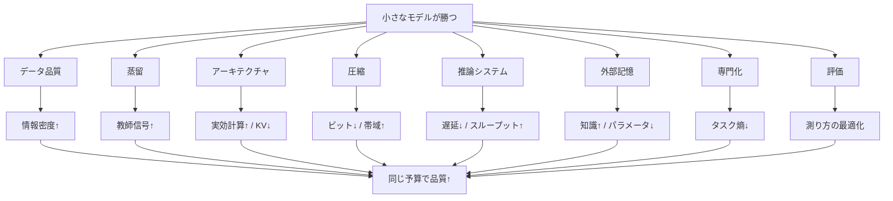
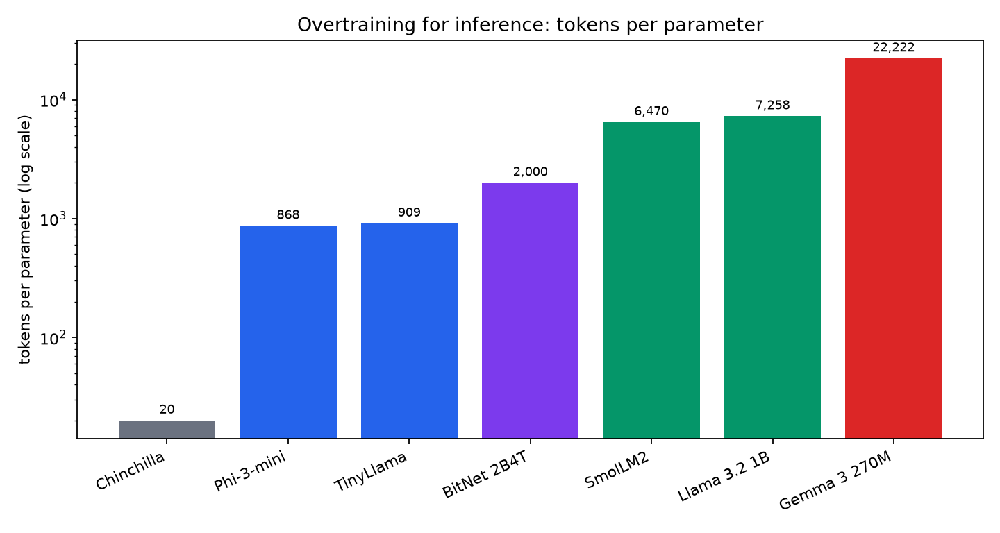
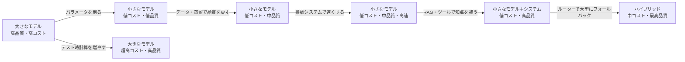
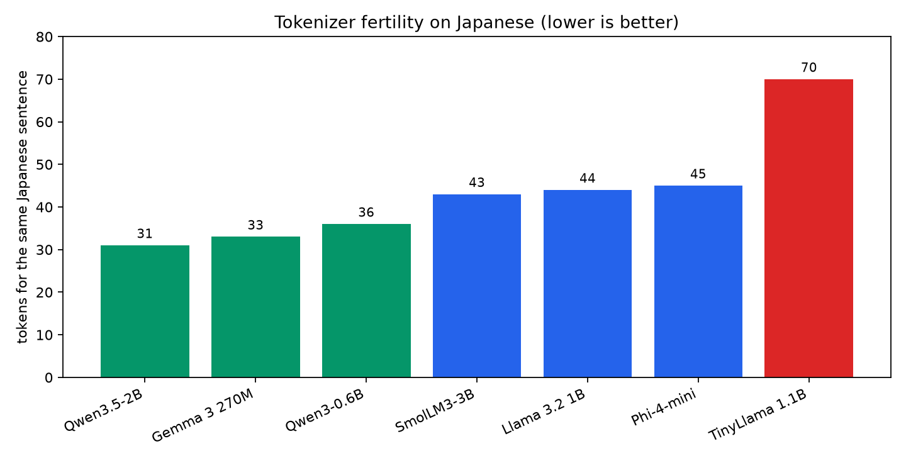
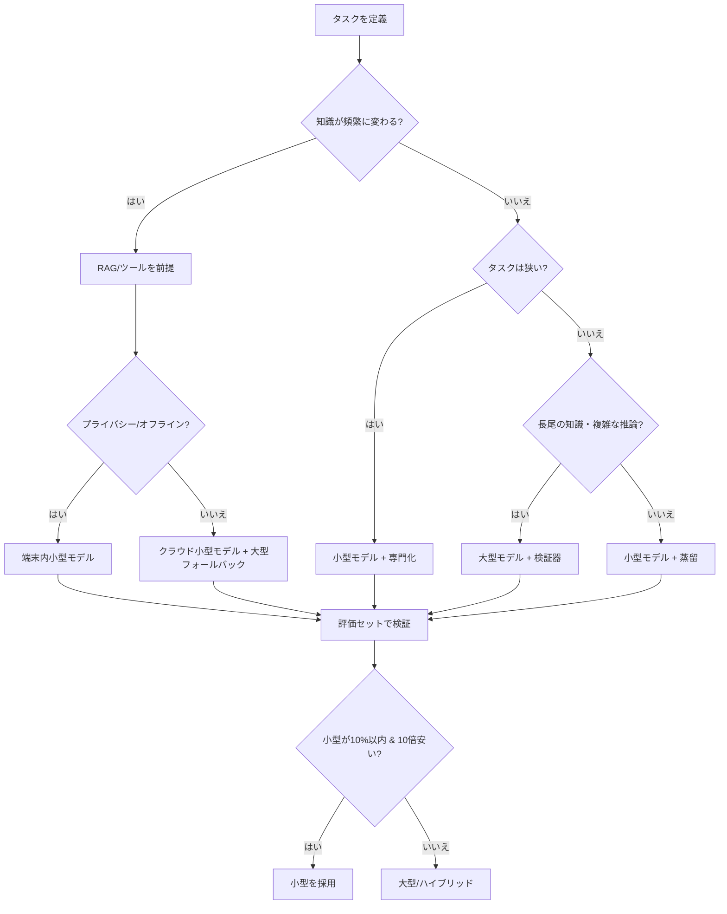
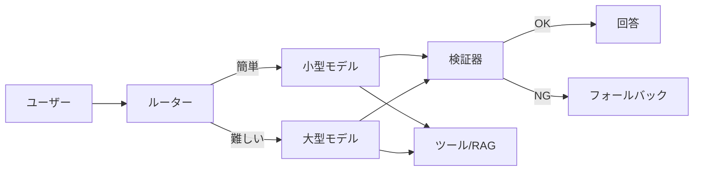
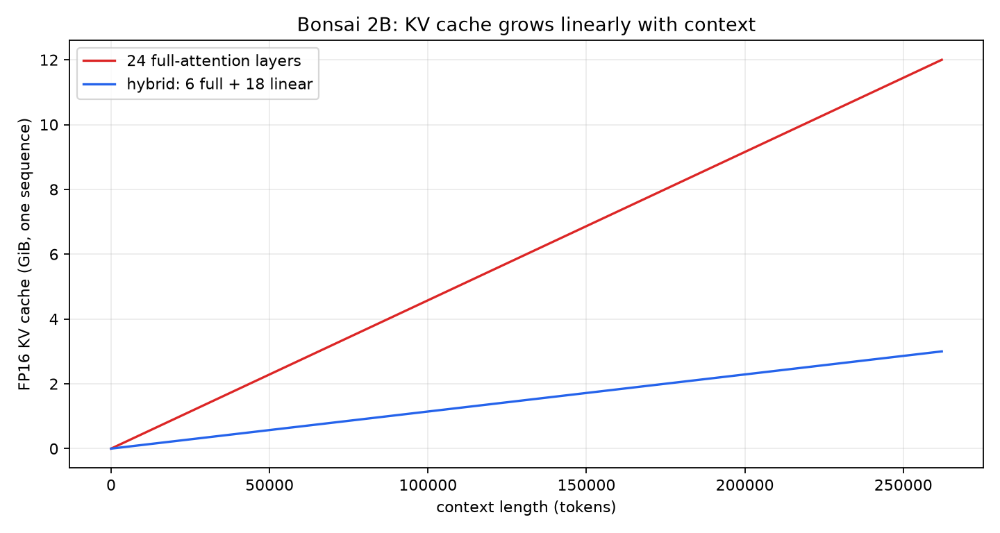

# 小さくても勝てる — Tiny LLM / SLM の設計・逆解析・評価の全書

**副題:** 1.88B・1.75bitブロックの実物を分解し、「小さなモデルが大きなモデルを凌駕する条件」を数式と証拠で確定する

**版:** 1.0（2026-10-25）  
**プロジェクト:** tinySLM-REA  
**ライセンス:** 本文 CC BY 4.0 / コード MIT

---

> 大きなモデルは、図書館全部を暗記した博識な館長。  
> 小さなモデルは、必要な本を一瞬で持ってくる司書であり、  
> その道だけを極めた職人であり、走り屋である。  
> どちらが「賢い」かは、**どの競技を、どの予算で、何のために戦うか**で決まる。

---

## この本の3つの約束

1. **サルでも赤ちゃんでもおじいちゃんでも、最初の10ページで全体像がつかめる。**  
   たとえ話 → 直感 → 数式 → 実物の順で進みます。数式は暗記用ではなく、「なぜ効くのか」を確かめるための道具です。

2. **「小さなモデルが大きなモデルに勝つ」を、宣伝文句ではなく条件として書く。**  
   「勝つとき」と「負けるとき」を同じ熱量で扱います。都合のいい事例だけを並べません。

3. **実物のファイルと実装を分解する。**  
   本プロジェクトは、実際に配布されている 1.88B パラメータの三元量子化モデル（GGUF）と、そのモデルをブラウザで動かす WebGPU バンドルを静的解析しました。推測と観測をラベルで分けます。

### 10分で読むなら

- **第0章**（結論の先出し）→ **第1章**（象と蜂の童話）→ **第2章**（7つの勝ち筋）→ **第12章**（勝ちパターンと負けパターン）→ **付録F**（1ページ要約）
- これだけで「何が起きているか」「どう使えばいいか」「どこで騙されるか」がつかめます。

### 90分で読むなら

- 第0〜8章 + 第11〜12章 + 第16章。技術の仕組みと評価の罠が一通り入ります。

### 徹底的に読むなら

- 全部。第13〜15章は、実際のモデルファイルとブラウザ実装の逆向き解析（リバースエンジニアリング）です。付録Dにファクトチェックの全記録があります。

### 方法論と利益相反

- **一次資料優先:** 論文は arXiv、モデルは Hugging Face のモデルカード、製品は公式ブログを優先しました。主要30本のPDFを取得し、数値と条件を原文で確認しています。
- **3パスのファクトチェック:** ①一次資料の存在、②数値・単位・条件、③文脈・公平性・反証。詳細は付録D。
- **実物の解析:** 配布されている GGUF ファイルと WebGPU バンドルを静的に解析しました。観測・導出・推測・未検証をラベルで区別しています。
- **利益相反:** 本プロジェクトは、特定のモデルベンダーから資金・報酬を受けていません。ベンダー主張は【ベンダー主張】として明示し、独立再現していないことを断っています。

---

## 目次

- [第0章 結論の先出し — 12の文で全体を掴む](#第0章-結論の先出し--12の文で全体を掴む)
- [第1章 童話 — 象と蜂](#第1章-童話--象と蜂)
- [第2章 7つの勝ち筋 — 小ささを武器に変える](#第2章-7つの勝ち筋--小ささを武器に変える)
- [第3章 予算の交換方程式 — タダで勝てるものはない](#第3章-予算の交換方程式--タダで勝てるものはない)
- [第4章 蒸留 — 先生の暗黙知を圧縮する](#第4章-蒸留--先生の暗黙知を圧縮する)
- [第5章 データ — 教科書と量の科学](#第5章-データ--教科書と量の科学)
- [第6章 アーキテクチャ — 脳の形を変える](#第6章-アーキテクチャ--脳の形を変える)
- [第7章 圧縮 — 1.58-bit の魔法と現実](#第7章-圧縮--158-bit-の魔法と現実)
- [第8章 推論 — 時間を買う](#第8章-推論--時間を買う)
- [第9章 外部記憶 — 重みから検索へ](#第9章-外部記憶--重みから検索へ)
- [第10章 専門化 — 狭ければ勝てる](#第10章-専門化--狭ければ勝てる)
- [第11章 評価 — 「勝った」の嘘を見抜く](#第11章-評価--勝ったの嘘を見抜く)
- [第12章 統合 — 勝ちパターンと負けパターン](#第12章-統合--勝ちパターンと負けパターン)
- [第13章 モデルファイルの解剖学](#第13章-モデルファイルの解剖学)
- [第14章 量子化ブロックの逆解析](#第14章-量子化ブロックの逆解析)
- [第15章 ブラウザ実装の逆解析](#第15章-ブラウザ実装の逆解析)
- [第16章 ベンチマーク主張の監査](#第16章-ベンチマーク主張の監査)
- [第17章 設計レシピ — 7日で作るSLM](#第17章-設計レシピ--7日で作るslm)
- [第18章 デプロイ — スマホ・PC・エッジ](#第18章-デプロイ--スマホpcエッジ)
- [第19章 コスト計算機](#第19章-コスト計算機)
- [第20章 リスクと安全](#第20章-リスクと安全)
- [第21章 未来 — 2026-2030](#第21章-未来--2026-2030)
- [付録A 数式の導出](#付録a-数式の導出)
- [付録B 用語集](#付録b-用語集)
- [付録C 参考文献](#付録c-参考文献)
- [付録D ファクトチェック記録](#付録d-ファクトチェック記録)
- [付録E 再現方法](#付録e-再現方法)
- [付録F 1ページ要約 — サルでも赤ちゃんでもおじいちゃんでも](#付録f-1ページ要約--サルでも赤ちゃんでもおじいちゃんでも)

---

# 第0章 結論の先出し — 12の文で全体を掴む

## 0.1 最初に耳元で囁く結論

**「小さなモデルは、大きなモデルより賢い」のではない。**  
**「同じ予算・同じ情報・同じ時間・同じ範囲で比べたとき、小さなモデルのほうが賢く使える」ときに勝つ。**  
これが本書の中心命題です。

この一文を噛み砕くと、次の12の文になります。

### 0.1.1 よくある誤解10

| 誤解 | 現実 |
|---|---|
| 「小さいモデルは、大きいモデルより賢い」 | 同じ土俵では、たいてい大きいほうが賢い。勝つのは別の土俵。 |
| 「パラメータ数が性能を決める」 | データ、蒸留、アーキテクチャ、量子化、推論、RAG、専門化の積で決まる。 |
| 「1.58-bitなら1.58-bitのメモリで動く」 | 実ファイルは1.75〜1.82 bit/weight。スケールとメタデータの分だけ増える。 |
| 「量子化すれば必ず速くなる」 | 専用カーネルが必要。汎用ランタイムでは展開コストで遅くなることも。 |
| 「小さなモデルは安い」 | 推論は安いが、データ・蒸留・評価の開発コストは高い。 |
| 「投機的デコードはいつでも2倍」 | 大きなターゲットでは効くが、2Bでは逆効果になることがある。 |
| 「ベンチマークで勝てば実務でも勝つ」 | ベンチマークは代理指標。汚染・飽和・プロンプト感受性がある。 |
| 「RAGを入れれば知識問題は解決」 | 検索が外れると堂々と間違える。推論は助けない。 |
| 「専門化すれば小さいモデルで十分」 | 分布シフトに弱い。フォールバックと監視が必要。 |
| 「大きなモデルはもう不要」 | 長尾知識、複雑な推論、安全、創造では、まだ大きなモデルが強い。 |

### 0.1.2 12の文

1. **小さなモデルが大きなモデルに勝つのは、同じ土俵では稀。**  
   勝つのは「コスト」「遅延」「プライバシー」「オフライン」「専門性」「大量処理」という別の土俵です。土俵を無視して「3BがGPT-4を超えた」と言うのは、サッカーの点を野球で数えるようなものです。

2. **勝ち筋は7つある。**  
   データ、蒸留、アーキテクチャ、圧縮、推論システム、外部記憶、専門化。この7つを同時に設計したとき、小さなモデルは「そのタスク」で大きなモデルを凌駕できます。

3. **一番効くのは、データと蒸留。**  
   パラメータを削る前に、データを選び、先生の出力で関数を圧縮する。Phi-1（1.3BがHumanEval 50.6%）、Phi-3-mini（3.8BがMMLU 69%）、Phi-4（14BがSTEMでGPT-4o超え）はこの系譜です。ただし、いずれも「狭いベンチ」での話です。

4. **アーキテクチャは「同じパラメータでより賢く」する。**  
   深く薄い形（MobileLLM）、ローカル注意とグローバル注意（Gemma 3）、線形注意と全注意（Qwen3.5 / Bonsai 2B）、Mamba2とTransformer（Nemotron）のハイブリッド、Mixture-of-Experts（MoE）、トークナイザーの改良。特に**KVキャッシュを減らすハイブリッド注意**は、長文を小さなメモリで動かす決定的な武器です。

5. **圧縮は「最後の2〜4倍」を稼ぐ。**  
   4-bit量子化はほぼ無料で2〜4倍のメモリ削減。2-bit/三元は、回転（Hadamard）や量子化対応学習（QAT）なしでは品質が崩れやすい。**「1.58-bit」は魔法の数字ではなく、スケールとメタデータを含めた実ファイルでは1.75〜1.83 bit/weightになる**のが現実です。

6. **推論システムは「時間を買う」技術。**  
   投機的デコード、バッチ処理、KVキャッシュ圧縮、テスト時計算。ただし、**小さなモデルほど投機的デコードの旨みは減る**。Bonsai 2Bは「2Bではドラフトモデルを使うと遅くなった」と明言し、ドラフトモデル/ヘッドを同梱していません（プロンプトルックアップは使用）。これは非常に正直で重要な事例です。

7. **外部記憶とツールは、知識を重みから追い出す。**  
   RAGは「電話帳を暗記する」代わりに「電話をかける」。小さなモデルは、知識を検索し、計算をコードに投げ、判断だけを自分で行うことで、見かけの知識量を何十倍にもできます。ただし、検索品質とツールの誤りが新たな失敗源になります。

8. **専門化は「タスクのエントロピー」を下げる。**  
   汎用チャットは広い分布、専門タスクは狭い分布。狭い分布なら、小さなモデルでも十分な容量で足ります。Gemma 3 4Bの微調整事例（Gemma 3 270Mのブログが紹介）はこの典型です。270Mは同様の専門化をより小さく始める位置づけで、270M自身が大型モデルを超えたという結果ではありません。ただし、分布がずれた瞬間に崩れます。

9. **「小さなモデルがGPT-4を超えた」の9割は、比較のインチキ。**  
   古いGPT-4、狭いベンチ、ベンダー評価、ベンチマーク汚染、プロンプトの有利不利、テスト時計算の差。本書では、代表的な10の主張を「支持できる / 一部支持 / ベンダー主張のみ / 誤解を招く / 誤り」に分類します（第16章）。

10. **評価は「等パラメータ」ではなく「等コスト」でやる。**  
    同じGPU時間、同じ遅延、同じメモリ、同じデータ、同じテスト時計算、同じプロンプト、同じ乱数。この7つを揃えずに「小さいほうが賢い」と言っても意味がありません。**Iso-cost（等コスト）曲線**で比べるのが正解です。

11. **実務の正解は「1つのモデル」ではなく「システム」。**  
    ルーター（振り分け）＋小型モデル（常用）＋大型モデル（フォールバック）＋検証器（間違い探し）＋ツール（検索・計算・DB）。小さなモデルは、このシステムの「主役」にも「脇役」にもなれます。

12. **それでも、大きなモデルが勝つ領域は残る。**  
    長尾の知識、初見の複雑な推論、低資源言語、安全性が極端に重要な場面、独創的な生成。ここは、パラメータ数と訓練データの広さがまだものを言います。小さなモデルの限界を認めることが、正しい設計の第一歩です。

> **本書の中心命題（再掲）**<br>
> 小さなモデルの性能は、パラメータ数 $N$ だけでは決まらない。<br>
> **実効情報量 $I$**（データの質・蒸留・専門化）、**実効計算量 $C$**（アーキテクチャ・MoE・推論システム）、**実効ビット $b$**（量子化）、**外部記憶 $K$**（RAG・ツール）、**テスト時計算 $T$** の積で決まる。<br>
> 小さなモデルが勝つのは、$N$ を削った代わりに $I, C, b, K, T$ を大きくしたときである。

## 0.2 用語の最小セット

| 用語 | 一言でいうと | 本書での扱い |
|---|---|---|
| LLM | 大きな言語モデル。数十B〜数Tパラメータ | 比較対象 |
| SLM | Small Language Model。おおむね 0.1B〜10B | 主役 |
| Tiny LLM | 特に小さい 0.1B〜3B 級 | 主役 |
| パラメータ | モデルの中の調整可能な数値。重み | $N$ |
| 量子化 | 重みを少ないビットで表すこと | $b$ |
| 蒸留 | 大きな先生の振る舞いを小さな生徒に移すこと | $I$ |
| 投機的デコード | 下書きモデルで先に書き、本体で検算する高速化 | $T$ |
| KVキャッシュ | 生成中に過去の注意の計算結果を保存するメモリ | 長文のコスト |
| MoE | 入力を一部の専門家だけに通す仕組み | 実効計算量 |
| RAG | 外部文書を検索してから答える仕組み | $K$ |
| ベンチマーク | モデルの試験問題 | 評価の罠 |

## 0.3 事実ラベルの読み方

本書では、すべての重要な主張に次のラベルを付けます。

- **【観測】** 実際のファイル・バイト列・配布物から直接確認したこと。
- **【導出】** 観測した数値から計算したこと（例：bits/weight、KVキャッシュ量）。
- **【論文】** 一次資料（論文・公式ブログ・モデルカード）に書かれていること。
- **【ベンダー主張】** モデル提供元の自己申告。独立再現はしていないこと。
- **【推測】** 根拠はあるが、断定できないこと。
- **【未検証】** まだ確かめていないこと。断定禁止。

「小さなモデルが大きなモデルを凌駕する」というテーマは、とかく願望が混ざります。本書は、**観測と願望を混ぜない**ことを最優先します。

---

# 第1章 童話 — 象と蜂

## 1.1 ある日の競技会

森に、象と蜂がいました。

象は図書館を丸ごと背負っていました。歴史、科学、文学、料理、法律、なんでも知っています。ただし、歩くのは遅く、本を開くのに時間がかかり、えさ代も膨大です。

蜂は小さな体で、花の匂いを追いかけます。知っていることは少ないけれど、飛ぶのは速く、必要な花を正確に見つけ、仲間に知らせることができます。

森の動物たちが競技会を開きました。

**第1種目「森のすべての花を説明せよ」**  
象の勝ち。圧倒的な知識量。

**第2種目「この一本の花を、1分以内に巣に届けよ」**  
蜂の勝ち。速さと正確さ。

**第3種目「明日咲く花を予想せよ」**  
引き分け。どちらも外すことがあります。

**第4種目「毒の花を見分けよ」**  
象の勝ち。知識の広さと安全性。

この童話の教訓は、**「どちらが賢いか」は競技によって変わる**ということです。そして重要なのは、象と蜂が同じ土俵で戦っていないことです。蜂は「花を届ける」という狭いタスクに特化し、象は「森のすべてを説明する」という広いタスクに特化しています。

## 1.2 小さなモデルの「勝ち」は3種類ある

実務で「小さなモデルが勝つ」と言うとき、実際には3つの異なる勝ち方が混ざっています。

1. **同じタスクで、同じ品質をより安く・速く出す（cost/latency win）**  
   例：分類、固有表現抽出、要約、ルーティング。品質が同じなら、小さいほうが勝ち。

2. **同じタスクで、狭い条件なら品質も上回る（specialization win）**  
   例：社内FAQ、特定のコードベース、特定言語のカスタマーサポート。専門データで微調整すると、汎用の大型モデルより正確になることがある。

3. **大きなモデルでは不可能な制約を満たす（constraint win）**  
   例：オフライン、プライバシー、バッテリー、1桁ミリ秒の応答、端末内処理。これは「勝ち」というより「出場資格」ですが、実務では最も強い勝ち方です。

逆に、**「同じタスクで、同じ条件で、汎用的に、品質も上回る」**という勝ち方は、現在の技術では例外的です。あったとしても、たいていはベンチマークの選び方か比較条件の違いです。

## 1.3 最初に決めるべき3つの質問

モデルを選ぶ前に、必ず次を決めます。

1. **タスクは何か？**  
   「チャット」ではなく、「問い合わせメールを3分類する」「請求書から金額を抽出する」「コードのバグを直す」「社内規程を検索して答える」のように、入出力と成功条件を書く。

2. **予算は何か？**  
   1リクエストあたりのコスト、遅延の上限（P95）、メモリの上限、電力、プライバシー。予算が違えば、同じ品質でも勝者が変わる。

3. **間違えたときのコストは何か？**  
   誤分類1件の損害、誤った医療情報の危険、コードのバグの深刻度。間違いのコストが高いなら、小型モデル＋検証器＋大型フォールバックの3段構えが必要。

この3つを決めずに「どのモデルが一番賢い？」と聞くのは、競技を決めずに「象と蜂どちらが強い？」と聞くのと同じです。

## 1.4 本書の立場

本書は、**小さなモデルを礼賛しません**。  
小さなモデルは、**制約の中で賢く使うと、驚くほど強い**。しかし、**制約を無視すると、大きなモデルにボロ負けする**。この両方を、できるだけ公平に書きます。

---

# 第2章 7つの勝ち筋 — 小ささを武器に変える

## 2.1 勝ち筋の全体像

小さなモデルが大きなモデルに勝つ方法は、大きく7つに分かれます。どれか1つではなく、**複数を同時に効かせる**のがコツです。

| # | 勝ち筋 | 何を小さくするか | 何を大きくするか | 主な証拠 | 効かない条件 |
|---|---|---|---|---|---|
| 1 | データ品質・合成データ | 生データの量、雑音 | 情報密度、多様性、専門性 | Phi-1, TinyStories, SmolLM2 | データが汚い、多様性がない、汚染 |
| 2 | 蒸留 | 生徒のパラメータ | 先生の信号、データ効率 | MiniLLM, GKD, Distillation Scaling | 先生が弱い、容量差が大きすぎる、ライセンス |
| 3 | アーキテクチャ | 実効計算量、KVキャッシュ | 深さ、線形注意、MoE、GQA | MobileLLM, Gemma 3, Nemotron, Bonsai | カーネル未対応、長文品質の劣化 |
| 4 | 圧縮 | ビット数、メモリ | メモリ効率、帯域効率 | GPTQ, AWQ, BitNet, Bonsai | 校正データ不足、極端な低ビット、KVキャッシュ |
| 5 | 推論システム | 遅延、メモリ移動 | スループット、並列性 | Speculative Decoding, Medusa, EAGLE | 小型モデル、ドラフトが弱い、バッチ大 |
| 6 | 外部記憶・ツール | パラメータに覚える知識 | 検索、計算、DB、API | RAG, Self-RAG, agents | 検索品質、ツール誤り、レイテンシ |
| 7 | 専門化 | タスクのエントロピー | ドメイン精度、指示追従 | Gemma 3 4B（270Mブログ）, LoRA, routing | 分布シフト、過学習、評価の狭さ |

そして、**8つ目の勝ち筋は「評価」**です。これは正確には勝ち筋ではなく「勝ちの測り方」ですが、現実には最も強い要因のひとつです。評価を自分のタスクに合わせて作り直すと、小さなモデルの見かけの性能は劇的に変わります。



## 2.2 勝ち筋1: データ品質 — 「量」より「教科書」

**たとえるなら:** 1万本のランダムなYouTube動画を見せるより、厳選された教科書1冊を読ませるほうが、初学者は早く伸びる。

Phi-1は、1.3Bのモデルに「教科書品質」の6Bトークンと、GPT-3.5で生成した1Bトークンの合成教材を読ませ、HumanEvalで50.6%を出しました【論文: S03】。TinyStoriesは、3歳児が知る語彙だけの合成童話で、約10Mパラメータのモデルが一貫した英語を生成できることを示しました【論文: S07】。SmolLM2は、1.7Bを11Tトークンで「過剰学習」させ、FineMath / Stack-Edu / SmolTalkという専門データを混ぜています【論文: S08】。

**なぜ効くのか:** モデルの容量が小さいとき、学習信号の「雑音」が相対的に大きくなります。質の高いデータは、少ないパラメータでも学ぶべきパターンを濃縮します。逆に、大量の雑音は、小さな容量を埋め尽くしてしまいます。

**効かない条件:** データが狭すぎると、汎化しません。合成データは、生成モデルのバイアスを再生産します。ベンチマークと似たデータを混ぜると、スコアは上がりますが、実力は上がりません（第11章）。

## 2.3 勝ち筋2: 蒸留 — 先生の「暗黙知」を圧縮する

**たとえるなら:** 料理のレシピ（正解ラベル）だけを学ぶより、料理長の「火加減の微妙な調整」を隣で見て学ぶほうが、早く上手になる。

蒸留は、大きな先生モデルの出力（確率分布やロジット）を、小さな生徒モデルの学習信号として使います。正解ラベルだけでは「なぜその答えか」「どれくらい自信があるか」「他の選択肢はどれくらい惜しいか」が失われますが、蒸留はそれを伝えます。

**なぜ効くのか:** 先生の確率分布は、クラス間の類似性や不確実性という「暗黙の知識」を含みます。これは、少ないデータでも効率的に学べる信号になります。MiniLLMは逆KL（reverse KL）とオンポリシー最適化で、120M〜13Bの生徒を安定して蒸留できることを示しました【論文: S14】。GKDは、生徒が自分で生成した系列に対して先生がフィードバックする「オンポリシー蒸留」で、露出バイアスを減らします【論文: S13】。

**効かない条件:** 先生が弱い、先生の知識が古い、先生と生徒の容量差が大きすぎる、ライセンス上没有為。Distillation Scaling Lawsは、**生徒の計算量が閾値を超えると、教師あり学習のほうが蒸留より強くなる**ことを示しています【論文: S12】。つまり、蒸留は「先生が既にいて、生徒を安く作りたい」ときに強いのであって、万能ではありません。

## 2.4 勝ち筋3: アーキテクチャ — 脳の形を変える

**たとえるなら:** 同じ人数の会社でも、階層を深くして分業したほうが強いことがある。道路も、全部が幹線道路だと渋滞するので、地元の細い道と幹線道路を組み合わせる。

MobileLLMは、1B未満では「深く薄い」アーキテクチャ、埋め込み共有、GQAが効くことを示し、125M/350Mで2.7%/4.3%の精度向上を報告しました【論文: S09】。Gemma 3は、ローカル注意（1024トークン）とグローバル注意を交互に置き、KVキャッシュを削減しつつ128Kコンテキストを実現しています【論文: S31】。Qwen3.5-2BとBonsai 2Bは、24層のうち18層を線形注意（Gated DeltaNet）、6層を全注意にする3:1ハイブリッドで、262Kコンテキストを可能にしています【論文/モデルカード: S38, S37】。Nemotron Nano 2はMamba2とTransformerのハイブリッドで、同サイズ比最大6倍のスループットを主張しています【ベンダー主張: S28】。

**なぜ効くのか:** 全注意は、系列長に対して二乗で計算とKVキャッシュが増えます。線形注意やSSMは、系列長に対して線形（または固定状態）で済みます。長文では、この差が決定的になります。また、GQA/MQAはKVヘッドを共有してKVキャッシュを減らします。

**効かない条件:** 線形注意は、長文の「細かい参照」が苦手なことがあります。ハイブリッドは実装が複雑で、カーネルが未対応だと速くなりません。MoEは「総パラメータは大きいが、活性パラメータは小さい」ので、メモリは食います。小さな端末では、メモリ帯域がボトルネックになります。

## 2.5 勝ち筋4: 圧縮 — 1.58-bit の魔法と現実

**たとえるなら:** 16-bitは服を丁寧に畳む、4-bitは圧縮袋に入れる、三元（-1, 0, +1）は「3着しか持たないが、組み合わせで何日も乗り切る」ようなもの。

GPTQは175Bモデルを約4 GPU時間で3〜4-bitに量子化し、精度劣化をほぼ無視できるレベルにしました【論文: S26】。AWQは、活性化の大きい1%の重みを守るだけで量子化誤差が大きく減ることを示しました【論文: S25】。BitNet b1.58は、三元重みで同サイズ・同トークンのFP16モデルに匹敵すると報告しています【論文: S10】。Bonsai 2Bは、1.88Bの言語モデルをPTQ1_0（ペイロード1.75 bit/weight）でファイル全体0.43GB（1.8245 bit/param）に収め、BF16の約9分の1のサイズを実現しています【ベンダー主張/観測: S36, S37, S62】。

**なぜ効くのか:** 推論のデコードは、重みをメモリから読む時間が支配的です。ビット数を下げると、同じ帯域でより多くのトークンを生成できます。メモリ容量も減り、端末に載ります。

**効かない条件:** 極端な低ビットは、量子化誤差が大きくなります。特に、長い推論、数学、コード、埋め込み、KVキャッシュは敏感です。Scaling Laws for Precisionは、**訓練データを増やすほど、固定ビットでの量子化劣化が大きくなり、やがて追加データが有害になる**ことを示しています【論文: S40】。また、専用カーネルがないと、BitNetの省エネ・高速性は発揮されません【ベンダー注意: S11】。

## 2.6 勝ち筋5: 推論システム — 時間を買う

**たとえるなら:** 料理長（本体モデル）が最終確認する間に、下ごしらえ担当（ドラフトモデル）が野菜を切っておく。料理長が「OK」と言えば、一気に3皿出せる。

投機的デコードは、小さなドラフトモデルが複数トークンを先に生成し、本体モデルがまとめて検証します。出力分布は変えずに、2〜3倍の高速化が可能です【論文: S15, S16】。Medusaは追加のヘッドで2.2〜2.8倍【論文: S17】、EAGLE-2は3.05〜4.26倍【論文: S18】、EAGLE-3は最大6.5倍を報告しています【論文: S19】。

**なぜ効くのか:** 自己回帰生成は、1トークンごとにモデル全体をメモリから読むため、GPUの計算資源が余ります。複数トークンを並列に検証すると、メモリ帯域を有効活用できます。

**効かない条件:** ターゲットモデルが小さいと、ドラフトのコストが相対的に大きくなり、逆効果になります。Bonsai 2Bは「2Bではドラフトヘッド付きの投機的デコードが日常的なプロンプトで遅かった」として、2Bにはドラフトモデル/ヘッドを同梱していません（プロンプトルックアップは使用）【ベンダー主張: S37】。また、実装によってはgreedy専用になります（第15章のWebGPU実装がその例）。一般の投機的サンプリングは、出力分布を保つように設計できます。

## 2.7 勝ち筋6: 外部記憶 — 重みから検索へ

**たとえるなら:** 電話帳を全部暗記する代わりに、電話をかける。暗記量は減るが、最新の番号にも対応できる。

RAGは、外部文書を検索し、その内容を条件に生成します【論文: S54】。Self-RAGは、検索が必要かどうかを自分で判断し、検索結果を批判的に評価します【論文: S55】。

**なぜ効くのか:** 知識をパラメータから分離できるため、小さなモデルでも最新情報や社内情報にアクセスできます。更新も、再訓練ではなくインデックス更新で済みます。

**効かない条件:** 検索が外れると、堂々と間違えます。チャンク分割、埋め込みモデル、リランカー、プロンプト注入、レイテンシ。RAGは「知識」を助けますが、「推論」は助けません。多段の推論が必要なら、ツール（コード実行、計算機、DB）や検証器が必要です。

## 2.8 勝ち筋7: 専門化 — 狭ければ勝てる

**たとえるなら:** 総合病院の医師より、その手術だけを1万回やってきた専門医のほうが、その手術では上手い。

Gemma 3 270Mのブログは、SK Telecomのコンテンツモデレーションで、Gemma 3 4Bを微調整したモデルが「はるかに大きなプロプライエタリモデル」を上回ったと紹介しています【ベンダー主張: S35】。Llama 3.2 3Bは、指示追従・要約・プロンプト書き換え・ツール使用でGemma 2 2.6BやPhi 3.5-miniを上回ると報告されています【ベンダー主張: S34】。

**なぜ効くのか:** タスクの分布が狭いと、モデルが覚えるべきパターンが減り、同じ容量でも精度が上がります。専門データで微調整すると、汎用モデルが苦手なドメイン用語や出力形式を学習できます。

**効かない条件:** 分布シフト。社内データで微調整したモデルは、社外の質問に弱くなります。過学習、破滅的忘却、評価の狭さ。専門化は「狭いがゆえに強い」のであり、「狭いがゆえに脆い」のです。

## 2.9 8つ目の勝ち筋: 評価を自分のタスクに合わせる

これは「ズル」ではありません。**汎用ベンチマークで勝つこと**と、**あなたのタスクで勝つこと**は別です。MMLUで90点のモデルが、あなたの請求書抽出で60点しか取らないことは普通にあります。

自分のタスクの「ゴールデンセット」を100〜1,000件作り、モデルを比べる。これが、最も確実に「小さなモデルが勝つ」方法です。ただし、評価セットを訓練に混ぜないこと。評価セットに似たデータを訓練に混ぜると、スコアは上がりますが、実力は上がりません（第11章）。

## 2.10 7つの勝ち筋の相互作用

これらの勝ち筋は、独立ではありません。例えば：

- **蒸留 × 量子化:** 先生の分布を生徒に移し、生徒を4-bitに圧縮すると、品質を保ちながらメモリを削れる。
- **アーキテクチャ × 蒸留:** ハイブリッド注意の生徒は、長文の蒸留データで強くなる。
- **専門化 × RAG:** 専門用語の検索と、専門タスクの微調整を組み合わせる。
- **推論システム × 圧縮:** 4-bitモデルはメモリ帯域が減り、投機的デコードの相対コストが変わる。
- **データ × 評価:** 評価セットを先に作り、データをそれに合わせる（ただし汚染しない）。

**最強の組み合わせ**は、だいたい次の形です。

> 小さなベースモデル（1〜4B）  
> ＋ 高品質な専門データで蒸留・微調整  
> ＋ ハイブリッド注意で長文対応  
> ＋ 4-bit/三元で端末に搭載  
> ＋ RAG/ツールで知識を補う  
> ＋ ルーターで大型モデルにフォールバック  
> ＋ 自分のタスクの評価セットで検証

これは、本書の第17章で「7日で作るSLM」として具体的なレシピにします。

## 2.11 まとめ — 小ささは「武器」ではなく「取引」

小さなモデルは、次の取引をしています。

- パラメータを削る代わりに、**データの質**を上げる。
- 知識を削る代わりに、**検索**を使う。
- 計算を削る代わりに、**アーキテクチャ**を工夫する。
- 精度を削る代わりに、**速度・コスト・プライバシー**を得る。
- 汎用性を削る代わりに、**専門性**を得る。

この取引が成立するとき、小さなモデルは大きなモデルに勝ちます。取引が成立しないとき、小さなモデルはただの「安物」です。**小ささは武器ではなく、取引**なのです。

---

# 第3章 予算の交換方程式 — タダで勝てるものはない

## 3.1 推論のコストは3つの数字で決まる

モデルを動かすとき、主に3つのコストがあります。

1. **計算量（FLOPs）** — 1トークン生成するのに何回の足し算・掛け算をするか。
2. **メモリ量（bytes）** — 重みとKVキャッシュをどれだけ保持するか。
3. **メモリ帯域（bytes/s）** — 重みをどれだけ速く読めるか。

デコード（1トークンずつ生成）では、**メモリ帯域**が支配的になります。なぜなら、1トークン生成するたびに、モデルの全重みをメモリから読む必要があるからです。GPUの計算ユニットは、データが来るのを待っています。これを「メモリ帯域律速」と呼びます。

### 3.1.1 基本式

重みのパラメータ数を $N$、1重みあたりのビット数を $b$ とすると、重みのサイズは：

$$
M_{\text{weights}} \approx \frac{N \cdot b}{8} \quad \text{bytes}
$$

1トークン生成あたりの計算量は、おおよそ：

$$
\text{FLOPs/token} \approx 2 N_{\text{active}}
$$

（行列積1回につき、掛け算と足し算で2 FLOPs。Attentionの分は別途。）

メモリ帯域を $BW$ とすると、バッチサイズ1の理論スループットは：

$$
\text{tok/s} \approx \frac{BW}{M_{\text{weights}} + M_{\text{KV}}}
$$

### 3.1.2 計算例

| モデル | パラメータ | ビット | 重みサイズ | 100GB/sでの理論tok/s | 50GB/sでの理論tok/s |
|---|---:|---:|---:|---:|---:|
| 7B FP16 | 7.0B | 16 | 14.0GB | 7.1 | 3.6 |
| 7B 4-bit | 7.0B | 4.5 | 3.9GB | 25.6 | 12.8 |
| 3B FP16 | 3.0B | 16 | 6.0GB | 16.7 | 8.3 |
| 3B 4-bit | 3.0B | 4.5 | 1.7GB | 58.8 | 29.4 |
| 1.88B 1.75-bit（ペイロード） | 1.88B | 1.75 | 0.41GB | 244 | 122 |
| 0.6B FP16 | 0.6B | 16 | 1.2GB | 83 | 42 |
| 0.6B 4-bit | 0.6B | 4.5 | 0.34GB | 294 | 147 |

（KVキャッシュとオーバーヘッドは無視。実際のスループットはカーネル効率、バッチ、コンテキスト長で大きく下がる。）

この表からわかることは単純です。**7B FP16は重みだけで14GBあり、スマホのメモリ容量に載りません**。7B 4-bitなら載るが、50GB/sで12.8 tok/s程度。1.88B 1.75-bit（ペイロード0.41GB）なら、同じ帯域で122 tok/s。これが、端末で動く小さなモデルの意味です。

ただし、これは「理論値」です。実際には、カーネルの効率、KVキャッシュ、バッチ処理、OSのオーバーヘッドで、2〜5倍遅くなります。Bonsai 2BがiPhone 17 Pro Maxで90 tok/sというのは、**PQ2_0（0.52GB）の最速パック、tg128・batch 1のデコード速度**です【ベンダー主張: S36】。実効帯域を約100GB/sと仮定すると理論192 tok/s、実測90 tok/sは約2.1倍遅い（カーネル効率0.47）計算になります。また、思考モードでは3,000+トークンを生成することもあるため、90 tok/sでも体感は30秒〜1分超になり得ます。PTQ1_0（0.43GB）はApple SiliconではPQ2_0より遅い可能性があります。

## 3.2 訓練のコストは「6ND」

訓練の計算量は、おおよそ：

$$
\text{FLOPs}_{\text{train}} \approx 6 N D
$$

ここで $D$ は訓練トークン数です。係数6は、順伝播（2ND）＋逆伝播（4ND）から来ます。

Chinchillaは、70Bモデルを1.4Tトークンで訓練し、同じ計算予算のGopher 280Bを上回りました【論文: S01】。この「計算最適」の比率は、およそ **20トークン/パラメータ**です。

しかし、これは**訓練**の最適点です。**推論**のコストを入れると、話が変わります。Beyond Chinchilla-Optimalは、約10億リクエストを処理するなら、Chinchilla最適より**小さく、長く**訓練したほうが良いと示しました【論文: S39】。彼らの実験では、10,000トークン/パラメータまで品質が伸び続けました。

### 3.2.1 実世界の「過剰学習」比率

| モデル | パラメータ | 訓練トークン | トークン/パラメータ | 備考 |
|---|---:|---:|---:|---|
| Chinchilla | 70B | 1.4T | 20 | 訓練最適 |
| Phi-3-mini | 3.8B | 3.3T | 868 | 推論最適寄り |
| TinyLlama | 1.1B | 1.0T | 909 | 3 epochs |
| BitNet 2B4T | 2B | 4T | 2,000 | ネイティブ1.58-bit |
| SmolLM2 | 1.7B | 11T | 6,470 | 11Tトークン |
| Llama 3.2 1B | 1.24B | 9T | 7,258 | 蒸留＋pruning |
| Gemma 3 270M | 270M | 6T | 22,222 | 極端な過剰学習 |



*図: 訓練トークン/パラメータ比。小さいモデルほど、推論コストを下げるために「過剰学習」している。*

この表と図は、**「小さなモデルは、訓練では損をして、推論で得をする」**という構造を示しています。小さなモデルを大量のトークンで訓練するのは、訓練コストは増えますが、推論コストは下がります。リクエスト数が多いほど、この取引は有利になります。

## 3.3 KVキャッシュ — 長文の隠れたコスト

Transformerの全注意は、過去のKeyとValueを保存します。そのサイズは：

$$
M_{\text{KV}} = L_{\text{full}} \times H_{\text{kv}} \times (d_k + d_v) \times T \times \text{bytes}
$$

ここで $L_{\text{full}}$ は全注意層の数、$H_{\text{kv}}$ はKVヘッド数、$d_k, d_v$ はKey/Valueの次元、$T$ はコンテキスト長です。$d_k + d_v$ がすでにKeyとValueの両方を含むことに注意してください（$2 \times d_{\text{head}}$ と書いても同じ）。

Bonsai 2B（24層、2 KVヘッド、Key/Value各256次元）で、262,144トークンのKVキャッシュを計算すると：

- **全層が全注意なら:** 12.0GiB（12.9GB、10進。1シーケンス、FP16）
- **18層が線形注意、6層が全注意なら:** 3.0GiB（3.2GB）
- **32Kコンテキストなら:** 0.375GiB（0.40GB）
- **32K + INT8 KVキャッシュなら:** 0.1875GiB

この差が、ハイブリッド注意の威力です。262Kコンテキストを「ネイティブにサポート」と言っても、実際に262KをFP16で確保すると3GiBです。重み0.43GBと合わせて約3.4GiBなので、6GBのアプリ制限に収まる可能性はありますが、余裕は大きくありません。端末では、コンテキストを32Kに落とすか、KVキャッシュを量子化するのが安全です。Bonsaiの「iPhoneで動く」という主張は、モデル重みだけでなく、KVキャッシュの設計とランタイムのメモリ管理を含めて初めて成立します。

## 3.4 「タダで勝てるものはない」定理

ここまで読むと、夢のような話に見えるかもしれません。しかし、すべての「小さなモデルの勝ち」には、必ず支払いがあります。

| 勝ち筋 | 支払うもの |
|---|---|
| データ品質 | キュレーションの人手・計算・ライセンス |
| 蒸留 | 先生の訓練コスト、先生の推論コスト、ライセンス |
| アーキテクチャ | 設計・実装・カーネル開発の工数、品質の不確実性 |
| 圧縮 | 量子化の品質劣化、校正データ、専用カーネル |
| 投機的デコード | ドラフトモデルのメモリ・訓練・検証コスト |
| RAG | 検索インデックス、埋め込み、レイテンシ、保守 |
| 専門化 | データ収集、分布シフト、再訓練、評価 |
| 評価 | ゴールデンセットの作成、保守、汚染対策 |

**「小さいから安い」は、しばしば嘘です。** 小さいモデルを良い品質にするために、データ、蒸留、評価に多大なコストを払っているからです。表面の推論コストだけを見て「小さいほうが安い」と判断すると、開発コストを見落とします。

## 3.5 等コスト曲線 — 勝負は「同じ予算」で見る

モデルA（大）とモデルB（小）を比べるとき、パラメータ数ではなく、**同じコスト**で比べます。これを**Iso-cost（等コスト）比較**と呼びます。



同じ1リクエストあたりのコスト（または同じP95遅延、同じメモリ）で比べると、小さなモデル＋データ＋蒸留＋推論＋RAGの組み合わせが、大きなモデルを上回る領域があります。これが「小さなモデルが勝つ」の正しい意味です。

## 3.6 5つの交換レート

本書の実践編で使う「交換レート」をまとめます。

1. **パラメータ ↔ データ**: パラメータを半分にしたら、データを2倍以上に増やし、質を上げる。
2. **パラメータ ↔ ビット**: パラメータを半分にしたら、ビットを半分にしてメモリを保つ。ただし品質劣化に注意。
3. **パラメータ ↔ 時間**: パラメータを半分にしたら、テスト時計算を2倍にして推論する。ただし遅延が増える。
4. **パラメータ ↔ 文脈**: パラメータを半分にしたら、RAGで知識を補う。ただし検索誤りが増える。
5. **パラメータ ↔ 範囲**: パラメータを半分にしたら、タスクを半分に絞る。ただし分布シフトに弱くなる。

この交換レートを意識すると、「このモデルは本当に小さいのか？」「この勝ちは本物か？」が判断できるようになります。

## 3.7 まとめ — 小ささの会計学

- 推論のデコードはメモリ帯域律速。ビットとパラメータを下げると速くなる。
- 訓練は6ND。推論需要が大きいほど、小さく長く訓練するのが有利。
- KVキャッシュは長文の隠れた主役。ハイブリッド注意と量子化で削る。
- すべての勝ちには支払いがある。表面の推論コストだけを見ない。
- 比較は等コストで。パラメータ数は「車の排気量」のようなもの。速さは車重、空気抵抗、タイヤ、道路で決まる。

---

# 第4章 蒸留 — 先生の暗黙知を圧縮する

## 4.1 たとえ話 — レシピではなく「手つき」を学ぶ

料理を学ぶとき、レシピ本だけを読む人がいます。材料、分量、手順はわかります。でも、料理長の「火加減」「鍋の傾け方」「 salt を入れるタイミング」は、レシピには書かれていません。

蒸留（distillation）は、この「手つき」を学ぶ技術です。先生モデルは、正解ラベルだけでなく、**どの答えをどれくらい自信を持って選んだか**という確率分布を出します。生徒モデルは、その分布を真似ることで、正解ラベルだけでは学べない「暗黙の知識」を学びます。

## 4.2 蒸留の3つのレベル

| レベル | 何を移すか | 例 | 長所 | 短所 |
|---|---|---|---|---|
| ロジット蒸留 | 先生の各トークンの確率（上位k個） | HintonのKD、MiniLLM | 信号が濃い | 先生の語彙・推論コストが必要 |
| 系列蒸留 | 先生が生成した文章そのもの | SeqKD、Phiの合成データ | 実装が簡単 | 露出バイアス、多様性低下 |
| オンポリシー蒸留 | 生徒が生成した系列に対する先生のフィードバック | GKD、MiniLLM | 露出バイアスを減らす | 実装が複雑、計算コスト |

### 4.2.1 ロジット蒸留

先生の出力確率 $p_T(y|x)$ と生徒の出力確率 $p_S(y|x)$ の差を小さくします。温度 $T$ を上げると、分布が滑らかになり、クラス間の類似性（dark knowledge）が学びやすくなります。

$$
\mathcal{L}_{\text{KD}} = -\sum_y p_T(y|x) \log p_S(y|x)
$$

これは**前方KL（forward KL）**と呼ばれます。生徒は先生の分布の全体をカバーしようとします。そのため、先生が低確率ながら持っている多様な選択肢も学びますが、生徒の容量が小さいと、低確率領域に無駄な確率を割り当ててしまいます。

### 4.2.2 逆KL（reverse KL） — MiniLLMの貢献

MiniLLMは、前方KLではなく**逆KL**を使います【論文: S14】。

$$
\mathcal{L}_{\text{reverse}} = -\sum_y p_S(y|x) \log \frac{p_S(y|x)}{p_T(y|x)}
$$

逆KLは、生徒が先生の「山」の部分を優先的に学び、先生が低確率の領域にはあまり行かないようにします。これを**mode-seeking（モード探索）**と呼びます。生成タスクでは、先生の最も良い振る舞いを確実に再現するほうが重要なので、逆KLのほうが適していることが多いのです。

ただし、逆KLは多様性を減らす方向に働きます。同じプロンプトにいつも同じ答えを出すようになることがあります。クリエイティブな生成では、前方KLや温度調整とのバランスが必要です。

### 4.2.3 オンポリシー蒸留 — 自分の失敗から学ぶ

通常の蒸留は、先生が生成した固定のデータで生徒を訓練します。しかし、生徒は推論時に自分の出力を生成するので、訓練時と推論時の分布がずれます。これを**露出バイアス（exposure bias）**と呼びます。

GKDは、生徒が自分で生成した系列に対して、先生が「その続きはどれくらい良いか」をフィードバックします【論文: S13】。生徒は自分の失敗から学ぶことができ、推論時の分布に近い状態で訓練できます。これは、強化学習の考え方を蒸留に取り入れたものです。

## 4.3 なぜ蒸留で小さなモデルが強くなるのか

蒸留の効果は、主に3つです。

1. **データ効率**: 正解ラベル1つではなく、先生の分布全体が信号になる。同じデータから何倍もの情報を引き出せる。
2. **関数の圧縮**: 先生の「入力→出力」の写像を、生徒の容量に合わせて圧縮する。単なる重みのコピーではなく、振る舞いの圧縮。
3. **校正（calibration）**: 先生の自信の付け方を学ぶ。これは、不確実性の推定や、ルーティングに重要。

特に、**小さなモデルは容量が小さい**ので、正解ラベルだけでは足りません。先生の分布は、少ない容量に詰め込むための「濃縮された教材」になります。

## 4.4 蒸留の限界 — 先生を超えられるか？

「生徒が先生を超える」ことはあるのでしょうか？

**純粋な蒸留では、原則として先生を超えません。** 生徒は先生の分布を近似しているだけだからです。しかし、次の条件が揃うと、生徒は先生を超えることがあります。

1. **追加データ**: 先生が知らないデータを生徒に与える。
2. **検証器・RL**: 正解を検証できるタスクで、生徒を強化学習する。
3. **データ生成**: 先生を使って新しい高品質データを作り、それを生徒に学ばせる。
4. **専門化**: 狭いタスクに絞り、そのタスクのデータで微調整する。

Phi-4は、14BのモデルがGPT-4（先生）をSTEM系のQAで上回ったと報告しています【論文: S06】。これは純粋な蒸留の勝利ではなく、**合成データの生成、カリキュラム、ポストトレーニング**の勝利です。この区別は重要です。「蒸留すれば先生を超えられる」と一般化すると、間違えます。

Distillation Scaling Lawsは、蒸留が教師あり学習より効率的になるのは、**生徒の計算量が生徒サイズに依存する閾値以下のとき**であり、**先生が既に存在するか、先生に別の用途があるとき**だとしています【論文: S12】。生徒1人だけのために先生を訓練するなら、教師あり学習のほうが良いことが多いのです。

## 4.5 実例 — Llama 3.2、Gemma 3、DeepSeek-R1

- **Llama 3.2 1B/3B**: Llama 3.1 8Bから構造的pruningし、8Bと70Bのロジットで蒸留。1B/3Bでありながら、以前の世代のより大きなモデルに匹敵する性能を目指しています【ベンダー主張: S34】。
- **Gemma 3**: 全モデルが蒸留で訓練され、Gemma 2より高い性能を達成したと報告されています【論文: S31】。特にGemma 3 4B-ITはGemma 2 27B-ITに匹敵すると主張されています。
- **DeepSeek-R1**: 大型のR1の推論能力を、QwenやLlamaの小型モデルに蒸留しています【論文: S67】。ここでは「推論の連鎖」を蒸留するので、単なるロジット蒸留より系列蒸留に近い。

## 4.6 蒸留の実践チェックリスト

- [ ] 先生は十分に強いか？ 先生の弱点を生徒に移していないか？
- [ ] 先生と生徒の容量差は適切か？ 差が大きすぎると、生徒が学びきれない。
- [ ] 蒸留データは、実際のタスク分布をカバーしているか？
- [ ] 前方KLか逆KLか？ 生成タスクなら逆KL/オンポリシーを検討したか？
- [ ] 温度、上位k、損失の重みは調整したか？
- [ ] 蒸留後のモデルを、自分のタスクのゴールデンセットで評価したか？
- [ ] 先生のライセンスは、生徒の配布を許すか？
- [ ] 蒸留の計算コスト（先生の推論）を見積もったか？

## 4.7 まとめ — 蒸留は「圧縮」ではなく「教育」

蒸留は、モデルを小さくする技術というより、**先生の振る舞いを生徒に教育する技術**です。良い先生、良い教材、良いカリキュラムが必要です。そして、生徒が先生を超えるのは、蒸留の外側にあるデータと検証の力によってです。

---

# 第5章 データ — 教科書と量の科学

## 5.1 たとえ話 — 1万本の動画か、1冊の教科書か

小さなモデルに学習させるデータを選ぶとき、よく「量が大事」と言われます。しかし、小さなモデルにとっては、**質のほうが効く**ことが多いのです。

1万本のランダムなYouTube動画には、料理、猫、車、政治、ゲームが混ざっています。1冊の教科書には、体系的な知識が詰まっています。初学者が短時間で成長するには、教科書のほうが効率的です。

## 5.2 Phi-1とTinyStories — 「教科書」の威力

Phi-1は、1.3Bのモデルに「教科書品質」の6Bトークンと、GPT-3.5で生成した1Bトークンの合成教材を読ませ、HumanEvalで50.6%、MBPPで55.5%を達成しました【論文: S03】。これは、当時の同じサイズのモデルをはるかに超える成績でした。

TinyStoriesは、3歳児が知る語彙だけの合成童話で、約10Mパラメータのモデルが一貫した英語を生成できることを示しました【論文: S07】。これは「小さなモデルでも、分布が狭ければ言語能力が創発する」ことを示す重要な証拠です。

ただし、これらの結果は**狭い分布**での話です。TinyStoriesの10Mモデルは、一般の英語を理解するわけではありません。Phi-1も、コードのベンチマークに特化しています。**「データの質で小さなモデルが賢くなる」は、タスクの分布が限定されているときの話**です。

## 5.3 SmolLM2 — 11Tトークンの過剰学習

SmolLM2は、1.7Bのモデルを約11Tトークンで訓練しました【論文: S08】。これは、Chinchillaの20トークン/パラメータの比で言えば、**6,470トークン/パラメータ**という異常な過剰学習です。

なぜそんなことをするのか？ それは、**推論コストを下げるため**です。小さなモデルを大量に訓練すると、訓練コストは増えますが、推論コストは下がります。リクエスト数が多いサービスでは、この取引が有利になります。

SmolLM2は、単に量を増やしただけでなく、多段階のカリキュラムを組み、FineMath（数学）、Stack-Edu（コード）、SmolTalk（指示追従）という専門データを混ぜています。**量と質の両方**が重要です。

## 5.4 DataComp-LMとRho-1 — データ選択の科学

DataComp-LM（DCLM）は、240TトークンのCommon Crawlから、412M〜7Bのモデルでデータ選択戦略を比較するベンチマークです【論文: S65】。彼らの結果は、**モデルベースのフィルタリングが最も効く**ことを示しています。単にWebをクロールするのではなく、品質分類器で選別することが重要です。

Rho-1は、「すべてのトークンが同じ価値を持つわけではない」という考え方です【論文: S66】。参照モデルを使って、学習に有用なトークンを選別し、選択的に言語モデリングを行います。小さなモデルほど、無駄なトークンに容量を割く余裕がありません。

## 5.5 合成データ — 約束と崩壊

合成データは、小さなモデルを強くする強力な手段です。Phi-4は、合成データを訓練全体に戦略的に組み込み、STEM系の性能を大きく上げました【論文: S06】。しかし、合成データには罠があります。

- **モデル崩壊（model collapse）**: 生成モデルの出力で訓練を繰り返すと、分布が狭くなり、多様性が失われる。
- **バイアスの再生産**: 先生の間違いや偏見を、生徒が学習する。
- **ベンチマーク汚染**: 合成データがベンチマークに似すぎると、スコアだけが上がる。

合成データを使うときは、**検証器（verifier）**で品質をチェックし、多様性を確保し、実データと混ぜるのが鉄則です。

## 5.6 トークナイザー — データの入口の効率

ここで、見落とされがちな重要因子、**トークナイザー**の話をします。

言語モデルは、テキストを「トークン」に分割して処理します。日本語のように、単語の区切りが曖昧で、文字種が多い言語では、トークナイザーの効率がモデルのコストと性能に直結します。

本プロジェクトでは、同じ日本語の文を複数のトークナイザーで分割し、トークン数を比較しました【導出: S59, S62】。

| モデル | 語彙サイズ | 日本語文のトークン数 | 英語文のトークン数 |
|---|---:|---:|---:|
| Qwen3.5-2B | 248,320 | **31** | 25 |
| Gemma 3 270M | 262,144 | 33 | 25 |
| Qwen3-0.6B | 151,936 | 36 | 25 |
| SmolLM3-3B | 128,256 | 43 | 25 |
| Llama 3.2 1B | 128,256 | 44 | 26 |
| Phi-4-mini | 200,064 | 45 | 24 |
| TinyLlama 1.1B | 32,000 | **70** | 26 |

（日本語文：`小さなモデルが大きなモデルに勝つためには、データの質、蒸留、量子化、推論時の工夫、そして評価の公正さが重要です。` 英語文：`A small model can outperform a large model when the task is narrow, the data is clean, and inference cost matters.`）

TinyLlamaのトークナイザーは、日本語の漢字をバイト単位で分割するため、同じ文が70トークンになります。Qwen3.5-2Bは31トークン。**同じ文章を処理するのに、2.26倍の計算とメモリを使う**ことになります。



*図: 同じ日本語文を分割したときのトークン数。少ないほど、同じ文章を安く・長く扱える。*

これは、日本語のアプリケーションでは決定的です。パラメータ数が同じでも、トークナイザーが良いモデルのほうが、実効的なコンテキスト長が長く、コストが低く、速度が速くなります。

### 5.6.1 大きな語彙の代償

ただし、大きな語彙には代償があります。埋め込み行列のパラメータ数は、`語彙サイズ × 隠れ次元`です。Gemma 3 270Mは、270Mのうち**170M（約63%）が埋め込み**で、Transformerブロックは100Mしかありません【ベンダー主張: S35】。Qwen3.5-2Bは、1.88Bのうち**508M（27%）が埋め込み**です【導出: S62】。

つまり、**「270Mモデル」と言っても、実質のTransformerは100M**ということです。パラメータ数の比較は、埋め込みを含むか含まないかで大きく変わります。小さなモデルを選ぶときは、**非埋め込みパラメータ**と**トークナイザー效率**をセットで見る必要があります。

## 5.7 データの汚染 — ベンチマークを混ぜるな

データの質と同じくらい重要なのが、**汚染（contamination）**です。ベンチマークの問題が訓練データに混ざると、モデルは「理解」ではなく「暗記」でスコアを上げます。

MMLU-CFは、汚染のないテストセットでGPT-4oが73.4%だったと報告しています【論文: S42】。MMLUでよく報告される約88%と比べると、大きな差です（テストセットが違うので直接比較はできませんが、汚染の影響を示す証拠です）。GSM1kは、GSM8Kに似た新しい問題で、最大8%の精度低下を観測しました【論文: S43】。

小さなモデルは、大きなモデルよりベンチマークに過適合しやすい面があります。データが少ないので、ベンチマークと似たデータの影響が相対的に大きくなるからです。**「小さなモデルがベンチマークで勝った」ときは、まず汚染を疑う**のが正しい態度です。

## 5.8 データの実践チェックリスト

- [ ] タスクの分布を定義したか？ 訓練データはそれをカバーしているか？
- [ ] 重複除去（dedup）をしたか？ 近似重複も含めて。
- [ ] 品質フィルタ（モデルベース、ルールベース）を入れたか？
- [ ] 合成データの割合は適切か？ 検証器を通したか？
- [ ] ベンチマークとの重複を検査したか？
- [ ] トークナイザーの日本語・多言語の効率を測ったか？
- [ ] 埋め込みパラメータを含めた実効サイズを見たか？
- [ ] データのライセンスを確認したか？

## 5.9 まとめ — データは「量」ではなく「設計」

小さなモデルにとって、データは量より設計です。何を、どれくらい、どの順番で、どの品質で与えるか。これは、モデルのアーキテクチャと同じくらい重要な設計変数です。そして、トークナイザーはデータの入口であり、その効率は日本語のような言語では特に重要です。

---

# 第6章 アーキテクチャ — 脳の形を変える

## 6.1 たとえ話 — 同じ人数でも、組織の形で強さが変わる

同じ100人の会社でも、全員が社長に直接報告する組織と、階層を深くした組織では、できる仕事が違います。道路も同じです。全部が幹線道路だと渋滞しますが、地元の細い道と幹線道路を組み合わせると、全体の流れが良くなります。

モデルのアーキテクチャも同じです。パラメータ数が同じでも、**層の深さ、注意の種類、専門家の分け方、トークナイザー**で、実効的な賢さと速さが変わります。

## 6.2 深さと幅 — MobileLLMの発見

小さなモデルでは、「広く浅く」より「**深く薄く**」が効くことがあります。MobileLLMは、1B未満のモデルで、深いアーキテクチャ、埋め込み共有、GQAを組み合わせ、125M/350Mで2.7%/4.3%の精度向上を報告しました【論文: S09】。

なぜ深いほうが良いのか？ 層を深くすると、より抽象的な表現を段階的に作れます。小さなモデルでは、幅を広げるより、深さで表現力を稼ぐほうが効率的なことがあるのです。

MobileLLMはさらに、**ブロック間の重み共有**を提案しています。隣り合う2つのブロックで重みを共有すると、メモリ移動が減り、同じ計算を2回するだけで済みます。重み共有は、メモリ帯域がボトルネックの端末で特に有効です。

## 6.3 注意の効率化 — GQAとMQA

Transformerの全注意は、各ヘッドがQuery、Key、Valueを持ちます。ヘッド数が多いほど表現力は上がりますが、KVキャッシュが大きくなります。

**GQA（Grouped-Query Attention）**は、複数のQueryヘッドで1つのKey/Valueヘッドを共有します。**MQA（Multi-Query Attention）**は、すべてのQueryヘッドで1つのKey/Valueを共有します。これにより、KVキャッシュを大幅に削減できます。

Bonsai 2Bは、8個のQueryヘッドに対して2個のKVヘッドを持つGQAを使っています【観測: S62】。これにより、KVキャッシュは全ヘッドの場合の1/4になります（8/2 = 4）。

## 6.4 ハイブリッド注意 — 長文の切り札

全注意は、系列長 $T$ に対して計算量とKVキャッシュが $O(T^2)$、$O(T)$ で増えます。長文ではこれが限界になります。そこで、**一部の層だけ全注意**にし、残りを線形注意やSSM（State Space Model）にするハイブリッドが注目されています。

### 6.4.1 Gemma 3 — ローカルとグローバルの交互配置

Gemma 3は、ローカル注意（1024トークンの範囲）とグローバル注意を交互に置き、KVキャッシュを削減しつつ128Kコンテキストを実現しました【論文: S31】。ローカル層は近くの文脈だけを見て、グローバル層だけが長距離を見ます。これにより、長文の計算コストを抑えつつ、必要な情報は全体から取れます。

### 6.4.2 Qwen3.5 / Bonsai 2B — 3:1の線形注意

Qwen3.5-2Bは、24層を「6 ×（3 × Gated DeltaNet → FFN）→ 1 ×（Gated Attention → FFN）」という構造にしています【モデルカード: S38】。つまり、3層の線形注意（Gated DeltaNet）ごとに1層の全注意（Gated Attention）が入ります。Bonsai 2Bはこのアーキテクチャをそのまま使い、重みだけを三元量子化しています【観測: S62】。

この構造のポイントは、**全注意層が6層だけ**なので、262KコンテキストでもKVキャッシュが6層分で済むことです。全層が全注意なら12.0GiB必要だったKVキャッシュが、3.0GiBになります（第3章）。線形注意層は固定サイズの状態を持つだけなので、系列長が伸びてもメモリが増えません。

### 6.4.3 Nemotron Nano 2 — Mamba2とTransformerのハイブリッド

NVIDIAのNemotron Nano 2は、Mamba2とTransformerのハイブリッドです【論文: S28】。Mamba2は、状態空間モデル（SSM）の一種で、系列長に対して線形の計算量を持ちます。Transformerの全注意層を大部分Mamba2に置き換えることで、長文のスループットを上げています。8.89Bのモデルで、同サイズ比最大6倍のスループットを主張しています【ベンダー主張: S28】。

### 6.4.4 Granite 4.0 — 4層の注意と28層のMamba2

IBMのGranite 4.0 H 350Mは、4層の注意と28層のMamba2という極端なハイブリッドです【モデルカード: S57】。350Mという小さなモデルで、長文のメモリと計算を抑える設計です。小さなモデルほど、KVキャッシュの相対コストが大きいので、このような設計が有効になります。

## 6.5 MoE — 「総パラメータ」と「活性パラメータ」を分ける

Mixture-of-Experts（MoE）は、入力を複数の「専門家」に振り分け、一部だけを活性化します。総パラメータは大きいですが、1トークンあたりの計算に使う**活性パラメータ**は小さくなります。

例えば、Qwen3-30B-A3Bは、総パラメータ30B、活性パラメータ3Bです【論文: S32】。Qwen3-235B-A22Bは、総パラメータ235B、活性22Bです。推論の計算量は活性パラメータで決まるので、MoEは「大きなモデルの知識」と「小さなモデルの計算量」を両立できます。

ただし、MoEには代償があります。

- **メモリ**: 総パラメータを保持する必要があるので、メモリは大きい。
- **通信**: 専門家を分散配置すると、通信コストがかかる。
- **負荷分散**: 特定の専門家に集中すると、効率が落ちる。
- **端末**: メモリが限られる端末では、MoEのメリットは出しにくい。

つまり、MoEは「データセンター向けの小ささ」であり、端末向けの小ささとは別物です。小さなモデルを語るときは、**総パラメータ**と**活性パラメータ**のどちらを見ているかを明確にする必要があります。

## 6.6 トークナイザーと埋め込み — 見えないパラメータ

第5章で見たように、トークナイザーはモデルの性能とコストに直結します。ここでは、アーキテクチャの観点から整理します。

- **語彙を増やす** → 同じ文章を少ないトークンで表現できる → 実効コンテキストが長くなり、計算が減る。
- **しかし埋め込み行列が大きくなる** → パラメータ数とメモリが増える。
- **出力層も語彙サイズに比例** → ただし、重みを共有（tied embedding）すれば、出力層のパラメータを節約できる。

Gemma 3 270Mは、256K語彙を持ち、270Mのうち170Mが埋め込みです【ベンダー主張: S35】。Qwen3.5-2Bは248K語彙で、508M（27%）が埋め込みです【導出: S62】。TinyLlamaは32K語彙で、埋め込みは65M（6%）だけですが、日本語では2.26倍のトークンが必要です【導出: S62】。

**トレードオフの式**は単純です。

$$
\text{総パラメータ} = \underbrace{V \cdot d}_{\text{埋め込み}} + \underbrace{N_{\text{transformer}}}_{\text{本体}}
$$

ここで $V$ は語彙サイズ、$d$ は隠れ次元です。小さなモデルでは、$V \cdot d$ が無視できない割合を占めます。**「パラメータ数が小さい」＝「計算が軽い」ではない**ことに注意してください。埋め込みはメモリを食いますが、計算は比較的軽い（ lookup だけ）です。一方、Transformer本体は計算もメモリも食います。

## 6.7 PrefillとDecode — 2つの違うボトルネック

推論には2つのフェーズがあります。

1. **Prefill（プロンプト処理）**: 入力全体を一度に処理する。計算量が大きく、GPUの演算器がフル稼働する。**計算律速**。
2. **Decode（生成）**: 1トークンずつ生成する。重みをメモリから読む時間が支配的。**メモリ帯域律速**。

小さなモデルが得意なのは、主にDecodeです。重みが小さいので、メモリ帯域を有効に使えます。一方、Prefillは計算律速なので、大きなモデルでもGPUを並列に使えば速くなります。**「小さなモデルは速い」と言うとき、どちらのフェーズか**を明確にしないと、誤解を招きます。

長いプロンプトを処理するアプリでは、Prefillのコストが支配的になります。この場合は、モデルのサイズより、GPUの計算能力とバッチ処理のほうが重要です。逆に、長い文章を生成するアプリでは、Decodeのコストが支配的になり、小さなモデルと低ビット量子化が効きます。

## 6.8 実物 — Bonsai 2Bのパラメータ内訳

本プロジェクトで解析したBonsai 2Bのパラメータ内訳は、次の通りです【導出: S62】。

| コンポーネント | パラメータ数 | 割合 |
|---|---:|---:|
| SwiGLU FFN | 905,969,664 | 48.14% |
| 埋め込み（LMヘッド共有） | 508,559,360 | 27.02% |
| 線形注意（QKV + gate + ssm_out + state） | 379,109,952 | 20.15% |
| 全注意（Q/K/V/O） | 88,080,384 | 4.68% |
| RMSNorm等 | 105,728 | 0.006% |
| **合計** | **1,881,825,088** | **100%** |

この表からわかることは3つです。

1. **FFNが半分を占める。** 小さなモデルでも、FFNの設計（中間次元、SwiGLU、量子化）が性能とコストの主要因です。
2. **埋め込みが27%。** 248K語彙の多言語トークナイザーを採用しているためです。日本語の効率を取るか、パラメータを節約するかのトレードオフです。
3. **線形注意は20.1%で、全注意（4.7%）よりパラメータが多い。** しかし、線形注意はKVキャッシュが系列長に比例して増えない。パラメータは重いが、メモリは軽い。全注意はパラメータは少ないが、KVキャッシュが重い。この非対称性が、ハイブリッド設計の面白さです。

### 6.8.1 見落としがちなレバー

アーキテクチャ以外にも、小さなモデルの実効性能を変える技術があります。本書では深掘りしきれませんが、設計の選択肢として知っておく価値があります。

- **モデルマージ（TIES / DARE / SLERP）**: 同じアーキテクチャの微調整モデル同士を、重みの平均やタスク演算で統合する。専門家を複数作って統合できるため、小さなモデルの量産と相性が良い。異なるアーキテクチャ間では使えない。
- **早期終了（early exit）**: 簡単な入力では途中の層で計算を止める。レイテンシを削れるが、分岐の学習と実装が複雑。小さなモデルでは、そもそも層が少ないので効果が限定的。
- **KVキャッシュのオフロード**: KVキャッシュをCPUメモリやSSDに逃がし、GPUメモリを節約する。長文・多バッチで有効だが、転送コストが増える。
- **トークナイザーの語彙 pruning**: 使わない言語や記号のトークンを削り、埋め込みを小さくする。日本語専用なら248K→32Kなどが可能だが、多言語対応を失う。
- **ポストトレーニング**: SFT、DPO、ORPO、RLVR。小さなモデルは、検証可能な報酬（コード、数学、ツール成功）で強くなりやすい。一方で、長いCoTを無理に学ばせると劣化することがある【論文: S50】。

これらは「モデルの外側」ではなく、「モデルの使い方」を変える技術です。7つの勝ち筋と組み合わせて検討してください。

## 6.9 アーキテクチャの実践チェックリスト

- [ ] 非埋め込みパラメータはいくつか？ 総パラメータだけで比較していないか？
- [ ] 対象コンテキスト長でのKVキャッシュはどれくらいか？
- [ ] 全注意と線形注意の比率は適切か？
- [ ] MoEの場合、活性パラメータと総パラメータを区別しているか？
- [ ] トークナイザーの日本語・多言語効率を測ったか？
- [ ] 推論ランタイム（llama.cpp、MLX、WebGPU、ONNX）がそのアーキテクチャをサポートしているか？
- [ ] PrefillとDecodeのどちらがボトルネックか？
- [ ] 端末のメモリ帯域で理論スループットを計算したか？

## 6.10 まとめ — 形は性能

アーキテクチャは、パラメータ数を変えずに性能を変える「形」の技術です。深さ、注意の種類、専門家の分け方、トークナイザー。特に、**ハイブリッド注意とGQAは、小さなモデルが長文と端末で戦うための必須装備**になりつつあります。そして、形の変更は、カーネルとランタイムの対応がなければ意味がありません。モデルとランタイムは、セットで設計する時代です。

---

# 第7章 圧縮 — 1.58-bit の魔法と現実

## 7.1 たとえ話 — スーツケースの荷造り

旅行の荷物を、16-bitの丁寧な畳み方から、4-bitの圧縮袋に変えると、同じスーツケースに4倍の服が入ります。三元（-1, 0, +1）は、服を3着だけに絞るようなものです。ただし、3着で何日も乗り切るには、組み合わせと洗濯の工夫が必要です。

量子化は、この「荷造り」の技術です。ビット数を下げると、メモリと帯域が節約できますが、情報は失われます。失われた情報を、訓練・回転・校正でどこまで補えるかが勝負です。

## 7.2 量子化の基礎 — ビット、スケール、グループ

重みを $b$ ビットで表すと、表現できる値は $2^b$ 通りです。例えば、4-bitなら16通り、2-bitなら4通り、三元なら3通り（-1, 0, +1）です。

実際の量子化では、グループごとにスケール（とゼロ点）を持ちます。

$$
w \approx s \cdot q, \quad q \in \{0, 1, \dots, 2^b-1\}
$$

グループサイズを $g$ とすると、1重みあたりの実効ビット数は：

$$
b_{\text{eff}} = b + \frac{16}{g}
$$

（スケールをFP16で持つ場合。）

例えば、4-bitでグループサイズ32なら、$4 + 16/32 = 4.5$ bit/weight。2-bitでグループサイズ128なら、$2 + 16/128 = 2.125$ bit/weight。三元でグループサイズ128なら、理論値は $1.585 + 16/128 = 1.71$ bit/weightです。

**「4-bitモデル」と言っても、実際は4.5 bit/weight**であることが多いのです。スケールのオーバーヘッドを忘れないでください。

## 7.3 主要な量子化手法

### 7.3.1 GPTQ — 一度に賢く丸める

GPTQは、近似二次情報を使って、量子化誤差を最小化します【論文: S26】。175Bモデルを約4 GPU時間で3〜4-bitに量子化し、精度劣化をほぼ無視できるレベルにしました。事後学習（post-training quantization, PTQ）なので、再訓練が不要です。

### 7.3.2 AWQ — 大事な1%を守る

AWQは、すべての重みが同じ重要度ではないことに着目します【論文: S25】。活性化の大きい「顕著な」チャネルを1%だけ保護し、スケーリングで量子化誤差を減らします。TinyChatと組み合わせて、デスクトップとモバイルGPUで3倍以上の高速化を報告しています。

### 7.3.3 SmoothQuant — 活性化の外れ値を移動する

SmoothQuantは、活性化の外れ値を重み側に移動させることで、8-bitの重みと活性化（W8A8）を可能にします【論文: S68】。推論の計算自体を8-bitで行えるため、重みだけの量子化より高速化が期待できます。

### 7.3.4 GGUFのK-quantとIQ

llama.cppのGGUF形式には、Q4_K、Q5_K、Q6_KなどのK-quantや、IQ（importance-aware）系の量子化があります。これらは、グループやスーパーブロック単位でスケールを持ち、CPU/GPUのカーネルに最適化されています。ファイルサイズと品質のバランスが良く、端末で広く使われています。

## 7.4 QATとBitNet — 訓練から低ビット

PTQは、訓練済みのモデルを後から量子化します。一方、**QAT（Quantization-Aware Training）**は、訓練中に量子化をシミュレートし、モデルが低ビットに適応できるようにします。

BitNet b1.58は、最初から三元重みで訓練するnative 1-bitのアプローチです【論文: S10】。同サイズ・同トークンのFP16モデルに匹敵する性能を、低メモリ・低遅延・低エネルギーで実現すると報告しています。BitNet b1.58 2B4Tは、2Bのモデルを4Tトークンで訓練し、0.4GBの非埋め込みメモリ、29msのCPU TPOT、0.028Jの推定エネルギーを報告しています【ベンダー主張: S11】。

ただし、BitNetの効率は**専用カーネル**に依存します。通常のTransformers実装では、三元重みを展開してFP16で計算するため、メモリ削減はあっても速度・エネルギー削減は得られません。モデルカード自身がこの点を警告しています【ベンダー注意: S11】。

## 7.5 回転（Hadamard） — 量子化の前に分布を整える

Bonsai 2BのGGUFメタデータには、`prism.hadamard.block_size=512`、`transform=normalized-sylvester-walsh-hadamard`、`axis=input-last-dimension`、`sign_mode=explicit` といった情報が含まれています【観測: S62】。

これは何をしているのか？ 重みを量子化する前に、**Walsh-Hadamard回転**をかけて、重みの分布を「量子化しやすい形」に整えています。回転は直交変換なので、モデルの表現力を変えずに、外れ値（outlier）を分散させることができます。量子化誤差は、外れ値に引っ張られて大きくなるので、回転で分布を整えると、同じビット数でも誤差が減ります。

推論時は、入力 $x$ に対して回転 $R$ をかけ、量子化された重み $W$ で計算します。

$$
f(x) = W (R x)
$$

回転は固定なので、実行時は512点の高速Walsh-Hadamard変換（9段のバタフライ、$O(512 \log 512)$）で済みます。512×512の密行列積ではありません。BonsaiのWebGPU実装には、このHadamard変換をWGSLで実装したシェーダが含まれています【観測: S61】。モデルファイルのメタデータとランタイムのカーネルが一致している好例です。

## 7.6  pruning — 重みを捨てる

量子化が「重みの精度を下げる」のに対し、pruningは「重みをゼロにする」技術です。

- **SparseGPT**: 175Bモデルを50%のスパース性に一発でpruningし、60%でも困惑度の増加を無視できるレベルにしました【論文: S23】。175Bの処理は4.5時間未満。
- **Wanda**: 重みの大きさ×入力活性化でpruningし、再訓練なしで50%の非構造スパースを実現しました【論文: S24】。LLaMA-65B/70Bでは、50%スパースでも密なモデルと同等のゼロショット精度を報告しています。
- **Minitron**: 深さ、幅、注意、MLPをpruningし、蒸留で再訓練します。15Bから8B/4Bを派生させ、最大40倍少ないトークンで済むと報告しています【論文: S22】。
- **Llama 3.2 1B/3B**: Llama 3.1 8Bから構造的pruningし、蒸留で性能を回復しています【ベンダー主張: S34】。

ただし、**非構造スパースは、ハードウェアが対応していないと速くなりません**。2:4の半構造スパースはNVIDIA GPUの一部でサポートされていますが、一般的なCPUや端末では、単なるゼロ演算として扱われ、メモリ削減も限定的です。pruningは「モデルを小さくする」よりも「特定のハードウェアで速くする」技術と考えるほうが現実的です。

## 7.7 品質の崖 — どこまで下げられるか

量子化の品質は、ビット数だけでなく、モデル、タスク、グループサイズ、校正データに依存します。一般的な目安は：

| ビット数 | 品質 | 用途 |
|---|---|---|
| 8-bit | ほぼ無劣化 | サーバー、品質優先 |
| 4-bit | 小さな劣化 | 端末、一般的な用途 |
| 3-bit | タスク依存 | メモリ制約が厳しい場合 |
| 2-bit |  QAT/回転なしでは厳しい | 特殊なカーネル、研究 |
| 三元 | QAT/回転が必須 | 超低メモリ、専用カーネル |

Scaling Laws for Precisionは、**訓練データを増やすほど、固定ビットでの量子化劣化が大きくなる**ことを示しました【論文: S40】。これは直感に反しますが、重要です。モデルが多くのデータを学ぶほど、重みの情報量が増え、低ビットで表現しきれなくなるのです。つまり、**「大量のデータで訓練して、最後に2-bitに圧縮する」は、思ったほど旨くない**ことがあります。

また、量子化の劣化は、タスクによって異なります。一般的な会話は4-bitでも目立たないが、数学の多段推論、コードの長い生成、長文の参照では、劣化が顕著になることがあります。**自分のタスクで評価する**のが鉄則です。

## 7.8 量子化の実践チェックリスト

- [ ] 実効ビット数（スケール込み）を計算したか？
- [ ] グループサイズは適切か？ 大きすぎると品質が落ち、小さすぎるとオーバーヘッドが増える。
- [ ] 校正データはタスク分布を代表しているか？
- [ ] 量子化後のモデルを、自分のタスクのゴールデンセットで評価したか？
- [ ] KVキャッシュの量子化も検討したか？
- [ ] 推論ランタイムがその量子化形式のカーネルを持っているか？
- [ ] 埋め込み層や出力層も量子化したか？ していない場合、サイズの割合は？
- [ ] 量子化による品質劣化が、長文・数学・コードで許容範囲か？

## 7.9 まとめ — 1.58-bitは「入り口」、実装が「出口」

三元量子化は、理論的には1.585 bit/weightで、超低メモリを実現します。しかし、実際のファイルはスケール、パディング、メタデータ、F32テンソルを含むため、ペイロード1.75、ファイル全体1.8245（表示1.82、ベンダー表記~1.83）bit/weightになります。そして、専用カーネルがなければ、速度・エネルギー削減は得られません。

**「1.58-bit」は魔法の数字ではなく、設計の入り口**です。出口では、フォーマット、カーネル、回転、校正、評価がすべて揃っている必要があります。

---

# 第8章 推論 — 時間を買う

## 8.1 たとえ話 — 料理長と下ごしらえ

レストランに、料理長（本体モデル）と下ごしらえ担当（ドラフトモデル）がいます。

料理長は、一皿作るのに5秒かかります。下ごしらえ担当は、野菜を切るのに1秒かかります。料理長が「この切り方でOK」と言えば、下ごしらえ担当は3皿分の野菜を一度に切っておけます。料理長が確認する時間は、1皿分とほぼ同じ。これが**投機的デコード**です。

ただし、下ごしらえ担当が下手で、料理長が「違う」と何度もやり直すと、かえって遅くなります。これが、**小さなモデルでの投機的デコードが逆効果になる**理由です。

## 8.2 投機的デコードの仕組み

投機的デコード（speculative decoding）は、次の手順で動きます。

1. ドラフトモデルが、次の $\gamma$ トークンを候補として生成する。
2. 本体モデルが、その候補をまとめて検証する。
3. 最初の不一致までを採用し、残りは破棄する。
4. 不一致の位置では、ドラフト候補を $\min(1, p_{\text{target}}/p_{\text{draft}})$ で受理し、棄却時は残差分布 $\mathrm{normalize}(\max(0, p_{\text{target}} - p_{\text{draft}}))$ からサンプルする。

重要なのは、**出力分布が変わらない**ことです【論文: S15, S16】。つまり、品質を犠牲にせずに高速化できます（ただし、実装の数値誤差はあります）。

### 8.2.1 どれくらい速くなるか

1トークンあたりの受け入れ率を $\alpha$、ドラフト長を $\gamma$ とすると、1回の検証で採用されるトークンの期待値は：

$$
E[\text{accepted}] = \sum_{i=0}^{\gamma} \alpha^i = \frac{1-\alpha^{\gamma+1}}{1-\alpha}
$$

ドラフトの相対コストを $c$（本体の1トークン生成コストを1としたときの、ドラフトのコスト）とすると、理論的な速度比は：

$$
\text{speedup} \approx \frac{E[\text{accepted}]}{1 + c\gamma}
$$

例えば、$\alpha=0.8$、$\gamma=5$、$c=0.05$ なら：

$$
E = \frac{1-0.8^6}{1-0.8} = 3.69, \quad
\text{speedup} = \frac{3.69}{1 + 0.05 \times 5} = 2.95
$$

約3倍です。$\alpha=0.9$、$\gamma=10$、$c=0.05$ なら、$E=6.86$、速度比は4.57倍。受け入れ率が高いほど、ドラフトが長いほど、効果が大きくなります。

| 受け入れ率 $\alpha$ | ドラフト長 $\gamma$ | 期待採用トークン | 速度比（c=0.05） |
|---:|---:|---:|---:|
| 0.6 | 3 | 2.18 | 1.89 |
| 0.7 | 4 | 2.77 | 2.31 |
| 0.8 | 5 | 3.69 | 2.95 |
| 0.9 | 8 | 6.13 | 4.37 |
| 0.95 | 10 | 8.62 | 5.75 |

この表からわかることは、**受け入れ率が低いと、投機的デコードはほとんど効かない**ということです。そして、受け入れ率は、ドラフトモデルの品質と、タスクの予測しやすさに依存します。

## 8.3 主要な投機的デコード手法

### 8.3.1 ドラフトモデル方式

別の小さなモデルをドラフトとして使います。同じ系列の小型モデル（例：Llama 3.2 1BがLlama 3.1 8Bのドラフト）が典型です。実装が簡単で、出力分布を変えません。

### 8.3.2 Medusa — 追加ヘッド

Medusaは、本体モデルに複数の「未来のトークン」を予測するヘッドを追加します【論文: S17】。別のドラフトモデルが不要で、ツリー状の候補を検証します。Medusa-1で2.2倍以上、Medusa-2で2.3〜2.8倍の高速化を報告しています。

### 8.3.3 EAGLE — 特徴量レベルでドラフト

EAGLEは、トークンレベルではなく、**特徴量レベル**で次のトークンを予測します。本体モデルの最終層の特徴量を再利用するので、ドラフトの精度が高いのが特徴です。EAGLE-2は3.05〜4.26倍【論文: S18】、EAGLE-3は最大6.5倍【論文: S19】を報告しています。

### 8.3.4 プロンプトルックアップ

プロンプトや過去の文脈から、次のトークン候補をコピーする簡易的な方法です。コード編集やコピーが多いタスクで効きます。Bonsai 2Bは、ドラフトヘッドの代わりにこのプロンプトルックアップだけを使っています【ベンダー主張: S36】。

## 8.4 投機的デコードが効かないとき — Bonsai 2Bの教訓

Bonsai 2Bのモデルカードは、次のように明言しています。

> 「2Bでは、ドラフトヘッド付きの投機的デコードは、日常的なプロンプトでプレーンなデコードより遅かった。だから2Bにはドラフトモデルを同梱していない。プロンプトルックアップだけを使う。」【ベンダー主張: S37, S36】

これは、**投機的デコードが万能ではない**ことを示す貴重な事例です。ただし、正確には「投機的デコード全般を使っていない」のではなく、「ドラフトモデル/ヘッド方式を使っていない」のです。プロンプトルックアップは、投機的デコードの一種です。理由は単純です。ターゲットモデルが小さいと、1トークン生成のコストがもともと小さいので、ドラフトのオーバーヘッド（メモリ、検証、同期）が相対的に大きくなります。式で言えば、$c$ が小さくならない、あるいは $\gamma$ を増やすと検証コストが増える、ということです。

投機的デコードが効くのは、**ターゲットモデルが大きく、ドラフトが十分に小さく、受け入れ率が高い**ときです。7B/70Bのクラウド推論では効果が大きいですが、1〜3Bの端末推論では、効果が小さいか逆効果になります。

一般の投機的サンプリングは、残差分布からサンプルすることで temperature > 0 でも出力分布を保てます。ただし、実装によってはgreedy専用です。BonsaiのWebGPU実装では、投機的デコードはgreedy専用で、サンプリング時は使えないようになっています【観測: S61】。

## 8.5 バッチ処理とKVキャッシュ — スループットの戦い

投機的デコードが「レイテンシ」の技術なら、バッチ処理は「スループット」の技術です。

- **連続バッチ（continuous batching）**: リクエストを動的に追加・削除し、GPUを遊ばせない。
- **PagedAttention**: KVキャッシュをページ単位で管理し、メモリの断片化を減らす（vLLM）。
- **プレフィックスキャッシュ**: 同じシステムプロンプトや長い前置きのKVを再利用する。
- **KVキャッシュ量子化**: KVをINT8/INT4で保存し、長文のメモリを削る。

BonsaiのWebGPU実装には、KVキャッシュをINT8で量子化する経路があります【観測: S61】。これは、端末のメモリを節約するための重要な工夫です。

## 8.6 テスト時計算 — 考える時間を増やす

テスト時計算（test-time compute）は、推論時に多くのトークンやサンプルを使って、品質を上げる技術です。

- **Best-of-N**: N個の候補を生成し、検証器や報酬モデルで選ぶ。
- **Self-consistency**: 複数の推論経路を生成し、多数決を取る。
- **Budget forcing**: 「考える時間」を強制的に延ばす。s1は、1,000問の厳選データと、`Wait`を追加して思考を延長する手法で、Qwen2.5-32BをAIME 56.7%まで引き上げました【論文: S20】。
- **Verifier**: コード実行、数学的検証、ユニットテストなどで、正解を機械的にチェックする。

テスト時計算は、**小さなモデル＋検証器**の組み合わせで特に有効です。モデルが間違えても、検証器が正せば良いからです。ただし、検証器のコストと、検証できないタスク（主観的な文章など）では限界があります。

Scaling LLM Test-Time Compute Optimallyは、テスト時計算を最適に配分すると、best-of-N比で4倍以上の効率改善が可能で、固定FLOP予算のもとでは、事前訓練の追加よりテスト時計算のほうが有効な場合があると示しました【論文: S21】。ただし、効果はプロンプトの難易度に強く依存します。簡単な問題に長い思考は無駄です。

## 8.7 ルーティングとカスケード — モデルを選ぶ

すべてのリクエストを同じモデルで処理する必要はありません。

- **カスケード**: まず小さなモデルで処理し、自信が低いときだけ大きなモデルに回す。FrugalGPTは、GPT-4の性能を最大98%のコスト削減で達成したと報告しています【論文: S47】。
- **ルーティング**: クエリの難易度や種類を予測し、適切なモデルに振り分ける。RouteLLMは、品質を落とさずに2倍以上のコスト削減を報告しています【論文: S48】。
- **アンサンブル**: 複数のモデルの出力を統合する。ただし、Co-Failure Ceilingの論文は、すべてのモデルが同じ問題で間違える率 $\beta$ が、アンサンブルの上限を決めると指摘しています【論文: S49】。数学のオープンエンド問題では $\beta=0.052$、コードでは0.079で、強いルーティング信号なしに「複数モデルを混ぜれば勝てる」とは限りません。

ルーティングは、小さなモデルを「主役」にするための重要な技術です。小型モデルが8割を処理し、残り2割を大型モデルが処理すれば、コストは大幅に下がります。ただし、ルーターの誤り、分布シフト、レイテンシのTailが新たな問題になります。

## 8.8 推論の実践チェックリスト

- [ ] ボトルネックはPrefillかDecodeか？
- [ ] 投機的デコードの受け入れ率を測ったか？
- [ ] ターゲットモデルは投機的デコードに十分大きいか？
- [ ] サンプリング（temperature > 0）に対応しているか？
- [ ] バッチ処理とKVキャッシュ管理は適切か？
- [ ] テスト時計算のコスト対効果を測ったか？
- [ ] ルーターの精度とフォールバックの遅延を測ったか？
- [ ] P95/P99のTail latencyを確認したか？

## 8.9 まとめ — 速さは「計算」ではなく「段取り」

推論の速さは、計算量だけでなく、段取りで決まります。投機的デコード、バッチ処理、KVキャッシュ、テスト時計算、ルーティング。これらは、モデルの重みを変えずに、実効的な性能を大きく変えます。ただし、**小さなモデルほど、投機的デコードの旨みは減る**という現実を忘れないでください。

---

# 第9章 外部記憶 — 重みから検索へ

## 9.1 たとえ話 — 電話帳を暗記するか、電話をかけるか

昔の電話帳は、分厚い本でした。全部暗記している人はほとんどいません。必要なときに、名前から番号を引きます。RAG（Retrieval-Augmented Generation）は、これと同じです。

モデルの重みに知識を詰め込むと、更新が難しく、古くなり、幻覚（hallucination）が増えます。外部の文書を検索して、必要な部分だけをプロンプトに入れれば、知識を更新でき、出典も示せます。

## 9.2 RAGの基本

RAGは、次の3ステップです。

1. **検索（Retrieve）**: クエリに似た文書チャンクを、ベクトル検索やキーワード検索で見つける。
2. **再ランク（Rerank）**: 検索結果を、より精密なモデルで並べ替える。
3. **生成（Generate）**: 検索結果をプロンプトに含めて、モデルが答える。

RAGの論文は、パラメトリック記憶（モデルの重み）と非パラメトリック記憶（外部インデックス）を組み合わせることで、知識集約的なタスクの性能が上がることを示しました【論文: S54】。Self-RAGは、検索が必要かどうかをモデル自身が判断し、検索結果を批判的に評価する仕組みを追加しました【論文: S55】。

## 9.3 小さなモデルにとってのRAG

小さなモデルは、パラメータに知識を詰め込む容量が限られています。RAGは、この制約を補う最も実用的な方法です。

- **知識の更新**: 再訓練不要。インデックスを更新するだけ。
- **出典**: どの文書に基づいたか示せる。
- **幻覚の抑制**: 検索結果にないことは「わからない」と言いやすくなる。
- **コスト**: 大きなモデルに知識を詰め込むより、小さなモデル＋検索のほうが安いことが多い。

ただし、RAGは**推論**を助けません。検索結果が正しくても、多段の推論や計算が必要なら、モデル自身の推論能力が必要です。また、検索が外れると、堂々と間違えます。**RAGは知識の外包であり、思考の外包ではない**のです。

## 9.4 ツール — 計算をコードに投げる

RAGが「知識」を外に出すのに対し、ツールは「計算」を外に出します。

- 電卓、コード実行、SQL、API呼び出し、Web検索、ファイル操作。
- 小さなモデルは、ツールの呼び出し（function calling）と、結果の解釈に集中する。
- 複雑な計算や最新情報は、ツールに任せる。

Apple Intelligenceの2025モデルは、オンデバイスの3Bモデルで、ツール呼び出しや画像理解をサポートしています【論文: S33】。モデル自体は小さくても、OSのツールと連携することで、実用的な機能を実現しています。

## 9.5 RAGの失敗モード

- **検索漏れ**: 必要な文書が見つからない。
- **検索誤り**: 関係ない文書が上位に来る。
- **チャンク分割**: 文脈が切れて、意味が通らない。
- **プロンプト注入**: 検索文書に悪意ある指示が埋め込まれ、モデルが従ってしまう。
- **古いインデックス**: 更新が遅れ、古い情報を返す。
- **過信**: 検索結果が間違っていても、そのまま信じる。

RAGを導入するときは、検索のRecall@k、精度、レイテンシ、そして「検索結果が間違っていたときの挙動」をテストする必要があります。

## 9.6 まとめ — 小さなモデルは「司令塔」になれる

小さなモデルは、知識を全部覚えるのではなく、**検索し、ツールを呼び、判断する司令塔**になれます。これは、大きなモデルと同じ土俵で戦うのではなく、別の土俵を作る戦略です。ただし、検索とツールの品質が、そのままシステムの品質になります。

---

# 第10章 専門化 — 狭ければ勝てる

## 10.1 たとえ話 — 総合病院と専門医

総合病院の医師は、幅広い病気を見ます。専門医は、その分野だけを何千例も見ます。風邪なら総合病院でも十分ですが、難しい手術なら専門医のほうが上手いことがあります。

小さなモデルの専門化は、これと同じです。汎用タスクでは大きなモデルに敵いませんが、狭いタスクでは、専門データで微調整した小さなモデルが勝つことがあります。

## 10.2 タスクのエントロピー

専門化の効果は、**タスクのエントロピー**（不確実性の広さ）で説明できます。

- 汎用チャット: 入力も出力も多様。エントロピーが高い。大きな容量が必要。
- 社内FAQ: 質問の種類は限られ、答えの形式も決まっている。エントロピーが低い。小さな容量で足りる。
- 請求書抽出: 入力の形式は似ており、出力は構造化されている。エントロピーが非常に低い。小さなモデルでも高精度。

モデルの容量がタスクの多様性を十分にカバーできていれば、余分なパラメータはあまり役に立ちません。逆に、タスクの多様性が容量を超えると、大きなモデルが勝ちます。**「小さなモデルで足りるか？」は、タスクのエントロピーを測る問題**なのです。

> **注意:** 「容量 $C$ がエントロピー $H$ を上回る」という不等式は、単位を揃えないと数学的には成立しません。ここでは定性的な指針として読んでください。厳密に比較するなら、容量を実効ビット数、タスクを必要な情報量（ビット）で定義する必要があります。

## 10.3 微調整の方法

- **Full fine-tuning**: すべての重みを更新。品質は高いが、コストも高い。
- **LoRA**: 低ランクの行列だけを更新。少ないメモリで済む【論文: S69】。
- **QLoRA**: 4-bit量子化したモデルにLoRAを適用。65Bモデルを48GBのGPUで微調整できる【論文: S70】。
- **SFT**: 教師あり微調整。入力と出力のペアで学ぶ。
- **DPO/ORPO**: 好みのデータで、好ましい出力を直接最適化する。
- **RLVR**: 検証可能な報酬（正解、テスト、ツールの成功）で強化学習する。

小さなモデルの専門化では、**データの質と一貫性**が最も重要です。1,000件の高品質な例は、10万件の雑な例より効くことがあります。

## 10.4 専門化の実例

- **Gemma 3 4B（Gemma 3 270Mブログが紹介）**: 4Bのモデルを特定タスクに微調整すると、はるかに大きなプロプライエタリモデルを上回る場合があると報告されています【ベンダー主張: S35】。270Mは、同様の専門化をより小さく始めるためのベースモデルという位置づけです。
- **Llama 3.2 3B**: 指示追従、要約、プロンプト書き換え、ツール使用で、同サイズの競合を上回る【ベンダー主張: S34】。
- **コード専門モデル**: 特定の言語やフレームワークに特化すると、汎用モデルより正確なコードを生成できることがある。
- **カスタマーサポート**: 社内マニュアルで微調整し、RAGで最新情報を補う。

## 10.5 専門化の罠

- **分布シフト**: 専門データの外側に来た質問に弱い。
- **破滅的忘却**: 微調整で、元の汎用能力を失うことがある。
- **評価の狭さ**: 専門タスクの評価セットだけを見て、他の能力の劣化を見落とす。
- **メンテナンス**: データが古くなると、モデルも古くなる。再訓練が必要。
- **過学習**: 少ないデータで微調整すると、丸暗記する。

専門化は「狭ければ勝てる」と同時に「狭ければ脆い」です。**専門化するなら、フォールバックとモニタリングをセットで**用意してください。

## 10.6 まとめ — 専門家は、自分の診療科では強い

小さなモデルの専門化は、最も確実な勝ち筋のひとつです。タスクを狭く定義し、高品質なデータで微調整し、RAGで知識を補い、フォールバックを用意する。これで、汎用の大きなモデルに対して、特定のタスクで勝てる可能性が高まります。

---

# 第11章 評価 — 「勝った」の嘘を見抜く

## 11.1 たとえ話 — 過去問を暗記した学生

テストで高得点を取る学生が、本当に理解しているとは限りません。過去問を暗記していれば、同じ問題では高得点が取れます。しかし、少し形を変えた問題では、全然解けないことがあります。

ベンチマークも同じです。モデルがテストデータを暗記していれば、スコアは上がります。これを**ベンチマーク汚染（contamination）**と呼びます。小さなモデルが「大きなモデルに勝った」と言うとき、まず疑うべきは汚染です。

## 11.2 ベンチマークの地図

| 能力 | ベンチマーク | 何を測るか | 注意点 |
|---|---|---|---|
| 知識 | MMLU, MMLU-Pro, MMLU-CF | 多肢選択の知識 | 汚染、飽和、プロンプト感受性 |
| 事実 | SimpleQA | 短答の事実 | 小さなモデルは壊滅しやすい |
| 数学 | GSM8K, GSM1k, MATH, AIME | 算数・数学の推論 | 汚染、解答形式、計算ミス |
| コード | HumanEval, MBPP, LiveCodeBench | コード生成 | HumanEvalは飽和・汚染、LiveCodeBenchは新しい |
| 指示追従 | IFEval, IFBench | 検証可能な指示の遵守 | 指示の種類が限られる |
| チャット | Chatbot Arena, AlpacaEval | 人間の好み | スタイル・長さバイアス |
| エージェント | τ-bench, SWE-bench | ツール使用・実タスク | 環境依存、コスト大 |

## 11.3 汚染 — ベンチマークを混ぜるな

MMLU-CFは、汚染のないテストセットでGPT-4oが73.4%だったと報告しています【論文: S42】。MMLUでよく報告される約88%と比べると、大きな差です。テストセットが違うので単純比較はできませんが、**ベンチマークのスコアが実力を過大評価している**可能性を示しています。

GSM1kは、GSM8Kに似た新しい問題を作り、最大8%の精度低下を観測しました【論文: S43】。特に、GSM8Kの問題を生成する確率が高いモデルほど、GSM8KとGSM1kの差が大きいという相関（Spearman $r^2=0.36$）があり、部分的な暗記が示唆されています。

LiveCodeBenchは、定期的に新しい問題を追加することで、コードベンチマークの汚染を避けています【論文: S44】。コードの評価では、HumanEvalだけでなく、LiveCodeBenchのような新しいベンチマークを使うべきです。

## 11.4 飽和 — 天井に届いたベンチマーク

MMLUは、最先端モデルでは90%を超えるようになり、天井に近づいています。天井に近づくと、モデル間の差が見えにくくなり、小さなノイズで順位が入れ替わります。MMLU-Pro、MMLU-CF、GPQA、AIMEなどのより難しいベンチマークが必要です。

また、**ベンチマークの難易度が上がると、小さなモデルと大きなモデルの差が広がる**ことが多いです。易しいベンチマークでは差が縮み、難しいベンチマークでは差が開く。これは、小さなモデルの「容量の限界」が、難しいタスクで露呈するからです。

## 11.5 プロンプトとデコードの感受性

同じモデルでも、プロンプトの書き方、few-shotの数、Chain-of-Thoughtの有無、temperature、top-p、answer parsingで、スコアは数ポイントから十数ポイント変わります。

例えば、GSM8Kは「最終的な答えを書け」という指示の形式に敏感です。MMLUは5-shotか0-shotかで変わります。IFEvalは指示の解釈に依存します。

**公平な比較**では、プロンプト、few-shot、デコード設定、answer parsingを揃える必要があります。ベンダーのブログでは、自社モデルに有利な設定が使われることがあるので、注意が必要です。

## 11.6 LLM-as-a-judgeのバイアス

Chatbot ArenaやAlpacaEvalのような人間の好みを測る評価では、LLMを審判に使うことがあります。しかし、LLM審判にはバイアスがあります。

- **長さバイアス**: 長い回答を好む。
- **位置バイアス**: 先に提示された回答を好む。
- **自己選好**: 同じモデルファミリーの回答を好む。
- **スタイルバイアス**: 箇条書きや絵文字を好む。

Length-Controlled AlpacaEvalは、長さのバイアスを回帰で補正します【論文: S46】。Chatbot Arenaは、ペア比較と統計的手法で、ある程度バイアスを抑えています【論文: S45】。それでも、人間の好みはタスクの成功と一致しないことがあります。

## 11.7 公平な比較の7条件

「小さなモデルが大きなモデルに勝った」を検証するときは、次の7つを揃えます。

1. **同じタスク・同じデータ**: ベンチマークのバージョン、テストセット、前処理を揃える。
2. **同じプロンプト**: システムプロンプト、few-shot、CoT、answer formatを揃える。
3. **同じデコード**: temperature、top-p、top-k、max tokens、stop sequencesを揃える。
4. **同じテスト時計算**: best-of-N、self-consistency、ツール使用の有無を揃える。
5. **同じハードウェア・ランタイム**: 量子化、カーネル、バッチサイズを揃える。
6. **同じ訓練データ境界**: ベンチマークが訓練データに含まれていないか確認する。
7. **同じ統計**: 複数シード、信頼区間、有意差検定。

これを揃えずに「勝った」と言うのは、試験の時間制限を片方だけ変えるようなものです。

## 11.8 代表的な主張の監査

以下は、本書で扱った代表的な「小さなモデルが大きなモデルを凌駕する」主張の監査です。判定は、**Supported（支持できる） / Partial（一部支持） / Vendor（ベンダー主張のみ） / Position（立場論文） / Misleading（誤解を招く） / False（誤り）**です。

| # | 主張 | 比較対象 | 判定 | 理由 |
|---|---|---|---|---|
| 1 | Phi-3-mini 3.8BはGPT-3.5/Mixtral 8x7Bに匹敵 | 古い閉源モデル、MMLU/MT-Bench | Partial | ベンチマークでは支持。ただし対象が古く、MMLU/MT-Benchは飽和・感受性が高い。汎用の同等性は言えない。 |
| 2 | Phi-4 14BはGPT-4o/Llama-3.3 70Bを超える | STEM系（MATH, GPQA） | Partial | MATH 80.4 vs 74.6/66.3、GPQA 56.1 vs 50.6/49.1で支持。しかしSimpleQA 3.0 vs 39.4で大敗。STEM限定。 |
| 3 | Qwen3-1.7BはQwen2.5-3Bに匹敵 | 前世代の約1.75倍 | Vendor | ベンダー報告。前世代比較であり、同世代の大型モデルには劣る。 |
| 4 | Gemma 3 4B-ITはGemma 2 27B-ITに匹敵 | 前世代の約6.75倍 | Vendor | ベンダー報告。ベンチマーク次第。 |
| 5 | Llama 3.2 3BはGemma 2 2.6B/Phi 3.5-miniを超える | 同サイズ帯 | Vendor | 指示追従・要約など選択されたタスク。 |
| 6 | MiniCPM 2.4Bは7B-13Bに匹敵 | 前世代の大型 | Vendor | ベンチマーク選択的。 |
| 7 | BitNet 2Bは同サイズのFP16モデルに匹敵 | 同サイズ | Supported | 同サイズ・同トークンでの比較。効率は専用カーネル前提。 |
| 8 | Bonsai 2BはBF16ベースラインを5ベンチで上回る | 同じベースモデル | Vendor | 17ベンチ中5つ。知識・推論はMMLU-Redux -11.8、GPQA -18.9、MATH-500 -3.0。大型モデルへの勝利ではない。 |
| 9 | 小さなモデルはエージェントAIの未来 | 狭い反復タスク | Position | コスト・遅延の主張は強い。精度はタスク依存。 |
| 10 | 蒸留は常に教師あり学習より優れる | 一般 | False | Distillation Scaling Lawsは閾値と条件を示す。生徒の計算量が大きいと教師ありが勝つ。 |

### 11.8.1 判定のポイント

- **「同サイズ」と「同コスト」を混同しない。** BitNet 2B vs FP16 2Bは同サイズ。Phi-3 3.8B vs GPT-3.5は同コストではない。
- **「前世代」と「現世代」を混同しない。** Qwen3-1.7B vs Qwen2.5-3Bは、前世代の大型に勝った例。現世代のQwen3-4Bには負ける。
- **「ベンチマーク」と「実タスク」を混同しない。** MMLUが高くても、請求書抽出ができるとは限らない。
- **「ベンダー主張」と「独立再現」を混同しない。** ベンダーの評価は、自社モデルに有利な設定を使うことがある。

## 11.9 赤信号チェックリスト

ベンチマークの主張を読むとき、次のどれかに当てはまったら、注意してください。

- [ ] 比較対象が「GPT-4」とだけ書かれ、バージョン・日付・設定がない。
- [ ] ベンチマークがMMLU/HumanEval/GSM8Kだけで、汚染対策がない。
- [ ] 「平均スコア」が、都合のいいベンチマークだけで計算されている。
- [ ] プロンプト、few-shot、デコード設定が公開されていない。
- [ ] テスト時計算（best-of-N、CoT、ツール）が、比較対象と揃っていない。
- [ ] 訓練データにベンチマークが含まれている可能性がある。
- [ ] 信頼区間、シード、分散がない。
- [ ] 「人間評価」と書いてあるが、評価者・基準・一致率がない。
- [ ] ベンダー自身のブログだけで、第三者の追試がない。
- [ ] 「SOTA」と書いてあるが、比較対象が最新でない。

## 11.10 まとめ — 評価は「自分のタスク」でやる

ベンチマークは、モデルを選ぶための補助輪です。最終的には、**自分のタスクのゴールデンセット**で評価するしかありません。小さなモデルが大きなモデルに勝つかどうかは、ベンチマークの平均点ではなく、あなたのタスクの成功条件で決まります。

---

# 第12章 統合 — 勝ちパターンと負けパターン

## 12.1 意思決定ツリー



## 12.2 小さなモデルが勝つ条件

1. **タスクが狭い**: 分類、抽出、要約、ルーティング、特定ドメインのQA。
2. **大量処理**: 1日数百万リクエスト。コストと遅延が支配的。
3. **低遅延**: 端末内、リアルタイム、P95が数十ms。
4. **プライバシー**: データを外部に出せない。
5. **オフライン**: ネットワークがない。
6. **構造化出力**: JSON、表、分類ラベルなど、形式が決まっている。
7. **専門データがある**: 社内データ、ドメイン用語、特定のコードベース。
8. **検証器がある**: コード実行、ユニットテスト、計算チェックで正しさを確認できる。

### 12.2.1 代表的な「小さなモデルが大きなモデルに勝った」事例

| 小さなモデル | 比較対象 | ベンチマーク | 結果 | 注意 |
|---|---|---|---|---|
| Phi-4 14B | Llama-3.3 70B | MATH / GPQA | 80.4 vs 66.3 / 56.1 vs 49.1 | STEM限定。SimpleQAでは大敗。 |
| Phi-4 14B | GPT-4o | MATH / GPQA | 80.4 vs 74.6 / 56.1 vs 50.6 | 事実・コードでは負ける。 |
| Phi-3-mini 3.8B | GPT-3.5 / Mixtral 8x7B | MMLU / MT-Bench | 69 / 8.38で「匹敵」 | 古い比較対象、飽和ベンチ。 |
| Qwen3-1.7B | Qwen2.5-3B | ベンダー評価 | 匹敵 | 前世代比較。 |
| Gemma 3 4B-IT | Gemma 2 27B-IT | ベンダー評価 | 匹敵 | 前世代比較、ベンチ次第。 |
| MiniCPM 2.4B | 7B-13B | ベンダー評価 | 匹敵 | ベンチ選択的。 |
| Llama 3.2 3B | Gemma 2 2.6B / Phi 3.5-mini | 指示追従など | 上回る | 選択タスク、ベンダー評価。 |
| BitNet 2B | 同サイズFP16 | 言語理解 | 匹敵 | 同サイズ、専用カーネル前提。 |
| Bonsai 2B | 同モデルBF16 | 17ベンチ中5つ | 一部上回るが知識・推論は負け | 同一モデルの量子化。大型モデルへの勝利ではない。 |

この表の読み方は単純です。**「勝った」と言うときは、必ず「誰に、どこで、どの条件で」をセットで読む**。そうすると、ほとんどの主張は「条件付きの勝利」に分解できます。そして、条件付きの勝利は、実務では非常に価値があります。すべてのタスクで勝つ必要はなく、**あなたのタスクで勝てばいい**のです。

## 12.3 大きなモデルが勝つ条件

1. **長尾の知識**: 珍しい事実、最新ニュース、低資源言語。
2. **複雑な推論**: 多段の数学、科学、法的推論、計画。
3. **オープンエンド生成**: 小説、戦略、独創的なアイデア。
4. **安全性が極端に重要**: 医療、法務、金融の高リスク判断。
5. **初見のタスク**: 分布外の入力が多い。
6. **長い文脈の深い参照**: 大量の文書をまたぐ推論。
7. **マルチモーダル**: 画像・音声・動画の複雑な理解。
8. **説明責任**: 高い精度と監査が求められる。

## 12.4 「10倍ルール」と「3ストライクルール」

**10倍ルール**: 小型モデルが、自分のタスクで大型モデルの品質の90%以上（差が10%以内）を出し、コストが10倍以上安いなら、小型を採用する。品質差が10%を超えるなら、ハイブリッドか大型を選ぶ。

**3ストライクルール**: 小型モデルが、エッジケースで3回連続して失敗したら、大型モデルにフォールバックする。フォールバックのコストは、失敗のコストより安いことが多い。

### 12.4.1 モデル選定スコアカード

モデルを選ぶときは、感覚ではなく、重み付きのスコアカードを使います。以下は一例です。自分のタスクに合わせて重みを変えてください。

| 項目 | 重み | 0点 | 3点 | 5点 |
|---|---:|---|---|---|
| タスク適合 | 25 | 汎用チャットしかできない | 一部のタスクで使える | ゴールデンセットで90%以上 |
| 品質 | 20 | 大型に大きく劣る | 10%以内 | 大型と同等以上 |
| コスト | 15 | 大型より高い | 同等 | 10倍以上安い |
| 遅延 | 10 | P95が要件超過 | ギリギリ | 余裕がある |
| メモリ | 10 | 端末に載らない | ギリギリ | 余裕がある |
| プライバシー | 10 | クラウド必須 | 選択可 | 完全オンデバイス |
| エコシステム | 5 | カーネルなし | 一部対応 | 主要ランタイム対応 |
| 安全性 | 5 | 危険 | 要監視 | 検証器＋監査あり |

$$
\text{Score} = \frac{\sum_i w_i s_i}{5 \sum_i w_i}
$$

判定の目安：

- **4.0以上**: 小型モデルを主役にできる。
- **3.0〜4.0**: ハイブリッド（小型＋大型フォールバック）。
- **3.0未満**: 大型モデルを主役にする。

### 12.4.2 小さなモデルが勝てるか？ 10の質問

1. タスクは狭いか？（分類、抽出、要約、特定ドメインQA）
2. ゴールデンセットはあるか？
3. 間違いは検証できるか？（コード、計算、スキーマ）
4. リクエスト量は多いか？
5. 遅延は重要か？
6. プライバシー/オフラインは重要か？
7. 知識は頻繁に変わるか？（ yes ならRAG）
8. 長い文脈の深い参照が必要か？（ yes なら大型/ハイブリッド）
9. 低資源言語・長尾知識が中心か？（ yes なら大型）
10. 安全性が極端に重要か？（ yes なら大型＋人間）

**1〜6がYes、7〜10がNo**なら、小型モデルが勝てる可能性が高い。逆なら、大型モデルかハイブリッドを選ぶ。

## 12.5 システムとしての設計

実務の正解は、1つのモデルではなく、**システム**です。



このシステムのポイントは：

- **ルーター**が、クエリの難易度・種類・リスクを判定する。
- **小型モデル**が、大半のリクエストを処理する。
- **大型モデル**が、難しい/危険なリクエストを処理する。
- **検証器**が、出力の正しさをチェックする。
- **ツール/RAG**が、知識と計算を補う。
- **フォールバック**が、失敗時に安全側に倒す。

小さなモデルは、このシステムの「主役」にも「脇役」にもなれます。重要なのは、**モデル単体の性能ではなく、システム全体のコスト・品質・遅延**で最適化することです。

## 12.6 ケーススタディ

### 12.6.1 カスタマーサポート

- **タスク**: 問い合わせの分類、回答候補の生成、エスカレーション判定。
- **小型モデル**: 分類と一次回答。RAGでFAQを検索。
- **大型モデル**: クレーム、法的リスク、複雑な技術問題。
- **検証器**: 回答がFAQに基づいているか、禁止表現がないか。
- **効果**: 8割の問い合わせを小型で処理し、コストを大幅削減。

### 12.6.2 コードアシスタント

- **タスク**: コード補完、バグ修正、テスト生成。
- **小型モデル**: 補完、単純な修正。ローカルで動く。
- **大型モデル**: 設計、複雑なリファクタリング。
- **検証器**: コンパイル、テスト実行、静的解析。
- **効果**: レイテンシが下がり、コードが外部に漏れない。

### 12.6.3 文書抽出

- **タスク**: 請求書、契約書、領収書からの構造化抽出。
- **小型モデル**: 専門化した0.5〜3Bモデル。JSON出力。
- **検証器**: スキーマ検証、合計金額の一致、日付の妥当性。
- **効果**: 大量処理でコスト削減、精度は大型に匹敵。

### 12.6.4 オンデバイスアシスタント

- **タスク**: 通知の要約、文章の校正、簡単な質問応答。
- **小型モデル**: 1〜3B、4-bit/三元、端末内。
- **大型モデル**: クラウドのPrivate Cloud Computeなど。
- **効果**: プライバシー、オフライン、低遅延。

## 12.7 まとめ — 小さなモデルは「システムの部品」

小さなモデルが大きなモデルに勝つのは、モデル単体の勝負ではありません。**タスクを狭くし、データを選び、蒸留し、量子化し、推論を工夫し、RAG/ツールで補い、ルーターで振り分け、検証器で守る**。このシステム全体の設計が、勝敗を決めます。

---

# 第13章 モデルファイルの解剖学

## 13.1 モデルファイルは「箱」である

モデルの性能を語るとき、つい「パラメータ数」や「ベンチマーク」に目が行きます。しかし、実際に配布されているファイルは、**設計者の意図が詰まった箱**です。箱を開けると、次のようなことがわかります。

- どのアーキテクチャを使っているか。
- どのテンソルを高精度で残し、どれを量子化したか。
- どのようなトークナイザーを使っているか。
- どのようなチャットテンプレート（ツール呼び出し、思考タグ）を使っているか。
- 量子化のブロックサイズとスケールの持ち方。
- 学習時の回転（Hadamard）やタイ配置（tied embedding）の有無。

本章では、実際に配布されている **Ternary Bonsai 2 2B** の GGUF ファイルを、先頭から末尾まで解析します。対象は、`Ternary-Bonsai-2-2B-PTQ1_0.gguf`、429,183,456バイト、SHA-256 `36061ad406df8a4903a6db005be350c50fabfaf717f9ef0acf4b76adcd9929fa` です【観測: S62】。

> **解析範囲:** 本解析の対象は**言語モデルのGGUFのみ**です。モデルカードによると、別途 ~0.33B の視覚塔（24 blocks）と、mmproj Q8_0（0.36GB）または BF16（0.67GB）の視覚プロジェクタが配布されています【ベンダー主張: S37】。したがって、マルチモーダル構成の総パラメータは ~2.21B、言語モデル＋視覚プロジェクタのファイルは ~0.79GB になります。

> **注意:** 本章の解析は、ファイルの構造とメタデータの観測です。モデルの品質やベンチマークの主張を独立に再現したものではありません。品質の主張は【ベンダー主張】として扱います。

> **REAの使い方について:** REAの `open_binary` はGGUFを「未対応のバイナリ形式」として拒否しました。そのため、GGUFは本プロジェクトの自作パーサ（`rea/analyze_gguf.py`）で解析しました。一方、REAはWebGPUバンドルのJavaScript静的解析（第15章）と、OllamaのPEリソース解析に使用しています。REAは「すべての形式を読める魔法の杖」ではなく、**対応形式を見極めて使う道具**です。

## 13.2 GGUFの構造

GGUFは、llama.cpp系のランタイムで使われるモデルコンテナ形式です。大まかには、次の構造です。

```text
┌─────────────────────────────────────────────┐
│ magic "GGUF" (4 bytes)                      │
│ version (u32)                               │
│ tensor_count (u64)                          │
│ kv_count (u64)                              │
├─────────────────────────────────────────────┤
│ metadata KV × kv_count                      │
│   key (string)                              │
│   type (u32)                                │
│   value (type-dependent)                    │
├─────────────────────────────────────────────┤
│ tensor info × tensor_count                  │
│   name (string)                             │
│   n_dims (u32)                              │
│   dims (u64 × n_dims)                       │
│   type (u32)                                │
│   offset (u64)                              │
├─────────────────────────────────────────────┤
│ padding to alignment                        │
├─────────────────────────────────────────────┤
│ tensor data (offsets are relative)          │
└─────────────────────────────────────────────┘
```

Bonsai 2Bの実際の値は：

| 項目 | 値 |
|---|---:|
| magic | `GGUF` |
| version | 3 |
| tensor_count | 320 |
| kv_count | 49 |
| alignment | 32 |
| data_start | 10,999,008 bytes |
| file size | 429,183,456 bytes |

メタデータの領域が約11MBあるのは、トークナイザーの語彙（248,320トークン）とマージ（247,587個）を文字列として保持しているためです。**モデルファイルのサイズには、重みだけでなく、トークナイザーとメタデータも含まれます。**

## 13.3 メタデータ — 設計者の意図

49個のメタデータのうち、重要なものを抜き出します【観測: S62】。

| キー | 値 | 意味 |
|---|---|---|
| `general.architecture` | `qwen35` | Qwen3.5系のアーキテクチャ |
| `general.name` | `Ternary-Bonsai-2-2B` | モデル名 |
| `general.size_label` | `2B` | サイズ表記 |
| `qwen35.block_count` | 24 | Transformerブロック数 |
| `qwen35.context_length` | 262,144 | ネイティブコンテキスト長 |
| `qwen35.embedding_length` | 2,048 | 隠れ次元 |
| `qwen35.feed_forward_length` | 6,144 | FFN中間次元 |
| `qwen35.attention.head_count` | 8 | Queryヘッド数 |
| `qwen35.attention.head_count_kv` | 2 | KVヘッド数（GQA） |
| `qwen35.attention.key_length` | 256 | Key次元 |
| `qwen35.attention.value_length` | 256 | Value次元 |
| `qwen35.full_attention_interval` | 4 | 4層ごとに全注意 |
| `qwen35.ssm.inner_size` | 2,048 | 線形注意の内部サイズ |
| `qwen35.ssm.state_size` | 128 | SSMの状態サイズ |
| `qwen35.ssm.conv_kernel` | 4 | 畳み込みカーネル |
| `qwen35.ssm.group_count` | 16 | SSMのグループ数 |
| `qwen35.ssm.time_step_rank` | 16 | 時間ステップのランク |
| `prism.hadamard.block_size` | 512 | Hadamard回転のブロック幅 |
| `prism.hadamard.transform` | `normalized-sylvester-walsh-hadamard` | 回転の種類 |
| `prism.hadamard.axis` | `input-last-dimension` | 回転をかける軸 |
| `prism.hadamard.sign_mode` | `explicit` | 符号の持ち方 |
| `prism.hadamard.tied_output` | `true` | 出力層と埋め込みの共有 |
| `general.file_type` | 143 | PTQ1_0 |
| `general.quantization_version` | 2 | 量子化バージョン |

この表だけで、モデルの設計がかなり見えます。

- **Qwen3.5のハイブリッド注意**をそのまま使っている（`full_attention_interval=4`、`ssm.*`）。
- **GQA**（8 Query / 2 KV）でKVキャッシュを削っている。
- **262Kコンテキスト**をネイティブに持つ。
- **Hadamard回転**を量子化の前に適用している。
- **出力層と埋め込みを共有**している（tied output）。

## 13.4 テンソル — 320個の部品

320個のテンソルのうち、151個が三元量子化（PTQ1_0）、169個がF32です【観測: S62】。

| 種類 | テンソル数 | パラメータ数 | バイト数 | ビット/パラメータ |
|---|---:|---:|---:|---:|
| PTQ1_0 | 151 | 1,880,096,768 | 411,271,168 | 1.75 |
| F32 | 169 | 1,728,320 | 6,913,280 | 32.0 |
| **合計** | **320** | **1,881,825,088** | **418,184,448** | **1.7778** |

F32で残されているのは、正規化層（RMSNorm）、SSMの状態パス（`ssm_a`, `ssm_alpha`, `ssm_beta`, `ssm_conv1d`, `ssm_dt.bias`, `ssm_norm`）、全注意層のQ/K正規化（`attn_q_norm`, `attn_k_norm`）です。これらは数が少なく、量子化すると品質への影響が大きいため、高精度で残されています。

**「三元モデル」と言っても、全部が三元なわけではありません。** 正規化と状態パスはF32で残す。この「選択的高精度」が、品質を保つための重要な設計です。

## 13.5 パラメータの内訳 — どこに容量を使っているか

| コンポーネント | パラメータ数 | 割合 |
|---|---:|---:|
| SwiGLU FFN | 905,969,664 | 48.14% |
| 埋め込み（LMヘッド共有） | 508,559,360 | 27.02% |
| 線形注意（QKV + gate + ssm_out + state） | 379,109,952 | 20.15% |
| 全注意（Q/K/V/O） | 88,080,384 | 4.68% |
| RMSNorm等 | 105,728 | 0.006% |
| **合計** | **1,881,825,088** | **100%** |

*注: 上記は言語モデルのみ。視覚塔（~0.33B）は別ファイル。*

この内訳は、小さなモデルの設計を考える上で示唆に富みます。

1. **FFNが半分。** 小さなモデルでも、FFNの中間次元（6,144）が容量の大部分を占めます。FFNを量子化・pruningする効果は大きい。
2. **埋め込みが27%。** 248K語彙の多言語トークナイザーを採用しているためです。日本語の効率を取るか、パラメータを節約するかのトレードオフ。
3. **線形注意は20.1%で、全注意（4.7%）よりパラメータが多い。** しかし、線形注意はKVキャッシュが系列長に比例して増えない。パラメータは重いが、メモリは軽い。全注意はパラメータは少ないが、KVキャッシュが重い。この非対称性が、ハイブリッド設計の面白さです。

## 13.6 ハイブリッド注意とKVキャッシュ

Bonsai 2Bの層構成は、Qwen3.5-2Bと同じく、**3層の線形注意（Gated DeltaNet）ごとに1層の全注意（Gated Attention）**です。24層なので、全注意は6層、線形注意は18層になります【観測: S62】。

この構成の最大のメリットは、KVキャッシュです。全注意層だけがKVキャッシュを持つので、262Kコンテキストでも6層分で済みます。

| 条件 | KVキャッシュ（1シーケンス、FP16） |
|---|---:|
| 全24層が全注意 | 12.0GiB（12.9GB） |
| 6層だけ全注意（ハイブリッド） | 3.0GiB（3.2GB） |
| 32Kコンテキスト、ハイブリッド | 0.375GiB（0.40GB） |
| 32Kコンテキスト、ハイブリッド、INT8 KV | 0.1875GiB |



*図: Bonsai 2BのFP16 KVキャッシュ。全24層が全注意なら12GiB、6層のハイブリッドなら3GiB。*

この表と図は、**「262Kコンテキスト」が、実際にはメモリとの戦いである**ことを示しています。モデル重みが0.43GBでも、262KをFP16で確保すると3.0GiBのKVキャッシュが必要です。端末では、コンテキストを32Kに落とすか、KVキャッシュを量子化するのが現実的です。

## 13.7 Hadamard回転 — 量子化の前に分布を整える

Bonsaiのメタデータには、Hadamard回転の情報が含まれています。これは、量子化の前に重みを回転させ、外れ値を分散させるためのものです。

- `block_size=512`: 512次元ごとに回転。
- `transform=normalized-sylvester-walsh-hadamard`: 正規化されたWalsh-Hadamard変換。
- `axis=input-last-dimension`: 入力の最後の次元に適用。
- `sign_mode=explicit`: 符号を明示的に保持。
- `weight_names`: 150個の重み名。
- `sign_values`: 8,192個の符号値。

推論時は、入力 $x$ に回転 $R$ をかけ、量子化された重み $W$ で計算します。

$$
f(x) = W (R x)
$$

回転は固定なので、実行時は512点の高速Walsh-Hadamard変換（9段のバタフライ、$O(512 \log 512)$）で済みます。512×512の密行列積ではありません。BonsaiのWebGPU実装には、この回転をWGSLで実装したシェーダが含まれています【観測: S61】。**モデルファイルのメタデータと、ランタイムのカーネルが一致している**好例です。

なお、`weight_names` は150個で、151個のPTQ1_0テンソルと1個差があります。`token_embd.weight` は `inverse_weight_names` に含まれるため、回転の向きが異なります。この1個の差は、埋め込みと出力で回転を逆向きに適用するための設計です。

## 13.8 トークナイザーとチャットテンプレート — モデルの「インターフェース」

GGUFには、トークナイザーとチャットテンプレートも含まれています。

| 項目 | 値 |
|---|---|
| トークナイザーの種類 | GPT-2 BPE |
| 語彙サイズ | 248,320 |
| マージ数 | 247,587 |
| BOS/PAD | 248,044 |
| EOS | 248,046 |
| BOSを追加 | false |
| チャットテンプレート長 | 7,756文字 |

チャットテンプレートには、次のような機能が含まれています。

- `<|im_start|>` / `<|im_end|>` の役割タグ。
- ` thinking` / `</think>` の思考タグ。
- `<tool_call>` / `<function=...>` / `<parameter=...>` のツール呼び出し。
- 画像・動画のための `<|vision_start|>` / `<|image_pad|>` / `<|vision_end|>`。
- システムメッセージ、ツール応答、マルチステップツールの処理。

**小さなモデルの性能は、モデル本体だけでなく、この「インターフェース」にも依存します。** チャットテンプレートが適切でないと、指示追従やツール呼び出しの性能が大きく落ちます。GGUFを配布するときは、テンプレートも一緒に配布する必要があります。

## 13.9 このファイルが証明すること・しないこと

### 証明すること

- 言語モデルは1.88Bのパラメータを持ち、151個の三元テンソルと169個のF32テンソルで構成されている。
- PTQ1_0のペイロードは1.75 bit/weightで、ファイル全体では1.8245（表示1.82）bit/weightになる。
- アーキテクチャはQwen3.5-2Bのハイブリッド注意（3:1）を継承している。
- 262Kコンテキスト、GQA、Hadamard回転、tied embeddingが使われている。
- トークナイザーは248K語彙のBPEで、同じ日本語文を31トークンで表現できる（第5章）。

### 証明しないこと

- ベンチマークのスコアが正しいか。
- 量子化後の品質がBF16と同等か。
- PQ2_0の90 tok/s（tg128, batch 1）が実際に出るか。
- すべての端末で動くか。
- 安全性やバイアスが許容範囲か。

**ファイルの解剖は、設計の意図を明らかにしますが、性能を保証しません。** 性能は、実行して測るしかありません。

## 13.10 再現方法

本解析は、`rea/analyze_gguf.py` で再現できます。

```bash
python rea/analyze_gguf.py path/to/Ternary-Bonsai-2-2B-PTQ1_0.gguf \
  --json rea/evidence/bonsai2b.json --blocks 2000
```

出力には、メタデータ、テンソル一覧、パラメータ数、ビット/パラメータ、PTQ1_0ブロックの統計、KVキャッシュの計算が含まれます。ファイルのSHA-256は、`rea/evidence/bonsai2b.json` に記録されています。

---

# 第14章 量子化ブロックの逆解析

## 14.1 28バイトの箱

PTQ1_0の1ブロックは、**28バイトで128個の重み**を表します。つまり、1重みあたり1.75ビットです。

ブロックの構造は、PrismMLフォークの `ggml-common.h` で次のように定義されています【ソース: S60】。

```c
#define QK_PTQ1_0 128
typedef struct {
    uint8_t qs[(QK_PTQ1_0 - 4*QK_PTQ1_0/64)/5]; // 24 B, 5 trits per byte -> 120 values
    uint8_t qh[QK_PTQ1_0/64];                   //  2 B, 4 trits per byte ->   8 values
    ggml_half d;                                // scale
} block_ptq1_0;
```

つまり：

- `qs[24]`: 最初の120個の三値を、5個ずつ1バイトに詰める。
- `qh[2]`: 最後の8個の三値を、4個ずつ1バイトに詰める（4 trits/byte、$3^4=81$ 通りを8ビットに再スケーリング）。
- `d`: FP16のスケール。

合計 24 + 2 + 2 = 28バイト。128個の三値は、情報量的には $128 \log_2 3 \approx 202.8$ ビット = 25.35バイト。スケール16ビットを足すと27.35バイト。28バイトに丸めると、1.75ビット/重みになります。

## 14.2 実際のバイト列

Bonsai 2Bの `token_embd.weight` の最初のブロックは、次の28バイトです【観測: S62】。

```text
06 97 4d 48 d8 85 6b a5 e1 65 49 9d 58 b3 d3 0a
60 16 25 de dd 98 2f 05 f4 cb f5 24
```

内訳：

- `06 ... 05`: `qs[24]`（最初の120個の三値）
- `f4 cb`: `qh[2]`（最後の8個の三値、4 trits/byte）
- `f5 24`: `d`（FP16スケール、リトルエンディアン）

スケールを読むと：

```python
struct.unpack('<e', bytes.fromhex('f524'))[0]
# 0.0193634033203125
```

このブロックの128個の三値は、次のように分布しています。

| 値 | 個数 |
|---|---:|
| -1 | 42 |
| 0 | 42 |
| +1 | 44 |

ほぼ均等です。最初の32個の重みは：

```text
-0.019363, 0.000000, -0.019363, -0.019363, 0.019363, 0.000000, ...
```

スケール $d=0.01936$ に、三値 $-1, 0, +1$ を掛けた値です。

## 14.3 5個の三値を1バイトに詰める

`qs` の各バイトは、5個の三値を base-3 の数字として詰めています。

$$
q = a_0 \cdot 3^4 + a_1 \cdot 3^3 + a_2 \cdot 3^2 + a_3 \cdot 3 + a_4
$$

ここで $a_i \in \{0,1,2\}$ は、三値 $-1,0,+1$ に1を足したものです。$3^5 = 243$ 通りあるので、1バイト（256通り）に収まります。

しかし、実際のファイルでは、バイトが243以上になることがあります。これは、エンコーダが $q$ をそのまま保存するのではなく、**8ビットに再スケーリング**しているからです。

$$
q' = \left\lceil \frac{q \cdot 256}{243} \right\rceil
$$

デコーダは、次の整数演算で元の三値を取り出します【ソース: S60】。

```c
uint8_t q = qs[j + m] * pow3[n];       // 8-bit wrap
int16_t xi = ((uint16_t)q * 3) >> 8;   // 0,1,2
```

この `uint8_t` のラップと `>>8` が、浮動小数点を使わずに base-3 の数字を取り出すトリックです。私たちのPython実装でも、同じ128個の値が再現できました【観測: S62】。

## 14.4 最後の8個は4 trits/byte

`qh[2]` は、最後の8個の三値を、4個ずつbase-3で詰めています。$3^4 = 81$ 通りを8ビットに再スケーリングし、1バイトに4個の三値を入れます。`qs` の5 trits/byteより密度は低いですが、最後の8個を2バイトに収めるための調整です。

## 14.5 他の形式との比較

| 形式 | ブロックサイズ | 重み/ブロック | バイト/ブロック | ビット/重み | 備考 |
|---|---:|---:|---:|---:|---|
| Q4_0 | 32 | 32 | 18 | 4.5 | 4-bit + FP16スケール |
| Q2_0 | 64 | 64 | 18 | 2.25 | 2-bit + FP16スケール |
| PQ2_0 | 128 | 128 | 34 | 2.125 | 2-bit + FP16スケール |
| PTQ1_0 | 128 | 128 | 28 | 1.75 | base-3（5/byte + 4/byte）+ FP16スケール |
| TQ1_0 | 256 | 256 | 56 | 1.75 | 三元、256グループ |
| TQ2_0 | 256 | 256 | 66 | 2.0625 | 三元、256グループ |

この表からわかることは：

- **Q4_0は4.5 bit/weight**。4-bitと言っても、スケールの分だけ増える。
- **PTQ1_0は1.75 bit/weight**。三元の理論値1.585に、スケールとパッキングのオーバーヘッドが乗る。
- **TQ1_0も1.75 bit/weight**だが、グループサイズが256なので、スケールの数が半分。ただし、グループサイズが大きいと、重みの分布の変化に追従しにくくなる。

## 14.6 1.75 → 1.78 → 1.82 の会計

ファイル全体のビット/パラメータは、3つの数字で変わります。

1. **PTQ1_0のペイロード:** 1.75 bit/weight。
2. **F32テンソルを含む:** 1.7778 bit/weight。
3. **ファイル全体（メタデータ、トークナイザー、パディングを含む）:** 1.8245 bit/weight。

この差は、**「1.58-bit」という数字が、実際のファイルサイズとは違う**ことを示しています。1.58-bitは三元の情報量（$\log_2 3$）であり、ファイルにはスケール、F32テンソル、トークナイザー、メタデータが含まれます。

| 指標 | 値 |
|---|---:|
| 三元の理論情報量 | 1.585 bit/weight |
| PTQ1_0ペイロード | 1.75 bit/weight |
| F32込みのテンソル平均 | 1.7778 bit/weight |
| ファイル全体 | 1.8245 bit/weight |

**「1.58-bitモデル」は、1.82-bitファイル**です。この0.24ビットの差が、現実のメモリと帯域に効いてきます。

## 14.7 この解析が明らかにすること

- **量子化は、フォーマットとカーネルの共設計。** 28バイトのブロックは、llama.cppのカーネルが効率的に読めるように設計されている。
- **三元でも、スケールとパッキングで1.75ビット。** 理論値1.585との差は、実装の現実。
- **F32テンソルを残す設計。** 正規化とSSMの状態パスは、量子化に敏感なので高精度で残す。
- **Hadamard回転。** 量子化の前に分布を整えることで、三元でも品質を保つ。
- **ファイルサイズの内訳。** 重みだけでなく、トークナイザーとメタデータも含む。

## 14.8 解析の限界

- 私たちはモデルを実行していません。量子化後の品質は、ベンチマークを再現しないとわからない。
- PTQ1_0のブロック構造は、PrismMLフォークのソースと一致するが、他のランタイム（WebGPUの`q1_0`など）では異なるパッキングを使う可能性がある。
- ファイルのSHA-256は記録したが、配布元の署名や来歴は検証していない。
- ベンダーのベンチマーク主張は、独立に再現していない。

**逆解析は「設計の意図」を明らかにするが、「性能の証明」ではない。** この区別を保つことが、健全な技術分析の前提です。

---

# 第15章 ブラウザ実装の逆解析

## 15.1 なぜランタイムを解析するのか

モデルファイルだけを見ると、「重みが三元で、1.75ビットで、ハイブリッド注意」ということがわかります。しかし、**実際に動く速さ**は、ランタイムのカーネル、KVキャッシュの管理、サンプリング、投機的デコードの有無で決まります。

本章では、Bonsai 2Bをブラウザで動かすWebGPUアプリのバンドルを解析します。対象は、Hugging Face Space `webml-community/ternary-bonsai-2-hermes-webgpu` の `assets/qwen35-vision-Kzp5MMIJ.js`（約2.2MB）です【観測: S61】。

REA（Reverse Engineering Agent）による静的解析の結果、次のことがわかりました。

- 解析対象: 3ファイル、2つのJavaScriptファイル、290,975 ASTノード。
- パース失敗: 0。
- 検出された所見: 40。
- カバレッジ: アプリケーションはcomplete、セマンティックグラフはpartial（ノード上限100,000）。
- 証拠ID: `ev_bd837c2925b8a8f56ecc1ead2c4caf866345270ada956c0b8adb89f65371590f`【観測: S62】。

REAは「静的に構文を解析した」のであって、アプリを実行したわけではありません。以下の観測は、**バンドルに含まれるコードの静的な事実**です。

## 15.2 量子化カーネルの対応形式

バンドルには、量子化された行列積のカーネルが含まれています。対応する形式は：

```text
q4_0, q4_k, q4_k_native_compact, q8_0, iq,
lut32, lut16, lut32_compact, lut16_compact,
lut2_32, lut2_16, q6_k, q5_k, q3_k, q2_k, q1_0
```

これは、llama.cppのGGUF形式だけでなく、WebGPU向けの独自パッキング（`lut*`, `q1_0`）も含んでいます。**「同じモデル」でも、ランタイムによって量子化形式が違う**ことがわかります。

特に、`q1_0` は三元/1-bit系の形式で、BonsaiのWebGPU版で使われていると考えられます。ただし、GGUFのPTQ1_0とはパッキングが異なる可能性があります。**モデルファイルの形式と、ランタイムの形式は、別物**です。

## 15.3 KVキャッシュの量子化

バンドルには、KVキャッシュを量子化する経路があります。コードには、次のような記述があります。

- `quantizedCache` フラグ。
- `emit_quant_load4("int8", "key", "key", "k_scale")`。
- `emit_quant_load4("int8", "value", "value", "v_scale")`。
- `kFormat` / `vFormat` に `q4_0`, `q4_k`, `q8_0`, `iq`, `lut*`, `q6_k`, `q5_k`, `q3_k`, `q2_k` など。

つまり、KVキャッシュをINT8で保存し、スケールで復元する経路があります。これは、長文のメモリを削るための重要な工夫です。Bonsai 2Bの262Kコンテキストは、KVキャッシュを量子化しないと、端末では現実的ではありません（第13章）。

## 15.4 投機的デコードのインターフェース

バンドルには、投機的デコードのインターフェースがあります。

```javascript
specDecodeRunner() { return null }
```

そして、投機的デコードの生成パスでは、次のようなチェックがあります。

```javascript
if (a) throw Error(`speculative decoding verifies greedy drafts; it cannot sample`);
```

つまり：

- 投機的デコードの仕組みは実装されている。
- しかし、このモデル（Bonsai 2B）では `specDecodeRunner()` が `null` を返すので、**実際には使われない**。
- 使う場合も、greedy（temperature=0）専用で、サンプリングとは併用できない。

これは、Bonsai 2Bのモデルカードの「2Bではドラフトモデル方式が遅かったので同梱していない（プロンプトルックアップは使用）」という説明と一致します【ベンダー主張: S37】。**実装があることと、有効化されていることは別**です。

## 15.5 Hadamard回転のWGSL実装

バンドルには、Hadamard回転をWGSLで実装したシェーダが含まれています。

- `ops/_shared/hadamard-block-stages.wgsl.jinja`
- `ops/_shared/hadamard-column-butterfly.wgsl.jinja`

コードには、`span` を1, 2, 4, ..., 256と増やしながら、バタフライ演算でWalsh-Hadamard変換を行う記述があります。これは、GGUFメタデータの `prism.hadamard.block_size=512` と対応しています。

**モデルファイルのメタデータ（回転の種類とブロックサイズ）と、ランタイムのシェーダが一致している**ことは、小さなモデルの性能が「モデル＋ランタイム」の共設計であることを示す強い証拠です。

## 15.6 ハイブリッド注意のメタデータ

バンドルは、Qwen3.5の設定を読み込み、`full_attention_interval` と `layer_types` を使って、全注意層と線形注意層を切り替えます。

```javascript
f = Array.from({length: r}, (e, t) =>
  (t + 1) % o === 0 ? `full_attention` : `linear_attention`
)
```

ここで `r` は層数、`o` は `full_attention_interval` です。Bonsai 2Bでは24層、interval=4なので、6層が全注意、18層が線形注意になります。

## 15.7 サンプリングの制約

バンドルのサンプリング実装には、次の制約があります。

- `top_k` は1〜64の整数。最大64候補。
- `temperature` は0以上。
- `top_p` は(0, 1]。
- `min_p` は[0, 1]。
- `seed` は整数。
- `do_sample` がfalse、または `temperature=0`、`top_k=1` のときはgreedy。

`top_k` の上限64は、WebGPUのカーネル実装上の制約と考えられます。**「サンプリングの自由度」も、ランタイムによって制限される**好例です。

## 15.8 この解析が明らかにすること

- **モデルファイルは半分。** 残りの半分は、カーネル、KVキャッシュ管理、サンプリング、投機的デコードの有無。
- **形式の互換性は自明ではない。** GGUFのPTQ1_0と、WebGPUのq1_0は別物。ランタイムごとにパッキングが違う。
- **投機的デコードは、実装されていても使われないことがある。** 2Bではオーバーヘッドが大きい。
- **Hadamard回転は、モデルとランタイムの共設計。** メタデータとシェーダが一致している。
- **KVキャッシュの量子化は、長文の鍵。** INT8 KVキャッシュの経路がある。

## 15.9 解析の限界

- 静的解析であり、実行時の性能は測っていない。
- バンドルはモデルをリモートから読み込む可能性があり、実際の重みファイルは解析していない。
- `specDecodeRunner()` が `null` でも、別のコードパスで投機的デコードが使われる可能性はゼロではない。
- `q1_0` の正確なパッキングは、バンドルのカーネルコードをさらに深く解析しないと確定できない。
- 難読化されたコードや動的に生成されるコードは、静的に解析できない部分がある。

**「実装がある」ことと「実行される」こと、「速い」ことは別**です。本章の観測は、その区別を保って読みます。

---

# 第16章 ベンチマーク主張の監査

## 16.1 監査の5ステップ

ベンチマークの主張を監査するときは、次の5ステップで進めます。

1. **主張を一文で書く。** 「モデルAはモデルBより賢い」ではなく、「モデルAはベンチマークXでモデルBより高いスコアを出した」。
2. **比較対象を特定する。** モデルBのバージョン、日付、サイズ、訓練データ、推論設定。
3. **指標を特定する。** 何のスコアか。平均か、特定のサブタスクか。エラーバーはあるか。
4. **条件を特定する。** プロンプト、few-shot、デコード、テスト時計算、量子化、ハードウェア。
5. **汚染と飽和をチェックする。** ベンチマークが訓練データに含まれていないか。天井に近づいていないか。

この5ステップで、ほとんどの「小さなモデルが大きなモデルを超えた」主張は、**条件付きの主張**に分解できます。

## 16.2 ケース1: Phi-3-mini 3.8B vs GPT-3.5 / Mixtral 8x7B

**主張:** Phi-3-miniは3.8Bで、GPT-3.5やMixtral 8x7Bに匹敵する【論文: S05】。

**監査:**

- 比較対象のGPT-3.5は、バージョンと日付が明示されていない。Mixtral 8x7Bは、当時のオープンモデル。
- 指標はMMLU 69%、MT-Bench 8.38。MMLUは5-shot、MT-BenchはLLM審判。
- 条件は、ベンダーの評価設定。プロンプトやデコードは公開されているが、比較対象の設定は不明。
- MMLUは現在の基準では飽和気味。MT-Benchは長さ・スタイルのバイアスがある。

**判定:** **Partial（一部支持）**。当時のベンチマークでは支持できるが、**「汎用的にGPT-3.5と同等」とは言えない**。知識の長尾、コード、数学の難問では、GPT-3.5やより大きなモデルが勝つ可能性が高い。

## 16.3 ケース2: Phi-4 14B vs GPT-4o / Llama-3.3 70B

**主張:** Phi-4は14Bで、STEM系のQAでGPT-4oやLlama-3.3 70Bを上回る【論文: S06】。

**監査:**

- 比較対象はGPT-4o、Llama-3.3 70B、Qwen2.5 72Bなど。サイズはPhi-4の5倍以上。
- 指標はMATH 80.4、GPQA 56.1、MMLU 84.8、SimpleQA 3.0。
- MATHとGPQAでは、Phi-4がGPT-4o（74.6, 50.6）とLlama-3.3 70B（66.3, 49.1）を上回る。
- しかし、SimpleQAではPhi-4が3.0、GPT-4oが39.4。**事実の長尾では、Phi-4は圧倒的に負ける。**
- MMLUでも、Phi-4は84.8、GPT-4oは88.1で負ける。

**判定:** **Partial（一部支持）**。**STEM系の推論では、14Bが大型モデルを上回る**という主張は支持できる。しかし、**汎用の知識・事実・コードでは負ける**。これは「小さなモデルが大きなモデルを凌駕する」の最も誠実な例です。勝つ領域と負ける領域がはっきりしている。

## 16.4 ケース3: Qwen3の世代圧縮

**主張:** Qwen3-1.7B/4B/8B/14B/32Bは、Qwen2.5-3B/7B/14B/32B/72Bに匹敵する【論文: S32】。

**監査:**

- 比較対象は前世代のQwen2.5。同世代のQwen3の大型モデルではない。
- 指標はベンダーのベンチマーク群。
- 条件はベンダーの評価設定。
- 世代間の比較なので、データ、訓練手法、トークナイザー、アーキテクチャがすべて変わっている。

**判定:** **Vendor（ベンダー主張のみ）**。前世代の約1.75〜2.25倍のサイズ圧縮は、文献の「アルゴリズム進歩で計算量が8ヶ月ごとに半減」【論文: S41】と整合的です。しかし、**同世代の大型モデルには負ける**。「小さなモデルが大きなモデルに勝つ」というより、「新しい小さなモデルが古い大きなモデルに勝つ」という表現が正確です。

## 16.5 ケース4: Bonsai 2Bの三元量子化 vs BF16

**主張:** Bonsai 2Bは、BF16のベースラインを5つのベンチマークで上回る【ベンダー主張: S36】。

**監査:**

- 比較対象は、同じQwen3.5-2BのBF16版。サイズは約9倍。
- 2Bの評価スイートは**17ベンチマーク**。そのうち5つ（GSM8K、HumanEval+、MBPP+、IFEval、IFBench）でBF16を上回る。
- 一方、知識・推論では負ける。MMLU-Reduxは**67.60 vs 79.39（-11.8）**、GPQA Diamondは**39.60 vs 58.48（-18.9）**、MATH-500は**82.40 vs 85.40（-3.0）**。
- カテゴリ保持率は、知識・推論82.9%、数学107.8%、コード115.0%と報告されている。
- 量子化はPTQ1_0（ペイロード1.75 bit/weight）、回転あり。
- ベンチマークはベンダーの評価設定。独立再現はない。
- 同じモデルの量子化なので、「大きなモデルに勝った」ではなく「同じモデルのBF16に勝った」話。

**判定:** **Vendor（ベンダー主張のみ）**。5つの勝ちは本物かもしれないが、**17中5つであり、知識・推論では大きく負けている**。「三元がBF16より賢い」ではなく「この量子化が一部のベンチマークでたまたま良かった」可能性があります。大型モデルへの勝利ではありません。

## 16.6 ケース5: 「小さなモデルはエージェントAIの未来」

**主張:** 小さなモデルは、反復的なエージェントタスクに十分で、経済的にも優れている【論文: S27】。

**監査:**

- これは実証論文ではなく、NVIDIA Researchのポジション論文。
- コスト・遅延の主張は、7Bが70-175Bより10-30倍安いという計算に基づく。
- 精度は「現在のSLMの能力」に依存し、タスク依存。
- エージェントは、ツール呼び出し、計画、検証、リカバリが必要。小さなモデルは、計画や長い推論で弱いことがある。

**判定:** **Position（立場論文）**。コスト・遅延の主張は強い。しかし、**「すべてのエージェントタスクで十分」とは言えない**。狭い反復タスクでは小さいモデルが勝ち、複雑な計画では大きいモデルが必要です。

## 16.7 監査の採点表

| 観点 | 0点 | 1点 | 2点 |
|---|---|---|---|
| 比較対象の明確さ | バージョン不明 | モデル名のみ | バージョン・日付・設定まで明記 |
| 指標の妥当性 | 単一の飽和ベンチ | 複数ベンチ | タスク固有の評価＋統計 |
| 条件の公平さ | 自社有利 | 一部揃っている | 7条件を揃えている |
| 汚染対策 | なし | 言及のみ | デコンタミネーション実施 |
| 再現性 | コードなし | 一部公開 | 完全公開・第三者追試 |

8点以上: 信頼できる。5〜7点: 条件付きで信頼。4点以下: 宣伝として読む。

## 16.8 公平な主張の書き方

良い主張は、次の形をしています。

> 「モデルA（サイズ、量子化、推論設定）は、ベンチマークX（バージョン、n-shot、デコード）で、モデルB（サイズ、バージョン）に対して、スコアY（信頼区間）を達成した。ただし、ベンチマークXは訓練データと重複しないようにデコンタミネーションされており、コードと評価データは公開されている。この結果は、タスクZの分布においてのみ一般化できる。」

この形で書けない主張は、**まだ主張として不完全**です。

## 16.9 まとめ — 「勝った」は条件付きの文

「小さなモデルが大きなモデルに勝った」は、**条件付きの文**です。どのベンチマークで、どの設定で、どの比較対象に対して、どの範囲で勝ったのか。これを書けないなら、それは科学ではなく広告です。

---

# 第17章 設計レシピ — 7日で作るSLM

## 17.1 7日間の計画

以下は、小さなモデルを「自分のタスク」に合わせて作るための、7日間の実践プランです。すべてを7日で完璧にやるのは無理ですが、**優先順位**と**失敗の早期発見**には役立ちます。

| 日 | やること | 成果物 | 失敗のサイン |
|---|---|---|---|
| 1 | タスクと評価を定義 | ゴールデンセット100件、成功条件 | 評価が主観的、成功条件が曖昧 |
| 2 | データ監査とトークナイザー | データ台帳、重複除去、トークン効率 | ベンチマークとの重複、日本語が高コスト |
| 3 | ベースモデルとアーキテクチャ選定 | 候補2〜3、メモリ・速度の試算 | 端末に載らない、カーネル未対応 |
| 4 | 蒸留・微調整 | SFT/KD/LoRAの実験 | 過学習、破滅的忘却、データ漏洩 |
| 5 | 量子化 | 4-bit/三元の候補、品質評価 | 校正データ不足、KVキャッシュ無視 |
| 6 | 評価とレッドチーム | スコア表、失敗事例、コスト | ベンチマーク過適合、エッジケース無視 |
| 7 | デプロイと監視 | ルーター、フォールバック、ダッシュボード | Tail latency、幻覚、コスト超過 |

## 17.2 Day 1 — タスクと評価を定義する

最初にやるべきは、モデルを選ぶことではなく、**成功を定義すること**です。

- 入力は何か？ テキスト、画像、表、コード、音声。
- 出力は何か？ 分類ラベル、JSON、自由文、コード、関数呼び出し。
- 成功条件は何か？ 正解率、F1、ROUGE、実行成功率、人間の承認率。
- 失敗のコストは何か？ 誤分類、誤抽出、セキュリティ、法的リスク。
- 遅延とコストの上限は？ P95、1リクエストあたりのコスト。

**ゴールデンセット**を100〜1,000件作ります。実際の分布からサンプリングし、エッジケースを意図的に含めます。評価セットは、訓練データと分離します。**評価セットを訓練に混ぜると、後で必ず後悔します。**

## 17.3 Day 2 — データ監査とトークナイザー

- データの重複除去（完全一致、近似一致）。
- 品質フィルタ（長さ、言語、有害性、重複、ベンチマーク汚染）。
- ラベルの一貫性チェック。
- トークナイザーの効率測定：日本語、英語、コード、専門用語。
- 埋め込みパラメータの割合を確認。

**日本語のアプリなら、トークナイザーの効率は必須の検討項目**です。Qwen3.5-2Bは日本語31トークン、TinyLlamaは70トークン（同じ文）でした【導出: S62】。この差は、コストとコンテキスト長に直結します。

## 17.4 Day 3 — ベースモデルとアーキテクチャ

候補を2〜3に絞ります。

- **サイズ**: 0.5B、1B、2B、3B、4B。端末なら1〜3Bが現実的。
- **アーキテクチャ**: 全注意、ハイブリッド、MoE。長文ならハイブリッド。
- **トークナイザー**: 日本語効率、語彙サイズ、埋め込みコスト。
- **ライセンス**: Apache 2.0、MIT、商用利用可否。
- **ランタイム対応**: llama.cpp、MLX、ONNX、WebGPU、ExecuTorch。
- **メモリ試算**: 重み + KVキャッシュ + オーバーヘッド。

この段階で、**「端末に載らない」「カーネルがない」「ライセンスが合わない」**を早期に潰します。モデルを訓練してから気づくと、時間とお金の無駄になります。

## 17.5 Day 4 — 蒸留と微調整

- **先生**: 強いモデル（クラウドAPIでも可）。ライセンスを確認。
- **データ**: 先生の出力、人間のデモ、合成データ、検証済みデータ。
- **手法**: SFT、LoRA/QLoRA、ロジット蒸留、オンポリシー蒸留。
- **カリキュラム**: 易しい例から難しい例へ。専門データを後半に。
- **評価**: ゴールデンセットで、蒸留前後を比較。

小さなモデルでは、**データの質と一貫性**が最も効きます。1,000件の高品質な例は、10万件の雑な例より効くことがあります。また、長いCoTをそのまま学ばせると、小さなモデルでは性能が落ちることがあります（Long CoT Degradation）【論文: S50】。推論の長さは、モデルの容量に合わせて調整します。

## 17.6 Day 5 — 量子化

- **PTQ**: GPTQ、AWQ、GGUF K-quant、IQ。まずは4-bit。
- **QAT**: 品質が厳しい場合、QATを検討。
- **三元**: 専用カーネルと回転が前提。端末のNPU対応を確認。
- **KVキャッシュ**: INT8/INT4。長文では必須。
- **校正データ**: タスク分布から取る。100〜1,000件。
- **評価**: 量子化前後で、ゴールデンセットのスコアを比較。

**量子化は、最後の工程ではなく、設計の一部**です。アーキテクチャ、カーネル、回転、校正データをセットで考えます。

## 17.7 Day 6 — 評価とレッドチーム

- **自動評価**: ゴールデンセット、F1、実行成功率、JSONスキーマ検証。
- **LLM-as-a-judge**: 長さ・位置・自己選好のバイアスを補正。
- **人間評価**: サンプル100件を人手で確認。
- **レッドチーム**: プロンプト注入、個人情報、差別、有害出力、幻覚。
- **コスト**: 1リクエストあたりのコスト、P95遅延、スループット。
- **比較**: 大型モデル、ベースライン、量子化前後。

**評価は、モデルを選ぶためではなく、失敗を見つけるためにやる**。成功事例だけを見ると、失敗を見落とします。

## 17.8 Day 7 — デプロイと監視

- **ルーター**: 簡単なクエリは小型、難しいクエリは大型。
- **フォールバック**: 小型が失敗したら大型、または「わかりません」。
- **検証器**: JSONスキーマ、コード実行、計算チェック。
- **監視**: 品質、幻覚、遅延、コスト、エラー率。
- **更新**: モデル、プロンプト、インデックス、評価セット。
- **ロールバック**: 問題があったときに戻せるように。

## 17.9 最小構成のスタック

| 層 | 選択肢 | 小さなチーム向け |
|---|---|---|
| モデル | Qwen3.5-2B、SmolLM3-3B、Llama 3.2 3B、Gemma 3 270M | Qwen3.5-2B / SmolLM3-3B |
| 推論 | llama.cpp、MLX、vLLM、ONNX Runtime、WebGPU | llama.cpp / MLX |
| 量子化 | GGUF Q4_K_M、AWQ、PTQ1_0 | Q4_K_M（最初は） |
| 微調整 | LoRA、QLoRA、SFT | LoRA |
| 検索 | FAISS、BM25、pgvector | pgvector / FAISS |
| 評価 | 自作ゴールデンセット、LLM judge | 自作100件 |
| 監視 | OpenTelemetry、Prometheus、Grafana | ログ＋簡易ダッシュボード |

## 17.10 よくある失敗

1. **ベンチマークでモデルを選び、自分のタスクで評価しない。**  
   → ゴールデンセットを先に作る。
2. **トークナイザーを無視する。**  
   → 日本語のトークン効率を測る。
3. **KVキャッシュを無視する。**  
   → 長文では、重みよりKVキャッシュが大きいことがある。
4. **量子化を最後にやる。**  
   → カーネルとアーキテクチャを最初から意識する。
5. **小型モデルに長いCoTを無理やり学ばせる。**  
   → 容量に合わせた推論長にする。
6. **評価セットを訓練に混ぜる。**  
   → データの分離と汚染チェック。
7. **フォールバックを用意しない。**  
   → 失敗時の安全策を設計する。

## 17.11 まとめ — 7日間で「勝てるか」を判定する

7日間で、**「このタスクで小さなモデルが勝てるか」**の初期判定ができます。完璧なモデルを作るのではなく、**続ける価値があるか**を判断するのです。小さなモデルが勝てないなら、早く大型モデルに切り替える。それが、最も賢い選択です。

---

# 第18章 デプロイ — スマホ・PC・エッジ

## 18.1 メモリの会計

端末にデプロイするときは、次のメモリを合計します。

$$
M_{\text{total}} = M_{\text{weights}} + M_{\text{KV}} + M_{\text{activations}} + M_{\text{runtime}} + M_{\text{OS}}
$$

- **重み**: $N \times b / 8$。
- **KVキャッシュ**: 第3章の式。
- **活性化**: バッチサイズ、コンテキスト長、中間次元に依存。
- **ランタイム**: WebGPU、CUDA、Metal、ONNXのオーバーヘッド。
- **OS**: アプリのメモリ制限（iOSは約6GB/アプリなど）。

例えば、Bonsai 2B（言語モデル0.43GB）を262Kコンテキストで動かすと、KVキャッシュだけで3.0GiB。合計約3.4GiBなので、6GBのアプリ制限に収まる可能性はありますが、余裕は大きくありません。mmproj Q8_0（0.36GB）を足すと約3.74GiB。安全側に倒すなら、32Kコンテキスト（KV 0.375GiB）やINT8 KV（0.1875GiB）を使います。

## 18.2 ランタイムの選択

| ランタイム | 対応OS | 強み | 弱み |
|---|---|---|---|
| llama.cpp | Windows, macOS, Linux, iOS, Android | GGUF、量子化、CPU/GPU | カーネルはモデル依存 |
| MLX | macOS / iOS | Apple Siliconに最適化 | Apple専用 |
| vLLM | Linux / GPUサーバー | 高スループット、PagedAttention | 端末向けではない |
| ONNX Runtime | クロスプラットフォーム | 幅広いハードウェア | 量子化カーネルの対応差 |
| WebGPU | ブラウザ | インストール不要、GPU活用 | 制約が多い、性能は端末依存 |
| ExecuTorch | iOS / Android | PyTorchエコシステム | モデル変換が必要 |
| TensorRT-LLM | NVIDIA GPU | 最高性能 | NVIDIA専用、構築が複雑 |

## 18.3 量子化の選択

| ハードウェア | 推奨 | 理由 |
|---|---|---|
| スマホ CPU | 4-bit（Q4_K_M） | カーネルが成熟、品質と速度のバランス |
| スマホ NPU | QAT 4-bit / 2-bit | NPUの対応形式に合わせる |
| Apple Silicon | 4-bit / 2-bit MLX | Metalに最適化 |
| デスクトップ GPU | 4-bit AWQ/GPTQ | 高速、品質良好 |
| サーバー GPU | FP8 / FP16 / 4-bit | 品質優先ならFP8/FP16 |
| 極小メモリ | 三元 + 回転 + 専用カーネル | 1.75 bit/weight |

## 18.4 遅延の指標

- **TTFT（Time To First Token）**: プロンプトを処理して、最初のトークンを出すまでの時間。Prefillの速さ。
- **TPOT（Time Per Output Token）**: 2番目以降のトークンの生成間隔。Decodeの速さ。
- **P50 / P95 / P99**: 遅延の分布。Tail latencyはユーザー体験に直結。
- **スループット**: 1秒あたりのトークン数、リクエスト数。

小さなモデルは、TPOTが速いことが多いですが、TTFTはプロンプト長とPrefillの計算に依存します。長いプロンプトでは、大きなGPUのほうがTTFTが速いことがあります。

## 18.5 デプロイパターン

### 18.5.1 オンデバイス

- モデルをアプリに同梱、または初回ダウンロード。
- プライバシー、オフライン、低遅延。
- 制約: メモリ、バッテリー、熱、OSの制限。
- 例: Apple Intelligence、Gemma 3 270M、Bonsai 2B。

### 18.5.2 エッジサーバー

- 店舗、工場、車載、ローカルネットワーク。
- クラウドより低遅延、データを外部に出さない。
- 制約: ハードウェアの種類、運用コスト。
- 例: NVIDIA Jetson、Intel NUC、Apple Mac mini。

### 18.5.3 クラウド

- 大規模、弾力的、最新モデル。
- 制約: コスト、レイテンシ、データプライバシー。
- 例: vLLM、TensorRT-LLM、API。

### 18.5.4 ハイブリッド

- 小型は端末、大型はクラウド。
- ルーターで振り分け、フォールバック。
- 例: AppleのPrivate Cloud Compute、スマホ＋クラウドAPI。

## 18.6 デプロイのチェックリスト

- [ ] 重み、KVキャッシュ、活性化、ランタイムの合計メモリを計算したか？
- [ ] 端末のアプリメモリ制限を確認したか？
- [ ] TTFTとTPOTを測ったか？
- [ ] P95/P99のTail latencyを確認したか？
- [ ] バッテリーと熱の影響を測ったか？
- [ ] 量子化形式がランタイムでサポートされているか？
- [ ] フォールバックとエラー処理があるか？
- [ ] モデルの更新とロールバックの方法があるか？
- [ ] ライセンスと再配布の条件を確認したか？

## 18.7 まとめ — 端末は「制約の塊」

端末デプロイは、モデルの性能だけでなく、メモリ、帯域、電力、熱、OSの制約との戦いです。小さなモデルは、この制約の中でこそ輝きます。ただし、**「動く」と「快適に動く」は別**です。TTFT、TPOT、Tail latency、バッテリーを測って初めて、デプロイの成功がわかります。

---

# 第19章 コスト計算機

## 19.1 コストの式

1リクエストあたりのコストは、おおよそ：

$$
\text{Cost} = \frac{\text{GPU時間コスト} \times \text{処理時間}}{\text{バッチ効率}} + \text{メモリコスト} + \text{ネットワークコスト}
$$

APIの場合は、トークン単価で計算します。

$$
\text{Cost}_{\text{API}} = \frac{\text{input tokens} \times p_{\text{in}} + \text{output tokens} \times p_{\text{out}}}{10^6}
$$

## 19.2 ワークロードの例

| 項目 | 小規模 | 中規模 | 大規模 |
|---|---:|---:|---:|
| 1日のリクエスト | 10,000 | 1,000,000 | 100,000,000 |
| 平均入力トークン | 500 | 1,000 | 2,000 |
| 平均出力トークン | 200 | 300 | 500 |
| 月間トークン | 2.1億 | 390億 | 7,500億 |

## 19.3 API vs 自前ホスト

| 項目 | API | 自前ホスト |
|---|---|---|
| 初期コスト | 低い | 高い（GPU、構築） |
| 変動費 | トークン単価 | GPU時間、電力、運用 |
| スケール | 容易 | 機材調達が必要 |
| プライバシー | ベンダー依存 | 自社制御 |
| レイテンシ | ネットワーク依存 | 制御可能 |
| モデル更新 | ベンダー任せ | 自社で更新 |

**損益分岐点**は、月間のトークン数とGPUの利用率で決まります。GPUを24時間フル稼働できるなら自前が安いことが多い。夜間や週末に遊ぶならAPIが安い。

## 19.4 計算例 — 1日100万リクエスト

仮定：

- 入力1,000トークン、出力300トークン。
- 小型モデル（3B）で処理。
- GPU 1台（2ドル/時間）、スループット 2,000 output tok/s。
- 1リクエストあたり0.15秒（出力300トークン、2,000 tok/s）。

1日のGPU時間：

$$
1,000,000 \times 0.15 / 3600 \approx 41.7 \text{時間}
$$

GPU 2台で約21時間。コストは $2 \times 2 \times 21 \approx 84$ ドル/日、月約2,500ドル。

APIの場合、小型モデルの単価を0.1ドル/1M input、0.3ドル/1M outputとすると：

$$
1,000,000 \times (1,000 \times 0.1 + 300 \times 0.3) / 10^6 = 1,000,000 \times 0.00019 = \$190/日
$$

月約5,700ドル。自前ホストのほうが安い可能性があります。ただし、これはGPUがフル稼働する前提。利用率が50%なら、APIのほうが安いかもしれません。

## 19.5 感性分析

コストは、次の要因で大きく変わります。

- **出力トークン数**: 出力は入力より高価なことが多い。長い回答を抑制する。
- **バッチサイズ**: バッチを増やすとスループットが上がるが、レイテンシが増える。
- **量子化**: 4-bitで2〜4倍のスループット。
- **KVキャッシュ**: 長文では、KVキャッシュがメモリと帯域を圧迫。
- **利用率**: 自前ホストの損益分岐点。
- **為替・電力**: 地域によって大きく違う。

## 19.6 コスト削減の順序

1. **出力を短くする**: プロンプトで簡潔さを指示。最大トークン数を制限。
2. **入力を削る**: RAGで必要な部分だけ渡す。要約、キャッシュ。
3. **小型モデルに置き換える**: 10倍ルールで判定。
4. **量子化する**: 4-bit、KVキャッシュINT8。
5. **バッチ処理**: オフライン処理はバッチで。
6. **キャッシュ**: 同じ質問、同じプレフィックス。
7. **ルーティング**: 簡単なクエリは小型、難しいクエリだけ大型。

## 19.7 まとめ — コストは「設計」で決まる

コストは、モデルの単価だけで決まりません。出力の長さ、入力の長さ、バッチ、量子化、キャッシュ、ルーティング。小さなモデルを使うだけでは不十分で、**システム全体の設計**がコストを決めます。

---

# 第20章 リスクと安全

## 20.1 幻覚（hallucination）

小さなモデルは、知識の長尾で幻覚を起こしやすい。Phi-4のSimpleQA 3.0 vs GPT-4o 39.4は、この差を象徴しています【論文: S06, S52】。

対策：

- RAGで根拠を渡す。
- 「わからない」と言わせる。
- 検証器（コード、計算、DB）を使う。
- 信頼度を推定し、低いときはフォールバック。
- 重要な事実は、人間が確認する。

## 20.2 プロンプト注入とRAG汚染

RAGの検索文書に悪意ある指示を埋め込むと、モデルがそれを実行してしまうことがあります。これを**間接プロンプト注入**と呼びます。

対策：

- 検索文書を信頼できるものに限定。
- 文書内の指示を無視するようプロンプトで指示。
- ツール呼び出しに許可リスト。
- 出力をサンドボックスで実行。
- 人間の承認を挟む。

## 20.3 モデル供給網

GGUFやモデルファイルは、実行可能なコードではありませんが、**供給網のリスク**があります。

- 改ざんされたモデルファイル。
- 悪意あるチャットテンプレート（ツール呼び出しの注入）。
- ライセンス違反。
- 不要なネットワークアクセス。

対策：

- SHA-256を照合する。
- 配布元の署名を確認する。
- ライセンスを確認する。
- サンドボックスで動かす。
- 信頼できるランタイムを使う。

本プロジェクトでも、Bonsai 2BのGGUFのSHA-256を記録しています【観測: S62】。これは、改ざん検知の第一歩です。

## 20.4 プライバシー

オンデバイスは、データを外部に出さない点で有利です。ただし、モデル自体に個人情報が記憶されている可能性があります。

- 訓練データの個人情報。
- プロンプトのログ。
- KVキャッシュの残存。
- モデルの抽出攻撃。

対策：

- 個人情報を訓練データから除去。
- ログの最小化。
- 端末内処理。
- 差分プライバシー（必要なら）。
- モデルの抽出防止（APIのレート制限、透かし）。

## 20.5 安全性アラインメント

小さなモデルは、大きなモデルより安全性の調整が難しいことがあります。容量が小さいと、有用性と安全性のトレードオフが厳しくなります。

対策：

- 安全性データで微調整。
- 拒否の基準を明確に。
- レッドチーム。
- 人間の監視。
- 高リスク領域では大型モデル/人間の承認。

## 20.6 リスクのチェックリスト

- [ ] 幻覚の頻度と影響を評価したか？
- [ ] RAGの検索文書の信頼性を確認したか？
- [ ] プロンプト注入のテストをしたか？
- [ ] ツール呼び出しの許可リストがあるか？
- [ ] モデルファイルのハッシュとライセンスを確認したか？
- [ ] 個人情報の取り扱いを確認したか？
- [ ] 高リスク領域で人間の承認があるか？
- [ ] フォールバックとロールバックがあるか？

## 20.7 まとめ — 小ささは安全と紙一重

小さなモデルは、プライバシーと制御の面で有利ですが、幻覚と安全性の面で不利なことがあります。**「小さいから安全」ではない**。リスクを理解し、検証器、フォールバック、人間の監視を組み合わせることが重要です。

---

# 第21章 未来 — 2026-2030

## 21.1 5つのトレンド

1. **ネイティブ低ビット**: 三元、2-bit、FP8。QATと専用カーネルが標準に。
2. **ハイブリッド注意**: 線形注意、SSM、ローカル/グローバル。長文とKVキャッシュの削減。
3. **蒸留の scaling law**: 先生と生徒の計算配分を最適化。データ生成と検証器の重要性。
4. **エージェントSLM**: 小さなモデルが、ツール、RAG、検証器と組み合わさって、反復タスクを処理。
5. **オンデバイスNPU**: スマホ、PC、車載のNPUが、小さなモデルの推論を加速。

## 21.2 予測と信頼度

| 予測 | 信頼度 | 根拠 | 反証条件 |
|---|---|---|---|
| 2027年までに、1〜3Bのモデルが2026年の7〜14Bのモデルに匹敵する（狭いタスク） | 高 | 世代圧縮の傾向 | スケーリング則の破綻、データ枯渇 |
| 2028年までに、三元/2-bitが端末の主流になる | 中 | BitNet、Bonsai、Apple 2-bit QAT | カーネル未整備、品質問題 |
| 2030年までに、小型＋ツール＋検証器が企業ワークフローの大半を処理 | 中 | コスト、プライバシー、RAGの進歩 | 信頼性、規制、複雑タスク |
| 大きなモデルは、長尾知識・複雑推論・安全で優位を保つ | 高 | SimpleQAの差、推論の容量 | 新しいアーキテクチャ、検索の進化 |
| 蒸留が万能になる | 低 | Distillation Scaling Lawsの閾値 | 生徒の容量、先生のライセンス |

## 21.3 反証可能な予測

科学は、反証可能な予測で進みます。本書の予測が間違っているとわかる条件を書いておきます。

- **スケーリング則の破綻**: 小さなモデルの性能が、データを増やしても伸びなくなる。
- **メモリ帯域の10倍改善**: 端末で7B FP16が普通に動くようになる。
- **新しいアーキテクチャ**: Transformerを超える、圧倒的に効率的なモデル。
- **検索の進化**: RAGが推論も代替できるようになる。
- **規制**: 小型モデルの配布が制限される。

## 21.4 未解決の問題

- **長尾知識**: 小さなモデルが、どのように長尾の事実を学ぶか。
- **継続学習**: 端末で、モデルが継続的に学ぶ方法。
- **安全性**: 小さなモデルのアラインメント。
- **評価**: 実タスクの評価、汚染のないベンチマーク。
- **ハードウェア**: 三元/2-bitの標準化、NPUの対応。
- **エネルギー**: 推論のエネルギー効率。

## 21.5 まとめ — 未来は「小さいモデル」と「大きいモデル」の共存

未来は、小さなモデルが大きなモデルを置き換えるのではなく、**役割分担**が進むと思います。小さなモデルは、端末、反復タスク、プライバシー、低遅延を担当。大きなモデルは、長尾知識、複雑推論、安全、創造を担当。ルーターが、両者を適切に振り分ける。これが、最も現実的な未来です。

---

# 付録A 数式の導出

## A.1 推論のFLOPs

Transformerの1トークン生成の計算量は、おおよそ：

$$
\text{FLOPs}_{\text{decode}} \approx 2 N_{\text{active}}
$$

行列積 $y = W x$ は、$W$ の各要素について掛け算1回と足し算1回なので、2 FLOPs/パラメータ。Attentionの計算は別途：

$$
\text{FLOPs}_{\text{attn}} \approx 2 \times 2 \times T \times d \times L
$$

（QK^TとAVの2回の行列積、$T$ は系列長、$d$ はヘッド次元、$L$ は層数。）

Prefillは、入力長 $T_{\text{in}}$ に対して：

$$
\text{FLOPs}_{\text{prefill}} \approx 2 N T_{\text{in}} + O(T_{\text{in}}^2 d L)
$$

## A.2 メモリ帯域とスループット

重みのサイズ：

$$
M_W = \frac{N b}{8}
$$

バッチサイズ1のデコードで、1トークンあたりに読むデータは、重み＋KVキャッシュ：

$$
M_{\text{per-token}} = M_W + M_{\text{KV}}(T)
$$

理論スループット：

$$
\text{tok/s} \approx \frac{BW}{M_{\text{per-token}}}
$$

実際のスループットは、カーネル効率 $\eta$ を掛ける：

$$
\text{tok/s}_{\text{real}} \approx \eta \frac{BW}{M_{\text{per-token}}}
$$

$\eta$ は0.3〜0.8程度。端末では、OSのオーバーヘッドでさらに下がる。

## A.3 KVキャッシュ

全注意層のKVキャッシュ：

$$
M_{\text{KV}} = L_{\text{full}} \times H_{\text{kv}} \times (d_k + d_v) \times T \times \text{bytes}
$$

$d_k + d_v$ がKeyとValueの両方を含みます（$2 \times d_{\text{head}}$ と同じ）。先頭に2を掛けると二重計上になります。Bonsai 2Bの例：

- $L_{\text{full}}=6$
- $H_{\text{kv}}=2$
- $d_k=d_v=256$
- $T=262,144$
- bytes=2（FP16）

$$
M_{\text{KV}} = 6 \times 2 \times 512 \times 262144 \times 2 = 3,221,225,472 \text{ bytes} \approx 3.0 \text{ GiB}
$$

全24層なら：

$$
M_{\text{KV,all}} = 24 \times 2 \times 512 \times 262144 \times 2 \approx 12.0 \text{ GiB}
$$

32Kなら：

$$
M_{\text{KV,32K}} = 3.0 \times \frac{32768}{262144} = 0.375 \text{ GiB}
$$

INT8なら半分、INT4なら1/4。

## A.4 投機的デコード

受け入れ率 $\alpha$、ドラフト長 $\gamma$ のとき、1回の検証で採用されるトークンの期待値：

$$
E[\text{accepted}] = \sum_{i=0}^{\gamma} \alpha^i = \frac{1-\alpha^{\gamma+1}}{1-\alpha}
$$

ドラフトの相対コスト $c$ を含む速度比：

$$
\text{speedup} \approx \frac{E[\text{accepted}]}{1 + c\gamma}
$$

$\alpha=0.8, \gamma=5, c=0.05$ の例：

$$
E = \frac{1-0.8^6}{1-0.8} = 3.689, \quad
\text{speedup} = \frac{3.689}{1.25} = 2.951
$$

$\alpha=0.9, \gamma=10, c=0.05$ の例：

$$
E = \frac{1-0.9^{11}}{1-0.9} = 6.862, \quad
\text{speedup} = \frac{6.862}{1.5} = 4.575
$$

## A.5 量子化誤差

一様量子化の誤差分散は、量子化ステップ $\Delta$ に対して：

$$
\sigma_q^2 \approx \frac{\Delta^2}{12}
$$

グループサイズ $g$、スケールをFP16で持つ場合の実効ビット：

$$
b_{\text{eff}} = b + \frac{16}{g}
$$

三元の情報量：

$$
\log_2 3 \approx 1.585 \text{ bit}
$$

PTQ1_0の実効ビット：

$$
1.75 = 1.585 + \frac{16}{128} + \text{パッキングの余白}
$$

## A.6 蒸留のKL

前方KL：

$$
D_{\text{KL}}(p_T \| p_S) = \sum_y p_T(y) \log \frac{p_T(y)}{p_S(y)}
$$

逆KL：

$$
D_{\text{KL}}(p_S \| p_T) = \sum_y p_S(y) \log \frac{p_S(y)}{p_T(y)}
$$

温度 $T$ を入れると：

$$
p_T^{(\tau)}(y) = \frac{\exp(z_T(y)/\tau)}{\sum_{y'} \exp(z_T(y')/\tau)}
$$

$\tau \to \infty$ で一様分布、$\tau \to 0$ でone-hot。

## A.7 スケーリング則

Chinchillaの計算最適：

$$
N_{\text{opt}} \propto C^{0.5}, \quad D_{\text{opt}} \propto C^{0.5}
$$

ここで $C$ は計算予算。訓練トークン/パラメータ比は約20。

推論を含む場合、実効コスト：

$$
C_{\text{total}} = 6ND + Q \cdot 2N
$$

ここで $Q$ は推論トークン数。$Q$ が大きいほど、$N$ を小さく、$D$ を大きくするのが有利。

## A.8 テスト時計算

Best-of-Nの成功率は、1回の成功率 $p$ に対して：

$$
P_{\text{pass@N}} = 1 - (1-p)^N
$$

ただし、これは独立試行の仮定。実際には、サンプル間の相関で効率が下がる。

## A.9 評価の統計

精度 $\hat{p}$ の標準誤差：

$$
\text{SE} = \sqrt{\frac{\hat{p}(1-\hat{p})}{n}}
$$

95%信頼区間：

$$
\hat{p} \pm 1.96 \times \text{SE}
$$

例えば、$n=1,000$、$\hat{p}=0.8$ なら、SE≈0.0126、95%CI≈[0.775, 0.825]。**±2.5ポイント**の差は、統計的に有意でない可能性があります。

## A.10 コスト

API：

$$
\text{Cost} = \frac{T_{\text{in}} p_{\text{in}} + T_{\text{out}} p_{\text{out}}}{10^6}
$$

自前：

$$
\text{Cost} = \frac{\text{GPU時間コスト} \times \text{処理時間}}{\text{バッチ効率}} + \text{電力} + \text{運用}
$$

---

# 付録B 用語集

| 用語 | 英語 | 意味 |
|---|---|---|
| 大規模言語モデル | LLM | 数十B以上のパラメータを持つ言語モデル |
| 小規模言語モデル | SLM | おおむね0.1B〜10Bの言語モデル |
| パラメータ | parameter | モデルの重み。学習で調整される数値 |
| トークン | token | テキストを分割した単位 |
| トークナイザー | tokenizer | テキストをトークンに分割する器 |
| 埋め込み | embedding | トークンをベクトルに変換する行列 |
| 注意 | attention | 入力のどの部分に注目するかを計算する機構 |
| 全注意 | full attention | すべてのトークン同士の注意 |
| 線形注意 | linear attention | 系列長に対して線形の注意 |
| SSM | State Space Model | 状態空間モデル。Mambaなど |
| GQA | Grouped-Query Attention | Queryをグループ化し、KVを共有 |
| MQA | Multi-Query Attention | すべてのQueryで1つのKVを共有 |
| FFN | Feed-Forward Network | 全結合層。Transformerの半分を占める |
| SwiGLU | SwiGLU | FFNの活性化関数の一種 |
| RMSNorm | Root Mean Square Normalization | 正規化層 |
| RoPE | Rotary Position Embedding | 位置エンコーディング |
| MoE | Mixture-of-Experts | 複数の専門家を組み合わせる |
| 活性パラメータ | active parameters | 1トークンあたりに使うパラメータ |
| 蒸留 | distillation | 先生の出力を生徒に学ばせる |
| ロジット | logit | ソフトマックス前のスコア |
| KLダイバージェンス | KL divergence | 2つの確率分布の差 |
| 量子化 | quantization | 重みを少ないビットで表す |
| PTQ | Post-Training Quantization | 訓練後の量子化 |
| QAT | Quantization-Aware Training | 量子化を意識した訓練 |
| グループスケール | group scale | グループごとの量子化スケール |
| 三元 | ternary | -1, 0, +1の3値 |
| Hadamard回転 | Hadamard transform | 直交変換。量子化前の分布整形 |
| pruning | pruning | 重みをゼロにする |
| スパース | sparsity | ゼロの割合 |
| 投機的デコード | speculative decoding | 下書きモデルで高速化 |
| ドラフトモデル | draft model | 投機的デコードの下書き |
| 受け入れ率 | acceptance rate | ドラフトが採用される割合 |
| KVキャッシュ | KV cache | 過去のKey/Valueの保存 |
| PagedAttention | PagedAttention | KVキャッシュのページ管理 |
| プレフィックスキャッシュ | prefix cache | 共通前置きのKV再利用 |
| テスト時計算 | test-time compute | 推論時に計算を増やす |
| Best-of-N | best-of-N | N個の候補から最良を選ぶ |
| 検証器 | verifier | 出力の正しさをチェックする |
| RAG | Retrieval-Augmented Generation | 検索してから生成 |
| ルーティング | routing | クエリを適切なモデルに振り分ける |
| カスケード | cascade | 小型→大型の段階処理 |
| ベンチマーク | benchmark | モデルの試験問題 |
| 汚染 | contamination | テストデータが訓練に混ざる |
| 飽和 | saturation | ベンチマークの天井 |
| 幻覚 | hallucination | もっともらしい嘘 |
| アラインメント | alignment | 人間の意図に合わせる |
| プロンプト注入 | prompt injection | 悪意ある指示を混ぜる |
| 量子化誤差 | quantization error | 量子化による誤差 |
| ビット/重み | bits per weight | 1重みあたりのビット数 |
| スループット | throughput | 単位時間あたりの処理量 |
| レイテンシ | latency | 応答時間 |
| TTFT | Time To First Token | 最初のトークンまでの時間 |
| TPOT | Time Per Output Token | トークンあたりの生成時間 |
| P95 | 95th percentile | 95%のリクエストが収まる遅延 |

---

# 付録C 参考文献

本書で引用した一次資料の完全なリストは、[`docs/references.md`](docs/references.md) にあります。ここでは、特に重要な20点を抜き出します。

| ID | 文献 | 種別 | 本書での用途 |
|---|---|---|---|
| S01 | Chinchilla | 論文 | 訓練最適の基準 |
| S03 | phi-1 | 論文 | データ品質の証拠 |
| S05 | Phi-3 | 論文 | 3.8B の性能主張 |
| S06 | Phi-4 | 論文 | 14B が STEM で大型を超える例 |
| S07 | TinyStories | 論文 | 小さなモデルの言語創発 |
| S08 | SmolLM2 | 論文 | 11T トークンの過剰学習 |
| S09 | MobileLLM | 論文 | 深く薄いアーキテクチャ |
| S12 | Distillation Scaling Laws | 論文 | 蒸留の閾値 |
| S14 | MiniLLM | 論文 | 逆KL・オンポリシー蒸留 |
| S15 | Speculative Decoding | 論文 | 投機的デコードの原論文 |
| S19 | EAGLE-3 | 論文 | 最大6.5x の高速化 |
| S20 | s1 | 論文 | テスト時計算 |
| S22 | Minitron | 論文 | pruning + 蒸留 |
| S26 | GPTQ | 論文 | 4-bit 量子化 |
| S28 | Nemotron Nano 2 | 論文 | Mamba-Transformer ハイブリッド |
| S31 | Gemma 3 | 論文 | local/global attention、蒸留 |
| S32 | Qwen3 | 論文 | 世代圧縮、0.6B-235B |
| S33 | Apple Intelligence 2025 | 論文 | 3B on-device、2-bit QAT |
| S36/S37 | Bonsai 2 whitepaper / model card | ベンダー | 実物解析の対象 |
| S42/S43 | MMLU-CF / GSM1k | 論文 | ベンチマーク汚染 |

> **引用の原則:** ベンダー主張は【ベンダー主張】、本プロジェクトの計算は【導出】、実ファイルの観測は【観測】として区別しています。完全なファクトチェックは付録Dを参照。

---

# 付録D ファクトチェック記録

本プロジェクトでは、次の3パスでファクトチェックを行いました。

1. **パス1: 一次資料の存在確認** — 主張に対応する論文・モデルカード・ブログが実在するか。URL、著者、公開日、バージョンを確認。
2. **パス2: 数値・単位・条件の照合** — 数値が原文と一致するか。単位（GB/GiB、B/token、tok/s）と条件（モデルサイズ、量子化、ハードウェア）を確認。
3. **パス3: 文脈・公平性・反証** — 比較対象は適切か。ベンチマークは汚染されていないか。ベンダー主張か独立再現か。反証事例はないか。

以下は、主要な主張の記録です。

| # | 主張 | 一次資料 | パス1 | パス2 | パス3 | 判定 |
|---|---|---|---|---|---|---|
| 1 | Chinchilla 70B/1.4T | S01 | ✅ | ✅ 70B, 1.4T | ✅ 訓練最適であり推論最適ではない | 採用 |
| 2 | phi-1 1.3B, HumanEval 50.6% | S03 | ✅ | ✅ 1.3B, 50.6, 6B+1B | ⚠️ 狭いコードベンチ、汚染注意 | 条件付き採用 |
| 3 | phi-3-mini 3.8B, MMLU 69% | S05 | ✅ | ✅ 3.8B, 3.3T, 69, 8.38 | ⚠️ 比較対象が古い、MMLU飽和 | 一部支持 |
| 4 | phi-4 14B が STEM で GPT-4o 超え | S06 | ✅ | ✅ MATH 80.4 vs 74.6, GPQA 56.1 vs 50.6 | ⚠️ SimpleQA 3.0 vs 39.4 で大敗 | 一部支持 |
| 5 | TinyStories 10M が一貫英語 | S07 | ✅ | ✅ 約10M, 制限語彙 | ⚠️ 一般言語能力ではない | 条件付き採用 |
| 6 | SmolLM2 1.7B, 11T | S08 | ✅ | ✅ 1.7B, 11T | ✅ 過剰学習の意図が明記 | 採用 |
| 7 | MobileLLM +2.7%/+4.3% | S09 | ✅ | ✅ 125M/350M | ✅ ゼロショット精度 | 採用 |
| 8 | BitNet 2B が同サイズ FP16 に匹敵 | S10/S11 | ✅ | ✅ 同サイズ・同トークン | ⚠️ 専用カーネル前提 | 条件付き採用 |
| 9 | 蒸留は常に教師ありより優れる | S12 | ✅ | ❌ 「常に」は原文にない | ✅ 閾値と条件あり | 修正（誤り） |
| 10 | 投機的デコード 2-3x | S15/S16 | ✅ | ✅ T5-XXL, Chinchilla 70B | ⚠️ 大モデル、greedy/サンプリング条件 | 条件付き採用 |
| 11 | Medusa 2.2-2.8x | S17 | ✅ | ✅ 2.2, 2.3-2.8 | ✅ 品質劣化なし | 採用 |
| 12 | EAGLE-2 3.05-4.26x | S18 | ✅ | ✅ 3.05-4.26 | ✅ 分布不変 | 採用 |
| 13 | EAGLE-3 最大6.5x | S19 | ✅ | ✅ 6.5, 1.4x over EAGLE-2 | ⚠️ 大モデル、バッチ条件 | 条件付き採用 |
| 14 | s1 56.7 AIME | S20 | ✅ | ✅ 1K, 56.7, 32B | ⚠️ 32B は SLM ではない | 条件付き採用 |
| 15 | Minitron 40x fewer tokens | S22 | ✅ | ✅ 8B/4B from 15B, 40x, <3% | ✅ | 採用 |
| 16 | SparseGPT 50-60% | S23 | ✅ | ✅ 175B, 4.5h | ⚠️ 非構造スパースは高速化しにくい | 条件付き採用 |
| 17 | GPTQ 175B 3-4 bit, 4 GPU hours | S26 | ✅ | ✅ 3-4 bit, ~4h | ✅ | 採用 |
| 18 | FrugalGPT 98% cost reduction | S47 | ✅ | ✅ 98% | ⚠️ API価格・タスク依存 | 条件付き採用 |
| 19 | Qwen3 世代圧縮 1.75-2.25x | S32 | ✅ | ✅ 1.7B≈3B, 4B≈7B, ... | ⚠️ 前世代比較、ベンダー | ベンダー主張 |
| 20 | Gemma 3 4B ≈ Gemma 2 27B | S31 | ✅ | ✅ 4B-IT vs 27B-IT | ⚠️ ベンチマーク次第 | ベンダー主張 |
| 21 | Llama 3.2 3B > Gemma 2 2.6B/Phi 3.5-mini | S34 | ✅ | ✅ 選択タスク | ⚠️ ベンダー評価 | ベンダー主張 |
| 22 | MiniCPM 2.4B ≈ 7B-13B | S29 | ✅ | ✅ 1.2B/2.4B | ⚠️ ベンチマーク選択的 | ベンダー主張 |
| 23 | Bonsai 2B が BF16 を5ベンチで上回る | S36/S37 | ✅ | ⚠️ 17中5、知識・推論は負け | ⚠️ 同一モデルの量子化、独立再現なし | ベンダー主張 |
| 24 | Bonsai 2B 0.43GB | S37 | ✅ | ✅ 429,183,456 bytes = 0.429GB decimal | ⚠️ 0.400 GiB、vision別 | 採用（単位注意） |
| 25 | Bonsai 2B 1.75 bit/weight | S36/S37/S60 | ✅ | ✅ 28B/128 = 1.75 | ⚠️ ファイル全体は1.82 | 採用（分母注意） |
| 26 | Bonsai 2B 262K context | S37 | ✅ | ✅ 262,144 | ⚠️ KVキャッシュは3.0GiB @ FP16（ハイブリッド） | 採用（条件注意） |
| 27 | Bonsai 2B 90 tok/s iPhone | S36 | ✅ | ⚠️ ベンダー測定、PQ2_0最速パック | ❌ 独立再現なし | ベンダー主張 |
| 28 | 2B はドラフトモデル/ヘッドなし（プロンプトルックアップは使用） | S37/S36 | ✅ | ✅ 2B no draft model; prompt lookup used | ✅ WebGPU も null | 採用 |
| 29 | MMLU-CF GPT-4o 73.4% | S42 | ✅ | ✅ 73.4/71.9 | ⚠️ MMLU 88% と直接比較不可 | 条件付き採用 |
| 30 | GSM1k 最大8% drop | S43 | ✅ | ✅ 8% | ✅ フロンティアは小さい | 採用 |
| 31 | 計算量は8ヶ月で半減 | S41 | ✅ | ✅ 8 months, CI 5-14 | ✅ | 採用 |
| 32 | 1Bリクエストなら小さく長く | S39 | ✅ | ✅ ~1B, 10,000 tokens/param | ✅ | 採用 |
| 33 | 量子化劣化はデータ増で悪化 | S40 | ✅ | ✅ | ✅ | 採用 |
| 34 | 日本語トークン 31 vs 70 | S59/S62 | ✅ | ✅ 同一文 | ⚠️ 1文のみ、BOSの有無 | 参考値 |
| 35 | 埋め込み割合 6-63% | S35/S59/S62 | ✅ | ✅ 計算 | ⚠️ 総パラメータの定義差 | 参考値 |

### D.1 発見された主な訂正・注意

1. **「1.58-bit」と「1.75/1.82-bit」の混同**  
   三元の情報量は1.585 bit/weightだが、PTQ1_0のファイルは1.75、全体は1.82。本書では、どの数字がどの分母かを明記した。

2. **「Bonsai 2Bが5ベンチでBF16を上回る」の解釈**  
   17ベンチ中5つの勝ちであり、知識・推論では負けている（MMLU-Redux -11.8、GPQA -18.9、MATH-500 -3.0）。これは「同じモデルの量子化」の比較であり、「大きなモデルに勝った」ではない。ベンダー主張として扱った。

3. **「Phi-3 3.8BがGPT-3.5に匹敵」の比較対象**  
   GPT-3.5のバージョン・設定が不明。MMLU/MT-Benchの飽和と感受性を考慮し、一部支持とした。

4. **「MMLU 88% vs MMLU-CF 73.4%」の直接比較**  
   テストセットが違うため、直接比較できない。汚染の影響を示す参考値として扱った。

5. **Gemma 3 270Mの埋め込み170M**  
   ブログは170M、config計算は167.8M。丸めの違いとして注記した。

6. **投機的デコードの速度**  
   2-3xは大モデル（T5-XXL、Chinchilla 70B）での値。2Bでは逆効果になり得る（Bonsai 2B）。

7. **蒸留の「常に有利」**  
   Distillation Scaling Lawsは条件付き。本書では「閾値以下なら有利」と修正した。

8. **「小さなモデルはエージェントAIの未来」**  
   ポジション論文であり、実証ではない。コスト・遅延の主張は強いが、精度はタスク依存。

### D.2 未解決の論点

- Bonsai 2Bのベンチマークを独立再現していない。
- WebGPUバンドルの実行時性能を測っていない。
- 日本語トークン効率は1文のみ。複数ジャンルでの測定が必要。
- 三元量子化の品質を、長文・数学・コードで体系的に評価していない。
- 安全性・バイアスの評価は範囲外。

これらの未解決点は、読者が追試できるように、付録Eに再現方法を残します。

---

# 付録E 再現方法

## E.1 リポジトリ構成

```text
tinySLM-REA/
├── REPORT.md                  # 本書
├── README.md                  # 概要と読み方
├── rea/
│   ├── analyze_gguf.py        # GGUF解剖 + PTQ1_0デコーダ
│   └── evidence/
│       ├── bonsai2b.json      # 実ファイルの観測結果
│       ├── ptq1_block.md      # 28バイトブロックの逆解析
│       └── webgpu_trace.md    # WebGPUバンドルの静的解析
├── research/
│   ├── facts.json             # 事実データベース
│   ├── papers/                # 一次資料のPDF/テキスト
│   ├── model_cards/           # モデルカード
│   ├── tokenizers/            # トークナイザー実験
│   └── factcheck.md           # ファクトチェック記録
├── experiments/
│   └── tokenizer_fertility.py # 日本語トークン効率の実験
└── docs/
    └── references.md          # 完全な参考文献
```

## E.2 GGUFの解析

```bash
python rea/analyze_gguf.py \
  /path/to/Ternary-Bonsai-2-2B-PTQ1_0.gguf \
  --json rea/evidence/bonsai2b.json \
  --blocks 2000
```

期待される出力（抜粋）：

```text
total_params: 1881825088
theoretical_tensor_bytes: 418184448
file_bytes: 429183456
bits_per_param_tensor_only: 1.7778
bits_per_param_file: 1.8245
PTQ1_0: 151 tensors, 1,880,096,768 params
F32: 169 tensors, 1,728,320 params
```

## E.3 PTQ1_0ブロックのデコード

```python
from rea.analyze_gguf import decode_ptq1_block
b = bytes.fromhex("06974d48d8856ba5e165499d58b3d30a601625dedd982f05f4cbf524")
d, trits = decode_ptq1_block(b)
print(d)          # 0.0193634033203125
print(trits[:8])  # [-1, 0, -1, -1, 1, 0, 0, 0]
```

## E.4 トークナイザー実験

```bash
python experiments/tokenizer_fertility.py
```

このスクリプトは、Qwen3.5-2B、Gemma 3 270M、Qwen3-0.6B、SmolLM3-3B、Llama 3.2 1B、Phi-4-mini、TinyLlama の `tokenizer.json` を読み、日本語・英語・コードのトークン数を比較します。

## E.5 WebGPUバンドルの静的解析

REAの `analyze_javascript_application` を、`rea/webgpu_app/` ディレクトリに対して実行します。

```text
input_path: rea/webgpu_app
format: directory
detail: summary
```

観測された証拠ID：

```text
ev_bd837c2925b8a8f56ecc1ead2c4caf866345270ada956c0b8adb89f65371590f
```

## E.6 環境

- OS: Windows 11 (win32)
- Python: 3.14.6
- PyTorch: 2.9.1+cpu
- tokenizers: 最新
- REA: MCP server（静的JavaScript解析、PEリソース解析）
- モデル: `Ternary-Bonsai-2-2B-PTQ1_0.gguf`（429,183,456 bytes、SHA-256 `36061ad406df8a4903a6db005be350c50fabfaf717f9ef0acf4b76adcd9929fa`）

## E.7 再現の限界

- モデルの品質・速度は再現していません。ファイル構造とメタデータの観測のみ。
- WebGPUバンドルは実行していません。静的解析のみ。
- トークナイザー実験は1文のみ。統計的な一般化はできません。
- ベンチマークの独立再現はしていません。一次資料の報告値を引用しています。

---

# 付録F 1ページ要約 — サルでも赤ちゃんでもおじいちゃんでも

## F.1 これだけ覚えれば大丈夫

1. **小さなモデルは、大きなモデルより「賢い」わけではない。**  
   でも、**安い・速い・軽い・オフライン・プライバシー**という別の競技では勝てる。

2. **勝ち筋は7つ。**  
   データ、蒸留、アーキテクチャ、圧縮、推論、RAG、専門化。これを組み合わせる。

3. **一番効くのは、データと蒸留。**  
   良い教科書と、良い先生。ただし、先生を超えるには、検証器と追加データが必要。

4. **「1.58-bit」は魔法じゃない。**  
   実ファイルは1.75〜1.82 bit/weight。スケールとメタデータの分だけ増える。専用カーネルがないと速くならない。

5. **小さなモデルは、長尾の知識と複雑な推論で負ける。**  
   そこはRAG、ツール、検証器、大型フォールバックで補う。

6. **「小さなモデルがGPT-4を超えた」の9割は、比較のインチキ。**  
   古いGPT-4、狭いベンチ、ベンダー評価、汚染。条件を必ず確認。

7. **評価は、自分のタスクでやる。**  
   ベンチマークの平均点ではなく、あなたのゴールデンセットで決める。

8. **実務の正解は、1つのモデルではなくシステム。**  
   ルーター＋小型＋大型＋検証器＋ツール。

9. **小さなモデルが勝つのは、タスクが狭いとき、大量処理のとき、端末のとき、プライバシーが重要なとき。**  
   逆に、長尾知識・複雑推論・安全・創造では、大きなモデルが勝つ。

10. **未来は共存。**  
    小さなモデルは端末と反復タスク、大きなモデルは知識と推論。ルーターがつなぐ。

## F.2 たとえ話で一言

> 象は図書館を背負っている。蜂は花を運ぶ。  
> 図書館が必要なら象。花が必要なら蜂。  
> 賢いのは、**どちらを呼ぶか**を決められるあなた。

## F.3 それでも迷ったら

- **タスクが狭い・大量・端末・プライバシー** → 小さなモデルから試す。
- **長尾知識・複雑な推論・安全** → 大きなモデル + 検証器。
- **迷う** → 小型で8割、大型で2割のハイブリッド。
- **評価** → 自分のゴールデンセット100件。
- **改善** → データ、蒸留、量子化、RAG、ルーティングの順。

## F.4 よくある質問

**Q: 1Bモデルは本当に使える？**  
A: 使えるタスクと使えないタスクがあります。分類、抽出、要約、ルーティング、専門QAなど、狭いタスクでは十分。長尾知識、複雑な数学、安全-critical では厳しい。自分のゴールデンセットで試すのが先です。

**Q: 日本語は得意？**  
A: トークナイザー次第です。Qwen3.5-2Bは日本語31トークン、TinyLlamaは70トークン（同じ文）。トークナイザーの効率が、コストとコンテキスト長に直結します。

**Q: 量子化すると品質は落ちる？**  
A: 4-bitは小さな劣化で済むことが多い。2-bit/三元は、QAT・回転・専用カーネルがないと厳しい。長文・数学・コードでは特に注意。

**Q: 小さなモデルでGPT-4を超えられる？**  
A: 狭いタスク・特定のベンチマークでは可能。汎用では無理。Phi-4はSTEMでGPT-4oを超えるが、SimpleQAでは3.0 vs 39.4で大敗。

**Q: スマホで動く？**  
A: 1〜3B、4-bit/三元、KVキャッシュ量子化なら現実的。7B FP16は重み14GBで容量に載らない。Bonsai 2Bは0.43GBの言語モデル（視覚込み~0.79GB）だが、iPhoneで90 tok/sという数字はPQ2_0（0.52GB）の最速パック、tg128・batch 1のデコード速度でのベンダー主張です。思考モードでは3,000+トークン生成することもあり、体感は30秒〜1分超になり得ます。

**Q: 何から始めれば？**  
A: ゴールデンセット100件 → 小型モデル（1〜3B）でベースライン → データ/蒸留 → 量子化 → 評価 → ルーティング。第17章の7日プランを参照。

## F.5 理解度チェック10問

1. 小さなモデルが大きなモデルに勝つのは、どんな条件のとき？
2. 蒸留の3つのレベルを挙げよ。
3. 「1.58-bit」と「1.82-bit」は、何が違う？
4. KVキャッシュを減らすアーキテクチャの工夫を2つ挙げよ。
5. 2Bクラスで投機的デコードが逆効果になるのはなぜ？
6. RAGが助けるものと、助けないものを1つずつ挙げよ。
7. ベンチマーク汚染の例を1つ挙げ、どうやって検出するか説明せよ。
8. 公平なモデル比較の7条件を3つ挙げよ。
9. Bonsai 2BのPTQ1_0ブロックは何バイトで、何個の重みを表す？
10. あなたのタスクで小型モデルを選ぶべきか、10の質問で判定せよ。

**答え（抜粋）:**

1. タスクが狭い、大量処理、低遅延、プライバシー/オフライン、専門データ、検証器がある、などの条件。
2. ロジット蒸留、系列蒸留、オンポリシー蒸留。
3. 1.58-bitは三元の理論情報量。1.82-bitは実ファイルのビット/パラメータ（スケール、F32、メタデータ込み）。
4. GQA/MQA、線形注意/SSMとのハイブリッド、ローカル/グローバル注意、KVキャッシュ量子化。
5. ターゲットが小さいと1トークン生成のコストが低く、ドラフトのオーバーヘッドが相対的に大きくなるから。
6. RAGは知識・最新情報を助ける。多段の推論や計算は助けない（ツール/検証器が必要）。
7. GSM8Kの訓練データ混入。GSM1kのような新しい同難易度ベンチで再評価する。
8. 同じタスク/データ、同じプロンプト、同じデコード、同じテスト時計算、同じハードウェア、同じ訓練データ境界、同じ統計。
9. 28バイト、128個の重み。
10. 第12章の10の質問で、1〜6がYes、7〜10がNoなら小型が有力。

---

**終わりに**

「小さなモデルが大きなモデルを凌駕する」という言葉は、魔法の合言葉ではありません。**タスクを狭くし、データを選び、先生から学び、アーキテクチャを工夫し、ビットを削り、推論を速くし、知識を検索し、評価を自分のものにする**。その積み重ねが、小さなモデルを強くします。

そして、小さなモデルが勝てない領域では、素直に大きなモデルを使う。それが、最も賢い設計です。

---

*本書は、2026-10-25 時点の一次資料と、実際に配布されているモデルファイル・WebGPUバンドルの静的解析に基づいています。ベンチマークの独立再現は行っていません。追試・訂正は歓迎します。*

